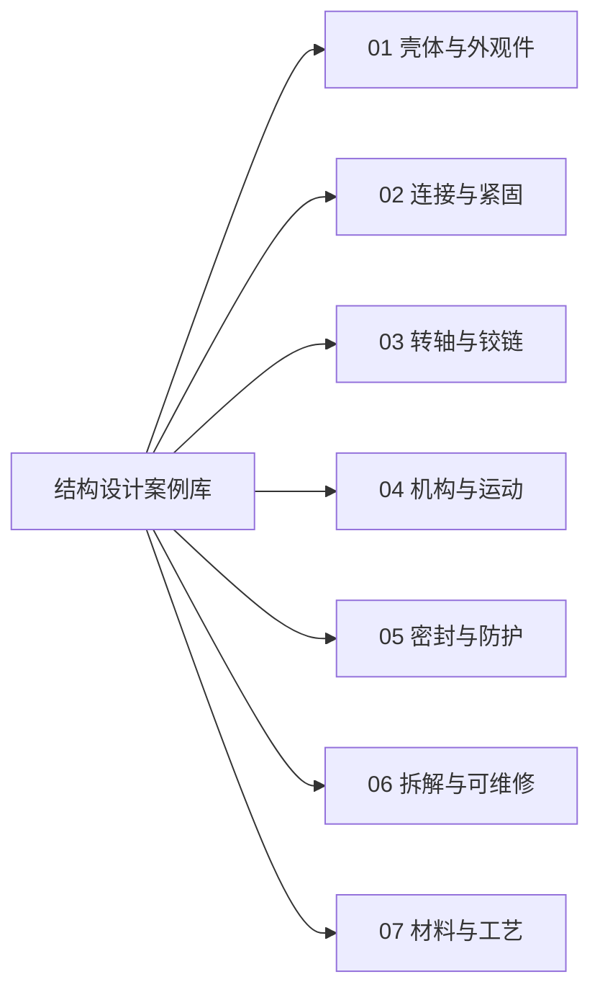

# 结构设计案例库 · 长周期收集计划

> 方向：产品与机械结构设计（外壳、卡扣、连接件、转轴铰链、锁扣与按压弹跳机构、防水密封、拆解结构等）。
> 节奏：**每 2 天**收集一次（单日 9:00 左右），每次目标新增 **20 个以上**案例（2026-11-21同步日志中的长期要求），不收高度同质化的案例；每次推进下面轮换表中的 1 个主题（原「周次」改为「第 N 次」）。
> 原则：**每个案例都要打开原始来源核实；不编造任何事实、参数或链接；来源没给的数字一律写「来源未给出」。**

返回 [[首页]] · 写作格式见 [[案例模板]] · 记录见 [[收集日志]]

---

## 一、分类体系

一级分类对应 vault 里的文件夹，每个文件夹里有一个「索引」页。二级分类写在笔记属性 `二级分类` 里（可多选）。

| 一级分类 | 说明 | 二级分类 |
| --- | --- | --- |
| 01-壳体与外观件 | 看得见的结构 | 分型与拔模 · 壁厚与加强筋 · 免工具外壳 · 隐藏紧固 · 装饰件/覆面 · 开孔与网罩 |
| 02-连接与紧固 | 零件怎么连在一起 | 卡扣 · 螺纹与嵌件 · 旋转卡口(Bayonet) · 滑轨/导轨 · 磁吸 · 胶粘 · 超声波焊接/热熔 · 铆接/压铆 · 电阻焊 · 可拆连接 · 导轨卡装 · 板载插座 |
| 03-转轴与铰链 | 一切转动连接 | 阻尼转轴 · 杯型铰链 · 折叠屏铰链 · 360°转轴 · 活动铰链/柔性铰链 · 齿轮同步机构 · 线缆穿铰链 · 标准接口/VESA |
| 04-机构与运动 | 会动的机构 | 按压弹跳(Push-Push) · 锁扣与快拆 · 齿轮/蜗杆传动 · 凸轮与连杆 · 弹簧与缓冲 · 柔顺机构/双稳态 · 力反馈 · 悬停支架 · 按键机构 · 模块化快换 |
| 05-密封与防护 | 防水、防尘、防跌 | 密封圈/密封槽 · O 形圈 · 现场成型密封(CIPG) · 排线防水胶圈 · 点胶/胶粘密封 · 包胶外壳 · 防水透气膜 · 防水透声膜 · 防尘结构 · 跌落缓冲 · 可维修防水 |
| 06-拆解与可维修 | 整机拆解与维修性 | 拆解分析 · 模块化设计 · 可维修设计 · 胶粘封装 · 反面案例 · 热插拔模块 · 用户可拆维护模块 |
| 07-材料与工艺 | 工艺对结构的约束 | 注塑 · 钣金 · 压铸/CNC · 3D 打印 · 包胶/双色 · 表面处理 · 发泡成型 |

**归类规则**
- 一个案例只放一个一级分类（以「最值得学的那个结构点」为准），其他维度用二级分类和标签补充。
- 整机拆解如果有多个亮点，**拆成多篇**（例：PS5 拆成「免工具侧板」和「DualSense 自适应扳机」两篇）。
- 需要新增二级分类时，先在本表加上，再同步到对应索引页。

---

## 二、周主题轮换（16 周一轮，之后循环并替换为新热点）

每轮以主题为主（目标20个以上），另留补充名额给本周各平台出现的**新产品/新热点**拆解。

| 周次 | 重点主题 | 中文关键词 | 英文关键词 | 优先平台 |
| --- | --- | --- | --- | --- |
| 1 | 卡扣设计 | 卡扣 扣位 倒扣 卡钩 | snap fit, cantilever snap, annular snap | B站、知乎、厂商设计指南、Printables |
| 2 | 防水密封 | 防水结构 密封圈 IP68 点胶 | waterproof design, gasket, O-ring groove, IP68 teardown | iFixit、公众号、Parker/厂商手册 |
| 3 | 折叠屏与笔记本转轴 | 转轴 铰链 水滴铰链 阻尼 | foldable hinge teardown, friction hinge | iFixit、B站、YouTube（JerryRigEverything） |
| 4 | 按压弹跳与推推锁 | 按压弹跳 心形槽 推推锁 按动笔 | push-push latch, heart cam, retractable pen mechanism | Google Patents、YouTube、Instructables |
| 5 | 螺纹连接与嵌件 | 热熔螺母 铜螺母 自攻螺丝柱 | heat-set insert, threaded insert, screw boss design | CNC Kitchen、Printables、厂商文章 |
| 6 | 锁扣与快拆 | 快拆 锁扣 卡口 旋转锁 | quick release, bayonet mount, latch mechanism | 小红书、Reddit r/mechanicalengineering、专利 |
| 7 | 可维修与模块化整机 | 模块化 可维修 拆机 | repairability, modular design, teardown 10/10 | iFixit、Framework/Fairphone 官方博客 |
| 8 | 柔顺机构与活动铰链 | 柔性铰链 柔顺机构 双稳态 | compliant mechanism, living hinge, bistable | BYU CMR、Printables、YouTube |
| 9 | 外壳设计（拔模、加强筋、壁厚） | 外壳结构 加强筋 拔模 壁厚 | rib design, draft angle, wall thickness, DFM | 知乎、Protolabs/Xometry 指南 |
| 10 | 磁吸结构 | 磁吸 磁铁 吸附 | magnetic attachment, MagSafe teardown | iFixit、B站拆机 |
| 11 | 按键与开关结构 | 按键结构 导电胶 硅胶按键 微动 | button design, rubber dome, tactile switch | iFixit、B站、YouTube |
| 12 | 钣金与压铸结构 | 钣金 折弯 压铸 | sheet metal design, die casting | 公众号、厂商技术文章 |
| 13 | 3D 打印功能结构 | 3D打印 卡扣 一体打印铰链 | print-in-place hinge, functional print | Printables、Thingiverse、Reddit r/functionalprint |
| 14 | 防跌缓冲与运动相机/户外产品 | 防摔 缓冲 包胶 | drop protection, overmold, rugged teardown | iFixit、YouTube |
| 15 | 齿轮、凸轮与连杆 | 齿轮传动 凸轮 连杆 机构 | gear train, cam mechanism, linkage | YouTube、Instructables、专利 |
| 16 | 反面案例与失效分析 | 失效 断裂 设计缺陷 | design failure, teardown repairability 0/10 | iFixit、Reddit、知乎 |

---

## 三、平台与搜索方法

| 平台 | 擅长 | 搜索方法 | 注意 |
| --- | --- | --- | --- |
| **iFixit 拆解** | 有图、有顺序，最适合写「堆叠方案」 | 公开 API：`https://www.ifixit.com/api/2.0/search/<关键词>?filter=teardown`，再用 `/api/2.0/guides/<guideid>` 拿每步文字和图片；图片地址 `https://guide-images.cdn.ifixit.com/igi/<guid>.large`；新闻稿在 `ifixit.com/News` | 区分官方拆解与社区拆解（核实状态里注明） |
| **B站** | 中文拆机、结构讲解视频、专栏图文 | 搜索接口 `api.bilibili.com/x/web-interface/search/type?search_type=video&keyword=<词>`（已验证可用）；`search_type=article` 搜专栏，正文用 `bilibili.com/read/mobile?id=<cv号>` 读取（2026-11-13 验证）；关键词如「卡扣结构设计」「拆机 结构」「转轴 拆解」 | 视频需看到具体画面/讲解才能写参数；只看标题不收录 |
| **知乎** | 结构工程师经验帖、设计规范 | 站内搜索「结构设计 卡扣」「防水结构」等，优先高赞回答与专栏 | 注意是否转载；数值类经验注明「作者经验值」 |
| **小红书** | 新产品细节照、设计灵感 | 关键词「结构设计」「工业设计 细节」「拆机」 | 多为图片，需交叉核实 |
| **微信公众号** | 结构设计专业号、厂商技术文 | 搜狗微信搜索 `weixin.sogou.com`，关键词同上 | 链接可能过期，收录时附发布日期与公众号名 |
| **YouTube** | 拆解、机构演示（JerryRigEverything、iFixit、CNC Kitchen 等） | 频道内搜索 + 关键词英文 | 引用时注明视频时间点 |
| **Reddit** | r/mechanicalengineering、r/functionalprint、r/teardown | 按 top/month 排序找新案例 | 讨论帖仅作线索，需找到原始来源 |
| **Instructables** | DIY 机构、可复现步骤 | 搜 mechanism、hinge、latch | 区分作者实测值与估计值 |
| **Printables / Thingiverse** | 3D 打印功能结构（一体打印铰链、卡扣测试件） | 搜 print-in-place、snap fit、compliant | 记录作者名与许可协议 |
| **Google Patents** | 机构原理、权利要求里的结构描述 | `patents.google.com/?q=<关键词>`，如 push-push latch、hinge assembly | 专利图可引用，注明专利号；不把专利描述当成量产事实 |
| **厂商技术文章** | 设计指南与参数（Protolabs、Xometry、Covestro/BASF 卡扣手册、Parker O 形圈手册、Gore 透气膜） | 官网 resources / design guide | 参数最可靠的来源，优先引用 |
| **Wikipedia** | 基础原理与术语 | 英文词条 + 中文词条 | 只用作原理类案例或补充来源 |

---

## 四、收录标准

**必须满足**
1. 原始页面**当次实际打开**并核对过要写的内容。
2. 能说清至少一个具体结构点（不是单纯的产品介绍或广告）。
3. 有图（下载到 `附件/`），下载失败时至少留原图链接。
4. 按 [[案例模板]] 写完全部小节，尤其是「结构原理 → 堆叠方案 / 零件清单 / 装配顺序 / 受力与运动分析」。

**优先收录**：有拆解图能讲清堆叠关系的；有可量化参数的；新上市产品的新结构；能和已有案例形成对比的（正反案例）。

**不收录**：来源不明的搬运图；只有标题的短视频；无法核实的参数帖；与已有案例完全重复的内容（可作为已有案例的「补充来源」）。

**评分（1–5）**
| 分 | 标准 |
| --- | --- |
| 5 | 有清晰拆解图 + 完整堆叠/机构说明 + 有参数，且有明显借鉴价值 |
| 4 | 结构讲得清楚、有图，参数较少 |
| 3 | 原理类或单点结构，资料较简略 |
| 2 | 只有部分可核实信息，作为线索保留 |
| 1 | 暂不建议收录（仅在日志中记为线索） |

**难度**：入门（单一结构，一看就懂）/ 进阶（多零件配合）/ 高级（复杂机构或多重约束）。

---

## 五、每次收集流程（每 2 天）

1. 打开本计划，按 [[收集日志]] 的「下次重点」确定本次主题（按轮换表顺序推进；跑完 16 个主题后回到第 1 个，关键词换成当季新产品）。
2. 在 [[收集日志]] 查看已收录内容，避免重复。
3. 按「三、平台与搜索方法」多平台搜索（有意扩充中文来源），挑出 15–25 个候选。
4. 逐个打开原页面核实并去重/去同质化，筛到 20 个以上（不足时明确缺口，不凑同质案例）；被排除的线索写进日志；下载配图到 `附件/`（命名：`产品-结构点.jpg`，英文小写+连字符）。
5. 复制 [[案例模板]]，在对应一级分类文件夹新建笔记，文件名 = 标题。
6. 更新：对应分类索引页的静态表、[[首页]] 的统计和静态表、`案例地图.canvas`（在对应分组里加「图片节点 + 笔记节点」）。
7. 在 [[收集日志]] 顶部追加一行。

---

## 六、阶段目标

| 阶段 | 时间 | 案例数（累计） | 目标 |
| --- | --- | --- | --- |
| 起步 | 第 0 周（2026-11-13） | 15 | 搭好框架、模板、首页、地图 ✅ |
| 第 1 个月 | 至 2026-12 中 | 35–45 | 7 个一级分类都至少有 3 个案例；07-材料与工艺补上首批 |
| 第 3 个月 | 至 2027-02 中 | 90–110 | 跑完第一轮 12 周主题；每个二级分类至少 1 个案例；中文平台案例占比 ≥ 30% |
| 第 6 个月 | 至 2027-05 中 | 170–200 | 跑完一轮 16 周主题；每个分类形成「正面案例 + 反面案例」对照；整理一份「设计检查清单」笔记 |
| 第 12 个月 | 至 2027-11 | 300+ | 形成按产品类型（手机、耳机、手表、笔记本、家电、工具）的专题索引 |
