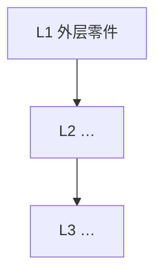

# {{标题}}

> [!summary] 一句话概述
> {{用一句话讲清：什么产品、用了什么结构、解决了什么问题。}}

## 配图

![[附件/{{文件名}}.jpg]]
*图源：{{来源名称 + 链接}}；{{图片说明}}*

## 结构原理

> 本节所有数字只写来源里给出的；来源没有就写「来源未给出」，不估算、不换算成看似精确的值。

### 堆叠方案

{{按「从外到内」或「从上到下」写清层叠顺序，并注明方向。}}

| 层级 | 零件 | 材料 | 厚度/尺寸 | 固定方式 | 依据 |
| --- | --- | --- | --- | --- | --- |
| L1（最外） | {{如 后盖玻璃}} | {{如 玻璃 / 来源未给出}} | {{来源未给出}} | {{如 背胶粘接}} | {{来源段落}} |
| L2 | {{…}} | {{…}} | {{…}} | {{…}} | {{…}} |

剖面示意（Mermaid 或文字，二选一）：

### 零件清单

| 零件 | 数量 | 功能 | 材料 | 依据 |
| --- | --- | --- | --- | --- |
| {{…}} | {{来源未给出则写}} | {{…}} | {{…}} | {{…}} |

### 装配顺序

1. {{第一步：哪个零件装到哪里，用什么方式固定}}
2. {{…}}

> 若来源只给了拆解顺序，注明「按拆解顺序反推」。

### 受力与运动分析

- **受力路径**：{{外力/压力/水压从哪里进入，经过哪些零件，由谁承担}}
- **运动关系**：{{哪些零件相对运动、自由度、限位方式；静态结构写「无相对运动」}}
- **失效风险**：{{来源提到的或可直接从结构推出的薄弱点，推断需标注「推断」}}

## 设计要点与参数

| 要点 | 内容 | 依据 |
| --- | --- | --- |
| {{如 壁厚/间隙/角度/材料}} | {{具体数值或做法}} | {{来源原文位置，如 iFixit 第 X 段}} |

> 来源没有给出的参数一律写「来源未给出」，不估算、不编造。

## 优缺点

**优点**
- {{…}}

**缺点 / 代价**
- {{…}}

## 可借鉴点

- {{我自己做设计时可以直接用的做法或检查项}}

## 相关案例

- [[{{相关案例笔记名}}]]
- 分类索引：[[{{一级分类索引页}}]]

## 来源与核实记录

- 主来源：[{{来源标题}}]({{URL}})（{{发布日期}}，{{作者/机构}}）
- 核实：{{YYYY-MM-DD 打开原页面核对了哪些内容}}
