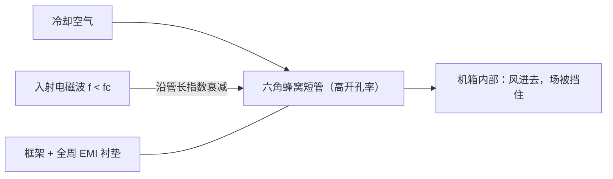

# EMI 蜂窝波导通风板：孔径、深度与截止频率

> [!summary] 一句话概述
> 蜂窝波导通风板用一排排短金属管来通风：孔格在截止频率以下像「截止波导」那样把电磁能量指数衰减掉，空气却还能从高开孔率的蜂窝里通过。屏蔽主要靠孔径（决定截止频率）和深度（决定衰减量），并且和风量对着干——孔越小、越深，屏蔽越好、风阻越大。它不是防雨百叶，也不能只用外壳上的薄孔来代替。

## 配图

![[附件/parker-chomerics-honeycomb-vents.jpg]]
*图源：[Parker Chomerics Vent Application and Design Guide](https://jhcss.com.au/static/uploads/files/parker-chomerics-vent-application-and-design-guide-tb-1200-en-wfiqyffmxqrc.pdf) 第 4 页；带框架的蜂窝通风板实物，用于说明这是「蜂窝芯 + 框架」组件，不是在薄板上直接冲一排孔*

![[附件/parker-honeycomb-cell-size-specs.jpg]]
*图源：同上第 5 页；标准孔径与厚度表（铝直孔蜂窝），以及 30°/45°/60° 斜蜂窝（用于滴水、导流和视线遮挡）*

> 图片版权归原作者所有，仅作个人学习收藏；出处见文末「来源与核实记录」。

## 结构原理

> Parker 提供可采购的尺寸、材料和实测衰减；RF Essentials 与 EMC 工具箱给出截止波导公式。公式是理想化计算，Parker 的表格是特定样品、特定条件下的测试，两者不要互相「反推成同一组数」。

### 堆叠方案

方向：**从机箱外侧到内侧（通风方向）**

| 层级 | 零件 | 材料 | 厚度/尺寸 | 固定方式 | 依据 |
| --- | --- | --- | --- | --- | --- |
| L1 | 框架 | 建议与蜂窝同种合金，以兼顾屏蔽和电偶腐蚀 | 框架厚度常限制整件 Z 向高度；Parker 后文还给出框料约 0.070" 等细节，按具体框型查 | 螺栓、焊接或粘结到机箱开口；框架与机箱之间需要 EMI 衬垫全周密封 | Parker Design Assistance、Installation |
| L2 | EMI 衬垫 | 铍铜簧片、导电弹性体、针织丝网等 | 来源未给本篇必须采用的压缩量 | 压在框架—机箱结合面 | Parker；RF Essentials 安装节 |
| L3 | 蜂窝芯 | 铝（5052 Grade B 等）、黄铜、钢、不锈钢；可镀镍、锡、铬酸盐 | 标准孔径 1/16"、1/8"、1/4"，最常见 1/8"（3.175 mm）；标准厚度 1/4"、1/2"、1"，最常见 1/4"。铝箔厚常见 0.0015" 或 0.002" | 与框架导电连接（焊接、焊接料或导电粘结）；RF Essentials 强调边缘必须导电连续 | Parker 第 5 页表；RF Essentials |
| L4 | 可选第二层蜂窝（Omni-Cell） | 铝蜂窝再叠一层，相对第一层旋转 90° | 例如 1/8" 孔径 × 1/4" 厚、两层 | 用于抑制单层铝蜂窝因粘接缝不导电造成的缝泄漏和极化差异 | Parker 第 4–5 页 |
| L5 | 可选斜蜂窝、防护格栅、过滤棉 | 铝斜蜂窝 30°/45°/60°；金刚石防护格栅；聚氨酯过滤棉等 | 斜蜂窝可滴水、导流、挡视线；防护格栅会牺牲部分风量 | 按环境选配 | Parker 第 5、16 页 |

剖面示意：

截止波导公式（只采用已打开页面中的写法）：

- EMC 工具箱，**圆波导**（吸收项）：  
  SE ≈ 32.0 · (t/d) · √(1 − (f/fc)²) dB，fc = 1.841 c / (π d)  
  当 f ≥ fc 时该式不适用。
- EMC 工具箱，**矩形孔**（最长边 w）：  
  SE ≈ 27.3 · (t/w) · √(1 − (f/fc)²) dB，fc = c / (2w)
- 工具箱说明：这只是**单个开孔的吸收项**，不含入口反射；孔多会增加总泄漏；薄板（t/w 很小）几乎没有波导效应。
- 远低于截止时，√ 项约等于 1，圆孔近似为 SE ≈ 32 · (t/d)。RF Essentials 即按此书写：SE (dB) = 32 × (depth / effective_diameter)，并给出 fc = 175.7 / d_effective（GHz，d 为 mm）。175.7 / d(mm) 与 1.841 c / (π d) 是同一圆波导截止频率的不同写法。
- RF Essentials 把六角蜂窝近似成圆波导，并取 **有效直径 ≈ 1.15 × 孔格宽度**。这是该文的几何近似，Parker 指南正文未写这个 1.15 系数，引用时必须标明假设。
- RF Essentials 例：3.2 mm（1/8"）孔格、12.7 mm（1/2"）深，按 d_eff ≈ 3.7 mm，SE ≈ 32 × (12.7/3.7) ≈ 110 dB，fc 约 47–48 GHz。这是理想单孔、远低于截止、只算吸收项的估算，与 Parker 实测表不是同一组数。

### 零件清单

| 零件 | 数量 | 功能 | 材料 | 依据 |
| --- | --- | --- | --- | --- |
| 蜂窝芯 | 1（或两层交叉） | 通风 + 截止波导屏蔽 | 铝 / 黄铜 / 钢 / 不锈钢 | Parker |
| 框架 | 1 | 安装、保持导电连续、保护蜂窝边缘 | 与蜂窝匹配的合金 | Parker |
| EMI 衬垫 | 全周 1 圈 | 封住框架—机箱缝 | 簧片、导电弹性体或丝网 | Parker；RF Essentials |
| 可选镀层 / 斜蜂窝 / 格栅 / 滤棉 | 按环境 | 耐蚀、滴水、防异物、过滤 | 见上 | Parker |

### 装配顺序

1. 先按热设计确定需要的通风面积和允许压降，再按要屏蔽的频段选孔径与厚度——Parker 写气流与衰减成反比，必须排优先级。
2. 选定材料与镀层（铝轻但耐蚀和低频磁屏蔽较弱；黄铜、钢、不锈钢更耐用；镀层可显著提高衰减，见测试表）。
3. 蜂窝与框架在全部边缘保持导电连接。
4. 框架用螺栓等到机箱开口，结合面全周加 EMI 衬垫，不能留缝（RF Essentials：衬垫任何一处断开都会把屏蔽拉下来）。
5. 需要滴水时改用斜蜂窝；需要防撞击时加防护格栅，并接受风量损失。
6. 安装后按项目要求测试屏蔽（RF Essentials 提到近场探头或大型设施用 IEEE 299）。

### 受力与运动分析

- **电磁**：频率低于孔格截止频率时，波在管里截止，衰减随 t/d 增加。孔径决定 fc，深度决定 SE。单层铝蜂窝因制造时箔带粘结缝不导电，水平和垂直极化的衰减可能差很多（见下表 100 MHz 的 70 dB vs 25 dB）；两层交叉或改镀层可以改善。
- **气流**：孔径变小或厚度增加，湍流和压降增加（Parker 三条变量）。铝 1/8"×1/2" 与 1/8"×1/4" 的压降表见设计要点。
- **环境**：裸铝氧化膜在约 10 GHz 以下通常还能用，更高频可能再掉 5–10 dB（RF Essentials）；湿热或海洋环境建议铬酸盐或镀锡，或改不锈钢。
- **失效风险**：框架缝泄漏（往往比蜂窝本身更致命）；电偶腐蚀；异物砸坏薄铝蜂窝；滤棉堵塞后风量下降。

## 设计要点与参数

| 要点 | 内容 | 依据 |
| --- | --- | --- |
| 标准孔径 | 1/16"（0.063"）、1/8"（0.125"）、1/4"；最常见 1/8" | Parker 第 5 页 |
| 标准厚度 | 1/4"、1/2"、1"；最常见 1/4"。铝 1/8" 孔径可配 1/8" 到 1.000" 多种厚度（表中深色行为常备规格） | Parker 第 5 页 |
| 铝箔厚 | 0.0015" 或 0.002"（直孔铝表） | Parker |
| 材料取向 | 耐用性：钢、不锈钢、黄铜明显好于铝；重量：铝最轻；屏蔽排序（Parker 叙述）：通常黄铜、铝、钢、不锈钢，镀层可再提高 | Parker 第 4 页 |
| 实测衰减例：铝 + 化学膜，单层 1/8"×1/2" | 水平/垂直：100 MHz 70/25 dB；500 MHz 50/35 dB；1 GHz 45/35 dB；5 GHz 50/35 dB；10 GHz 55/40 dB | Parker 第 15 页。指南注明仅供参考，随条件而异 |
| 同尺寸铝 + 化学镀镍 | 100 MHz 95/90 dB；500 MHz 85/80 dB；1 GHz 80/85 dB；5–10 GHz 约 80–85 dB | Parker 第 15 页 |
| 两层 Omni-Cell，每层 1/8"×1/4"，化学膜 | 100 MHz 水平/垂直都是 60 dB，极化差明显小于单层铝 | Parker 第 15 页 |
| 钢 + 化学镀镍，单层 1/8"×1/2" | 10 kHz H 场 35 dB，200 kHz H 场 60 dB；E 场 100 MHz 100 dB，1 GHz 85 dB，10 GHz 80 dB | Parker 第 15 页 |
| 黄铜 + 锡铅镀，单层 1/8"×1/2" | 100 MHz 95 dB；1 GHz 80 dB；10 GHz 80 dB | Parker 第 15 页 |
| 风阻例（铝） | 1/8"×1/2"（A）与 1/8"×1/4"（B）：1000 ft/min 时压降 0.07 / 0.05 in. H2O；2000 ft/min 时 0.13 / 0.09 in. H2O | Parker 第 15 页 Air Flow 表 |
| 截止频率与 SE 公式 | 见上文；圆波导 fc = 1.841c/(πd) = 175.7/d(GHz, d 为 mm)；远低于截止时 SE≈32(t/d)。六角孔用 d_eff≈1.15×孔宽是 RF Essentials 的近似 | EMC 工具箱；RF Essentials |
| 工具箱圆孔例 | Ø10 mm、深 25 mm、500 MHz：fc≈17.57 GHz，SE≈79.9 dB（单孔吸收项）；同样孔若只有 2 mm 深，仅约 6.4 dB | EMC 工具箱 FAQ |
| RF Essentials 开孔率叙述 | 该文写蜂窝开孔率通常为总面积的 85%–95%。Parker 本指南未在已核对页给出同一百分比，引用时归为 RF Essentials | RF Essentials |

## 优缺点

**优点**
- 能在同一开口上同时要风量和很高的截止衰减，薄板上开大孔做不到
- 孔径、厚度、材料、镀层、层数都可以按频段和压降选
- 斜蜂窝还能顺带滴水和挡视线

**缺点 / 代价**
- 屏蔽和风量互斥，要先排优先级
- 单层铝蜂窝有极化差和缝泄漏，关键场合要交叉双层或改镀层
- 安装缝比蜂窝本身更容易漏；衬垫和导电搭接决定现场成绩
- 比普通百叶或冲孔板更厚、更重、更贵

## 可借鉴点

- **开口要屏蔽时，做成有深度的管子，而不是在薄盖上开大孔**：工具箱的 2 mm 深 vs 25 mm 深就是数量级差别
- **先定要挡的最高频率，再选孔径使 fc 远高于它**；再靠厚度凑 SE，并回头看压降
- **框架四周的导电衬垫和蜂窝—框架连接，优先级不低于选孔径**
- **铝单层若水平和垂直差很多，改镀镍或改两层交叉**
- **户外要滴水就用斜蜂窝**，不要指望直孔蜂窝当防雨百叶
- 本篇是电磁屏蔽通风。纯散热防雨看百叶那一篇；两者不要互相替代

## 与库中相似案例对比

| 对比项 | 本案例（蜂窝波导通风板） | [[外壳散热通风口与防雨百叶：开孔率、进出风与滴水路径]] | [[注塑喇叭网罩：开孔率、孔径孔距与脱模]] |
| --- | --- | --- | --- |
| 目标 | 通风 + 把电磁波挡在截止频率以下 | 通风 + 防雨防尘 | 透声 + 外观 |
| 孔的深度 | 必须有，深度就是波导长度 | 百叶是斜叶片，用自由面积和排水路径 | 尽量壁厚 ≤ 孔径，以免当细管挡高频声 |
| 开孔率 | 可以很高（RF Essentials 称常达 85%–95%），靠截止而不是靠把孔开小来屏蔽 | 要看自由面积，不是几何开孔率 | 扬声器前 30%–40% 或更高 |
| 公式 | 截止波导 SE、fc（须注明假设） | Af = L(A+B+n×C) | 78.5 或 90.7 × (d/p)² |

## 相关案例

- [[外壳散热通风口与防雨百叶：开孔率、进出风与滴水路径]]
- [[注塑喇叭网罩：开孔率、孔径孔距与脱模]]
- [[GORE 防水透气膜：压力平衡与粘贴式透气阀的安装参数]]
- 分类索引：[[01-壳体与外观件 索引]]

## 来源与核实记录

- 主来源：[Parker Chomerics Vent Application and Design Guide](https://jhcss.com.au/static/uploads/files/parker-chomerics-vent-application-and-design-guide-tb-1200-en-wfiqyffmxqrc.pdf)（Parker Chomerics，TB-1200，经 jhcss.com.au 转存，24 页）——孔径/厚度表、材料、第 15 页屏蔽与风阻测试数据、安装与镀层
- 独立第二来源：[What is the honeycomb waveguide vent…](https://rfessentials.com/rf-knowledge-base/what-is-the-honeycomb-waveguide-vent-and-how-does-it-provide-both-airflow-and-sh/)（RF Essentials）——截止波导解释、SE≈32(t/d_eff)、fc=175.7/d、d_eff≈1.15×孔宽的近似及 1/8"×1/2" 估算例、安装与腐蚀
- 补充（公式页，已打开并核对其自称的公式来源为经典截止波导吸收项）：[通风孔/蜂窝截止波导屏蔽](https://emctoolbox.com/zh/calculators/vent-waveguide-se/)（EMC 工具箱）——圆/矩形公式、仅吸收项、薄孔几乎无效的示例
- 核实：2026-11-17 下载 Parker PDF 并打开其余两页。未把理想公式结果写成 Parker 实测值。原计划中的 TE 中文页按简报此前异常，未依赖。
