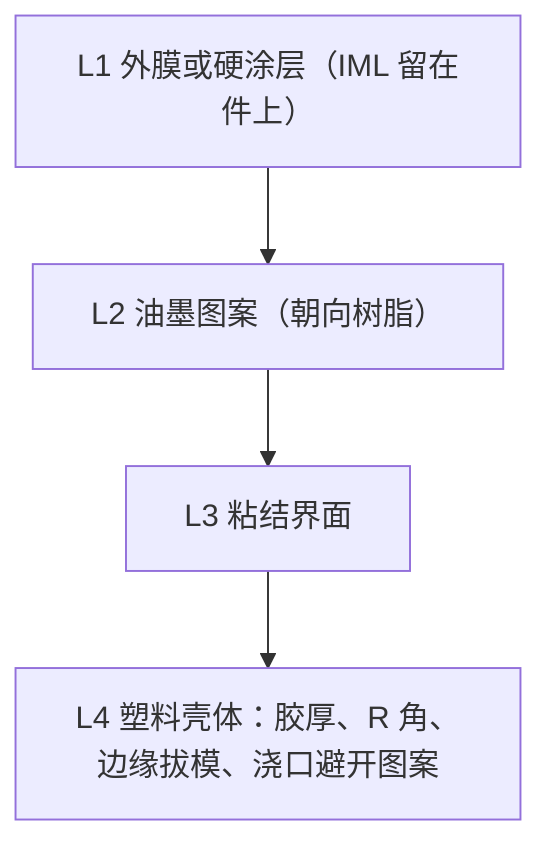

# IMD与IML模内装饰：圆角、翻边与浇口避开图案

> [!summary] 一句话概述
> 把装饰膜和塑料壳体一次注塑在一起时，壳体的圆角、边缘拔模、翻边深度和胶厚都要迁就膜片的拉伸与贴合，浇口还要避开图案以免冲刷油墨；它解决的是膜片对结构的约束，不是喷漆或双色注塑的选色与拆件。

## 配图

![[附件/yxfimd-iml-appliance-panel.jpg]]
*图源：[深圳市悦迅福科技有限公司《IMD/IML模内注塑技术的那些小细节》](https://yxfimd.com/news-detail-336.html) 页内成品照片；家电面板类 IML/IMD 件，图案与标识做在膜层里，壳体边缘和窗口需要足够的圆角与拔模，才能让膜片贴合而不在转角开裂*

![[附件/yxfimd-iml-large-panel.jpg]]
*图源：[悦迅福《IML工艺产品结构设计极限值》](https://yxfimd.com/news-detail-328.html) 相关配图（长条大面板类成品）；该文把门锁、扫地机面盖、大面板单独列出胶厚下限，并给出边缘拔模、外观 R 角、通孔和螺丝柱的极限值*

![[附件/yxfimd-imd-back-cover.jpg]]
*图源：[悦迅福《IMD模内注塑工艺》](https://yxfimd.com/news-detail-360.html) 页内成品照片；带开窗的模内装饰后盖。开窗、通孔在悦迅福极限值文中要求出模角度 3 度以上、通孔直径 1.0 mm 以上，过小只能后段 CNC*

> 图片版权归原作者所有，仅作个人学习收藏；出处见文末「来源与核实记录」。上述照片是成品外观，不是标注了翻边角的剖视图；结构数值以正文和参数表为准。

## 结构原理

> 本节所有数字只写来源里给出的；来源没有就写「来源未给出」，不估算、不编造。

IML（模内贴标）是把已经印刷并预成型的膜片放入模腔，注塑后膜永久留在塑件表面，油墨夹在膜与塑料之间。IMD（此处按思为客和部分国内用法，指卷对卷转印）则是射出时只把油墨和装饰层转到塑件上，载膜随后剥离。苏州知库站采用另一种常见说法：IML 多为预成型后放入（偏平面/浅曲），IMD 可在模内同步成型、能做更复杂三维曲面。名称在行业里并不完全统一，本篇以「膜片对壳体结构的约束」为准，不把术语之争写成结构规则。

对结构设计师，真正的边界是膜片能弯多少、能包多深、胶位要多厚、熔体从哪里进来才不会把图案冲掉。悦迅福把这些写成一组极限值：小件整体胶厚要到 1.2 mm 以上（极限 1.00 mm），大面板要到 2.5 mm 以上；边缘出模角 3 度以上；外观 R 角最小 0.5 mm，太小则片材折弯会裂、有细裂纹或跑料；2D 刀模下料时包边只能包到 R 边，无法再向下翻。知库站从另一侧给出：R 角半径取 ≥1 mm，拔模 >1°，并避免深拉 >15 mm 的尖角；图案要避开分模线和顶针位。

浇口是第二组约束。思为客写：IML 的浇口位置与射出方式需防止熔体冲击薄膜、冲刷油墨；射出温度与速度采用适中至略慢，避免高速高压造成薄膜位移。知库站则要求图案避开分模线与顶针。这些都不是双色注塑里「硬胶先射、软胶后射」的拆件规则，也不是免喷涂材料的选色边界。

### 堆叠方案

按装饰壳体的局部剖面「从外观膜面到塑料基材」观察。IML 与转印型 IMD 的最外层不同，下表按 IML（膜留在件上）为主，并注明转印型差异。

| 层级 | 零件 | 材料 | 厚度/尺寸 | 固定方式 | 依据 |
| --- | --- | --- | --- | --- | --- |
| L1（最外） | IML：透明膜或硬涂层；转印型 IMD：转到塑件上的硬涂/油墨，载膜已剥离 | 知库站：膜厚 0.1–0.5 mm；铅笔硬度可达 2H–3H。思为客：IML 常用 PC、PET、PMMA 与复合膜，带硬涂层 | 膜厚 0.1–0.5 mm（知库站） | IML 与基材注塑融合；转印型在开模后剥载体膜 | 知库站；思为客要素二 |
| L2 | 油墨 / 图案层 | 耐高温注塑或转印油墨 | 知库站：套印精度 ±0.1 mm，细线宽 ≥0.15 mm；印刷层做在膜片内侧（朝树脂） | 夹在膜与塑料之间，或转移到塑件表面 | 知库站「图案和手感」「膜片印刷」 |
| L3 | 胶合层或熔接界面 | 来源未给出单独牌号 | 来源未给出 | 注塑热量使粘结层与基材结合 | 思为客 IML/IMD 原料系统 |
| L4（最内） | 塑料壳体（胶位、翻边、骨位、螺丝柱） | ABS、PC/ABS、PP 等 | 见参数表：整体胶厚、边缘斜度、R 角、骨位、通孔、螺丝柱 | 注塑成型，与膜片在模内完成贴合或转印 | 悦迅福极限值文；知库站设计配合节 |

剖面示意：

### 零件清单

| 零件 | 数量 | 功能 | 材料 | 依据 |
| --- | --- | --- | --- | --- |
| 装饰膜片或卷式转印膜 | 每穴至少 1 张 / 一段 | 提供图案、耐磨和必要时的触控或背光窗口 | PC、PET、PMMA 或复合膜 | 思为客；知库站 |
| 塑料壳体或面盖 | 1 | 提供刚度、翻边、骨位和安装柱，并决定膜片能否贴合 | ABS、PC/ABS、PP 等 | 悦迅福；思为客 |
| 模具定位与真空吸附 | 来源未给出 | 防止膜片位移、起皱、鼓包 | 模具侧结构 | 思为客要素三 |
| 浇注系统 | 来源未给出 | 填充胶位，同时避免直冲图案 | 模具 | 思为客；知库站 |

### 装配顺序

按 IML 常见工序（思为客）：

1. 膜片印刷，油墨在内侧，耐温高于注塑温度。
2. 薄膜热压预成型，再裁切。悦迅福写：若是 2D 刀模下料，包边只能包到 R 边，不能再向下包。
3. 将膜片放入模腔，靠定位结构和真空吸附贴紧型腔，避免皱褶。
4. 合模注塑。浇口与射速要避免冲击、冲刷图案；胶厚、R 角和边缘斜度必须在此时已经做对，无法靠后道喷涂补救。
5. 冷却、开模取件。转印型 IMD 还要在开模时同步剥离载膜。
6. 如漏白边或通孔达不到膜内成型极限，悦迅福指出需要后段 CNC。

> IML 顺序来自思为客「生产管控」对四阶段的归纳；结构极限来自悦迅福。不是某件产品的拆解反推。

### 受力与运动分析

- **受力路径**：手指按压、刮擦作用在最外层硬涂或膜上，再传到油墨和塑料壳体。壳体边缘和窗口转角是膜片弯曲半径最小的地方，也是开裂和露白的起点。螺丝锁附经过螺丝柱传到面板，悦迅福要求大件螺丝柱内外径之间胶位 0.7–0.8 mm，以避免表面缩印。
- **运动关系**：成品膜层与壳体之间设计上无相对运动。转印型 IMD 仅在开模瞬间有载膜剥离。脱模时若斜度不足，硬涂层会顶白或裂（知库站建议气顶加顶针）。
- **失效风险**：悦迅福：R 角过小导致片材折弯开裂、细裂纹、跑料；覆膜后常见内拱变形，变形量 1.00 mm 以上；偷胶、凹槽、沉台落差超过 0.30 mm 会在外观上显出来。知库站：脱层多因膜温与料温不匹配或污染；皱膜因包覆不足或真空不稳；高光面深拉导致膜厚不均发白。思为客：高速高压造成薄膜位移或冲墨。

## 设计要点与参数

| 要点 | 内容 | 依据 |
| --- | --- | --- |
| 整体胶厚 | 电子烟类小件整体厚度需 1.2 mm 以上，极限 1.00 mm；门锁、扫地机面盖、大面板整体胶位厚度 2.5 mm 以上 | 悦迅福极限值第 1 条 |
| 边缘 / 通孔拔模 | 产品边缘斜度（出模角）3 度以上；有通孔时出模角度同样 3 度以上 | 悦迅福第 2、10 条 |
| 外观圆角 | 外观上 R 角最小做到 0.5 mm，太小则片材折弯会裂开、有细裂纹、跑料 | 悦迅福第 4 条 |
| 另一机构的圆角与拔模 | R 角半径取 ≥1 mm；件要有足够拔模（>1°）；避免深拉 >15 mm 的尖角；高光面避免深拉导致膜厚不均发白 | 苏州知库站「图案和手感」「设计阶段怎么配合」 |
| 漏白边 | 不采用 CNC 时，正常露白边标准 0.50 mm，极限 0.30 mm | 悦迅福第 3 条 |
| 后模骨位 | 后模骨位厚度 0.60 mm，后模骨位出模角度 0.5 度 | 悦迅福第 5 条 |
| 偷胶 / 凹槽 / 沉台 | 落差不能超过 0.30 mm，边缘要求倒大 C 角过渡顺滑，否则需要后工序 CNC | 悦迅福第 6 条 |
| 包边 | 2D 刀模下料时，包边只能包到 R 边，无法再向下面包边 | 悦迅福第 9 条 |
| 通孔 | 通孔直径 1.0 mm 以上，太小只能 CNC | 悦迅福第 11 条 |
| 大件螺丝柱 | 外径 4.2–4.3 mm，内孔 2.70 mm，内外径之间胶位厚度 0.7–0.8 mm，防止表面螺丝柱缩水印 | 悦迅福第 12 条 |
| 覆膜变形 | IML 产品覆膜后有变形，一般为内拱，变形量为 1.00 mm 以上 | 悦迅福第 8 条 |
| 膜厚与工艺窗口 | 膜厚 0.1–0.5 mm；注塑温度 200–280 ℃，模温 60–90 ℃；套印 ±0.1 mm，细线宽 ≥0.15 mm | 知库站 |
| 浇口与顶出 | 浇口与射出方式须防止冲击薄膜、冲刷油墨；分模面需避开薄膜边缘。图案避开分模线与顶针位。脱模用气顶+顶针组合减拉伤 | 思为客要素一、三、四；知库站 |
| 插穿位 | 模具插穿时，边缘后模位置不能有 R 角/C 角类结构，防止插穿位薄钢 | 悦迅福第 7 条 |

> 悦迅福外观 R 最小 0.5 mm，知库站写 ≥1 mm，两者并存，按更严或按膜片供应商验证，不取平均。来源未给出通用「翻边角度 β」的度数时，不编造；悦迅福只明确 2D 下料只能包到 R 边。

## 优缺点

**优点**
- 图案被膜或硬涂保护，耐刮、不掉色，适合带标识、渐变或触控图形的面板。
- 装饰和成型一次完成，减少后喷和贴标工序。
- 把胶厚、R 角、拔模和浇口写成可检查的极限值，能在结构图阶段避免不可成型的翻边和尖角。

**缺点 / 代价**
- 结构自由度低于普通注塑：小 R、小斜度、深翻边、大落差都可能让膜裂、起皱或露白。
- 浇口不能只按充填最优来放，必须绕开主图案，有时要牺牲流动平衡。
- 覆膜后可能内拱变形（悦迅福写 1.00 mm 以上），大平面尺寸和装配要预留。
- 设备、膜片和洁净度投入高于普通注塑或单纯喷涂；小批量、纯色件不一定划算。

## 可借鉴点

- 先分清 IML（膜留在件上、可预成型包边）还是转印型 IMD（更偏平面、浅曲），再订圆角和包边深度。
- 外观转角不要小于 0.5 mm，重要高光或深拉区域按 ≥1 mm 更稳；边缘和通孔拔模按 3 度起做，不要按普通光面 1 度套用。
- 2D 冲切的膜不要设计成越过 R 再向下的深翻边。
- 浇口、分模线和顶针避开主图案和开窗；射速不要直冲膜面。
- 大面板把整体胶厚做到 2.5 mm 一级，并按 4.2–4.3 / 2.70 mm 检查螺丝柱，防止表面缩印。
- 在结构图上标出偷胶落差，超过 0.30 mm 就要改或接受 CNC。

## 与库中相似案例对比

| 对比项 | 本篇 | [[免喷涂材料 vs 喷涂：成本、良率与三条硬边界]] | [[双色注塑：硬胶先射、软胶后射的结构拆件规则]] | [[微软 Surface Laptop 超声波点焊与 Alcantara 覆面（反面案例）]] |
| --- | --- | --- | --- | --- |
| 主角 | 装饰膜对壳体圆角、拔模、胶厚、包边和浇口位置的约束 | 免喷涂料与喷漆在成本、良率和外观边界上的选择 | 两种塑料先后注射的拆件与粘结 | 成型后再覆面、点焊的失效案例 |
| 何时用本篇 | 面板必须带印刷图形、纹理或硬涂，并在注塑时把膜或油墨做进去 | 只做颜色和表面效果、不需要膜内图案 | 需要软硬胶或两种颜色的实体截面 | 讨论后装覆面，不是模内装饰 |
| 不要用本篇代替 | 本篇不比较免喷涂和喷漆的成本曲线，也不给出双色的先后顺序 | 免喷涂篇没有膜片拉伸和冲墨规则 | 双色是两次熔体，不是一张膜 | 覆面工艺不同 |

## 相关案例

- [[免喷涂材料 vs 喷涂：成本、良率与三条硬边界]]
- [[双色注塑：硬胶先射、软胶后射的结构拆件规则]]
- [[微软 Surface Laptop 超声波点焊与 Alcantara 覆面（反面案例）]]
- [[注塑均匀壁厚与厚薄渐变：相邻壁厚比与过渡段长度]]
- 分类索引：[[01-壳体与外观件 索引]]

## 来源与核实记录

- 主来源：[深圳市悦迅福科技有限公司《IML工艺产品结构设计极限值》](https://yxfimd.com/news-detail-328.html)（发布日期 2024-10-30。已核对该页 12 条结构极限：胶厚、出模角、露白边、R 角、骨位、落差、包边、通孔、螺丝柱和内拱变形，并保存相关成品照片。同站 [《IMD模内注塑工艺》](https://yxfimd.com/news-detail-360.html)、[《IMD/IML模内注塑技术的那些小细节》](https://yxfimd.com/news-detail-336.html) 仅补充成品图，仍属同一机构）
- 补充来源：[苏州工业设计知库站《CMF设计：IMD / IML 模内装饰的工艺边界与选型》](https://www.szcntop.cn/show-388.html)（2026-10-29。已核对膜厚 0.1–0.5 mm、R≥1 mm、拔模 >1°、避免深拉 >15 mm 尖角、图案避开分模线与顶针、注塑温度与套印精度。该页三张「小批量」配图分别为白壳、黑色手柄和波纹进气管，与模内装饰结构对应关系不明确，本文未用作技术插图）
- 补充来源：[思为客《IML 與 IMD 射出成型完整解析｜八大核心要素》](https://global.switek.com.cn/zh/News/Blog/Views/13369.html)（2026-08-25，页面署名 SWITEK，同时注明「文章來源：射出成型科學」且内容可能取自公开渠道。仅采用其中关于 IML/IMD 流程、浇口防冲刷、真空吸附和分模面避膜的原则表述，不把该页当作第二组毫米级极限值的出处）
- 放弃线索：https://faveira.com/doc/ZBurVEYmM0i 仅为需 JavaScript 的文档站外壳，未能读到正文；http://www.szyxtd.cn/gongsidongtai/17-221.html 与 http://www.hxsiml.com/Advantages/10.html 请求失败（500 或无响应）。未使用搜索摘要中的未打开参数。
- 核实：2026-11-22 打开上述成功页面并下载悦迅福成品照片。
