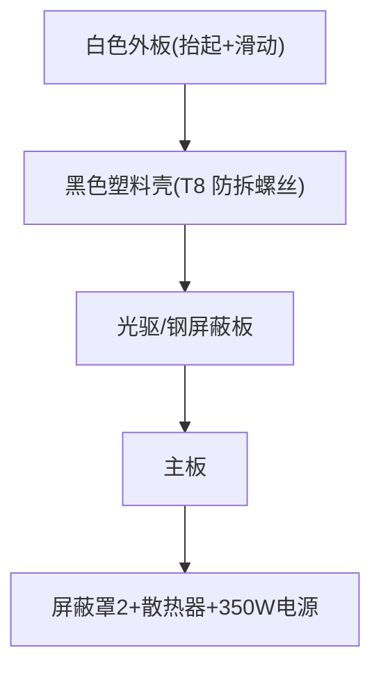

# PS5 免工具侧板与 DualSense 隐藏螺丝

> [!summary] 一句话概述
> PS5 两块白色外板「抬起再滑动」即可免工具取下，直接露出 M.2 扩展位、风扇和可吸尘的集尘口；DualSense 手柄则把 4 颗螺丝藏在可卡扣拆下的饰圈和 L1/R1 键下面，外观零可见螺丝。

## 配图

![[附件/ps5-side-panel.jpg]]
*iFixit：PS5 白色侧板免工具取下*

> 图片版权归原作者所有，仅作个人学习收藏；出处见文末「来源与核实记录」。

## 结构原理

> 本节数字只写来源里给出的；来源没有就写「来源未给出」。

### 堆叠方案

方向：**PS5 主机：从外到内**

| 层级 | 零件 | 材料 | 厚度/尺寸 | 固定方式 | 依据 |
| --- | --- | --- | --- | --- | --- |
| L1 | 白色外板 ×2 | 塑料 | 来源未给出 | 抬起+滑动拆卸（免工具） | Step 3 |
| L2 | 黑色塑料壳（两半） | 塑料 | 来源未给出 | T8 Torx 防拆螺丝，其中一颗在防拆贴纸下 | Step 3-4 |
| L3 | 光驱 / 钢板屏蔽罩 | 钢 | 来源未给出 | 大量螺丝 | Step 4-5 |
| L4 | 主板（液态金属导热） | — | 来源未给出 | 螺丝 | Step 5 |
| L5 | 金属屏蔽罩 2 + 散热器 + 电源 | 铜热管/散热片 | 来源未给出 | 螺丝 | Step 10 |

剖面示意：

### 零件清单

| 零件 | 数量 | 功能 | 材料 | 依据 |
| --- | --- | --- | --- | --- |
| 白色外板 | 2 | 外观、导风 | 塑料 | Step 3 |
| 120 mm 离心风扇 | 1 | 双侧进风散热 | — | Step 3 |
| M.2 扩展位盖 | 1 | 1 颗 Phillips 螺丝 + 金属盖 | 金属 | Step 3 |
| DualSense 饰圈 | 1 | 卡扣固定，下面藏 2 颗螺丝 | 塑料 | Step 13 |
| DualSense 螺丝 | 4（Phillips） | 2 颗在饰圈下、2 颗在 L1/R1 键下 | — | Step 13-14 |

### 装配顺序

1. (按拆解顺序反推) 散热器、电源、主板、屏蔽板依次装入黑色塑料壳
2. 两半黑色壳用 T8 防拆螺丝合起
3. 白色外板对位后滑动卡入
4. DualSense：中框装好后合壳，4 颗螺丝 + 卡扣固定，最后装 L1/R1 键和饰圈

> 来源只给出拆解顺序，以上为反推。

### 受力与运动分析

- **受力路径**：外板只承担外观与导风，不承力（推断）；结构载荷由内部黑壳与钢板承担。
- **运动关系**：外板沿特定方向滑动脱扣；无运行中相对运动。
- **失效风险**：防拆 T8 螺丝增加维修门槛（结论段）。

## 设计要点与参数

| 要点 | 内容 | 依据 |
| --- | --- | --- |
| 风扇 | 120 mm 离心风扇 | Step 3 |
| 电源 | 350 W | Step 10 |
| DualSense 电池 | 5.7 Wh | Step 14 |
| 维修评分 | 7/10 | Step 20 |
| 卡扣尺寸/滑动行程 | 来源未给出 | — |

## 优缺点

**优点**
- 日常维护（清灰、加 SSD）免工具
- 手柄无可见螺丝，外观干净且仍可拆

**缺点 / 代价**
- 内部用防拆螺丝
- DualSense 摇杆与 USB-C 焊接

## 可借鉴点

- 按「用户维护频率」分层：高频维护的部件放在免工具外板之下
- 隐藏螺丝可放在可卡扣拆下的饰件或按键下

## 相关案例

- [[DualSense 自适应扳机：电机+蜗杆的力反馈机构]]
- [[卡扣三种基本形式：悬臂、环形、扭转]]
- [[Framework 笔记本模块化扩展卡与磁吸边框]]
- 分类索引：[[01-壳体与外观件 索引]]

## 来源与核实记录

- 主来源：[PlayStation 5 Teardown](https://www.ifixit.com/Teardown/PlayStation+5+Teardown/138280)（2020-11-05，Taylor Dixon / iFixit）
- 核实：2026-11-13 通过 iFixit API 读取 20 步原文，核对外板拆卸方式、螺丝位置与参数。
