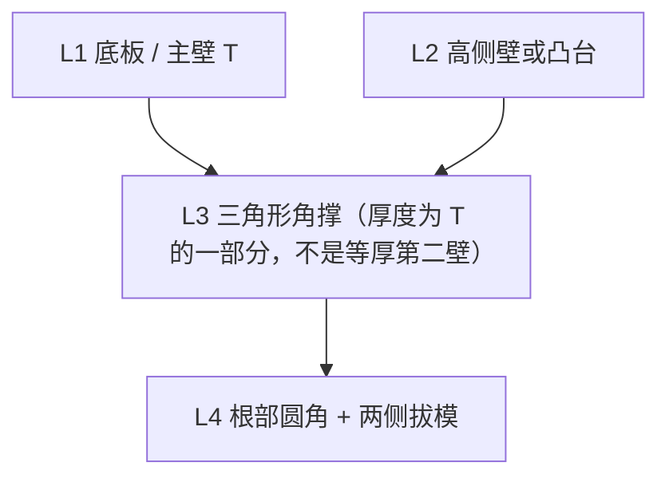

# 三角筋与角撑（Gusset）：斜撑高侧壁或凸台，而不是再做一面等厚壁

> [!summary] 一句话概述
> 三角筋（角撑、gusset）是连接高侧壁或凸台与底板的斜向三角形（或楔形）支撑，用来把根部弯矩分散到更大的区域，而不是再立一面与主壁等厚的「第二面壁」。厚度仍按主壁的一部分来取（Envalior 图：A = 0.5T–0.7T；RTP 总图标加强角撑板为 T/2；Protolabs：支撑材料遵守 40%–60%），根部要有圆角，两侧要有拔模，并留出冷却和排气空间。本篇对照已有加强筋篇和 Boss 柱篇：主角是斜撑几何，不是长条筋比例，也不是柱壁厚与底孔。

## 配图

![[附件/swcpu-gussets-photo.jpg]]
*图源：[SWCPU, Ribs and Gussets Design in Injection Molding](https://www.swcpu.com/blog/ribs-and-gussets/)（Posted January 7, 2025；已打开页面并下载 example-of-gussets-design.webp）；注塑件底板上的一排三角形角撑，用于把立壁撑回底板。文中定义：gussets 是加强转角、侧壁和凸台的楔形支撑，通常从一面延伸到与之大致成直角的另一面*

![[附件/envalior-gusset-design-rules.jpg]]
*图源：[Envalior《波纹、加强筋与肋板》](https://www.envalior.com/zh-cn/services/design-guide/corrugations-ribs-and-gussets) 页中「加强肋板设计准则」图（已打开中文页并下载）；L 形壁的立边（reinforcing edge）与底板（component wall）之间用若干三角形角撑连接。图中尺寸：A（筋/角撑厚度）= 0.5T–0.7T，B（间距）≥ 2T，C（角撑沿底板方向的长度）≥ 2T，D（被加强立边的厚度）≥ 2T。正文：加强肋板可用于加强转角、侧壁及柱体（bosses），本质可视为筋的一个子类，筋的尺寸与布局准则同样适用*

![[附件/rtp-part-overview-gusset.jpg]]
*图源：[RTP《热塑性塑料注塑设计指南》](https://www.rtpcompany.com/wp-content/uploads/RTP-Part-Design-Guidelines-for-Injection-Molded-Thermoplastics_CHS.pdf) 第 2 页总图（2017 年 3 月版，已打开 PDF）；在凸台、连接加强筋和普通加强筋之外，单独标出「加强角撑板」，其上标注厚度 T/2，底部可见约 2T 的水平尺寸。该页把角撑与筋、凸台画在同一壳体里，用于局部撑住侧壁或特征，而不是把整面壁加厚*

> 图片版权归原作者所有，仅作个人学习收藏；出处见文末「来源与核实记录」。

## 结构原理

> 本节所有数字只写来源里给出的；来源没有就写「来源未给出」。通用长条筋的 0.4–0.6 t / 高 ≤3 t / 间距 ≥4 t 已有专篇，本篇只在对照时提及，不把它们当作角撑的全部内容。

### 堆叠方案

方向：**在需要被撑住的立壁或凸台根部，从底板经三角形斜撑连到立壁/柱**。

| 层级 | 零件/特征 | 材料 | 厚度/尺寸 | 固定方式 | 依据 |
| --- | --- | --- | --- | --- | --- |
| L1 | 公称底板或主壁 | 热塑性塑料 | 公称壁厚 T（或 t） | 一体注塑 | 各来源均以主壁为基准 |
| L2 | 高侧壁、转角立边或凸台（boss） | 同上 | 来源未统一给出侧壁高度上限。RTP 第 4 页：独立式凸台按加强筋指南设计，并用连接加强筋和/或角支承加固；连接加强筋应为基座处公称壁厚的 0.6 倍。Envalior 图中被加强立边厚度 D ≥ 2T | 一体 | Envalior 图与正文；RTP 第 4 页「凸台」 |
| L3 | 三角形角撑本体 | 同上 | Envalior 图：A = 0.5T–0.7T，沿底板长度 C ≥ 2T，间距 B ≥ 2T。RTP 总图标角撑厚度 T/2。SWCPU：厚度一般为所支撑壁的 60%–75%，高度不应超过主壁厚度的 3 倍。Protolabs：支撑材料遵守相对壁厚 40%–60%，以免缩痕和 shadowing | 一体斜撑，不是再做一面等厚壁 | Envalior 图；RTP 第 2 页；SWCPU；Protolabs 壁厚提示 |
| L4 | 根部圆角与拔模 | 同上 | Envalior 对筋（同样适用于角撑）写：根部半径为一般壁厚的 25%–50%，建议最小 0.4 mm，超过 50% 会堆料。SWCPU：角撑应有圆角、倒角或切角，避免尖角困气。NetProto：根部太尖会应力集中，根部太大又会在对面形成厚岛；拔模面需要斜度 | 一体 | Envalior「加强筋尺寸设计」；SWCPU「Corner Design」；NetProto |

剖面示意：

### 零件清单

| 零件/特征 | 数量 | 功能 | 材料 | 依据 |
| --- | --- | --- | --- | --- |
| 三角形或楔形角撑 | 按载荷和跨度布置，来源未给出必选数量 | 把高侧壁或凸台撑回底板/主壁，分散根部弯矩 | 同塑件 | Envalior；SWCPU；NetProto |
| 被支撑的高侧壁或转角 | 按壳体 | 提供深度和封闭空间；单独直立时根部易弯 | 同塑件 | Envalior；Protolabs「box lids that have tall, thin walls」 |
| 被支撑的凸台 | 按连接点 | RTP、Envalior、SWCPU 均把角撑列为加固凸台的手段；柱本身的壁厚比和底孔见已有 Boss 篇 | 同塑件 | RTP 第 4 页；Envalior；SWCPU「Support for Bosses」 |
| 普通长条筋 | 可选，与角撑分工 | 沿大面提高刚度；不是本篇主角 | 同塑件 | SWCPU 对照图；已有加强筋篇 |
| 根部圆角 | 每处交线 | 降低应力集中、改善流动，但避免堆成厚岛 | 同塑件 | Envalior；NetProto；SWCPU |

### 装配顺序

一体注塑结构，无装配步骤。设计顺序建议按来源归纳如下：

1. 先定公称壁 T，高侧壁或凸台不要靠把整面加厚来扛弯矩（Protolabs、Envalior：加厚壁有局限性）。
2. 在立壁或凸台与底板之间加三角形斜撑，而不是再做一个与主壁等厚的直角「第二面壁」（NetProto：brace, not a second wall）。
3. 按来源校核厚度（40%–60%、T/2、0.5T–0.7T 或 60%–75%，见参数表，不折中成一个数）、高度（SWCPU：不超过 3 倍主壁厚）、间距（Envalior 图 B ≥ 2T）和根部圆角。
4. 两侧拔模，并在密集环绕凸台时留出钢材冷却和排气空间（NetProto）。
5. 来源未给出角撑相对浇口的必选方位；SWCPU 建议尽量与熔体流动方向一致，以改善充填。

### 受力与运动分析

- **受力路径**：高侧壁或凸台根部的弯矩和横力，经三角形斜撑传到底板或相邻主壁。SWCPU：角撑在转角、侧壁和凸台等最易受应力的交接处提供额外支撑，并帮助把载荷更均匀地分散。来源未给出许用载荷或截面模量公式。
- **运动关系**：静态结构，无相对运动。成形时熔体需充满三角形封闭区和根部；NetProto 指出过大或排得过密的角撑会在根部困气、并使钢材难以冷却。
- **失效风险**：角撑做成与主壁等厚 → 对面缩痕、周期变长（NetProto、Protolabs 40%–60%、SWCPU）。根部尖角 → 应力开裂或困气；根部圆角过大 → 对面厚岛（NetProto、Envalior 对超过 50% 半径的警告）。无拔模 → 顶白、拉伤。用角撑去代替正确的柱壁厚或底孔 → 不是同一问题，见已有 Boss 篇。

## 设计要点与参数

| 要点 | 内容 | 依据 |
| --- | --- | --- |
| 定义与用途 | 三角形或楔形斜撑，用于加强转角、侧壁和凸台，把特征连回底板；不是全高的长条筋，也不是紧固用的柱 | Envalior；SWCPU；NetProto |
| 不要做成等厚第二壁 | 与主壁一样厚的角撑会成为缩痕和周期风险；应按公称壁来减薄 | NetProto；Protolabs 40%–60% |
| Envalior 图中尺寸 | A = 0.5T–0.7T；间距 B ≥ 2T；长度 C ≥ 2T；被加强立边 D ≥ 2T | Envalior「加强肋板设计准则」图 |
| RTP 角撑厚度 | 第 2 页总图标「加强角撑板」为 T/2 | RTP 第 2 页图 |
| 连接筋（与角撑一起用） | 连接加强筋应为基座处公称壁厚的 0.6 倍，以避免凹陷 | RTP 第 4 页 |
| SWCPU 厚度与高度 | 厚度一般为所支撑壁的 60%–75%；高度不应超过主壁厚度的 3 倍 | SWCPU「Thickness and Height Recommendations」 |
| Protolabs 相对壁厚 | 用 gussets 加强高而薄的壁时，支撑材料仍须遵守 40%–60% 规则，以免缩痕和 shadowing | Protolabs Wall Thickness Guidelines |
| 根部圆角 | Envalior（筋准则，正文称同样适用于角撑）：一般壁厚的 25%–50%，建议最小 0.4 mm；超过 50% 会堆料，增加残余应力、气泡或塌陷痕。SWCPU：用半径、倒角或切角避免尖角 | Envalior；SWCPU |
| 拔模 | Envalior 对筋：侧面 1°–1.5°（低筋或特例可更小，但可能擦伤或难脱模）。NetProto：随型芯或型腔脱出的角撑面需要拔模 | Envalior「加强筋尺寸设计」；NetProto |
| 外观对面 | 角撑对面若是 A 级外观面，更要控制厚度与根部堆料（NetProto 要求在 DFM 中标注 show-face） | NetProto |
| 与长条筋的分工 | 需要沿大面提高刚度时用筋；只需在立壁、转角或柱根局部斜撑时用角撑 | SWCPU 对照；NetProto |

> 来源没有给出的参数一律写「来源未给出」。各机构厚度比例不同，按来源分列，不平均成一条「公司标准」。

## 优缺点

**优点**
- 用很少的材料把高侧壁或凸台的根部刚度提上去，不必把整面壁加厚。
- 斜撑几何明确针对「交接处弯矩」，比沿面拉一条长筋更对症。
- 可与连接筋一起环绕凸台（RTP），把柱的载荷导入主壁，而不把柱做成实心厚块。

**缺点 / 代价**
- 角撑对面容易缩痕，外观面尤其敏感（Protolabs、NetProto）。
- 在凸台四周排得过密会困气、冷却不良（NetProto）。
- 各手册厚度区间并不重合（40%–60%、T/2、0.5T–0.7T、60%–75%），选值必须写明依据并做样件确认。
- 角撑不能替代正确的柱壁厚、底孔或主壁过渡。

## 可借鉴点

- 看到高侧壁或孤立凸台将要在根部弯曲时，先加三角形斜撑，而不是把壁或柱加厚到和底板一样。
- 把角撑画成「瘦三角形」：厚度按主壁的一部分，根部有圆角，两边有拔模，底边长度至少约 2T（Envalior 图中的 C）。
- 外观面背后的角撑优先取更保守的相对厚度（Protolabs 40%–60% 或 RTP 的 T/2），并检查对面是否出现缩痕或阴影。
- 支撑凸台时，角撑只负责把柱连到壁上；柱壁厚比 0.6、自攻底孔仍按已有 Boss 篇，不要用加厚角撑去「补」一个过薄的柱。
- 多条角撑不要贴在一起，给钢材留出冷却和排气的空间。

## 与库中相似案例对比

| 对比项 | 本案例（三角筋 / 角撑） | [[塑料件加强筋设计：厚度、高度与间距比例]] | [[注塑螺丝柱（Boss 柱）：壁厚比 0.6 分水岭与自攻底孔公式]] | [[注塑均匀壁厚与厚薄渐变：相邻壁厚比与过渡段长度]] |
| --- | --- | --- | --- | --- |
| 主角几何 | 连接立壁或凸台与底板的三角形斜撑 | 沿大面延伸的长条筋 | 螺丝柱壁厚、根部和自攻底孔 | 主壁厚薄过渡 |
| 主要作用 | 局部撑住高壁或柱的根部，防止根部弯曲 | 提高整面刚度、控制筋厚防缩 | 紧固与防裂、防缩 | 让壁厚可制造 |
| 何时用这篇 | 高侧壁、转角或凸台需要斜撑，又不能再做一面等厚壁时 | 布置长条筋网格时 | 设计柱本身和底孔时 | 先定公称壁和过渡时 |
| 参数如何分工 | 本篇给斜撑厚度、长度、间距和「不要等厚」 | 已有篇给通用筋比例，本篇不重抄为唯一内容 | 柱的 0.6 比和底孔公式仍用已有篇；本篇只写如何用角撑把柱连到壁上 | 公称壁 T 是角撑的基准，细节见该篇 |
| 是否重复 | 否 | 已有，对照而不替代 | 已有，对照而不替代 | 本轮新篇，互补 |

## 相关案例

- [[塑料件加强筋设计：厚度、高度与间距比例]]
- [[注塑螺丝柱（Boss 柱）：壁厚比 0.6 分水岭与自攻底孔公式]]
- [[注塑均匀壁厚与厚薄渐变：相邻壁厚比与过渡段长度]]
- [[注塑缩痕：厚壁背面凹陷、减胶坑与保压边界]]
- 分类索引：[[01-壳体与外观件 索引]]

## 来源与核实记录

- 主来源：[Envalior，波纹、加强筋与肋板](https://www.envalior.com/zh-cn/services/design-guide/corrugations-ribs-and-gussets)（已打开中文页：加强肋板用于转角、侧壁及凸台，属筋的子类；并下载「加强肋板设计准则」原图中的 A/B/C/D 尺寸。中文主来源。页面未给出独立发布日期）
- 补充来源 1：[RTP《热塑性塑料注塑设计指南》](https://www.rtpcompany.com/wp-content/uploads/RTP-Part-Design-Guidelines-for-Injection-Molded-Thermoplastics_CHS.pdf)（2017 年 3 月；已打开第 2 页总图「加强角撑板」T/2、第 4 页连接加强筋 0.6 倍公称壁。独立机构）
- 补充来源 2：[SWCPU, Ribs and Gussets Design in Injection Molding](https://www.swcpu.com/blog/ribs-and-gussets/)（2025-01-07；已打开并下载实物角撑照片与筋/角撑对照图。独立机构）
- 补充来源 3：[Protolabs, Injection Molding Wall Thickness Guidelines](https://www.protolabs.com/resources/design-tips/improving-part-design-with-uniform-wall-thickness/)（已打开：tall, thin walls 可用 gussets，并遵守 40%–60%。独立机构）
- 补充来源 4：[NetProto, Gusset Design for Injection Molding](https://netproto.com/design-guide/gussets)（已打开：三角撑不是第二面壁、根部圆角与排气/冷却定性规则。独立机构。该页对具体厚度数字写得较原则，定量仍以来源 1–3 为准）
- 核实：2026-11-22 打开上述页面与 PDF，下载原图。任务书中的 plasdata 链接本批未作为主证引用。未把通用筋比例或 Boss 底孔公式写成这篇的主角。
