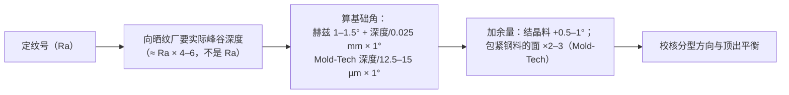

# 咬花（晒纹）与拔模角：每 0.025 mm 纹深加 1°

> [!summary] 一句话概述
> 外观件侧壁咬花后，纹路的凹凸会在脱模时「刮」侧壁，所以要按纹深加拔模角。赫兹工业设计的经验公式：基础 1–1.5° + 纹深 ÷ 0.025 mm × 1°，并提醒 VDI 3400 纹号对应的是 Ra，不是深度（实际峰谷深度约为 Ra 的 4–6 倍）；纹理厂 Mold-Tech 则在技术数据表里写明旧规则「每 25 µm 纹深 1.5°」已不再适用，推荐每 12.5–15 µm 纹深 1°，且包紧钢料的面要 2–3 倍。

## 配图

![[附件/moldtech-texture-draft.png]]
*图源：[Standex Engraving Mold-Tech Texture Technical Data Sheet](https://www.mold-tech.com/wp-content/uploads/2020/01/SMT-Technical-Data-Sheet.pdf)；纹深与拔模角示意（图例：0.003" / 75 µm 纹深标 7°）、晒纹前模面抛光要求*

> 图片版权归原作者所有，仅作个人学习收藏；出处见文末「来源与核实记录」。赫兹原文配图为产品照片，与纹理尺寸无关，未收录。

## 结构原理

> 本节数字只写来源里给出的；来源没有就写「来源未给出」。

### 堆叠方案

方向：**侧壁剖面，从模具钢到塑料件**

| 层级 | 零件/区域 | 材料 | 厚度/尺寸 | 固定方式 | 依据 |
| --- | --- | --- | --- | --- | --- |
| L1 | 模具钢基体 | P20（预硬约 HRC30）、H13 等 | 化学咬花建议热处理到 HRC48 以上 | — | 赫兹 FAQ；Mold-Tech 列出可晒纹钢种 |
| L2 | 晒纹前模面 | — | 纹深 < 20 µm 用 500# 砂纸面；20–100 µm 用 400#；> 100 µm 用 320#；不得残留 EDM 层 | 抛光 | Mold-Tech |
| L3 | 纹理层（纹深） | 化学腐蚀 / 激光 / 电火花 | VDI #24/27/30/33/36 = Ra 1.6/2.5/4/6.3/10 µm；深度约为 Ra × 4–6 | 晒纹 | 赫兹 |
| L4 | 拔模角 | — | 见下表 | 模具设计 | 赫兹；Mold-Tech |
| L5 | 塑料件侧壁 | ABS/PC 或 PP/PA/POM | 结晶料再加 0.5–1° | 注塑 | 赫兹 |

剖面示意：

### 零件清单

| 零件 | 数量 | 功能 | 材料 | 依据 |
| --- | --- | --- | --- | --- |
| 咬花侧壁 | — | 外观、防刮、手感 | 塑料 | 赫兹 |
| 顶针（含扁顶针） | 按需 | 平衡顶出，避免局部负角刮纹 | 模具钢 | 赫兹对讲机实例 |
| 行位/斜顶 | 按需 | 按其动作方向单独评估纹理拔模 | — | Mold-Tech |

### 装配顺序

> 本案例为模具与工艺流程，按赫兹给出的「实际操作顺序」：

1. 先确定纹号。
2. 向晒纹厂要实际深度（不是 Ra）。
3. 套公式算基础角。
4. 结合材料收缩率和分型方向加余量。
5. 最后校核顶出平衡；开模前与模具厂、晒纹厂确认钢材硬度。

### 受力与运动分析

- **受力路径**：塑料冷却向模芯收缩 → 侧壁被「箍」在模芯上产生正压力 → 脱模时纹路凸起与侧壁之间产生摩擦与几何干涉 → 拔模角不足即拉毛、发白。
- **运动关系**：塑料件沿开模/顶出方向相对模具运动；行位、斜顶的拔模要按它们自己的动作方向算。
- **失效风险**（赫兹列出）：收缩包紧（结晶料更严重）；化学腐蚀在深腔、拐角处纹深不均（按最深点算）；顶出不平衡导致局部变成负角硬刮；分型面附近 R 角太小；预硬钢咬花纹路深浅不一，注塑几百模后纹面磨亮。

## 设计要点与参数

| 要点 | 内容 | 依据 |
| --- | --- | --- |
| 赫兹公式 | 拔模角 = 1–1.5° + 纹深 / 0.025 mm × 1°；深度 0.02 mm 给 2°，0.05 mm 给 3° | 赫兹 |
| VDI 3400 对照 | #24：Ra 1.6，深 0.006–0.010 mm，建议 1.5–2°；#27：Ra 2.5，0.010–0.015，2–2.5°；#30：Ra 4，0.016–0.024，2.5–3°；#33：Ra 6.3，0.026–0.038，3–3.5°；#36：Ra 10，0.040–0.060，3.5–4.5° | 赫兹表（深度为经验换算） |
| Mold-Tech 规则 | 旧规则 1.5°/25 µm 已不适用；推荐 1°/12.5–15 µm | Mold-Tech |
| 包紧面 | 会收缩包紧在钢料上的区域需要 2–3 倍拔模 | Mold-Tech |
| 擦穿面 | 有纹理的侧壁擦穿需要额外拔模或专门处理 | Mold-Tech |
| 结晶料 | PP、PA、POM 在公式值上再加 0.5–1° | 赫兹 |
| 钢材 | 化学咬花热处理到 HRC48 以上；P20（约 HRC30）纹路易深浅不一 | 赫兹 |
| 模面抛光 | < 20 µm 纹：500#；20–100 µm：400#；> 100 µm：320# | Mold-Tech |
| 反例 | 客户把 Ra 4 µm 当成 0.004 mm 深度，只给 1°，T0 四面侧壁拉毛，改模 + 重新晒纹拖三周 | 赫兹 |
| 实例 | 对讲机外壳给了 3° 仍一侧拉痕，加两根扁顶针调顶出平衡解决 | 赫兹 |

> 两条规则对比（换算，推断）：同样 25 µm 纹深，赫兹给「1–1.5° 基础 + 1°」= 2–2.5°；Mold-Tech 给 25 ÷ 12.5–15 ≈ 1.7–2°（未含基础角）。两者量级接近，但 Mold-Tech 明确把包紧面放大到 2–3 倍，这一点赫兹公式里没有。

## 优缺点

**优点**
- 纹理能遮盖缩痕、熔接痕、划伤，提升手感
- 公式简单，可以在出图前就定好每个侧壁的角度

**缺点 / 代价**
- 拔模角加大会改变外形和壁厚分布
- 依赖晒纹厂实际深度，图纸阶段只能估算

## 可借鉴点

- **图纸上标纹号时同时标「实际深度」和对应拔模角**，避免用 Ra 当深度
- **空间不够时三条退路**（赫兹）：① 外侧预留 0.3–0.5 mm 胶位，用角度换厚度（透明、高光料不建议）；② 改分型面，让拔模方向顺着纹路；③ 降纹号或局部减纹（#33 → #27 深度砍一半以上，拔模从 3° 多降到 2° 出头）
- **包紧模芯的面拔模乘 2–3 倍**（Mold-Tech）
- **出现拉毛先查顶出平衡**，不一定是角度不够
- 螺丝柱外侧如果晒纹，也要按纹深加拔模（见 [[注塑螺丝柱（Boss 柱）：壁厚比 0.6 分水岭与自攻底孔公式]]）

## 与库中相似案例对比

| 对比项 | 本案例 | [[注塑倒扣脱模：强脱、斜顶还是滑块]] | [[塑料外壳止口与扣位：间隙参数与三个翻车案例]] |
| --- | --- | --- | --- |
| 关注点 | 表面纹理带来的拔模需求 | 倒扣结构的脱模方式 | 止口间隙 |
| 共同点 | 都是「模具能不能顺利脱模」的约束 | — | — |

## 相关案例

- [[注塑螺丝柱（Boss 柱）：壁厚比 0.6 分水岭与自攻底孔公式]]
- [[注塑倒扣脱模：强脱、斜顶还是滑块]]
- [[免喷涂材料 vs 喷涂：成本、良率与三条硬边界]]
- 分类索引：[[01-壳体与外观件 索引]]

## 来源与核实记录

- 主来源：[咬花深度0.05mm，脱模角留几度不粘模](https://www.hezidesign.com/gongyi/1228.html)（赫兹工业设计，2026-10-15，王然）
- 补充来源：[Texture Technical Data Sheet](https://www.mold-tech.com/wp-content/uploads/2020/01/SMT-Technical-Data-Sheet.pdf)（Standex Engraving Mold-Tech，2020 PDF）
- 核实：2026-11-13 打开两个来源原文核对全部数值。赫兹表中「实际深度」列是作者按 Ra × 4–6 换算的经验区间，非标准值。
