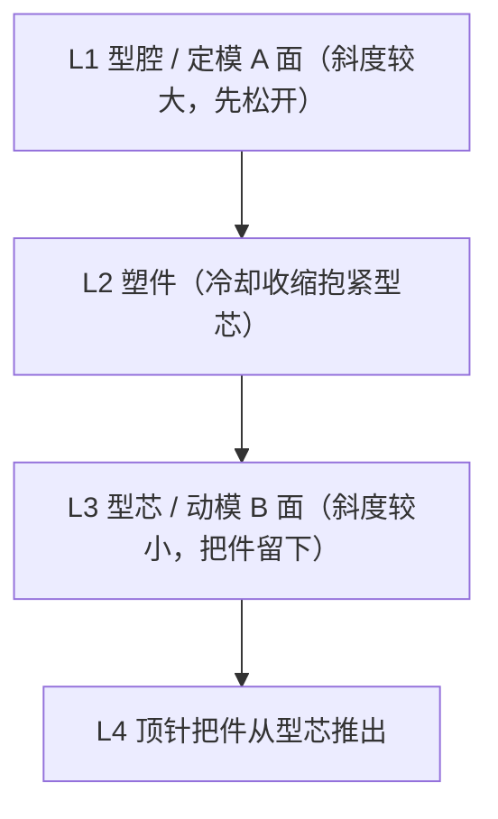

# 型芯与型腔拔模差：收缩抱紧型芯，让塑件留在动模顶出侧

> [!summary] 一句话概述
> 塑料冷却时会收缩并抱紧型芯（公模、通常在动模 / B 面），开模后制件必须留在有顶出系统的那一侧，而不能跟着型腔（母模、常为定模 / A 面外观侧）被带走。做法是让型腔侧斜度大于型芯侧——Firstmold 的规则是模腔拔模角一般比模芯大 0.5°——使制件先脱离型腔、继续留在型芯上，再由顶针推出。本篇讲留模和两侧斜度差，不是按咬花纹深加角度。

## 配图

![[附件/xometry-core-cavity-shrink.jpg]]
*图源：[Xometry, How to Choose Core and Cavity Placement in Injection Molding](https://www.xometry.com/resources/injection-molding/injection-molding-core-and-cavity/)（已打开页面并下载原图 core_and_cavity.png）；左侧 CORE（型芯）为凸出的公面，右侧 CAVITY（型腔）为凹入的母面，中间红色示意塑件包在型芯外侧。Xometry 正文强调：开模后制件必须始终留在带顶针的那一侧*

![[附件/xometry-draft-friction.jpg]]
*图源：同 Xometry 上文配图 IMCoreandCavityImage-03；对照「有拔模则摩擦较小」与「无拔模则摩擦较大」。Xometry 并写：拔模角也可以用来把制件留在模具正确的一侧*

![[附件/envalior-draft-vs-depth.jpg]]
*图源：[Envalior《脱模斜度》](https://www.envalior.com/zh-cn/services/design-guide/draft-angle) 页中「脱模斜度示意图」（已打开中文页并下载）；横轴为深度 C（mm），纵轴为斜度造成的单边让位 A（mm），曲线对应 0°30′ 至 3°。该页正文：冷却收缩使零件紧贴模具型芯或公面，加大脱模难度；通常建议 1° 至 3°，无纹理侧壁每侧最小 0.5°*

> 图片版权归原作者所有，仅作个人学习收藏；出处见文末「来源与核实记录」。

## 结构原理

> 本节所有数字只写来源里给出的；来源没有就写「来源未给出」。咬花按纹深加角度的规则见已有专篇，本篇不把纹理增量当作主角。

### 堆叠方案

方向：**沿开模方向，从定模型腔（A 面）到塑件再到动模型芯（B 面）及顶出系统**。

| 层级 | 零件/特征 | 材料 | 厚度/尺寸 | 固定方式 | 依据 |
| --- | --- | --- | --- | --- | --- |
| L1（定模 / A 面） | 型腔（cavity，母面，常为外观面） | 模具钢 | Firstmold：模腔拔模角一般应比模芯大 0.5°，以便开模时产品留在模芯。AIM：外观侧通常在型腔（A-Side / stationary side），斜度用于开模时释放、避免真空和擦伤纹理 | 固定在注塑机固定板（AIM 所称 stationary side） | Firstmold「03.草稿角」；AIM「Purpose of Draft on the Cavity」 |
| L2 | 塑件侧壁 | 热塑性塑料 | 冷却时收缩并抱紧型芯（Envalior）。Xometry：大多数塑料收缩明显，低收缩材料更难留在顶针侧，需要额外的设计考虑 | 成形后包在型芯上 | Envalior；Xometry「Material」与「Draft angles」 |
| L3（动模 / B 面） | 型芯（core，公面） | 模具钢 | Firstmold：模芯斜度小于模腔。AIM：B-Side / moving side 也要有斜度，否则顶针推进时会在制件与钢材之间形成强烈真空，直到真空破坏并造成变形 | 随动模后退，带着塑件离开型腔 | Firstmold；AIM「Purpose of Draft on the Core」 |
| L4 | 顶出系统（顶针等） | 模具零件 | 来源未给出顶针直径或数量。Xometry：开模后制件必须始终粘在有顶针的一侧，才能稳定重复顶出 | 装在动模侧 | Xometry「Ejector System」 |

剖面示意：

### 零件清单

| 零件/特征 | 数量 | 功能 | 材料 | 依据 |
| --- | --- | --- | --- | --- |
| 型腔（母模） | 1 套凹面 | 成形外观面，开模时先释放塑件 | 模具钢 | Xometry；AIM；Firstmold |
| 型芯（公模） | 1 套凸面 | 成形内表面；收缩后被塑件抱紧，使制件留在顶出侧 | 模具钢 | Envalior；Xometry 图 |
| 塑件侧壁斜度 | 两侧可不同 | 型腔侧更大、型芯侧更小，形成留模所需的斜度差 | 与塑件相同 | Firstmold 0.5° 差及材料表 |
| 顶针 / 顶出系统 | 来源未给出数量 | 把留在型芯上的制件推出；无斜度时还要对抗真空（AIM） | 模具零件 | Xometry；AIM |
| 分型面 | 1 | 两半模具的分界面；本篇不把阶梯分型的 shut-off 最小斜度当作主角（Envalior 另有 5°–7° 的 shut-off 规则，属封胶面，不是留模差角） | 模具 | Envalior「止口位的脱模斜度」仅作区分 |

### 装配顺序

按开模与顶出顺序，而不是产品装配（Xometry 循环第 4 步 Demold/Ejection，并结合 Firstmold、Envalior、AIM）：

1. 充填并冷却：塑件在型腔与型芯之间的间隙中成形，冷却收缩后抱紧型芯（Envalior）。
2. 开模：动模后退。型腔侧斜度较大，塑件先与 A 面脱离；型芯侧斜度较小，塑件仍留在 B 面（Firstmold 的 0.5° 差即为此）。
3. 若设计反了——型腔斜度不足或型芯斜度过大、或低收缩材料没把特征取向放到顶针侧——制件可能留在定模，此时没有顶针，无法稳定取出（Xometry）。
4. 顶针推进：把仍在型芯上的制件推出。型芯也必须有斜度，否则 AIM 所述的真空会让顶出过程变形、拉伤。
5. 来源未给出具体顶出行程或顶针布置尺寸。

### 受力与运动分析

- **受力路径**：开模瞬间，型腔表面与塑件之间的摩擦和真空应尽快消失；塑件对型芯的抱紧力则暂时把制件留在动模。随后顶针克服型芯侧残余包紧力和真空，把件推出。Envalior 把收缩抱紧型芯列为脱模变难、表面可能划伤的原因。
- **运动关系**：型腔与型芯沿开模方向分离；塑件应只跟随型芯；然后相对型芯沿同一方向脱出。无工作状态下的产品相对运动。
- **失效风险**：两侧斜度相同或型腔斜度偏小 → 制件粘在定模，无法顶出（Firstmold 规则的反面，推断需标注：这是从「差 0.5° 才能留在模芯」直接推出的失效模式）。型芯完全无斜度 → 顶出真空和拉伤（AIM、Protolabs drag marks）。低收缩材料更难主动留在顶针侧（Xometry）。本篇不把「每 0.025 mm 纹深加 1°」当作设计主角；若外观面有纹理，应转到已有咬花专篇，并仍保证型腔侧更易释放。

## 设计要点与参数

| 要点 | 内容 | 依据 |
| --- | --- | --- |
| 留模目标 | 开模时产品仍留在模芯；Xometry：制件必须始终留在有顶针的一侧 | Firstmold；Xometry |
| 两侧斜度差 | 模腔的拔模角度一般应比模芯大 0.5° | Firstmold 中英文「03. Draft Angle」 |
| 收缩抱紧 | 热塑性塑料冷却收缩，零件紧贴模具型芯或公面，加大脱模难度并可能导致表面划痕 | Envalior |
| Envalior 推荐斜度 | 通常 1° 至 3°；无表面纹理的侧壁每侧最小 0.5° | Envalior「脱模斜度尺寸设计」（纹理增量见已有咬花篇，本表不展开） |
| Firstmold 总范围 | 拔模角通常 0.5°–5°，一般约 2°，随尺寸、高度和形状而变 | Firstmold 03 |
| Firstmold 型芯 / 型腔对照（原文，含角分） | ABS 型芯 35′–1°、型腔 40′–1°20′；PS 30′–1°、35′–1°30′；PC 30′–50′、35′–1°；PP 25′–50′、30′–1°；PE 20′–45′、25′–45′；PMMA 30′–1°、35′–1°30′；POM 30′–1°、35′–1°30′；PA 20′–40′、25′–40′；HPVC 50′–1°45′、50′–2°；筋一般为 0.5°，最小 0.25°（表中另有 SPV、CP 两行，见原表） | Firstmold 材料表；英文页与中文页一致，中文页曾被网页转换误作「英尺」，此处按英文页及中文页的角分符号转录 |
| 型腔侧的作用 | 帮助开模时释放，避免真空，避免擦伤外观或纹理；AIM 经验：许多纹理按型腔深度每英寸 1°，最小 1°，能接受则 2° 更好 | AIM「Purpose of Draft on the Cavity」 |
| 型芯侧的作用 | 顶出时打破制件与钢材之间的真空，减少变形 | AIM「Purpose of Draft on the Core」 |
| 低收缩材料 | 更难让制件留在顶针侧，需要额外设计考虑 | Xometry「Material」 |
| 一般拔模示例（非差角） | Protolabs：无纹理时 50 mm 高的壁可用 2°，75 mm 高可用 3°；斜度加在每一面，须同时校核壁厚是否被斜度吃薄或加厚 | For Dummies 第 26 页。此为高度相关的一般值，不是型芯/型腔差角 |

> 来源没有给出的参数一律写「来源未给出」。角分（′）按原文保留，不自行改成小数度再充作来源值。

## 优缺点

**优点**
- 用很小的两侧差角（Firstmold 写一般 0.5°）就可以把留模方向设计进去，而不必额外做倒扣或强脱。
- 顺应收缩抱紧型芯的物理事实（Envalior），把「问题」变成「把件留在顶针侧」的手段。
- 外观面（型腔）斜度更大，有利于开模时先释放、减少擦伤。

**缺点 / 代价**
- 外壳内外壁的斜度不再对称，止口、配合面和外观面都要按两侧分别标注，不能在模型里只给一个统一拔模。
- 低收缩材料或几乎没有型芯可抱紧的扁平件，差角不一定留得住，还要靠倒扣、顶针形状或真空阀等，来源未给出这些补救的尺寸。
- 型芯斜度过小，顶出真空和拉伤风险上升（AIM）；不能把「型芯斜度越小越好」推到零。

## 可借鉴点

- 分型方案先问：顶针在哪一侧？型芯（公面、内表面）是否也在这一侧？如果不是，先改结构取向，再谈斜度大小。
- 在 CAD 里给型腔侧和型芯侧分别赋斜度，不要左右复制同一个角度。检查项：型腔侧比型芯侧大约 0.5°（Firstmold），且两侧都落在该材料表的区间内。
- 外观面（常为型腔）宁可略大，以保证先松开；型芯侧保留足够斜度以打破顶出真空，而不是做成直壁。
- 材料收缩越小，越要主动用斜度差和特征取向把件留在顶针侧（Xometry），不能假设「收缩会自然抱紧」。
- 有咬花的外观面，纹深加角度按已有专篇执行，但加完之后仍应保持型腔侧比型芯侧更容易释放。

## 与库中相似案例对比

| 对比项 | 本案例（型芯/型腔拔模差与留模） | [[咬花（晒纹）与拔模角：每 0.025 mm 纹深加 1°]] | [[注塑倒扣脱模：强脱、斜顶还是滑块]] | [[塑料外壳止口与扣位：间隙参数与三个翻车案例]] |
| --- | --- | --- | --- | --- |
| 主角 | 两侧斜度差，让件留在动模型芯 | 按纹深增加拔模 | 倒扣如何出模 | 止口和扣位的间隙 |
| 物理机制 | 收缩抱紧型芯 + 型腔先松开 | 纹理凹凸钩住型腔表面 | 侧向抽芯或强脱 | 装配配合 |
| 何时用这篇 | 决定制件留在哪一侧、给内外壁不同斜度时 | 已定留模侧、要按纹理加深斜度时 | 有倒扣、直开模出不来时 | 设计壳与盖的止口时 |
| 是否重复 | 否。本篇不把纹深加角度再写一遍，也不把 shut-off 最小斜度写成留模规则 | 已有，本篇只对照 | 已有，本篇假定直开模可出 | 止口斜度与留模差角是两件事 |

## 相关案例

- [[咬花（晒纹）与拔模角：每 0.025 mm 纹深加 1°]]
- [[注塑倒扣脱模：强脱、斜顶还是滑块]]
- [[塑料外壳止口与扣位：间隙参数与三个翻车案例]]
- [[注塑均匀壁厚与厚薄渐变：相邻壁厚比与过渡段长度]]
- 分类索引：[[01-壳体与外观件 索引]]

## 来源与核实记录

- 主来源：[Firstmold，塑料产品的结构设计](https://firstmold.com/zh/tips/structural-design-of-plastic-products/)（2023-05-23 发布，页面显示最后修改 2026-11-06；已打开中文「03.草稿角」与[英文 Draft Angle](https://firstmold.com/tips/structural-design-of-plastic-products/) 核对：模腔一般比模芯大 0.5°、材料对照表。中文主来源。中文页表格曾出现「英尺」一类转换错误，数值以英文页及中文页角分符号为准）
- 补充来源 1：[Envalior，脱模斜度](https://www.envalior.com/zh-cn/services/design-guide/draft-angle)（已打开中文页：收缩紧贴型芯或公面、1°–3°、无纹理每侧最小 0.5°、以及示意图。独立机构。该页另有阶梯分型 shut-off 至少 5°、建议 7° 或更大，本篇仅区分、不作为留模差角）
- 补充来源 2：[Xometry, How to Choose Core and Cavity Placement in Injection Molding](https://www.xometry.com/resources/injection-molding/injection-molding-core-and-cavity/)（Published 2023-08-04，Updated 2026-01-07；已打开并下载型芯/型腔与摩擦对照图。独立机构）
- 补充来源 3：[AIM Processing, Getting the Drift on Draft](https://www.aimprocessing.com/blog/getting-the-drift-on-draft)（2016-12-07，Jon Gelston；已打开：A 面型腔与 B 面型芯各自的斜度目的。独立机构）
- 补充来源 4：[Proto Labs, Injection Moulding Part Design For Dummies](https://www.protolabs.com/media/1011290/im-for-dummies-en.pdf)（2012；已打开第 25–26 页 Figure 2-3、2-4，仅作一般拔模示意。与差角规则不重复计为差角来源）
- 核实：2026-11-22 打开上述页面与 PDF。任务书中的 https://ace-molding.com/h-nd-8.html 本次 WebFetch 返回 HTTP 500，未写入引用。未把本篇写成咬花加拔模或倒扣出模选择的重复。
