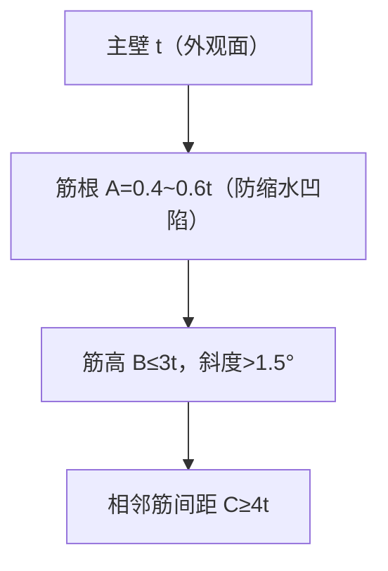

# 塑料件加强筋设计：厚度、高度与间距比例

> [!summary] 一句话概述
> 注塑件要提高刚度，应该「矮而多」地加筋而不是加高：B 站专栏《塑料产品结构设计基础知识——加强筋的设计》给出筋厚 0.4–0.6 t（t 为壁厚）、筋高 ≤ 3 t、筋间距 ≥ 4 t、斜度 > 1.5° 等比例规则，并分别讲了箱体转角、螺丝柱和支撑面的加强筋做法。

## 配图

![[附件/rib-design-dimensions.jpg]]
*图源：B 站专栏 cv14903048（UG产品设计教学）；加强筋尺寸 A/B/C/D 标注示意*

![[附件/rib-design-ratio.jpg]]
*图源：同上（图片带「知乎」水印）；另一张比例图：e = 0.6–0.7a、f ≥ 2a（a 为壁厚），与正文 A = 0.4–0.6 t 的取值不同*

> 图片版权归原作者所有，仅作个人学习收藏；出处见文末「来源与核实记录」。

## 结构原理

> 本节数字只写来源里给出的；来源没有就写「来源未给出」。

### 堆叠方案

方向：**从外观面向内**（单层壁 + 内侧加强筋）

| 层级 | 零件/特征 | 材料 | 厚度/尺寸 | 固定方式 | 依据 |
| --- | --- | --- | --- | --- | --- |
| L1（外观面） | 主壁 | 塑料 | 壁厚 t（来源未给具体值） | 一体注塑 | 第 3 节 |
| L2 | 加强筋根部 | 同上 | 大端厚 A = 0.4–0.6 t，一般取 50% | 一体 | 第 3 节 |
| L3 | 加强筋本体 | 同上 | 高 B ≤ 3 t；相邻筋距 C ≥ 4 t；斜度 > 1.5° | 一体 | 第 1、3 节 |
| L4（支撑面处） | 筋顶 | 同上 | 低于支撑面至少 0.5 mm | 一体 | 第 6 节 |

剖面示意：

### 零件清单

| 特征 | 数量 | 功能 | 材料 | 依据 |
| --- | --- | --- | --- | --- |
| 长条形/圆形网格加强筋 | 按需 | 提高刚度、减少扭歪、利于充填 | 同壳体 | 第 2 节 |
| 转角/侧壁加强筋 | 按需 | 箱体转角和侧壁加强 | 同壳体 | 第 2 节 |
| 螺丝柱加强筋 | 按需 | 螺丝柱过高或受力时加强 | 同壳体 | 第 4、5 节 |
| 支撑面加强筋 | 按需 | 支撑面加强且保持支撑面平齐 | 同壳体 | 第 6 节 |

### 装配顺序

一体注塑结构，无装配步骤。

### 受力与运动分析

- **受力路径**：弯曲载荷由主壁 + 筋组成的 T 形截面承担，筋把壁的截面惯性矩提高（推断：来源只说提高强度和刚度）。
- **运动关系**：无相对运动。
- **失效风险**：筋过厚 → 与主壁连接处缩水凹陷；筋过高 → 筋部受力破坏、自身刚性下降；斜度不足 → 顶伤；多条筋排列不当 → 收缩不均（来源第 1 节）。

## 设计要点与参数

| 要点 | 内容 | 依据 |
| --- | --- | --- |
| 筋厚 | 小于被加强壁厚；大端厚 A = 0.4–0.6 t，一般 50% | 第 1、3 节 |
| 筋高 | B ≤ 3 t；要提高刚度应「增加筋数目而不是高度」 | 第 1、2、3 节 |
| 筋间距 | C ≥ 4 t | 第 3 节 |
| 筋到零件表面距离 | D ≥ 1.00 mm | 第 3 节 |
| 脱模斜度 | > 1.5° | 第 1 节 |
| 排布 | 多条筋错开排列减少收缩不均；一般做斜骨避免困气 | 第 1 节 |
| 螺丝柱筋 | 顶面宽 ≥ 0.50 mm；底宽 = 螺丝柱高度 × 0.20–0.50；离柱顶面 ≥ 1.00 mm | 第 5 节 |
| 支撑面筋 | 低于支撑面至少 0.5 mm | 第 6 节 |
| 材料/具体壁厚 | 来源未给出 | — |

> 同一篇文章正文写 A = 0.4–0.6 t，而一张配图写 e = 0.6–0.7a，说明网络上流传的经验值本身不统一；用前应结合材料缩水特性和外观要求判断。

## 优缺点

**优点**
- 不增加壁厚即可提高刚度，避免厚壁缩水、延长周期
- 规则全部是比例，换壁厚直接套用

**缺点 / 代价**
- 筋根仍可能在外观面产生缩痕，高光面需更保守
- 多筋增加模具加工和排气难度（推断）

## 可借鉴点

- 加强筋检查四件套：A ≤ 0.6 t、B ≤ 3 t、C ≥ 4 t、斜度 > 1.5°
- 螺丝柱高或受力时用三角筋连到侧壁/底面，底宽按柱高 0.2–0.5 倍
- 支撑面上的筋要比支撑面低 0.5 mm 以上，保证放置平稳

## 相关案例

- [[塑料外壳止口与扣位：间隙参数与三个翻车案例]]
- [[注塑倒扣脱模：强脱、斜顶还是滑块]]
- [[双色注塑：硬胶先射、软胶后射的结构拆件规则]]
- 分类索引：[[01-壳体与外观件 索引]]

## 来源与核实记录

- 主来源：[塑料产品结构设计基础知识——加强筋的设计](https://www.bilibili.com/read/cv14903048)（B 站专栏，2022-01-19，UG产品设计教学）
- 核实：2026-11-13 打开专栏原文核对全部尺寸规则；配图下载自专栏，部分图带「知乎」水印，原始出处未注明。
