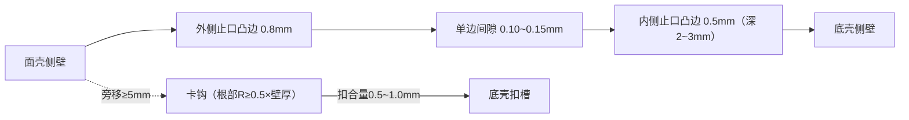

# 塑料外壳止口与扣位：间隙参数与三个翻车案例

> [!summary] 一句话概述
> 面壳与底壳之间用「止口」做精定位、用「扣位」做受力连接：东莞赫兹工业设计的结构工程师给出止口单边间隙 0.10–0.15 mm、扣位根部 R ≥ 0.5 倍壁厚等经验值，并用三个真实翻车（R 角太小断扣、忽略蠕变扣不紧、扣位间距过大中间鼓缝）说明每个参数的来历；B 站「鸿图教育」专栏补充了止口方向、面刮/底刮和模具侧（滑块/斜顶）的约束。

> [!note] 与已收录案例的区别
> [[卡扣三种基本形式：悬臂、环形、扭转]] 只讲卡扣的原理分类；本篇讲的是**整机外壳合壳**时止口 + 扣位的配合关系、配缝外观和模具约束，并给出带数字的经验值与失败案例。

## 配图

![[附件/shell-lip-face-bottom-step.jpg]]
*图源：B 站专栏「塑胶产品结构设计-止口与扣位的设计」（鸿图教育）；面刮与底刮示意（面刮 < 0.15，底刮 < 0.10）*

![[附件/shell-lip-parting-line.jpg]]
*图源：同上；美工线位置：下盖空间足够时美工线设在上盖，下盖空间很小时设在下盖*

> 图片版权归原作者所有，仅作个人学习收藏；出处见文末「来源与核实记录」。

## 结构原理

> 本节数字只写来源里给出的；来源没有就写「来源未给出」。下列数值均为文章作者的经验值。

### 堆叠方案

方向：**合壳截面，从外到内**（面壳与底壳在侧壁结合处）

| 层级 | 零件/特征 | 材料 | 厚度/尺寸 | 固定方式 | 依据 |
| --- | --- | --- | --- | --- | --- |
| L1（外） | 外侧止口凸边（侧壁强度大的一侧放里边，另一侧在外） | 塑料 | 外边止口凸边厚 0.8 mm | 与对侧止口嵌合 | B 站 1.2 第 3、4 条 |
| L2 | 止口配合间隙 | — | 单边 0.10–0.15 mm（ABS/PC 取 0.12，PP 取 0.15）；B 站图示 B1 = 0.075–0.10 mm、B2 = 0.20 mm | — | 赫兹 二-1；B 站 1.2 第 4 条 |
| L3 | 内侧止口凸边 | 塑料 | 里边止口凸边厚 0.5 mm；止口深度 2.0–3.0 mm | 嵌合 | B 站 1.2；赫兹 二-2 |
| L4（内） | 扣位（卡钩 + 扣槽），放在止口旁边 ≥ 5 mm | 塑料 | 卡钩厚 0.5–0.6 倍壁厚；扣合量 0.5–1.0 mm | 弹性卡合 | 赫兹 四、五 |

剖面示意：

### 零件清单

| 零件/特征 | 数量 | 功能 | 材料 | 依据 |
| --- | --- | --- | --- | --- |
| 止口（凸边 + 槽） | 沿整圈合壳线 | 精定位、防窜动、防透光、阻隔灰尘/静电 | 同壳体 | 赫兹 二；B 站 1.1 |
| 卡钩/扣位 | 间距 ≤ 80 mm（建议 50–60 mm） | 合壳受力连接 | 同壳体 | 赫兹 四 |
| 美工线 | 0.50 × 0.50 mm（可选） | 掩饰配缝段差 | — | B 站 1.2 第 5 条 |
| 螺丝柱 | 来源未给出 | 与扣位分担受力 | — | 赫兹 五-第三 |
| 导入 C 角 | 止口前端 | 长止口装配导向 | — | 赫兹 五-第二（0.5×45°） |

### 装配顺序

1. 对准止口：200 mm 以上的长止口靠前端 0.5×45° C 角导入。
2. 沿止口压合面壳与底壳，止口嵌合面有脱模斜度和端部倒角，便于滑入。
3. 卡钩越过扣槽导入面后弹回，扣合量 0.5–1.0 mm 形成保持力。
4. 若有螺丝柱，再锁螺丝，螺丝柱分担扣位应力。

> 来源未给出完整装配工序，以上按文章描述的结构关系整理。

### 受力与运动分析

- **受力路径**：分离力由卡钩根部弯曲承担（根部最易应力集中）；止口只负责定位，不应受扣位变形牵连，因此两者不要放在同一断面。
- **运动关系**：装配时卡钩悬臂弹性弯曲；装好后静态，止口限制面内窜动。
- **失效风险**（来源给出的三个翻车案例）：
  1. 卡钩根部 R0.2 mm（壁厚 2.0 mm）→ 第 30 次扣合从根部断裂；改为 R ≥ 1.0 mm 后扣 500 次完好。
  2. 目标装拆力 30–50 N，只按理论变形量计算、没算材料蠕变 → T0 实测只有 12 N；作者建议初始设计力取目标值的 1.5–2 倍。
  3. 约 200×60×30 mm 长条产品只在四角放扣位 → 装配后中间鼓缝；解决办法是长边中间补一对扣位或止口骨位，扣位间距 ≤ 80 mm。

## 设计要点与参数

| 要点 | 内容 | 依据 |
| --- | --- | --- |
| 止口单边间隙 | 0.10–0.15 mm；0.08 以下易卡死、0.20 以上透光；ABS/PC 取 0.12，PP 取 0.15 | 赫兹 二-1 |
| 止口深度 | 2.0–3.0 mm；50 mm 内小件 1.5 mm、100–200 mm 件 2.5 mm、300 mm 以上 3.0 mm 起 | 赫兹 二-2 |
| 止口脱模斜度 | 单边 1°–2°（作者案例：深 3 mm 给 0.5° 被顶变形，改 1.5° 解决）；B 站写嵌合面 > 3–5° | 赫兹 二-3；B 站 1.2 第 1 条 |
| 止口凸边厚 | 外边 0.8 mm，里边 0.5 mm | B 站 1.2 第 4 条 |
| 段差 | 可接受面刮 < 0.15 mm、底刮 < 0.10 mm，尽量面壳大于底壳 | B 站 1.3 |
| 卡钩根部 R | ≥ 壁厚 × 0.5（最小 0.5 mm，建议 1.0 mm 以上） | 赫兹 四 |
| 卡钩悬臂长 / 厚 | 8–15 mm；厚 0.5–0.6 倍壁厚 | 赫兹 四 |
| 扣合量 | 0.5–1.0 mm | 赫兹 四 |
| 扣位间距 | ≤ 80 mm，建议 50–60 mm；转角处扣位尽量靠近转角 | 赫兹 四；B 站 2.1 |
| 卡钩侧面脱模斜度 | 单边 0.5°–1° | 赫兹 四 |
| 模具侧 | 朝壳体内部的卡扣，斜销（斜顶）运动空间 ≥ 5 mm；上盖卡钩常走滑块、下盖走斜顶 | B 站 2.1、2.2 |
| 止口与扣位位置关系 | 不放同一断面，扣位离止口 5 mm 以上；扣位靠近螺丝柱 | 赫兹 五 |

> 两篇来源的脱模斜度取值不同（1°–2° vs > 3–5°），说明这类经验值与产品尺寸、外观要求有关，使用前需按自己的模厂和材料验证。

## 优缺点

**优点**
- 止口一圈同时解决定位、防透光、防尘，结构简单不加零件
- 扣位免螺丝、装配快，参数化后可直接套用

**缺点 / 代价**
- 间隙、扣合量都在 0.1 mm 量级，受缩水率波动影响大，常需 T0 后修模
- 扣位带来倒扣，需要滑块/斜顶，增加模具成本；材料蠕变会让保持力随时间衰减

## 可借鉴点

- 设计检查清单：止口单边间隙、止口深度与斜度、卡钩根部 R、扣合量、扣位间距、止口与扣位是否同断面
- 保持力按目标值 1.5–2 倍设计，预留蠕变衰减
- 长条形产品先画扣位分布，间距超过 80 mm 就补结构
- 让面壳略大于底壳（面刮），段差更易接受

## 相关案例

- [[卡扣三种基本形式：悬臂、环形、扭转]]
- [[注塑倒扣脱模：强脱、斜顶还是滑块]]
- [[塑料件加强筋设计：厚度、高度与间距比例]]
- [[PS5 免工具侧板与 DualSense 隐藏螺丝]]
- 分类索引：[[01-壳体与外观件 索引]]

## 来源与核实记录

- 主来源：[止口和扣位设计实战——三个翻车案例总结的结构设计经验数据](https://www.hezidesign.com/gongyi/963.html)（2026-07-03，邓铮，东莞市赫兹工业设计有限公司官网文章）
- 补充来源：[塑胶产品结构设计-止口与扣位的设计](https://www.bilibili.com/read/cv8988013)（B 站专栏，2020-12-25，鸿图教育）
- 核实：2026-11-13 打开两篇原文，逐条核对止口/扣位参数与三个翻车案例的数字；配图取自 B 站专栏。注意赫兹文章为设计公司营销性质的经验分享，数值未附测试数据。
