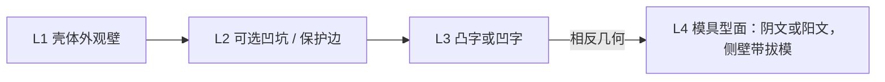

# 壳体凸字与凹字LOGO：字高、笔画宽和凸凹拔模的差异

> [!summary] 一句话概述
> 注塑壳体上的品牌、型号和法规文字，是做在表面上的微型凸起或凹陷，必须按成型特征来设计：要有最小字高和笔画宽，也要给字母侧壁留拔模。首饰模具建议凸字高 0.15–0.30 mm、凹字深 0.15–0.25 mm，笔画宽不小于 0.25 mm；CN Mould 把凸字高度下限写成至少 0.2 mm，并建议文字拔模大于 10°；Koreben 则给出另一组更偏「可读性」的数字，以及凸字与凹字不同的拔模。它和 [[咬花（晒纹）与拔模角：每 0.025 mm 纹深加 1°]] 都涉及表面和斜度，但本篇是成型文字和标识的几何，不是皮纹本身。

## 配图

![[附件/firstmold-raised-text-in-recess.jpg]]
*图源：[首饰模具《塑料产品结构设计完全指南》](https://firstmold.com/zh/tips/structural-design-of-plastic-products/)「文字与图案」节插图；在壳体表面先做一个凹陷区域（Grooves），再在凹坑里做出凸起文字（Texts）。这样外观面没有高出周边的笔画，模具上对应的是凹坑里的阴文，便于加工*

![[附件/firstmold-text-stroke-spacing.jpg]]
*图源：同上「文字大小规格」插图；A 为笔画宽度，建议不小于 0.25 mm；B 为两字间距，建议不小于 0.40 mm；C、D 为文字到边缘的距离，建议不小于 0.60 mm*

![[附件/cnmould-text-section.jpg]]
*图源：[CN Mould & Plastic《Designing Textures, Text, and Symbols on Plastic Parts》](https://www.cnmouldplastic.com/designing-textures-text-and-symbols-on-plastic-parts.html) Figure 1-1；三种做法的剖面：a 为零件上凸起的文字（高 0.2），b 为在凸台上再做凸字（高 0.2），c 为先凹下 0.5 再在凹坑里做高 0.2 的字，相当于周围有高出字体的保护边*

> 图片版权归原作者所有，仅作个人学习收藏；出处见文末「来源与核实记录」。

## 结构原理

> 本节所有数字只写来源里给出的；来源没有就写「来源未给出」。

### 堆叠方案

方向：**从壳体外观面到模具上与文字相反的型面**

成型文字不是印刷，是模具型面的微型几何。零件上要凸字，模具上就要凹下去；零件上要凹字，模具上就要凸出来（CN Mould）。因此「好不好做」往往先取决于模具那一侧：首饰模具认为零件上用凸字、让文字凹进模具，模具更好加工；C&J 和 Koreben 则从使用和耐磨出发，更推荐外观面用凹字。

一个常见折中（首饰模具、CN Mould 图 1-1c）是：在需要「表面不能再高出一截」的位置，先做一个凹陷区，再在凹坑里做凸字。外观摸上去不刮手，模具上仍然是凹坑加阴文，比较好加工。

| 层级 | 零件 / 型面 | 材料 | 厚度/尺寸 | 固定方式 | 依据 |
| --- | --- | --- | --- | --- | --- |
| L1 | 壳体外观壁 | 注塑塑料 | 主壁厚度来源在本篇未作为文字规则给出 | 与文字一体成型 | 各来源 |
| L2 | 可选的凹陷区（保护边） | 与壳体同材 | CN Mould：包围文字的边应至少比字体高 0.3 mm；图 1-1c 示例为凹下 0.5、字高 0.2 | 一体 | CN Mould；首饰模具插图 |
| L3 | 凸字或凹字本身 | 与壳体同材 | 见下方高度 / 深度 / 笔画表；字母侧壁必须有拔模 | 一体 | 首饰模具；CN Mould；Koreben；C&J |
| L4 | 模具上的相反几何 | 模具钢，牌号来源未给出 | 零件凸字 → 模具阴文；零件凹字 → 模具阳文 | 蚀刻或机加到型面里 | 首饰模具；CN Mould |

剖面示意：

### 零件清单

| 零件 | 数量 | 功能 | 材料 | 依据 |
| --- | --- | --- | --- | --- |
| 壳体主壁 | 1 | 承载标识的表面 | 注塑塑料 | 各来源 |
| 凸字或凹字 | 按标识内容 | 品牌、编号、法规标记 | 与壳体一体 | 首饰模具；Koreben |
| 凹坑 / 保护边（可选） | 按需 | 让字不高出外观面，或保护笔画不被磨 | 与壳体一体 | 首饰模具；CN Mould |
| 模具文字型面 | 与标识对应 | 成型并决定能否脱模、能否保持棱边 | 模具钢 | CN Mould；Koreben |

### 装配顺序

文字与壳体一体注塑，没有单独装配。对应的是设计与模具加工顺序（按来源整理，不是拆解反推）：

1. 先决定标识做在外观面还是内表面，以及用凸字、凹字，还是「凹坑里的凸字」。
2. 按来源校核字高 / 字深、笔画宽、字距和到边缘的距离，避免把 CAD 里看起来清楚、实际只有 0.5 mm 高的字直接交给模具（Koreben 原文提醒过这一点）。
3. 给每个笔画的侧壁加拔模。凸字和凹字的斜度要求不同（见参数表），咬花面上还要再加大斜度。
4. 把文字方向对准开模方向，避免只为了一个 LOGO 增加滑块或斜顶（CN Mould：「The Golden Rule: Design for Ejection」）。
5. 小字、细图案多用模具蚀刻，稍大的文字可以直接在模具上加工（首饰模具）。

### 受力与运动分析

- **受力路径**：标识本身通常不承力。使用中主要是磨损、刮擦和顶出时的摩擦力。Koreben 因此更推荐凹字：更耐磨损、更不容易被碰坏。CN Mould 则指出，模具上凸出来的阳文（对应零件凹字）在清理和维护时更容易被碰伤，而且更依赖拔模才能脱模。
- **运动关系**：成型后文字与壳体无相对运动；唯一的「运动」是顶出时字母侧壁相对模具型面滑动，所以没有拔模就会拉伤、咬死或把细笔画拔钝（Koreben、CN Mould）。
- **失效风险**：笔画太细、字太小会充不满、棱边变圆、难以阅读（Koreben、首饰模具）。C&J 把「凸字高度 1 mm」列为常见错误：模具难加工，也容易积污。咬花太深会把浅字淹没，必须加大字深和字号（Koreben）。

## 设计要点与参数

四家机构的数字并不相同，下表分开写，不合成「统一标准」。

| 要点 | 内容 | 依据 |
| --- | --- | --- |
| 凸字高度 | 首饰模具：一般 0.15–0.30 mm。CN Mould：零件上凸字高度应至少 0.2 mm。Koreben：推荐 0.25–0.40 mm，最大建议 0.50 mm。C&J：凸字深度（此处指高度）≤0.5 mm，并反对做成 1 mm | 各来源原文 |
| 凹字深度 | 首饰模具：0.15–0.25 mm。Koreben：推荐 0.25–0.50 mm，实际可用上限 0.75 mm。C&J：凹字深度 ≥0.3 mm，外观面最佳实务为 0.3–0.5 mm 深 | 各来源原文 |
| 笔画宽 | 首饰模具：A 不小于 0.25 mm。CN Mould：一般不小于 0.3 mm，常建议 0.8 mm 以便阅读和保证模具强度 | 首饰模具；CN Mould |
| 字距与边距 | 首饰模具：字距 B≥0.40 mm，到边缘 C、D≥0.60 mm。CN Mould：如字母「H」两竖之间的间距应至少 0.4 mm | 首饰模具；CN Mould |
| 字高（字符高度） | Koreben：≥2.5 mm，较好为 3.0–5.0 mm；笔画宽 ≥0.40 mm，较好 ≥0.60 mm。其他三家未给出这一档字符高度 | Koreben |
| 拔模（差异最大） | Koreben：凸字每侧 0.5°–1°，凹字每侧 1°–3°，咬花面还要再加斜度。CN Mould：文字和符号建议拔模大于 10°，以保证干净脱模、不被拖伤 | Koreben；CN Mould |
| 保护边 | 若用边框包围文字，边框应至少比字体高 0.3 mm | CN Mould |
| 优先方向 | 首饰模具：优先零件凸字（模具阴文），好加工；若不许高出表面，就在凹坑里做凸字。C&J / Koreben：外观面更倾向凹字，耐磨损、不易积污 | 首饰模具；C&J；Koreben |
| 字体 | Koreben 建议用 Arial、Helvetica、Verdana、Univers 这类等线、笔画均匀的字体，避免装饰体、细衬线和尖内角 | Koreben |
| 与咬花的关系 | Koreben：重皮纹（MT/VDI）上要加大字深和字号；抛光面（SPI-A）才适合细字。这是「字要在纹上面还能被看见」，不是按纹深去加壳体主拔模 | Koreben |

## 优缺点

**优点**
- 标识与壳体一体，不需要丝印、铭牌或贴标，也不会在使用中单独脱落
- 凹坑里做凸字，可以同时照顾「表面不要凸包」和「模具比较好加工」（首饰模具、CN Mould）

**缺点 / 代价**
- 过细、过小的字会充不满，修模和蚀刻成本不成比例地升高（Koreben）
- 零件凹字对应模具阳文，模具维护时更容易碰伤（CN Mould）
- 各家对高度和拔模的建议相差很大（0.15 mm 到 0.50 mm，0.5° 到大于 10°），必须在图上写明采用哪一套，并和模具厂确认加工方式

## 可借鉴点

- 先选凸、凹还是「凹坑里的凸字」，再填高度 / 深度，不要在 CAD 里随便拉伸 1 mm 高的立体字
- 笔画宽先按 ≥0.25 mm（首饰模具）或 ≥0.3 mm（CN Mould）检查；要稳定可读，CN Mould 建议到 0.8 mm
- 字距 ≥0.40 mm，到边缘 ≥0.60 mm（首饰模具）
- 拔模不要照搬壳体主壁的斜度：凸字和凹字不同；若按 CN Mould，文字本身可能需要大于 10°。与模具厂确认加工方式后再锁定
- 咬花面上的字要加大、加深，不要只加壳体拔模就认为字一定清楚
- 文字方向必须平行开模方向，避免为 LOGO 单独做侧抽

## 与库中相似案例对比

| 对比项 | 本案例 | [[咬花（晒纹）与拔模角：每 0.025 mm 纹深加 1°]] | [[免喷涂材料 vs 喷涂：成本、良率与三条硬边界]] |
| --- | --- | --- | --- |
| 对象 | 成型文字、LOGO、编号的微型几何 | 皮纹本身，以及为脱模给主壁加的斜度 | 外观颜色和表面处理路线 |
| 关键尺寸 | 字高 / 字深、笔画宽、字距、凸字与凹字各自的拔模 | 按纹深增加的拔模角 | 喷涂与免喷涂的成本、良率边界 |
| 模具对应 | 凸字 = 模具阴文，凹字 = 模具阳文 | 纹路蚀刻在型腔表面 | 不决定文字几何 |
| 何时用这篇 | 壳体上要做一体成型的字或标识 | 要选皮纹、并按纹深加主壁拔模 | 在选涂料或免喷涂料 |

## 相关案例

- [[咬花（晒纹）与拔模角：每 0.025 mm 纹深加 1°]]
- [[免喷涂材料 vs 喷涂：成本、良率与三条硬边界]]
- [[塑料外壳止口与扣位：间隙参数与三个翻车案例]]
- 分类索引：[[01-壳体与外观件 索引]]

## 来源与核实记录

- 主来源：[首饰模具《塑料产品结构设计完全指南》](https://firstmold.com/zh/tips/structural-design-of-plastic-products/)（2023-05-23 出版，2026-11-06 最后修改，作者 James Li，FirstMold / 首饰模具。已打开中文「文字与图案」节，核对凸字 0.15–0.30 mm、凹字 0.15–0.25 mm、笔画宽 / 字距 / 边距，以及凹坑里做凸字的插图）
- 补充来源 1：[CN Mould & Plastic《Designing Textures, Text, and Symbols on Plastic Parts》](https://www.cnmouldplastic.com/designing-textures-text-and-symbols-on-plastic-parts.html)（已打开英文正文和图 1-1，核对 0.2 mm 高度下限、笔画 0.3 mm / 建议 0.8 mm、间距 0.4 mm、保护边高 0.3 mm、拔模大于 10°。独立机构）
- 补充来源 2：[Koreben《Molded Text Design Guidelines for Injection Molding》](https://koreben.com/zh/molded-text-design-guidelines/)（已打开；页面路径含 /zh/，正文为英文。核对凸字 / 凹字高度或深度、字符高度 ≥2.5 mm，以及凸字 0.5°–1°、凹字 1°–3° 的拔模差。独立机构）
- 补充来源 3：[C&J《塑膠產品設計 DFM 檢查清單》第 5.3 节「文字/LOGO 方向」](https://cnj.tw/Article/PlasticProductDFMChecklist/)（已打开繁体中文正文：凸字高度 ≤0.5 mm，凹字深度 ≥0.3 mm，外观面推荐凹字 0.3–0.5 mm 深。独立机构。该页封面配图是车间清单示意，不是文字剖面，故未用作结构插图）
- 核实：2026-11-22 实际打开上述四页。未把咬花「按纹深加 1°」的主壁拔模规则写成文字规则。四家高度和拔模数字保留原文差异，未平均、未取整合并。
