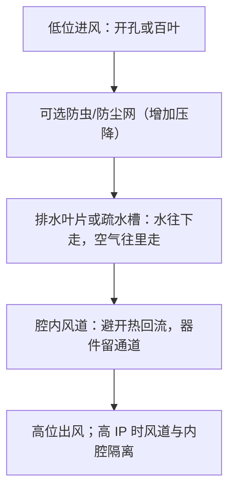

# 外壳散热通风口与防雨百叶：开孔率、进出风与滴水路径

> [!summary] 一句话概述
> 产品外壳要散热又要挡雨，关键不是把孔开得看起来很多，而是空气真正能走的「自由面积」、进风与出风不要短路，以及叶片或疏水槽把水引走。几何开孔率不等于自由面积：AMCA 把自由面积定义为空气能通过的最小截面，还要扣掉叶片投影重叠；永锢给铝壳的进风孔、上下进出和 IP 分层，是面向工控盒、户外机柜这类产品外壳的做法，不能把大楼百叶的尺寸直接抄到消费电子上。

## 配图

![[附件/amca-louver-free-area-definition.png]]
*图源：[亚洲 AMCA 网络研讨会：通风百叶的性能与选择](https://www.amca.org/assets/resources/public/assets/uploads/AsiaAMCA-Webinar-Louver_Performance_n_Selection-ZH.pdf) 第 14 页（2021-08-06）；上半页区分「通风面积 / free area」与「开口率 / opening area」，下半页给出 Af = L(A+B+n×C) 及 A、B、C 的几何定义*

![[附件/amca-louver-blade-types.png]]
*图源：同上第 10 页；固定式 / 可调式 / 组合式，以及通道型、内外翼缘、幕墙型框；叶片分非排水 J 型、K 型和带集水的排水型*

![[附件/amca-louver-insect-screen-effect.jpg]]
*图源：同上第 17 页；AMCA 501-2017 对同一百叶加减防虫网、防鸟网的对比：1.4×1.4 防虫网使透水量降 30.2%，压降也变化。讲义写明百叶性能测试时不装丝网*

> 图片版权归原作者所有，仅作个人学习收藏；出处见文末「来源与核实记录」。

## 结构原理

> 永锢文面向铝外壳产品，给出一套厂商自己的开孔与风道规则，其中风量公式写明是「工程简化版」，本篇只原样记录，不推算、不改写成标准公式。AMCA 讲义面向建筑通风百叶，用来把「自由面积、排水叶片、丝网压降」这几个概念说清楚，并划定适用边界。

### 堆叠方案

方向：**从室外到壳内热源（产品外壳常见做法，据永锢；百叶几何据 AMCA）**

| 层级 | 零件 | 材料 | 厚度/尺寸 | 固定方式 | 依据 |
| --- | --- | --- | --- | --- | --- |
| L1 | 进风口（低位：底部或侧面低处） | 铝壳开孔或百叶 | 永锢建议单孔直径 3–8 mm，开孔率 30%–50%；工业场景再加防尘网/防水百叶。这是该文建议，不是 AMCA 尺寸 | 与壳体一体或加网 | 永锢 2.1 |
| L2 | 防虫网 / 防尘网（可选） | 丝网 | AMCA 举例：防虫网 1.4×1.4（讲义表，单位按原表）；并明确丝网会改变透水、风量和压降。永锢写 IP54 用防尘网+疏水槽 | 装在开孔内侧或百叶后 | AMCA 第 17 页；永锢 2.5 |
| L3 | 百叶或疏水导流（户外） | 叶片截面可以是 J、K 或排水型（AMCA） | 自由面积按叶片之间的最小间距计算，不是把孔的投影面积简单相加 | 固定在开口上 | AMCA 分类与自由面积定义 |
| L4 | 风道腔体 | 壳体内部通道 | 永锢：优先直线，必须弯折时用 R≥5 mm 圆角；器件与壳/筋留 2–5 mm 气流通道 | 腔体与隔板 | 永锢 2.3 |
| L5 | 出风口（高位：顶部或侧面高处） | 开孔、斜百叶+防水棉，或独立风道 | 永锢：IP54 以上用斜百叶+防水棉；IP65 用独立密封风道+防水透气阀，风道与内腔隔离。进风口不要正对出风口 | 与壳体一体 | 永锢 2.2、2.5 |
| L6 | 散热筋（若为挤出铝壳） | 6063（挤出）/ 6061（CNC） | 永锢：自然对流筋距 3–8 mm、筋高 15–30 mm，沿气流平行；强制风冷筋距 2–5 mm、筋高 10–20 mm | 一体挤出或机加 | 永锢 2.4、6.1 |

剖面示意：

AMCA 的关键定义（讲义第 14 页原文概念）：

- **通风面积 / 过流面积（free area）Af**：空气通过百叶的最小面积。Af = L(A+B+n×C)
  - A：顶框与最上面叶片的最小距离
  - B：底框与最下面叶片的最小距离
  - C：相邻叶片之间的最小距离
  - n：中间叶片间隔数
  - L：两边框之间的最小距离
- **通风面积百分比** βf = Af / (W×H)，W、H 为百叶实际宽、高
- 讲义把「通风面积百分比（percent of free area）」和「开口率（percent of opening area）」并列写出，强调国内若只提一个「通风面积百分比」而且算法不统一，会出现选错。几何上看到的开口，不等于扣除叶片投影重叠后的自由面积。

### 零件清单

| 零件 | 数量 | 功能 | 材料 | 依据 |
| --- | --- | --- | --- | --- |
| 进风开孔或进风百叶 | 按风量布置 | 进气，位置靠下、远离出风口 | 壳体材料 | 永锢 |
| 出风开孔或出风百叶 | 按风量布置 | 排气，位置靠上 | 壳体材料 | 永锢 |
| 防尘/防虫网 | 按需 | 挡虫挡尘，但会改变压降和透水 | 丝网 | AMCA；永锢 |
| 疏水槽 / 排水型叶片 | 户外或防雨场合 | 把水导到外侧，避免灌进腔体 | 与百叶或壳体一体 | AMCA 排水型叶片；永锢疏水槽 |
| 独立风道 + 透气阀 | 高 IP 方案 | 散热风道与密封内腔分开 | 来源未给出阀型号 | 永锢 IP65/66 方案 |
| 散热筋 | 按挤出或机加 | 扩大换热面 | 6063/6061 | 永锢 |

### 装配顺序

面向产品外壳的设计顺序（综合两源，不把建筑选型步骤直接当成消费电子流程）：

1. 先分清目标：是自然对流还是强制风冷，要不要防雨、要不要防虫网，IP 等级是否要求内腔全密封。
2. 布置进、出风：下进上出，错开防止热风回流（永锢把「进出风正对」列为常见翻车）。
3. 计算或校核的是**自由面积/通风面积**，不是把孔的外形面积加起来；若加丝网，要把丝网对压降和透水的影响算进去（AMCA）。
4. 户外开口采用排水叶片或疏水槽，底部留滴水路径，不要在水平面上开「只会积水」的孔。
5. 高 IP 时用独立风道，让冷却空气不进密封腔，内腔另做压力平衡（永锢；与已收录的透气膜案例是同一问题的不同开口）。
6. 用热成像和进出风风速做实物验证（永锢列出的测试项）；建筑百叶则按压降曲线和防雨等级选型（AMCA），两套试验不要混用。

### 受力与运动分析

- **气流路径**：热空气上浮，自然对流靠烟囱效应；永锢还建议自然对流风道高度:宽度 ≥ 3:1，并竖直安装。强制风冷时，风道弯折和密筋会加大风阻，该文建议风阻大时选高风压风扇。
- **水的路径**：排水型叶片带集水槽，侧框带排水槽（AMCA）。产品外壳上的斜百叶、疏水槽应把溅水导到壳外，而不是让它沿孔壁爬进腔体。
- **丝网的代价**：AMCA 表中，加 1.4×1.4 防虫网后，每平米透水量降低 30.2%，压降降低 16.0%（原表在该次测试条件下；讲义同时写丝网对通风性能不利，测试标准百叶时不装网）。设计产品外壳时，防尘网会改变你真正得到的风量和防雨表现，不能只按光孔开孔率验收。
- **失效风险**：进出风短路；筋过密或直角弯导致风量不足；开孔直接打进密封腔破坏 IP；胶圈老化漏水（永锢避坑清单）。

## 设计要点与参数

| 要点 | 内容 | 依据 |
| --- | --- | --- |
| 自由面积 ≠ 几何开孔率 | 自由面积是气流最小截面，按叶片间最小间距算；开口率是另一项。不要只用「看起来开了多少孔」 | AMCA 第 14 页 |
| 自由面积公式（建筑百叶） | Af = L(A+B+n×C)，βf = Af/(W×H)；A/B/C/L 定义见上。这是讲义中的百叶算法，不能直接拿消费电子小孔阵的 d、p 去套这套 A、B、C | AMCA |
| 永锢进风建议（产品铝壳） | 单孔直径 3–8 mm，开孔率 30%–50%；矩阵错位，避免挡住 PCB | 永锢 2.1。厂商建议，不是 AMCA 标准 |
| 进出风面积比（永锢） | 进风口 ≥ 出风口 × 1.2，避免出风成为瓶颈 | 永锢 1.2 |
| 永锢风量简化式 | 强制风冷 Q = 0.05×P/ΔT（Q：m³/min，P：功耗 W，ΔT：温升 ℃）；风道截面积 S ≥ Q/(V×60)，自然对流 V 取 0.1–0.3 m/s，强制 1–3 m/s。原文写明「工程简化版」，本篇不验证、不改写 | 永锢 1.2 |
| 散热方式分界（永锢） | 该文以 P≤30 W 倾向自然对流，P＞30 W 倾向强制风冷；工业允许温升 ≤40 ℃，消费级 ≤50 ℃。均为该文经验分界 | 永锢 1.2 |
| 筋与间隙（永锢） | 见堆叠表；器件与壳留 2–5 mm 通道；禁止进出风正对 | 永锢 |
| IP 分层（永锢） | IP54：防尘网+疏水槽；IP65/66：独立密封风道，内腔全密封，另配防水透气阀 | 永锢 2.5 |
| 丝网影响（AMCA） | 1.4×1.4 防虫网：透水量 −30.2%，透水测试风量 −1.0%，压降 −16.0%（讲义表，该次试验）；12.5×12.5 防鸟网、19×16 菱形防鸟网数据见原表 | AMCA 第 17 页 |
| 通风系数分级（AMCA，建筑百叶） | 讲义以通风系数 CD 分级，例如 CD≥0.4 为 4 级；并对照 AMCA Discharge Loss Coefficient 的 1–4 类。用于建筑百叶选型，不是产品壳开孔等级 | AMCA 第 13 页 |
| 适用边界 | AMCA 明确：标准针对建筑用通风百叶，不适用于室内装饰百叶、室外遮阳百叶等非通风百叶。更不要把讲义例题里的 1 m 级百叶尺寸写成手机或小型工控盒参数 | AMCA；本篇注释 |

## 优缺点

**优点**
- 把「看起来的开孔」和「真正能过风的面积」分开，选型不容易被外观百分比骗到
- 下进上出 + 排水路径，可以同时散热和挡雨
- 高 IP 用独立风道，不必在密封腔上直接开孔

**缺点 / 代价**
- 防尘网、防虫网会改压降和透水，要按带网状态验收
- 自由面积计算依赖最小间距，叶片一重叠，有效面积比开孔率小一截
- 永锢的简化风量公式没有在 AMCA 讲义里出现，跨项目套用风险要自己评估
- 建筑百叶的试验方法和尺寸不能照搬到小型产品外壳

## 可借鉴点

- **先问自由面积，再问开孔率**：有叶片、有网、有重叠时，用最小气流截面，不要用外形开孔百分比交差
- **进风在下、出风在上，并且错开**：防止热风回流；进风还要略大于出风（永锢的 1.2 倍是该厂商规则）
- **给水留出路**：排水叶片或壳上疏水槽，底部可滴水，不要在平面上开坑
- **高防水不要在腔体上直接打散热孔**：独立风道 + 内腔透气阀
- **加了防尘网就要重新看风量和防雨**，AMCA 的丝网对照表说明「光孔测试」和「带网使用」不是同一件事
- 本篇是外壳通风。若开口同时还要电磁屏蔽，看蜂窝波导通风板那一篇，不要把防雨百叶当成屏蔽件

## 与库中相似案例对比

| 对比项 | 本案例（外壳通风与防雨百叶） | [[注塑喇叭网罩：开孔率、孔径孔距与脱模]] | [[GORE 防水透气膜：压力平衡与粘贴式透气阀的安装参数]] | [[EMI 蜂窝波导通风板：孔径、深度与截止频率]] |
| --- | --- | --- | --- | --- |
| 目标 | 散热通风 + 防雨/防尘 | 透声 + 外观 + 可注塑 | 压差平衡 + 挡液态水 | 通风 + 电磁屏蔽 |
| 「开孔率」含义 | 须区分几何开孔率与自由面积 | 圆孔公式直接算开孔率 | 多个 1 mm 孔，看透气量 | 蜂窝开孔率高，但靠截止波导衰减电磁波 |
| 适用对象 | 工控盒、户外机柜、充电桩等外壳；AMCA 仅借概念 | 消费电子外观网 | 密封外壳呼吸 | 需要 EMC 的通风口 |

## 相关案例

- [[注塑喇叭网罩：开孔率、孔径孔距与脱模]]
- [[GORE 防水透气膜：压力平衡与粘贴式透气阀的安装参数]]
- [[EMI 蜂窝波导通风板：孔径、深度与截止频率]]
- 分类索引：[[01-壳体与外观件 索引]]

## 来源与核实记录

- 主来源（中文）：[铝外壳散热风道设计完全指南](https://www.yonggubox.com/cn/new/new-97-605.html)（永锢，页面标注 2026-04-07）——产品铝壳的进出风布置、开孔建议、IP 分层和该厂商简化公式
- 独立第二来源：[亚洲 AMCA 网络研讨会：通风百叶的性能与选择](https://www.amca.org/assets/resources/public/assets/uploads/AsiaAMCA-Webinar-Louver_Performance_n_Selection-ZH.pdf)（Asia AMCA，2021-08-06，42 页中文讲义）——自由面积定义与公式、排水叶片、丝网影响、通风系数。讲义声明内容为教育用途，观点不一定代表 AMCA International
- 核实：2026-11-17 打开永锢页面并下载 AMCA PDF 核对定义页与丝网表。未把建筑百叶例题中的外形尺寸写成产品外壳参数，也未把永锢简化公式当作标准公式。
