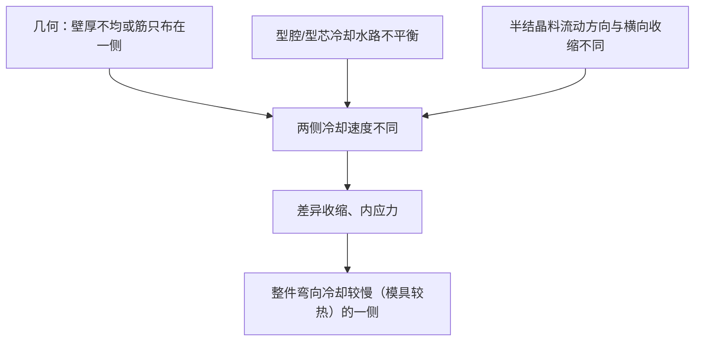

# 注塑件翘曲：壁厚不均与筋不对称使整件弯向冷却较慢的一侧

> [!summary] 一句话概述
> 注塑件翘曲是整件因冷却和收缩不对称而弯曲或扭转，不是厚壁背后那一点局部凹陷。维林把成因写成壁厚不均、加强筋布局不对称或冷却通道不均匀造成的差异收缩；RTP 要求避免壁厚变化过大，并「保持公称壁两侧加强筋的平衡，以免出现不均匀收缩，导致翘曲」。OriNovate 和 3D Systems 进一步指出：零件会弯向冷却较慢的一侧（也就是模具较热的一侧）。它和 [[注塑缩痕：厚壁背面凹陷、减胶坑与保压边界]] 常一起出现，但本篇的对象是整件变形。

## 配图

![[附件/rtp-rib-balance-warpage.jpg]]
*图源：[RTP《热塑性塑料注塑设计指南》中文版](https://www.rtpcompany.com/wp-content/uploads/RTP-Part-Design-Guidelines-for-Injection-Molded-Thermoplastics_CHS.pdf) 第 3 页；加强筋示意：筋最大厚度为公称壁的 0.5–0.75 倍、间距至少 2.5 倍壁厚、高度不大于三倍壁厚，两侧各至少 1/2° 脱模。正文明确要求「保持公称壁两侧加强筋的平衡，以免出现不均匀收缩，导致翘曲」——本篇要用的是这条对称约束，不是再抄一遍通用筋比例*

![[附件/rtp-wall-variation-warpage.jpg]]
*图源：同上第 2 页；上图是带筋、凸台和圆角的壳体示意，下图对比「不推荐」的壁厚突变与「推荐」的逐渐过渡。设计建议写明：避免壁厚变化过大以减少收缩差异、以免发生翘曲；壁厚变化应有过渡区，以减少应力集中、凹陷、空隙和翘曲的可能性*

> 图片版权归原作者所有，仅作个人学习收藏；出处见文末「来源与核实记录」。

## 结构原理

> 本节所有数字只写来源里给出的；来源没有就写「来源未给出」。

### 堆叠方案

方向：**从外观面到筋所在的内侧，再对照模具型腔 / 型芯两侧的冷却**

翘曲不是「再加一层零件」，而是同一塑件在冷却时两边收缩不一致，整件离开平面或扭转。维林的定义是：零件不同区域以不同速率冷却，导致差异收缩。壁厚不均、加强筋布局不对称或冷却通道不均匀都会导致翘曲；半结晶塑料在流动方向的收缩大于垂直于流动方向的收缩，会加剧这个问题。

OriNovate 把宏观机制写得更直：当壁面一侧冷却比另一侧快——原因可以是模面冷却水温差、不对称肋条或厚度阶差——零件会朝冷却较慢的一侧弯曲。3D Systems 缺陷表用另一套表述表达同一方向：水温不正确，部件朝向工具的热侧向内弯曲。

| 层级 | 零件 / 区域 | 材料 | 厚度/尺寸 | 固定方式 | 依据 |
| --- | --- | --- | --- | --- | --- |
| L1（外观壁） | 壳体或面板的主壁 | 热塑性塑料 | 维林：许多零件实用起始范围 1.2–3.0 mm；具体值依树脂而定 | 与筋、凸台一体注塑 | 维林「壁厚：从均匀性开始」 |
| L2 | 加强筋、局部厚薄和凸台 | 与塑件同材 | 不对称布置本身就会在冷却时翘曲（维林）；RTP 要求公称壁两侧筋平衡 | 一体成型 | 维林翘曲节；RTP 第 3 页 |
| L3 | 型腔 / 型芯两侧冷却 | 模具钢与冷却水路，来源未给出牌号 | 来源未给出水路直径；要求的是两侧平衡，而不是事后用保压「压平」 | 模具设计 | OriNovate；维林；3D Systems |

维林给过一个用来解释冷却差的例子：一处 2 mm、另一处 4 mm 时，厚截面冷却速度慢 40–50%。薄壁先固化，厚壁继续收缩，产生内应力，结果是翘曲、缩痕及负载下开裂。这是壁厚不均导致整件变形的路径，不是缩痕篇里「厚壁背面被抽凹」的局部坑。

剖面示意：

### 零件清单

| 零件 | 数量 | 功能 | 材料 | 依据 |
| --- | --- | --- | --- | --- |
| 塑件主壁 | 1 | 外观与基本刚度；壁厚均匀是抗翘曲的基础 | 热塑性塑料 | 维林；RTP |
| 加强筋 | 按结构需要 | 提高刚度；必须相对中性轴 / 公称壁两侧对称，否则冷却时固有地翘曲 | 与塑件同材 | 维林；OriNovate；RTP |
| 模具冷却水路 | 型腔、型芯两侧 | 让两侧冷却速度接近 | 来源未给出 | OriNovate；维林；3D Systems |
| 浇口 | 按方案 | OriNovate 把浇口对称列为几何对策之一；RTP 另外提醒：不要在壁厚变化较大的区域附近浇注 | 模具浇注系统 | OriNovate；RTP 第 2 页 |

### 装配顺序

本结构是单件注塑后的变形问题，没有多零件装配顺序。与「装配」对应的是开模前的几何和模具检查（按维林、OriNovate 整理，不是拆解反推）：

1. 先把主壁做成尽可能均匀的壁厚。维林：变化不可避免时要渐变，不要突变。
2. 加筋时在对面镜像布置，保持公称壁两侧平衡（维林、RTP、OriNovate）。
3. 检查模具两侧冷却水路是否平衡，避免一边热水、一边冷水（OriNovate、3D Systems）。
4. 再考虑浇口对称和材料选择。维林：翘曲至关重要时，考虑低收缩非晶材料（ABS、PC）或纤维填充牌号，而不是未填充的半结晶材料。
5. 工艺参数（保压、模温差）只能掩盖根本的几何问题，不能替代对称设计（OriNovate 原文）。

### 受力与运动分析

- **受力路径**：没有外加机构力。驱动力是冷却过程中的收缩差：先冷却、先定型的一侧会限制后冷却一侧继续收缩，整件被拉弯或扭转。厚区、有筋的一侧通常热容量更大、冷却更慢。
- **运动关系**：出模前塑件被型腔约束；出模后残余应力释放，变形会继续发展。来源没有给出「出模后还要翘多少小时」的数字。
- **失效风险**：装配面、止口和孔距超差；外观平面度不合格；受力时在应力集中处开裂（维林把「负载下开裂」和翘曲、缩痕写在同一结果里）。半结晶未填充料的各向异性收缩会让流动方向和横向再叠加一层翘曲（维林、RTP 术语页也讨论了各向异性收缩）。

## 设计要点与参数

| 要点 | 内容 | 依据 |
| --- | --- | --- |
| 翘曲定义 | 不同区域冷却速率不同导致差异收缩，表现为整件弯曲或扭转 | 维林「翘曲的成因」 |
| 三个几何 / 模具成因 | 壁厚不均、加强筋布局不对称、冷却通道不均匀 | 维林 |
| 弯曲方向 | 朝冷却较慢的一侧弯曲；3D Systems 写作朝向工具的热侧向内弯曲 | OriNovate；3D Systems 缺陷表「翘曲」 |
| 对称筋 | 如果在一侧加筋，应在对面镜像；不对称设计在冷却时固有地翘曲。RTP：保持公称壁两侧加强筋的平衡 | 维林；RTP 第 3 页；OriNovate |
| 冷却平衡 | 模具两面冷却水路要平衡；3D Systems 还把冷却时间过短、材料过热、工具周围没有冷却列为翘曲原因 | OriNovate；3D Systems |
| 壁厚不均的冷却差举例 | 2 mm 与 4 mm 相邻时，厚截面冷却速度慢 40–50% | 维林 |
| 壁厚变化 | RTP：避免变化过大，以免收缩差异导致翘曲；变化应有过渡区。维林另给出过渡距离等于厚度差×3（例如 2 mm→3 mm 需要 3 mm 渐变长度）——这条过渡规则是壁厚设计，不是本篇的主角，仅作交叉 | RTP 第 2 页；维林 |
| 材料 | 翘曲敏感时考虑 ABS、PC 等低收缩非晶料或纤维填充牌号，而不是未填充半结晶料 | 维林 |
| 工艺的位置 | 保压、模温差只能掩盖根本的几何问题 | OriNovate |
| 浇口 | OriNovate：浇口对称。RTP：避免在壁厚变化较大的区域附近浇注 | OriNovate；RTP 第 2 页 |

> 加强筋的 0.5–0.75 t、高度 ≤3 t、间距 ≥2.5 t 是 RTP 第 3 页的通用筋比例，库内已有 [[塑料件加强筋设计：厚度、高度与间距比例]]。本篇只借用该页上「两侧平衡，以免翘曲」这一条，不再把通用筋比例当作本篇要点。

## 优缺点

**优点**
- 先把壁厚和筋做成对称、把模具两侧冷却做平衡，比试模后靠保压和模温差「扳平」更稳定（OriNovate、维林）
- 翘曲方向（弯向热侧 / 慢冷侧）可以用来反查：哪一侧筋更多、哪一侧水路更热

**缺点 / 代价**
- 外观面往往不允许在背面「镜像」出同样的筋，对称布局有时要改结构或改分型
- 半结晶未填充料即使壁厚均匀，流动方向与横向收缩不同仍可能翘（维林）
- 只用工艺去掩盖不对称几何，换模具、换批次后变形可能回来（OriNovate）

## 可借鉴点

- 看到整件弯曲，先分清它是不是局部缩痕：缩痕是厚壁背后的坑，翘曲是平面度或对角线在走
- 检查三件事：壁厚是否一边厚一边薄、筋是否只布在一侧、型腔和型芯的冷却是否一边热一边冷
- 加筋时默认「对面镜像」；RTP 的说法是公称壁两侧都要平衡
- 弯曲方向应指向冷却较慢、模具较热的一侧，可用来反查水路和筋布局
- 材料方面，翘曲敏感时不要先选未填充半结晶料
- 不要指望加大保压把已经不对称的收缩压回去

## 与库中相似案例对比

| 对比项 | 本案例 | [[注塑缩痕：厚壁背面凹陷、减胶坑与保压边界]] | [[塑料件加强筋设计：厚度、高度与间距比例]] |
| --- | --- | --- | --- |
| 现象 | 整件弯曲、扭转、平面度超差 | 厚壁背面局部凹陷 | 筋的厚度、高度、间距本身 |
| 机制 | 两侧冷却 / 收缩不对称 | 厚区芯部补缩不足，表皮被抽凹 | 筋太厚会在背面留下缩痕，所以要削薄 |
| 对策主角 | 对称壁厚、对称筋、冷却平衡 | 减胶、筋壁比、保压窗口 | 0.4–0.6 t 等比例（不同来源数字不同） |
| 何时用这篇 | 零件「拱起来了」「对角在扭」 | 外观面出现一个坑 | 只是在定筋的截面比例 |

气体辅助和微发泡也可以减轻收缩差，但那是另一套工艺：[[气体辅助注塑（GAIM）：用气道掏空厚筋消缩痕]] 用气道掏空厚筋；微发泡用气泡生长代替保压，筋壁比甚至可以接近 1:1，见本批 MuCell 篇。本篇讨论的是实心注塑件在不对称几何下的整件翘曲。

## 相关案例

- [[注塑缩痕：厚壁背面凹陷、减胶坑与保压边界]]
- [[塑料件加强筋设计：厚度、高度与间距比例]]
- [[注塑熔接痕：位置由浇口定、深浅由前锋温差定]]
- [[发泡件缩水：模温、排气与保压和实心件相反]]
- 分类索引：[[01-壳体与外观件 索引]]

## 来源与核实记录

- 主来源：[维林《注塑成型设计指南：实用DFM规则》](https://weilinplastic.com/zh/注塑成型设计指南/)（更新于 2026 年 8 月，作者 Frank Lai，威林 / Weilin Plastic。已打开中文正文，核对「翘曲的成因」、2 mm/4 mm 冷却差 40–50%、对称筋位布局、材料选择。该页配图被站点验证页拦截，未能下载，故正文配图改用已打开的 RTP 手册插图）
- 补充来源 1：[RTP《热塑性塑料注塑设计指南》中文版](https://www.rtpcompany.com/wp-content/uploads/RTP-Part-Design-Guidelines-for-Injection-Molded-Thermoplastics_CHS.pdf)（RTP Company，8 页。已打开官方 PDF，文件大小与预下载副本一致，为 15 042 611 字节；核对第 2 页壁厚变化与翘曲、第 3 页「保持公称壁两侧加强筋的平衡，以免出现不均匀收缩，导致翘曲」）
- 补充来源 2：[OriNovate《射出成型壁厚設計：縮痕、肋與翹曲改善》](https://www.orinovate.com/resources/design-tips/solving-wall-thickness-molded-parts)（发布 2026-04-24，更新 2026-08-21。已打开正文，核对「朝冷卻較慢的一側彎曲」以及几何优先于工艺的对策）
- 补充来源 3：[3D Systems《注塑成型设计的基础知识》](https://cn.3dsystems.com/quickparts/learning-center/injection-molding-basics)（已打开中文页缺陷表：翘曲原因包括冷却时间过短、材料过热、刀具周围没有冷却、水温不正确，并写「部件朝向工具的热侧向内弯曲」）
- 核实：2026-11-22 实际打开上述来源。东丽 TORELINA《成型缺陷与对策》已打开，翘曲对策仅为「增加冷却时间，模温平衡，制品壁厚均一化」，没有额外几何数字，未列入参数表。未把通用筋比例或缩痕减胶坑写成这篇的主体。
