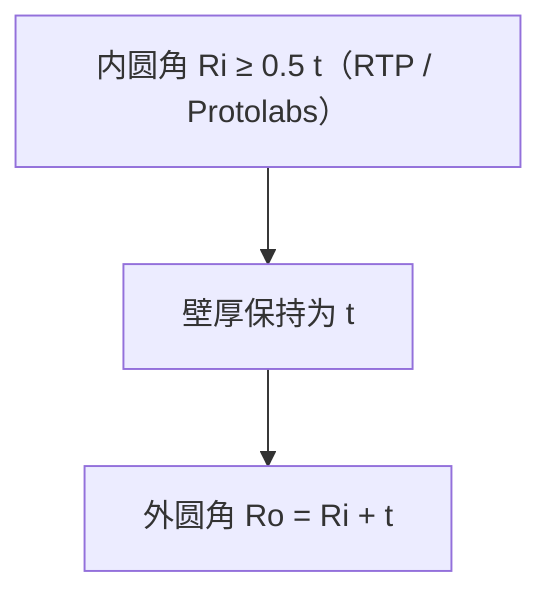

# 注塑内圆角与外圆角：内半径至少 0.5 t、外半径等于内半径加壁厚

> [!summary] 一句话概述
> 注塑件转角要把内圆角和外圆角一起设计：内半径至少约为公称壁厚 t 的一半，外半径取「内半径 + t」，才能在拐角处保持壁厚不变。只倒内角或只倒外角，会把拐角做薄或做厚，既是应力集中点，也是熔体的滞流点。本篇讲转角半径关系，不是加强筋厚度，也不是缩痕减胶。

## 配图

![[附件/rtp-inner-outer-radius.jpg]]
*图源：[RTP《热塑性塑料注塑设计指南》](https://www.rtpcompany.com/wp-content/uploads/RTP-Part-Design-Guidelines-for-Injection-Molded-Thermoplastics_CHS.pdf) 第 3 页（2017 年 3 月版，已打开 PDF）；U 形截面标注「内半径 > T/2」「外半径等于内半径 + T」「厚度 = T」。指南原文：内半径应至少为公称壁厚的 50%；外半径应为公称壁厚加上内半径（公称壁厚的 150%）*

![[附件/firstmold-good-bad-corner.jpg]]
*图源：[Firstmold《塑料产品的结构设计》](https://firstmold.com/zh/tips/structural-design-of-plastic-products/)「04.R 角」配图 Good and bad corner structural design（中英文页已打开，图为同一套）；从左到右：内外皆尖角（Worst，拐角约 1.4 t）→ 只做内圆角 r=0.6 t、外角仍尖（拐角约 1.7 t，局部加厚）→ 内外皆 r=0.6 t（拐角仍约 1.4 t）→ 内 r=0.6 t、外 r=0.6 t + t（Best，壁厚回到 t）*

![[附件/protolabs-fig2-5-round-corners.jpg]]
*图源：[Proto Labs, Injection Moulding Part Design For Dummies](https://www.protolabs.com/media/1011290/im-for-dummies-en.pdf) 第 28 页 Figure 2-5（已打开 PDF）；圆角转角示意。图注原文：Round corners reduce stresses inside the mould。同手册第 27 页还写明：外半径过大而内半径不调整会把拐角做薄；外半径过小会在拐角加厚并阻碍树脂流动*

> 图片版权归原作者所有，仅作个人学习收藏；出处见文末「来源与核实记录」。

## 结构原理

> 本节所有数字只写来源里给出的；来源没有就写「来源未给出」。

### 堆叠方案

方向：**在转角截面上，从内圆角经壁厚到外圆角**（同一壁的内外表面，不是多层装配）。

| 层级 | 零件/特征 | 材料 | 厚度/尺寸 | 固定方式 | 依据 |
| --- | --- | --- | --- | --- | --- |
| L1（内侧） | 内圆角（fillet） | 与塑件相同 | RTP：内半径至少为公称壁厚的 50%（图注写内半径 > T/2）。Protolabs：interior radius at least half of the wall thickness，更大更好，但须与外半径成比例。Firstmold：内角半径一般为材料厚度的 0.50–1.50 倍，最小不得小于 0.30 mm。赫兹：R内 = 0.5–1.0 倍壁厚，最小不小于 0.25 mm | 一体注塑 | RTP 第 3 页；Protolabs 第 27、37 页；Firstmold「04.R 角」；赫兹 3.2 节 |
| L2 | 公称壁 | 同上 | 厚度 = t（或 T）。目标是拐角处壁厚仍等于 t | 一体 | RTP 图注「厚度 = T」；Firstmold「设计 r 角时墙壁厚度应保持一致」 |
| L3（外侧） | 外圆角 | 同上 | RTP / Protolabs：外半径 = 内半径 + 壁厚（即公称壁厚的 150%，若内半径取 0.5 t）。Firstmold 对照图 Best：Internal r=0.6 t，External r=0.6 t + t | 一体 | RTP 第 3 页；Protolabs 第 27、37 页；Firstmold 配图 |
| L4（特例） | 凸台或筋的根部圆角 | 同上 | RTP：凸台底部半径应为公称壁的 1/4，最小半径 0.015 in。赫兹：筋根部圆角 0.25–0.5 倍壁厚。Protolabs：内部特征边缘也要有半径，以助流动并减少模具磨损 | 一体 | RTP 第 3 页；赫兹表 3；Protolabs 第 27 页 |

剖面示意：

### 零件清单

| 零件/特征 | 数量 | 功能 | 材料 | 依据 |
| --- | --- | --- | --- | --- |
| 内圆角 | 每个内转角一处 | 降低应力集中，改善熔体拐弯，避免尖角滞流 | 同塑件 | RTP、Protolabs、Firstmold、赫兹 |
| 外圆角 | 每个外转角一处 | 与内圆角配对，保持拐角壁厚等于 t | 同塑件 | 同上 |
| 可触及边缘的最小倒角/半径 | 按手持件外沿 | Firstmold：可接触表面不允许尖锐边缘，必要时倒角至最小半径 0.30 mm，防止割伤手指 | 同塑件 | Firstmold「04.R 角」第 4 点 |
| 分型面上的转角 | 尽量避免做成圆角 | Firstmold：分型面上的圆角会增加模具制作难度，并在产品表面留下焊缝，影响外观 | 同塑件 / 模具分型 | Firstmold「04.R 角」第 3 点 |

### 装配顺序

一体注塑结构，无装配步骤。设计与成形上的顺序是：

1. 先定公称壁厚 t，再按 t 计算内、外半径，而不是先随便倒一个 R 再补壁厚。
2. 内外半径同时给出：内半径取至少约 0.5 t（或各来源允许的更大值），外半径跟着设为内半径加 t，保证拐角等厚。
3. 凸台、筋与主壁相交处单独给根部圆角，但不要大到在对面造成明显局部增厚（RTP 提醒：凸台接触公称壁的一边应为圆角，同时应避免因壁厚增加导致凹陷）。
4. 分型线处除非有特殊要求，不要为了「好看」而把分型面做成圆角（Firstmold）。
5. 来源未给出具体的模具抛光或顶出参数。

### 受力与运动分析

- **受力路径**：尖角是应力集中点。RTP 写明凸台和加强筋底部的尖角会成为应力集中点；Protolabs 写 sharp corners also cause stress risers，成为潜在失效点。圆角把应力分散到更大的区域。来源未给出应力集中系数的数值表。
- **运动关系**：塑件本身无相对运动。充填时熔体必须转过拐角：圆角让流动更顺；外半径过小造成拐角局部加厚，Protolabs 写这也会阻碍树脂在模具中的流动（滞流）。
- **失效风险**：只做内圆角、外角仍尖 → Firstmold 图中拐角局部可到约 1.7 t，成为厚区；只做过大外圆角、内角不改 → Protolabs：拐角被做薄。分型面上的圆角还可能留下焊缝（Firstmold）。手持件外沿尖角有割伤风险（Firstmold，最小 0.30 mm）。

## 设计要点与参数

| 要点 | 内容 | 依据 |
| --- | --- | --- |
| 内半径下限 | RTP：至少为公称壁厚的 50%。Protolabs：至少为壁厚的一半，更多更好。Firstmold：一般为 0.50–1.50 倍壁厚 | RTP 第 3 页；Protolabs 第 27 页；Firstmold 04 |
| 外半径关系 | 外半径 = 内半径 + 壁厚。RTP 表述为「公称壁厚的 150%」（对应于内半径取 50% t 时） | RTP 第 3 页；Protolabs 第 27、37 页 |
| 保持拐角等厚 | 内外半径必须成对调整，否则拐角变薄或变厚 | Protolabs 第 27 页三条提示；Firstmold 配图 Worst→Best |
| 内半径最小值（绝对尺寸） | Firstmold：最小不得小于 0.30 mm。赫兹：最小不小于 0.25 mm。两条不要混成一个数 | Firstmold 04；赫兹 3.2 节 |
| 可触及边缘 | Firstmold：最小半径 0.30 mm，防止割伤手指，手持电子产品尤其重要 | Firstmold 04 第 4 点 |
| 分型面 | 除非特别要求，避免在分型面上做圆角 | Firstmold 04 第 3 点 |
| 凸台根部半径 | RTP：公称壁的 1/4，最小 0.015 in | RTP 第 3 页 |
| 筋根部圆角 | 赫兹：0.25–0.5 倍壁厚（这是筋根圆角，不是本篇主角的外壳转角公式） | 赫兹表 3 |
| 尖角禁忌 | 赫兹：分型面、止口、卡扣根部避免出现小于 R0.2 的尖角；FAQ 写内外角最小 R 不低于 0.2 mm | 赫兹 3.2 节与 FAQ |

> 来源没有给出的参数一律写「来源未给出」。0.015 in 不换算成 mm 再写入。

## 优缺点

**优点**
- 内外成对的圆角能在转角处保持壁厚，兼顾强度、充填和冷却。
- 同一套「Ri ≥ 0.5 t，Ro = Ri + t」在 RTP 与 Protolabs 中一致，便于写入公司检查表。
- 根部圆角同时降低应力集中和模具尖角磨损（Protolabs）。

**缺点 / 代价**
- 外观若要求「锋利棱线」，外圆角会改变造型，需要在分型或装饰面上另作取舍。
- 半径过大也会在局部堆料：RTP 提醒凸台根部圆角要避免因壁厚增加导致凹陷；这与「越大越好」不是同一回事。
- 分型面上随意加 R 会增加模具难度并可能留下焊缝（Firstmold）。

## 可借鉴点

- 检查转角时不要只看内 R：在截面上量拐角壁厚，是否仍等于公称 t；不是就同时改内、外半径。
- 默认起步可用 RTP / Protolabs 的组合：Ri = 0.5 t，Ro = 1.5 t；若采用 Firstmold 图中的 0.6 t 内半径，则外半径为 0.6 t + t。
- 凸台和筋的根部另用更小的根部半径（RTP 的 t/4 或赫兹的 0.25–0.5 t），并检查对面是否会出现缩痕。
- 手持件外沿至少按 Firstmold 做到 0.30 mm 圆角或倒角。
- 分型线经过的棱，优先保持清晰分型，不要为了倒圆而把分型面做成空间曲面圆角。

## 与库中相似案例对比

| 对比项 | 本案例（内圆角与外圆角） | [[塑料件加强筋设计：厚度、高度与间距比例]] | [[注塑缩痕：厚壁背面凹陷、减胶坑与保压边界]] | [[注塑螺丝柱（Boss 柱）：壁厚比 0.6 分水岭与自攻底孔公式]] |
| --- | --- | --- | --- | --- |
| 主角 | 壳体或特征转角的内外半径关系 | 长条筋的厚、高、间距 | 厚壁背面凹陷与减胶 | 螺丝柱壁厚比和底孔 |
| 关键几何 | Ri 与 Ro 成对，保持拐角等厚 | 筋截面比例 | 减胶坑、保压 | 柱壁、根部、底孔 |
| 何时用这篇 | 画每一个内外转角、检查尖角和拐角壁厚时 | 决定加筋方案时 | 处理缩痕时 | 设计螺丝柱时 |
| 根部圆角如何分工 | 本篇给外壳转角公式；筋/柱根部只作附带参数 | 已有篇含筋根圆角，但不讲外壳内外 R 配对 | 不讲圆角配对 | 柱根圆角服务于防裂与防缩，不是外壳转角 |
| 是否重复 | 否 | 已有，本篇不抄筋比例 | 已有，本篇不写缩痕机理 | 已有，本篇不写 0.6 壁厚比与底孔公式 |

## 相关案例

- [[注塑均匀壁厚与厚薄渐变：相邻壁厚比与过渡段长度]]
- [[塑料件加强筋设计：厚度、高度与间距比例]]
- [[注塑螺丝柱（Boss 柱）：壁厚比 0.6 分水岭与自攻底孔公式]]
- [[注塑缩痕：厚壁背面凹陷、减胶坑与保压边界]]
- 分类索引：[[01-壳体与外观件 索引]]

## 来源与核实记录

- 主来源：[RTP Company《热塑性塑料注塑设计指南》](https://www.rtpcompany.com/wp-content/uploads/RTP-Part-Design-Guidelines-for-Injection-Molded-Thermoplastics_CHS.pdf)（版权页 2017 年 3 月；已打开预下载中文 PDF 第 3 页「半径」及插图。中文主来源）
- 补充来源 1：[Proto Labs, Injection Moulding Part Design For Dummies](https://www.protolabs.com/media/1011290/im-for-dummies-en.pdf)（2012；已打开第 27–28 页 Rounding the bends、Figure 2-5，以及第 37 页 Keeping the Fillets Consistent。独立机构）
- 补充来源 2：[Firstmold，塑料产品的结构设计](https://firstmold.com/zh/tips/structural-design-of-plastic-products/)（2023-05-23 发布，页面显示最后修改 2026-11-06；已同时打开[英文页](https://firstmold.com/tips/structural-design-of-plastic-products/)核对「04.R Corner」数值与配图。独立机构）
- 补充来源 3：[赫兹，注塑件设计避坑指南](https://www.hezidesign.com/gongyi/686.html)（2026-05-01；已打开 3.2 节圆角规则。仅作旁证，与主来源和其他补充来源不是同一机构）
- 核实：2026-11-22 打开上述 PDF 与页面，下载并裁切手册/网页原图。未把 0.015 in 换算成 mm。未把本篇写成加强筋或缩痕的重复。
