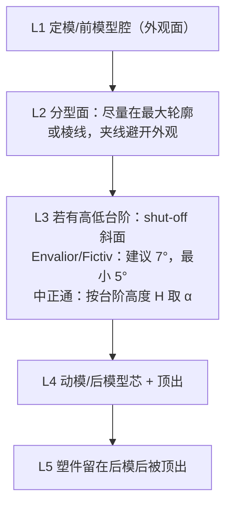

# 注塑分型面与阶梯封胶斜度：最大轮廓留后模，shut-off 至少 5–7°

> [!summary] 一句话概述
> 分型面应放在塑件脱模方向的最大轮廓（或棱线）上，并尽量让塑件留在带顶出的后模、夹线避开外观面；当分型必须做成高低台阶时，连接不同高度的封胶面（shut-off）不能与开模方向平行，Envalior 与 Fictiv 都把该面的斜度写成推荐约 7°、最小 5°，中正通则按台阶高度另给了一组更细的 α 值。

## 配图

![[附件/envalior-stepped-parting-shutoff.jpg]]
*图源：[Envalior《脱模斜度》](https://www.envalior.com/zh-cn/services/design-guide/draft-angle) 插图「阶梯与平面分型线」（见图 2）；左侧为阶梯分型（Stepped Parting Line），右侧为分型线细节，局部放大标出 Shut Off Angle，并写明 7° Type、5° Min。这是阶梯分型封胶面斜度的官方示意，不是产品上下盖止口*

![[附件/moldds-stepped-parting-5221.jpg]]
*图源：[中正通《注塑模具分模面的确定：8 条选择原则与 10 项检查要点》](https://www.moldds.com/design-applications/51.html) 图 5.2.1 台阶型分模面示意图；图中标出台阶高度 H1、H2、H3，水平距 D，以及夹角 A1、A2、A3 和分型线 PL。正文要求：一般 D ≥ 0.25 mm（薄钢位建议 0.3–0.5 mm）；当 H1 ≥ H2 ≥ H3 时，角度应满足 A1 ≤ A2 ≤ A3*

![[附件/moldds-parting-transition-5226.jpg]]
*图源：同上图 5.2.6 分模面转折位；不同高度分型面接到基准平面时形成的台阶面，正文要求该面尽量平坦，图示尺寸「A」一般大于 15°，合模时允许此面避空，转角优先按加工刀具半径取 R ≥ 3.0 mm*

> 图片版权归原作者所有，仅作个人学习收藏；出处见文末「来源与核实记录」。

## 结构原理

> 本节所有数字只写来源里给出的；来源没有就写「来源未给出」，不估算、不换算成看似精确的值。

分型面是前、后模贴合的面，也是塑件上会出现模具夹线的位置。本篇只讨论「分型面放在哪」和「高低面之间那条封胶斜面怎么取角度」，不讨论产品上下盖之间的止口间隙，也不按咬花纹深去加侧面拔模。

### 堆叠方案

方向：**沿开模方向，从定模（前模/母模）到动模（后模/公模）**

| 层级 | 零件/区域 | 材料 | 厚度/尺寸 | 固定方式 | 依据 |
| --- | --- | --- | --- | --- | --- |
| L1 定模（前模）型腔 | 通常成型外观面 | 模具钢，来源未给出牌号 | 来源未给出模板厚度 | 固定在注塑机定模板上 | 赫兹：前模形成外表面；中正通：分模线尽量不破坏光滑外表面 |
| L2 分型面（平面或阶梯） | 前、后模的贴合面，塑件上的夹线所在 | 模具分型面 | 平面分型时锁模力垂直作用于分型面；阶梯分型则有高度跳跃 | 合模锁紧；曲面分型时中正通要求加斜面锁紧 | Envalior 图 2；中正通原则 7 |
| L3 阶梯封胶面（shut-off） | 连接不同高度分型面的贴合斜面 | 与模板同一钢料 | Envalior / Fictiv：推荐约 7°、最小 5°；中正通按台阶高度取 α，见参数表 | 合模时两半相互贴合，不可与开模方向平行 | Envalior；Fictiv；中正通图 5.2.1 |
| L4 动模（后模）型芯与顶出 | 通常成型内表面，并承担顶出 | 模具钢；顶出零件见顶针专篇 | 来源未给出 | 开模后塑件应留在此侧以便顶出 | 中正通原则 2；澳承恩原则 10；赫兹 |
| L5 塑件 | 外壳或结构件 | 热塑性塑料 | 来源未给出本篇壁厚 | 注塑成型后顶出 | 各来源 |

剖面示意：

### 零件清单

| 零件/模具要素 | 数量 | 功能 | 材料 | 依据 |
| --- | --- | --- | --- | --- |
| 前模（定模） | 1 | 成型外观面，构成分型面一侧 | 来源未给出钢种 | 赫兹；中正通 |
| 后模（动模） | 1 | 成型内表面，开模后带走塑件并顶出 | 来源未给出钢种 | 中正通原则 2；澳承恩原则 10 |
| 平面或阶梯分型面 | 尽量少、尽量平直 | 决定夹线位置与开模方向 | — | 澳承恩原则 8；中正通原则 8 |
| 封胶斜面（shut-off） | 每个高度跳跃处 | 让高低分型在合模时贴合，避免平行面拖曳磨损 | — | Envalior；Fictiv |
| 基准平面 | 有高度差的分型时需要 | 为后续加工提供放置与加工基准 | — | 中正通注意事项 (4) |
| 斜面锁紧 | 侧向分力不能自平衡时 | 用前后模刚性平衡侧向压力；中正通写角度 A 一般为 15°，斜度越大平衡效果越差 | — | 中正通图 5.2.7 |

### 装配顺序

> 来源讲的是模具设计与合模关系，不是整机拆解。下面按「设计选定 → 加工封胶面 → 合模验证」整理。

1. **先定开模方向和最大轮廓**：中正通要求分模面设在胶件脱模方向最大的投影边缘；澳承恩要求尽量选在产品棱线上，并保证开模行程尽量短。
2. **决定塑件留在哪一侧**：中正通、澳承恩、赫兹都要求尽量让胶件留在后模，以便顶出，且顶针痕迹不出现在外观面。赫兹还写：前模斜度通常比后模大约 0.5°，以便开模时产品留在后模。Envalior 则从收缩角度解释：冷却收缩会使零件紧贴型芯或公面，加大脱模难度。
3. **把夹线放到不显眼处**：分模面尽量不破坏光滑外表面；夹线、段差要提交客户确认（澳承恩原则 2）。外观要求高时，分型可放到侧面或背面（赫兹）。
4. **能平则平，必须台阶再做 shut-off**：最直接的结构是垂直于开模方向的平面分型（Envalior 图 2）。需要高低面时，在高度跳跃处做出带斜度的封胶面，并按中正通补基准平面、转折位和封胶距离。
5. **合模检查**：封胶面不得与开模方向平行；中正通还要求投影面积大的方向放在主分型、投影面积小的方向作为侧向分型，必要时加斜面锁紧。

### 受力与运动分析

- **受力路径**：锁模力沿开模方向作用。平面分型时，Envalior 写锁模力正好作用在分型面垂直方向，两半之间容易保证无间隙。阶梯分型时，封胶斜面承受合模贴合与可能的错位剪力；若侧向分力不能自平衡，中正通要求用斜面锁紧把力传到前后模刚性上。
- **运动关系**：开模时后模后退，塑件应留在后模再被顶出。封胶面本身在开合模中是反复贴合、分开的接触面，没有产品零件之间的相对运动。
- **失效风险**：Envalior 写，shut-off 若与抽芯/开模方向完全平行，会产生拖曳并随时间磨损模具；最坏情况下合模错位可能造成严重损坏。中正通补充：尖角形封胶面不易封胶且易损坏；封胶距离不足（其一般要求同一曲面上有效封胶距离 D ≥ 3 mm）也会影响封胶。澳承恩还指出，斜滑块锁紧力较小，若把大投影面积放到侧向分型，容易锁不紧而溢毛边。

## 设计要点与参数

| 要点 | 内容 | 依据 |
| --- | --- | --- |
| 分型面位置 | 设在胶件脱模方向最大投影边缘；尽量平直、减少分模面数目，优先选在棱线；夹线避开外观 | 中正通原则 1、3、8；澳承恩原则 8；赫兹 |
| 塑件留侧 | 力求留在后模，利于顶出且顶针痕不在外观面 | 中正通原则 2；澳承恩原则 10；赫兹 |
| 平面 vs 阶梯 | 最直接的是垂直于开模方向的平面分型；阶梯分型的高度连接面称为 shut-off，绝不可与开模方向平行 | Envalior |
| 阶梯封胶斜度（通则） | 应至少设计七度或更大的拔模斜度；五度应视为最小值 | Envalior 正文；图注 7° Type、5° Min |
| 阶梯封胶斜度（另一机构） | 若分型线是台阶形，通常对 shut-off 施加 5 到 7 度斜度，以免两半闭合时出现间隙 | Fictiv |
| 台阶型分模按高度取 α | 当 H ≤ 3 mm，斜度 α ≥ 5°；3 mm ≤ H ≤ 10 mm，α ≥ 3°；H > 10 mm，α ≥ 1.5°。特殊要求时按产品选取 | 中正通图 5.2.1 正文（与上两行 5–7° 通则不同，并列保留） |
| 台阶水平距 D | 一般 D ≥ 0.25 mm；薄钢位建议 0.3–0.5 mm。多个台阶且 H1 ≥ H2 ≥ H3 时，A1 ≤ A2 ≤ A3，并尽量取同一角度方便加工 | 中正通 |
| 封胶距离 | 同一曲面上有效封胶距离，一般 D ≥ 3 mm | 中正通注意事项 (3) |
| 分模面转折位 | 接到基准平面的台阶面，图示尺寸「A」一般大于 15°，合模时允许避空；转角 R ≥ 3.0 mm | 中正通图 5.2.6 |
| 斜面锁紧角 | 角度 A 一般为 15°；斜度越大，平衡效果越差；合模时锁紧斜面要求完全贴合 | 中正通图 5.2.7 |
| 前、后模斜度差 | 产品的前模斜度通常比后模大约 0.5°，以便开模时留在后模 | 赫兹（交叉，不是封胶角本身） |
| 排气与浇注 | 分模面尽可能与料流末端重合，便于排气；同时不妨碍浇注系统开设 | 澳承恩原则 6、7 |

> 来源没有给出的参数一律写「来源未给出」，不估算、不编造。Envalior/Fictiv 的 5–7° 是针对阶梯封胶面的通则；中正通的 α 随台阶高度变化，高台阶可取到 1.5°。两套数字来自不同机构，本文不作取舍。

## 优缺点

**优点**
- 分型放在最大轮廓并让塑件留后模，开模和顶出路径清楚，夹线可预判。
- 必须做高低面时，给 shut-off 足够斜度，可避免平行面反复摩擦、错位啃钢。
- 平面分型锁模方向简单；阶梯分型则能迁就产品外形，而不必为了「一条平缝」去改产品。

**缺点 / 代价**
- 阶梯、曲面分型会增加加工和研配难度，还要补基准平面、转折位和封胶距离。
- 封胶角取得太小，模具易磨损、溢料；取得太大，可能侵占产品结构或让薄钢位不够（中正通写：夹角影响产品结构时要协商）。
- 分型选错会出现外观夹线、塑件粘前模、或不得不加侧抽（澳承恩、中正通都强调尽量避免侧抽）。

## 可借鉴点

- 评审外壳 3D 时先标「最大轮廓」和「允许出现夹线的边」，再决定能不能用一张平面分型。
- 只要出现高低面，就把连接面当成 shut-off 检查：是否平行于开模方向；斜度是否达到 Envalior/Fictiv 的 5–7° 通则，或是否按中正通的台阶高度表取值。
- 同时检查水平距 D、封胶宽度和转折位 R，不要只看一个角度。
- 需要前模多包紧、后模少包紧时，可用「前模斜度大于后模」来保证留模侧，不要和封胶角混为一谈。
- 夹线、段差在图纸阶段提交外观确认，而不是试模后再谈判。

## 与库中相似案例对比

| 对比项 | 本案例 | [[咬花（晒纹）与拔模角：每 0.025 mm 纹深加 1°]] | [[塑料外壳止口与扣位：间隙参数与三个翻车案例]] |
| --- | --- | --- | --- |
| 关注点 | 模具分型面放在哪，以及阶梯分型封胶面的最小斜度 | 侧壁按纹深增加拔模，避免拖花 | 产品上、下盖之间的止口和扣位间隙 |
| 斜度含义 | shut-off 是两半模具相互贴合的封胶斜面，不是塑件外观侧壁的脱模斜度 | 咬花斜度是塑件相对型腔的脱模斜度 | 止口斜度服务装配与外观缝，不是模具封胶 |
| 何时用这篇 | 要决定夹线位置、塑件留哪一侧，或产品有高低面必须阶梯分型时 | 已定分型，只为纹理面补拔模 | 设计对盖、防尘防水止口、扣位过盈/间隙时 |
| 来源 | 中正通 + Envalior + Fictiv + 澳承恩 | 见该案例 | 见该案例 |

与 [[注塑倒扣脱模：强脱、斜顶还是滑块]] 的差异：本篇尽量用分型选择和封胶面避免侧抽；倒扣篇是倒扣已经存在之后，在强脱、斜顶、滑块之间做选择。

## 相关案例

- [[咬花（晒纹）与拔模角：每 0.025 mm 纹深加 1°]]
- [[塑料外壳止口与扣位：间隙参数与三个翻车案例]]
- [[注塑倒扣脱模：强脱、斜顶还是滑块]]
- [[注塑熔接痕：位置由浇口定、深浅由前锋温差定]]
- 分类索引：[[01-壳体与外观件 索引]]

## 来源与核实记录

- 主来源：[注塑模具分模面的确定：8 条选择原则与 10 项检查要点](https://www.moldds.com/design-applications/51.html)（发布日期 2026-03-14，更新于 2026 年 11 月 11 日，中正通设计团队。已打开原文，核对接线原则、图 5.2.1 台阶 α 与 D、封胶距离、转折位、斜面锁紧，并下载相应插图）
- 补充来源：[Envalior《脱模斜度》](https://www.envalior.com/zh-cn/services/design-guide/draft-angle)（打开时页面未给出发布日期；已打开中文页并核对「至少七度或更大、五度应视为最小值」，下载「阶梯与平面分型线」图。英文对应页 https://www.envalior.com/en-us/draft-angle 同属 Envalior，不另计机构）
- 补充来源：[Fictiv, Draft Angle Guidelines for Injection Molding](https://www.fictiv.com/articles/draft-angle-injection-molding)（Steve Melito，2024-01-19；已打开原文，核对 stepped parting shut-off 通常取 5 to 7 degree）
- 补充来源：[塑胶模具分型面设计的 11 个原则](https://ace-molding.com/h-nd-8.html)（东莞市澳承恩塑胶五金制品有限公司，2021-08-04；已打开并摘录棱线分型、留后模、避免侧抽、分型与料流末端重合等原则。该站点证书为自签，用浏览器兼容方式打开成功）
- 补充来源：[注塑模具基础——工业设计师必须了解的模具结构与设计要点](https://www.hezidesign.com/gongyi/680.html)（赫兹工业设计，2026-04-30；已打开，仅作「最大轮廓、留后模、前模斜度大约 0.5°」交叉，不当作本篇唯一中文源）
- 核实：2026-11-22 实际打开上述页面并下载配图。未把产品止口或咬花加拔模写成同一结构。Envalior/Fictiv 与中正通的封胶角数值不同，已在参数表分列。
