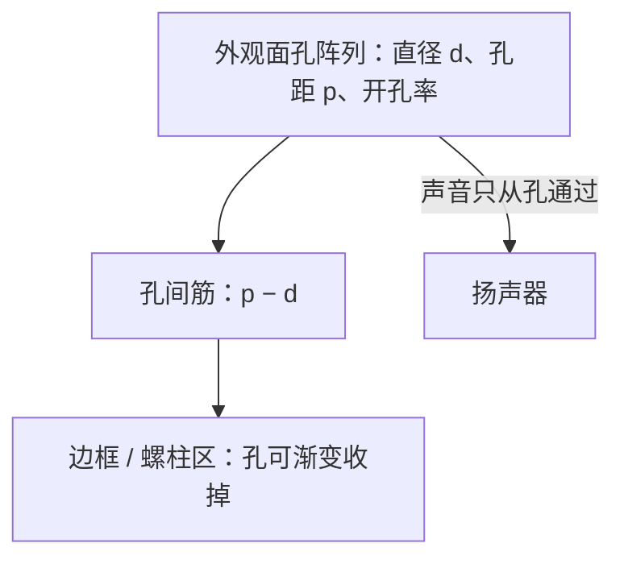

# 注塑喇叭网罩：开孔率、孔径孔距与脱模

> [!summary] 一句话概述
> 外壳上的喇叭网罩要同时挡手、好看和让声音过去：决定听感的首先是开孔率，其次才是孔径、孔距和排布。SolidVents 把圆孔开孔率写成公式，并建议扬声器正前方做到 30%–40% 或更高；落到注塑件上，这些微孔要靠细型芯针成型，怡讯模具文指出孔径常见 0.5–1.5 mm，细针易弯、易短射、易粘模拉毛，要从模具钢材、排气、顶出和材料流动性一起解决。本篇不讨论网布加防水透声膜的声学叠层。

## 配图

![[附件/solidvents-speaker-grille-patterns.jpg]]
*图源：[Speaker Grille Hole Pattern Design](https://solidvents.com/guides/speaker-grille-design) 页面配图（SolidVents）；展示不同开孔图案（菱形阵列与旋转单元），用于说明孔阵列既是声学开孔率问题，也是外观设计问题*

> 图片版权归原作者所有，仅作个人学习收藏；出处见文末「来源与核实记录」。

## 结构原理

> SolidVents 的开孔率与孔径规则主要针对穿孔网（含钣金、打印和消费电子网罩的通用算法）。怡讯文专门讲精密微孔**塑料**网的注塑难点。两套来源合在一起用，但不要把钣金冲压的「孔径 ≥ 板厚」直接写成注塑强制条件，除非该文也这么说。

### 堆叠方案

方向：**从外观面到扬声器（只讨论结构网，不含透声膜）**

| 层级 | 零件 | 材料 | 厚度/尺寸 | 固定方式 | 依据 |
| --- | --- | --- | --- | --- | --- |
| L1 | 外观网罩（孔阵列区） | 注塑塑料；工艺文建议高流动性 ABS、PC/ABS | SolidVents：消费电子孔径常见 1–3 mm。怡讯：精密微孔常见 0.5–1.5 mm | 与外壳一体，或单独注塑后再卡扣/焊接到门板（震雄文提到车用罩的后组装，本篇仅作工艺背景，不把那篇当参数来源） | SolidVents；怡讯 |
| L2 | 孔间筋（web） | 与网一体 | SolidVents：筋宽 = 孔距 − 孔径；钣金冲压时建议筋宽至少等于料厚。注塑件的最小筋宽该文未给同等公式，但筋过窄会减弱、难填满 | 一体成型 | SolidVents |
| L3 | 边框、安装柱、密封区 | 与网一体或加厚边 | 扬声器正前方保持高开孔率，靠近螺柱、密封边处可将孔渐变收掉（SolidVents 的 gradient / fade） | 一体成型 | SolidVents |
| L4 | 扬声器单元（被保护对象） | 来源未展开 | 来源未给出 | 装在网内侧 | — |

本篇**不含**防尘网布和防水透声膜。那些属于声学孔防护叠层，见已收录的对照案例。

剖面示意：

圆孔开孔率（SolidVents，对扬声器前方区域计算）：

- 正交（方阵）排列：开孔率 % = 78.5 × (d / p)²
- 错列 60°（蜂窝/六角）排列：开孔率 % = 90.7 × (d / p)²

文中例子：d = 2 mm，p = 3 mm，错列约 40%；同样孔做方阵只有约 35%。这就是错列在音频网里更常见的原因——同样的最小筋宽，开孔率更高。

### 零件清单

| 零件 | 数量 | 功能 | 材料 | 依据 |
| --- | --- | --- | --- | --- |
| 注塑网罩 | 1 | 保护、外观、透声 | 高流动 ABS / PC/ABS 等 | 怡讯；SolidVents |
| 微孔型芯针（模具） | 与孔数对应 | 成型每一个孔 | 怡讯写常用 S136、NAK80 等淬硬钢，并加导向 | 怡讯 |
| 顶出系统 | 1 套 | 均衡脱模，避免拉凹、断针、顶白 | — | 怡讯 |

### 装配顺序

若网与外壳一体，则只有注塑和后处理；若是分件：

1. 先在扬声器前方圈出「必须保持高开孔率」的区域，按 SolidVents 的顺序：定目标开孔率 → 按工艺选孔径 → 用公式反推孔距 → 检查筋宽 → 选排布 → 在螺柱和密封边做渐变 → 再出图。
2. 模具：密布细针、微排气槽、浇口与流动平衡用模流分析（怡讯）。
3. 注塑：高速高压以填满微孔，但压力过大会溢边、弯针；常用多段射速（怡讯）。
4. 均衡顶出；必要时退火去内应力（怡讯）。
5. 去微孔毛刺（怡讯提到冷冻去毛刺或超声清洗，避免手工刮孔）；再做尺寸和声学检查。

### 受力与运动分析

- **受力路径**：手指按压、跌落或装配力走孔间筋和边框；孔越多、筋越窄，网面刚度越低，边框和渐变区要承担更多。
- **运动关系**：使用中无相对运动。开模时塑料收缩包紧型芯针，这是最危险的「运动」：顶出不平衡会撕孔、留毛刺，甚至把针断在模里（怡讯）。
- **声学与结构的耦合**：开孔率不足时，高频先被挡住，再是整体声压下降（SolidVents）。孔相对壁厚太细，会像短管一样摩擦掉高频；该文建议尽可能让壁厚 ≤ 孔径，否则就要加大孔或提高开孔率补偿。
- **失效风险**：短射堵孔、困气烧焦、翘曲导致安装孔错位、孔缘毛刺挡风挡声、细针弯曲后孔径不一致（怡讯）。

## 设计要点与参数

| 要点 | 内容 | 依据 |
| --- | --- | --- |
| 目标开孔率 | 扬声器前方 30%–40% 很常见；约 40% 以上通常视为「声学上透明」；25%–30% 可接受但高频可能略损；低于约 25% 有可闻衰减和染色风险，应避免挡在扬声器正前 | SolidVents 表 |
| 开孔率公式 | 方阵 78.5×(d/p)² %；错列 60° 90.7×(d/p)² %。例：2 mm 孔、3 mm 错列孔距 ≈ 40% | SolidVents |
| 消费电子孔径 | 常见 1–3 mm：小于 1 mm 制造更难、厚壁时高频易被扼；大于 3 mm 容易看见扬声器，手指或杂物更容易伸入 | SolidVents |
| 精密注塑微孔 | 典型 0.5–1.5 mm，数量可达数千、且是大面积薄件 | 怡讯 |
| 钣金冲压限制（对照，勿直接当注塑规则） | 孔径不小于料厚（d ≥ t）；筋宽一般至少一倍料厚 | SolidVents |
| 壁厚与孔径 | 尽量壁厚 ≤ 孔径，否则孔像细管，吃掉高频 | SolidVents |
| 排布 | 错列/六角：同样筋宽开孔率更高、刚度更匀，音频默认。方阵对齐产品轮廓，同等 d/p 开孔率约低 13%。同心圆适合圆形扬声器。渐变：正前方满开孔率，到螺柱和密封边收掉 | SolidVents |
| 材料（注塑） | 优先高流动性、低收缩、抗冲击的树脂，如高流动 ABS、PC/ABS，以便通过细针间隙 | 怡讯 |
| 模具与脱模 | 细针易被熔体侧向力打弯或折断；冷却收缩包紧针；要用淬硬钢、导向、均衡顶出，针间做微排气，避免烧焦和短射。边框与网面厚度差易翘曲，用对称冷却和预变形补偿 | 怡讯 |

## 优缺点

**优点**
- 开孔率可以用公式从孔径、孔距算出来，先定声学目标再出图
- 错列排布能在同样筋宽下多换开孔率
- 渐变开孔兼顾透声和安装强度
- 注塑可把网、边框、卡扣一次做出来

**缺点 / 代价**
- 开孔率、外观和强度互相拉扯，薄大面密孔很容易短射、烧焦、翘曲
- 模具是细针森林，维修和寿命成本高
- 孔缘毛刺会直接破坏声学和手感，后处理麻烦
- 它只是结构网：要防尘防水，还得另做网布或透声膜，不能把两类孔混用一张膜

## 可借鉴点

- **先圈扬声器前方，把开孔率定为 30%–40% 或以上**，再用公式反推孔距，不要先在外观上铺满「好看的小孔」再回头算
- **优先错列**；只有产品轮廓强调整齐网格时才用方阵，并接受开孔率下降
- **安装柱和密封边不要打满孔**，用开孔率渐变过渡
- **注塑网按「细针工艺」做评审**：排气、浇口、顶出平衡、材料流动性，并把短射、堵孔、毛刺、孔形一致性写进试模验收
- 本篇的开孔是外观/结构孔。麦克风或扬声器若还要防水防尘，另做叠层，不要把透声膜兼用成壳体透气阀

## 与库中相似案例对比

| 对比项 | 本案例（注塑/穿孔喇叭网罩） | [[喇叭防尘网与防水透声膜叠层：声学孔与结构孔不要混用]] |
| --- | --- | --- |
| 主角 | 外壳外观网上的孔阵列、开孔率与注塑脱模 | 最外防尘网 + 内侧防水透声膜的声学叠层 |
| 关键指标 | 开孔率、孔径/孔距、筋宽、短射与粘模 | 插损、耐水压、孔径；并强调不要与结构透气孔混用 |
| 是否含膜 | 不含 | 含防水透声膜 |
| 用法 | 用来设计壳上的网和模具 | 用来设计拾音/出音孔的防护叠层 |

## 相关案例

- [[喇叭防尘网与防水透声膜叠层：声学孔与结构孔不要混用]]
- [[外壳散热通风口与防雨百叶：开孔率、进出风与滴水路径]]
- 分类索引：[[01-壳体与外观件 索引]]

## 来源与核实记录

- 主来源：[Speaker Grille Hole Pattern Design: Open Area, Hole Size & Layout Guidelines](https://solidvents.com/guides/speaker-grille-design)（SolidVents）——开孔率定义与公式、30%–40% 目标、孔径与壁厚、排布选择
- 独立第二来源：[Injection Molding Challenges for Precision Micro-Perforated Speaker Grilles](https://www.yixunmold.com/Injection-Molding-Challenges-for-Precision-Micro-Perforated-Speaker-Grilles-id08555455.html)（东莞怡讯模具，页面标注 Publish Time 2026-04-28）——0.5–1.5 mm 微孔、细针、排气、短射、翘曲与顶出
- 曾打开的中文设备文 [震雄：车用扬声器罩](https://chenhsong.com.cn/注塑机在汽配行业案例-车用扬声器罩的小门道/)（2023-01-04）主要讲注塑机，结构参数很少，仅提到要注意网孔前后模拔模斜度以防粘模，不作为参数来源。jdt888 中文工艺页打开超时，未引用。
- 核实：2026-11-17 打开 SolidVents 与怡讯全文。未把钣金 d ≥ t 写成注塑强制规则。
