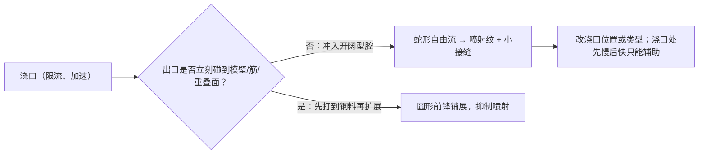

# 注塑喷射纹（Jetting）：浇口冲入开阔型腔形成蛇形流

> [!summary] 一句话概述
> 喷射纹出现在浇口附近：熔体高速穿过狭窄浇口后冲进开阔型腔，却没有立刻碰到模壁，于是像一条蛇一样在空腔里折叠前进，在表面留下波浪状或「老鼠尾」痕迹，并在折叠接触处形成小接缝；对策首先是让熔体一进型腔就打到侧壁、筋或对面钢料，或改用重叠、潜入、护耳、扇形浇口，工艺上只能作为辅助。

## 配图

![[附件/pe-jetting-snake-photo.jpg]]
*图源：[Laura Florez, Intro to Plastics: Solving Jetting in Injection Molding, Plastics Engineering](https://www.plasticsengineering.org/2025/03/intro-to-plastics-solving-jetting-in-injection-molding-008282/) 文首照片，Courtesy of Kunststoff Institut Lüdenscheid；两件试样表面都留下从浇口一侧展开的蛇形「自由流」痕迹。正文把这种缺陷称为 free flow 或 jetting，并形容低粘度时像「老鼠尾」（mouse tail），或流动弯折后在表面形成小皱纹*

![[附件/pe-jetting-gate-configs.jpg]]
*图源：同上文插图 “Recommended gating configurations to avoid jetting”；上排标 X 的是容易喷射的布置（侧浇口正对开阔型腔、沿壁平行射出、顺流动方向直冲等），下排标 O 的是让熔体先碰到壁面或改用重叠浇口、隧道浇口、垂直于流向的浇口后再扩展。作者强调：只是平行贴着模壁射出去，仍是较差设计，希望熔体先形成一个类似「硬币」的前锋，再按圆形扩展*

![[附件/autodesk-overlap-gate.jpg]]
*图源：[Autodesk Moldflow 2024 中文帮助《解决喷射问题》](https://help.autodesk.com/cloudhelp/2024/CHS/MoldflowInsight-CLC-Troubleshoot/files/Troubleshooting-molding-problems/LM_JETTING_PROBLEMS.html) 图 2「叠加浇口以使喷射降至最小。a 叠加浇口」；左图熔体进入开阔型腔后呈蛇形自由流（警告），右图用重叠（叠加）浇口让熔体先打到零件表面/模壁，再向四周扩展（对勾）*

> 图片版权归原作者所有，仅作个人学习收藏；出处见文末「来源与核实记录」。

## 结构原理

> 本节所有数字只写来源里给出的；来源没有就写「来源未给出」，不估算、不换算成看似精确的值。

Autodesk 的定义是：当聚合物熔体高速推进通过限流区域（喷嘴、流道或浇口），或被推入开放的较厚区域，并且未与模壁形成接触时，就会出现喷射。弯曲的蛇形喷射流会在熔体折叠之间形成接触点，生成小的接缝，并导致零件强度下降、表面瑕疵和内部缺陷。

Plastics Engineering 用了一个更形象的类比：这就像把牙膏挤进杯子——料没有先碰到壁，而是在空腔里自由装填。正常充填应当以浇口为中心、按圆形均匀扩展，前提是熔体进入型腔后立刻遇到一面墙，由这面墙引导第一股料。

本篇主角是这一充填缺陷，不是熔接痕的形成机理，也不是把浇口类型本身再写一遍。

### 堆叠方案

方向：**按料流路径，从浇口进入型腔的最初一段**

| 层级 / 位置 | 发生了什么 | 设计杠杆 | 依据 |
| --- | --- | --- | --- |
| 浇口（限流） | 熔体被加速穿过狭窄截面 | 加大浇口、加长直身段、改扇形/护耳，避免突然放流 | Autodesk；CoreLMould |
| 浇口出口与型腔入口 | 截面突然变厚、变开阔 | 避免浇口正对空腔；让料立刻碰到模壁、筋或重叠在零件表面上 | Autodesk；Plastics Engineering |
| 第一股自由流（若未贴壁） | 形成蛇形或老鼠尾，折叠处出现小接缝 | 这是要消除的状态，不是目标结构 | Autodesk；Plastics Engineering 实物图 |
| 贴壁后的扩展前锋 | 熔体沿壁面向四周铺展 | 用重叠、潜入、隧道、护耳或垂直于流向的浇口，强制先贴壁 | Autodesk 图 2；PE 对照图 |
| 后续充填与保压 | 前锋建立后再提高速度 | 浇口通过时先慢，分散流动后再加快 | Autodesk；CoreLMould 分段曲线 |

剖面示意：

### 零件清单

| 零件/模具要素 | 数量 | 功能 | 材料 | 依据 |
| --- | --- | --- | --- | --- |
| 浇口 | 1 或若干 | 把熔体引入型腔；位置和类型决定会不会先喷射 | 由流道系统形成 | Autodesk；PE |
| 重叠（叠加）浇口 / 潜入式（隧道、潜水）浇口 | 可选替代 | 让熔体先打到零件表面或模壁，再进入型腔 | — | Autodesk：重新定位浇口将熔体对准金属表面，或使用重叠或潜入式浇口 |
| 护耳浇口 / 扇形浇口 | 可选替代 | 用逐渐扩散的流动区域降低熔体流速、剪切应力和剪切速率 | — | Autodesk |
| 冷料井 | 可选 | 东丽把「增加冷料井的尺寸」和「把浇口放在料流方向会急剧变化的部位」列为喷射对策 | — | 东丽 TORELINA 表 6.1「喷射」行 |
| 型腔侧壁、筋或挡料面 | 浇口对面或侧旁 | 给第一股料一个撞击/导向面 | 模具钢 | PE；CoreLMould 写可将浇口导向型腔壁面或加强筋，而非开阔空间 |

### 装配顺序

> 来源是缺陷诊断与改模顺序，不是产品拆解。Plastics Engineering 作者明确写：工艺修改的作用相当有限，真正解决问题的是改变浇口和模壁几何。

1. **识别喷射而不是把它当成普通流痕**：位置靠近浇口，形态是蛇形、老鼠尾或从浇口向外的波浪纹（PE、Autodesk）。
2. **先查浇口是否正对空腔**：若第一股料没有墙可撞，优先改位置，让料对准侧壁、筋，或改成重叠、潜入、护耳、扇形浇口。
3. **东丽补充**：把浇口放到料流方向会急剧变化的部位，并加大冷料井；同时可提高模具温度。
4. **工艺只作辅助或应急**：Autodesk 建议优化螺杆速度曲线，使熔体通过浇口时前锋速度先低，分散后再提高。PE 的经验是：提高熔温并把浇口处注射速度降到非常低（文中写 down to 1 or 2 mm/s）可能减轻表面痕迹，但会拉长周期，只能作为应急；他们在 15% GF-PP 制件上最终仍是改了型腔，让熔体进入时碰到模壁。
5. **用短射观察**：CoreLMould 建议用短射看实际前锋；PE 也强调要能想象浇口诞生后最初一瞬间的流动。

### 受力与运动分析

- **受力路径**：喷射本身是充填流动问题。Autodesk 指出蛇形折叠会形成小接缝，导致零件强度下降和内部缺陷，所以它不只是外观问题——折叠接触处相当于一串微型熔接。
- **运动关系**：成型后塑件无相对运动。缺陷发生在充填最初阶段，前锋尚未转为稳定的贴壁扩展。
- **失效风险**：外观不可接受；折叠接缝处可能成为薄弱点。PE 认为「只沿着壁面平行射出」仍不能可靠建立受控前锋。CoreLMould 还指出，低粘度材料（如 PP、PE）比高粘度材料（如 PC、填充尼龙）更易喷射。东丽则把「模温太低」列为可能原因之一。

## 设计要点与参数

| 要点 | 内容 | 依据 |
| --- | --- | --- |
| 成因 | 熔体高速通过限流区或进入开放较厚区域，且未与模壁接触，形成蛇形自由流 | Autodesk |
| 外观与内部 | 表面瑕疵，折叠处形成小接缝，并导致零件薄弱和内部缺陷 | Autodesk；PE 实物照片 |
| 浇口对策（结构） | 重新定位浇口，将熔体对准金属表面；或使用重叠、潜入式浇口；或使用护耳、扇形浇口逐渐扩散减速 | Autodesk |
| 浇口对策（另一机构） | 让流动前锋一进入型腔就有导向墙；对照图给出重叠浇口、隧道浇口、垂直于流向的浇口等推荐，并指出平行贴壁射出仍较差 | Plastics Engineering |
| 浇口对策（材料商） | 增加冷料井尺寸；将浇口设置在料流方向会急剧变化的部位；增加模具温度 | 东丽表 6.1「喷射」 |
| 工艺曲线 | 熔体通过浇口时最初保持较低的熔体前沿速度，完成分散后再提高 | Autodesk |
| 应急工艺（有代价） | 提高熔体温度，并把浇口处注射速度降得很低（文中：down to 1 or 2 mm/s）可能改善痕迹，但影响周期，只宜应急；根本办法仍是改浇口和模壁几何 | Plastics Engineering |
| 浇口尺寸与直身段（交叉，仅一家给出） | CoreLMould 写：浇口尺寸通常应为标称壁厚的 60–80%；提供充分直身段长度（最小 0.8–1.5 mm）；其文还给出第一段 20–30% 速度至熔体越过浇口、第二段 60–80% 充填等曲线。这些数字未见 Autodesk 或 PE 原文重复，仅作为该机构说法保留 | CoreLMould |

> 来源没有给出的参数一律写「来源未给出」。CoreLMould 文中还有若干项目节省金额和「流速逾 200 mm/sec」的案例数字，缺乏独立交叉，本文不写入上表。

## 优缺点

**优点**
- 把喷射从「调机问题」明确成「浇口与第一面墙的几何问题」，改模方向清楚。
- 重叠、潜入、护耳、扇形和「对准侧壁/筋」都是可在图纸上检查的项。
- 分段注射可以在不立刻改模时减轻症状。

**缺点 / 代价**
- 改浇口位置或类型通常要动模具钢料；重叠浇口会在零件表面留下另一形态的浇口痕迹。
- 浇口处把速度降到极低会拉长周期，且 PE 认为工艺窗口有限。
- 扇形、护耳浇口会占用边缘或增加去除浇口的工作。

## 可借鉴点

- 评审浇口时想象「第一股料会不会撞墙」：正对空腔就要改位置，或加重叠、挡料面、筋。
- 不要满足于「浇口沿着壁面平行射出」，PE 把它列为仍然较差的布置。
- 短射看浇口附近是否出现蛇形流，再决定改模还是只调速度曲线。
- 把喷射纹和熔接痕分开：喷射在浇口附近由自由流造成；熔接痕在两股前锋汇合处。
- 若只能先量产，可临时采用浇口处先慢后快，但要把改浇口几何列为正式措施。

## 与库中相似案例对比

| 对比项 | 本案例 | [[注塑熔接痕：位置由浇口定、深浅由前锋温差定]] |
| --- | --- | --- |
| 关注点 | 浇口冲入开阔型腔形成的蛇形喷射纹 | 两股前锋汇合处的熔接痕 |
| 发生位置 | 靠近浇口，是充填刚开始的自由流 | 流程中后段的汇合点，由浇口位置和绕流决定 |
| 对策重心 | 让第一股料立刻贴壁，或改重叠/潜入/护耳/扇形浇口 | 挪浇口让汇合点离开外观，并控制汇合时温差和排气 |
| 何时用这篇 | 浇口附近出现蛇形纹、老鼠尾或浇口对面有喷射痕迹时 | 孔、槽、多浇口汇合处出现熔接线时 |
| 来源 | Autodesk + Plastics Engineering + 东丽 + CoreLMould | 见该案例 |

本轮若另有「浇口类型与位置」专篇，应把它当浇口形式总览来用；本篇只把浇口当作抑制喷射的手段，不重复讨论浇口痕迹、对面气纹的一般选型。该专篇若不在库中，先用本篇处理喷射这一项缺陷。

## 相关案例

- [[注塑熔接痕：位置由浇口定、深浅由前锋温差定]]
- [[注塑缩痕：厚壁背面凹陷、减胶坑与保压边界]]
- [[免喷涂材料 vs 喷涂：成本、良率与三条硬边界]]
- 分类索引：[[01-壳体与外观件 索引]]

## 来源与核实记录

- 主来源：[解决喷射问题（Autodesk Moldflow Insight 2024 中文帮助）](https://help.autodesk.com/cloudhelp/2024/CHS/MoldflowInsight-CLC-Troubleshoot/files/Troubleshooting-molding-problems/LM_JETTING_PROBLEMS.html)（Autodesk，帮助版本标注 2024；已打开中文页，核对成因、后果与对策，并下载图 2 重叠浇口示意图。对应英文页 https://help.autodesk.com/cloudhelp/2024/ENU/MoldflowComm-CLC-Troubleshoot/files/Troubleshooting-molding-problems/LM_JETTING_PROBLEMS.html 已打开核对，同属 Autodesk，不另计机构）
- 补充来源：[Laura Florez, Intro to Plastics: Solving Jetting in Injection Molding](https://www.plasticsengineering.org/2025/03/intro-to-plastics-solving-jetting-in-injection-molding-008282/)（Plastics Engineering / SPE，2025-03-21；已打开全文，下载 Kunststoff Institut Lüdenscheid 蛇形纹照片、推荐浇口对照图，并核对 15% GF-PP 改模实例与 1 or 2 mm/s 的应急速度说法）
- 补充来源：[成型缺陷与对策｜TORELINA™](https://www.plastics.toray/zh/technical/torelina/tec_039.html)（东丽塑料，打开时页面未另给发布日期；已打开表 6.1「喷射」行：原因是浇口位置、模温太低；对策是加大冷料井、把浇口放在流向急剧变化处、提高模温）
- 补充来源：[如何在不修改浇口的情况下消除喷射纹](https://corelmould.com/zh/blog/jetting-guide/)（CoreLMould，页面标注 2024 年 1 月 1 日；已打开中文正文，仅把与另外三家一致的「对准壁面/筋、分段先慢后快」以及该文独有的 60–80% 壁厚、直身段 0.8–1.5 mm 作为交叉。未采用文中未交叉的金额和单次流速案例）
- 核实：2026-11-22 实际打开上述页面并下载配图。http://newgreatwall.com.cn/Infocenter/NewDetals/67aec01e399e50a4 返回 500，未引用。未把熔接痕机理写成同一篇。
