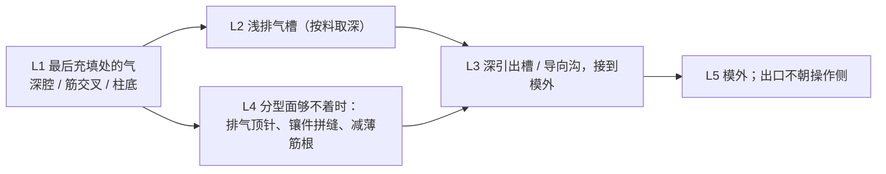

# 注塑困气烧焦与排气槽：最后充填处开浅槽，筋交叉用镶件或排气顶针

> [!summary] 一句话概述
> 型腔里的空气和熔体释放的气体如果排不出去，会在最后充填处被压缩发热，轻则气纹、缺料，重则把塑料烧焦发黑（淘小铺称为与柴油机点火同一类的绝热压缩）；排气要开在分型面的最后充填处，深筋、柱底和筋交叉处则靠镶件拼缝、排气顶针或减薄筋根把气赶走，槽深必须按材料来，而不能做成产品外壳上的通风口或百叶。

## 配图

![[附件/moldds-vent-defects.jpg]]
*图源：[中正通《注塑模具排气槽设计指南：原理、方法与参数详解》](https://www.moldds.com/design-applications/107.html) 图 1（原图标题为「9-1 排气不良的危害」）；六种常见表现：气纹、披锋、烧焦、气泡、熔接线、缺料。烧焦子图为模流结果在深腔/末端的高温困气区，缺料子图为筋片末端充不满。正文把困气处炭化、烧焦写为「气体被压缩产生高温，常出现在最后填充的深腔、骨位底部」*

![[附件/moldds-vent-section.jpg]]
*图源：同上文配套排气槽结构图（正文图 2 说明：1. 分流道　2. 排气槽　3. 导向沟）；平面图在型腔末端和流道尾布置排气，剖面 A-A 标出浅槽深度 h、宽度方向的 b、长度 L，导向沟/出口段另标 (0.20~0.30) mm。正文把常规尺寸写成：宽度 b 为 5–8 mm，长度 L 为 8–10 mm 左右，深度 h 为 0.005–0.04 mm 并按塑料品种取值；入口浅、出口加深，以免熔体轻易溢出*

![[附件/moldds-vent-depth-chart.jpg]]
*图源：同上「常见塑料排气槽深度速查」图；数值为常用起始值。图中：LCP 0.005 mm；PP / PPS / PA 0.01 mm；PE、PS、POM、PA(GF)、PET、PC/ABS、PBT、PPE/PS 0.02 mm；ABS、AS(SAN)、PPE(PPO)、PC、PBT(GF) 0.03 mm；PMMA 0.04 mm。注：低粘度材料取浅，PC、PMMA 等可适当取深，但不以溢料为限。淘小铺、丞耀的分档与此不完全相同，见参数表*

> 图片版权归原作者所有，仅作个人学习收藏；出处见文末「来源与核实记录」。

## 结构原理

> 本节所有数字只写来源里给出的；来源没有就写「来源未给出」，不估算、不换算成看似精确的值。

模具里的气体不只是型腔空气。中正通写：还包括流道里的空气，以及塑料在高温下分解产生的气体。丞耀把它归纳成三类：原有空气、降解气体，以及未彻底烘干时的蒸汽。这些气体若停在最后充填点，会被后面的熔体压缩。丞耀按绝热压缩原理解释：被高度压缩的气体温度会剧烈升高（原文：可达数百度），直接导致塑料焦化；压力过大阻挡流动，则造成短射。淘小铺把烧痕位置固定、工艺乱飘这一条，当作区分「模具困气」和「料温/水分问题」的关键。

本篇写的是模具排气槽和局部排气结构，不是产品外壳上的散热通风口或防雨百叶。

### 堆叠方案

方向：**沿气体排出路径，从型腔最后充填处到模外**

| 层级 | 零件/区域 | 材料 | 厚度/尺寸 | 固定方式 | 依据 |
| --- | --- | --- | --- | --- | --- |
| L1 困气点（型腔末端） | 最后充填处、深腔底、骨位/柱位底部、筋交叉、熔接线预测处、流道尾端 | 此处是气体被压缩的位置 | — | 由浇口和型腔几何决定 | 中正通 5 个必开点；淘小铺；丞耀：流动末端以及结合线预测处 |
| L2 浅排气槽 | 优先开在分型面上、有胶位且可加工的一侧 | 分型面钢料 | 中正通：宽 5–8 mm，长 8–10 mm，深 0.005–0.04 mm（按料）；淘小铺：分型面浅槽宽 5 到 10 mm，深按料（如 ABS 约 0.03 mm） | 铣在分型面上，必须经专用通道接到模外，不可接入顶针孔或螺钉孔 | 中正通 9 条要求；淘小铺 |
| L3 导向沟 / 深引出槽 | 浅槽出口段 | 同一分型面 | 中正通图面标注 (0.20~0.30) mm；淘小铺：槽尾再接一条 0.3 mm 以上的深槽把气引到模外 | 与浅槽连通，出口朝天侧或地侧，不可朝操作侧 | 中正通图 2 与要求 9；淘小铺 |
| L4 局部排气结构 | 分型面够不着的死角：排气顶针、镶件/镶针拼缝、行位末端浅槽；必要时多孔排气钢 | 顶针、镶件或烧结多孔钢 | 淘小铺：普通顶针配合间隙本身约在 0.01 mm 上下；排气顶针在靠近头部处磨出扁平排气面，排气面积比普通顶针大好几倍 | 顶针、镶件可拆下来清理；排气通道仍要独立出模外 | 中正通要求 5、6 与行位排气；淘小铺 |
| L5 模外大气 | 气体最终排出处 | — | — | 中正通：出口朝天侧或地侧，避免高温熔料随气体喷向操作侧 | 中正通 |

剖面示意：

筋交叉等死角，淘小铺给过一个结构侧的例子：烧焦点卡在两条加强筋的十字交口，筋深 8 mm、壁厚 1.2 mm，没有位置开槽；后来把其中一条筋的根部壁厚从 1.2 减到 0.9，让料先填满筋底把气赶走，再配合一根排气顶针。这是该文的车间案例，不是通用公式。

### 零件清单

| 零件/模具要素 | 数量 | 功能 | 材料 | 依据 |
| --- | --- | --- | --- | --- |
| 分型面浅排气槽 | 开在最后充填处，数量按困气点 | 排出型腔气体，又要浅到不溢料 | 分型面钢料 | 中正通；淘小铺 |
| 导向沟 / 深引出槽 | 每条浅槽的出口段 | 把气从浅槽引到模外，避免「气只从型腔赶到浅槽里」 | 同一钢料 | 中正通图 2；淘小铺 |
| 排气顶针或普通顶针（兼排气） | 深腔、筋底等分型面够不着的位置 | 利用配合间隙或扁平排气面排气，并可随顶出自清洁（清理频率见各文） | 顶针钢材 | 淘小铺；中正通同时警告：排气不可接到普通顶针孔当专用通道 |
| 镶件 / 镶针上的排气槽 | 柱位、骨位、拼缝处 | 把封闭气腔打开，并便于拆下清理 | 镶件钢 | 中正通要求 5、6 |
| 行位（滑块）末端排气 | 行位背面、底面等最后到达处 | 就近排气且可拆清；不可开在滑动配合面或锁紧面上 | 行位钢 | 中正通第五节 |
| 多孔排气钢 | 死角又深又小、机械加工够不着时的备选 | 气体从微孔透过；淘小铺写比普通钢贵好几倍，且孔会堵，需拆清 | 烧结多孔钢 | 淘小铺 |

### 装配顺序

> 来源是模具排气设计与试模排查顺序，不是产品拆解。

1. **先找出气会停在哪里**：有模流看「最后填充」和「困气」；没有模流就沿料流路径问「气最后停在哪」（中正通）。烧焦已经出现时，淘小铺建议先把烧痕位置圈在模具上，再把注射速度降三成打一模，若烧痕变浅或移位，基本可坐实是困气而不是单纯料温过高。
2. **分型面末端开浅槽，槽尾接深槽到模外**：不要只开浅槽不接引出槽。
3. **给分型面排不到的位置补局部排气**：深腔底、筋交叉、柱底用排气顶针或镶件拼缝；行位末端在非滑动面开槽，同样独立接到模外。
4. **按材料选深度，试模以不溢料为限**：同一套「通用深度」不能打天下。飞边时淘小铺建议先用油石轻轻研低分型面，而不是一上来重新开槽；PA 类要往更浅收。
5. **按周期清理**：丞耀写模具生产约 5,000～10,000 模后，排气槽常被析出物堵塞；淘小铺写行业里普遍连续生产一到两万模次清一次，停机超过一周再开机前也要刷。中正通强调把排气做在可拆、可动的零件上，否则堵塞等于没开。

### 受力与运动分析

- **受力路径**：充填时熔体推动型腔气体向末端集中；气体压力升高后，或者把料挡住形成缺料，或者被压缩升温把塑料烧焦，也可能把压力传到分型面、镶缝而挤出披锋（中正通）。
- **运动关系**：排气槽本身是静止的缝。顶针、行位上的排气会随顶出或抽芯运动，因而有自清洁或可拆清洗的优点；但也因此更不能把排气通道接到普通顶针孔、螺钉孔，否则会漏料、腐蚀和卡死（中正通把这写成硬要求）。
- **失效风险**：槽开浅了继续烧焦、缺料；开深了飞边。槽尾不接深槽，气只是换个地方被堵住。筋交叉、深柱底部只靠分型面往往排不到。保养中断后，老模具会突然再烧焦。丞耀和淘小铺都把堵塞列为量产后烧焦复现的常见原因。

## 设计要点与参数

| 要点 | 内容 | 依据 |
| --- | --- | --- |
| 必开位置 | 薄胶易熔接/易缺填处；熔体最后汇合处与厚壁处；实心柱、骨位、螺丝柱底部；流道尾端；分型面 | 中正通第二节 |
| 通道规则 | 所有排气必须经专用通道接到模外，不可接通顶针孔，也不可接通螺钉孔；出口朝天侧或地侧，不可朝操作侧 | 中正通第 3、9 条 |
| 浅槽宽度与长度 | 宽度 b：5–8 mm；长度 L：8–10 mm 左右 | 中正通第四节 |
| 浅槽宽度（另一机构） | 沿产品周边、在充填末端开浅槽，宽 5 到 10 mm | 淘小铺 |
| 深度总范围 | 深度 h：0.005–0.04 mm，按塑料品种取 | 中正通 |
| 中正通分档（起始值，mm） | PE 0.02；PP 0.01；PS 0.02；PPS 0.01；ABS 0.03；AS(SAN) 0.03；PPE(PPO) 0.03；POM 0.02；PPE/PS 0.02；PA 0.01；PA(GF) 0.02；PET 0.02；PC 0.03；PC/ABS 0.02；PMMA 0.04；PBT 0.02；PBT(GF) 0.03；LCP 0.005。玻纤增强料通常比未增强料略深 0.005–0.01 mm，但以不溢料为限 | 中正通深度表与图注 |
| 淘小铺分档（mm） | PP / PE：0.02–0.03（宁浅勿深）；ABS / PS：0.03 左右；PC / PMMA：0.04–0.05；PA66：0.012–0.02（极易飞边，要往死里收） | 淘小铺深度表 |
| 丞耀分档（mm） | PE/PP：约 0.01～0.02；ABS/PC：约 0.03～0.05；添加玻纤的材料：可放宽至 0.04 | 丞耀 3.3 节 |
| 引出槽深度 | 中正通图面导向沟处标注 (0.20~0.30) mm；淘小铺写槽尾再接 0.3 mm 以上深槽 | 中正通图 2；淘小铺 |
| 顶针兼排气 | 普通顶针配合间隙约在 0.01 mm 上下；排气顶针在针身靠近头部磨出扁平排气面 | 淘小铺 |
| 筋交叉死角的一个案例 | 筋深 8 mm、壁厚 1.2 mm 的十字交口无开槽空间；将其中一条筋根从 1.2 减到 0.9，并加排气顶针 | 淘小铺（车间案例，不是通用比例） |
| 清理周期 | 丞耀：约 5,000～10,000 模后常被堵塞；淘小铺：普遍一到两万模次清一次 | 丞耀；淘小铺 |

> 三家深度表对同一材料并不完全一致，例如 PP：中正通 0.01 mm，丞耀 0.01～0.02 mm，淘小铺 0.02–0.03 mm；PC：中正通 0.03 mm，淘小铺与丞耀可到 0.04–0.05 mm。本文并列原文，不折中成一个「标准值」。设计起始可先选一家作为初值，以试模不溢料、不烧焦为准。

## 优缺点

**优点**
- 把烧焦从「调机」改回「气体要有路可走」，位置判断和开槽规则都可检查。
- 分型面浅槽成本最低；顶针、镶件、行位排气能覆盖分型面到不了的死角，且便于清理。
- 按材料分档深度，比「随便开一条缝」更不容易飞边或继续困气。

**缺点 / 代价**
- 深度差 0.01 mm 就可能在溢料和烧焦之间切换，要靠试模收敛，不能只抄表。
- 排气开在滑动面、锁紧面或接到顶针孔，会换成另一类故障：拉伤、卡死、漏料。
- 多孔钢和密集镶件会增加成本和保养负担；不清理就会在量产后突然复发。

## 可借鉴点

- 看到位置固定的黑斑，先圈在模具上对应「最后充填处」，不要第一时间只降料温。
- 出图检查五处：分型面末端、流道尾、柱底、骨底、筋交叉；浅槽必须接到模外深槽。
- 禁止把排气道接到顶针孔或螺钉孔；出口不要朝操作侧。
- 深度按材料选起始值，并把三家表的差异当作公差意识：PP、PA 宁浅，PC、PMMA 可略深，一律以不溢料为限。
- 筋交叉没有开槽空间时，考虑减薄一条筋根，并加排气顶针或把该处做成可拆镶件，而不是在滑动面上硬开槽。
- 把排气清理写进保养周期（约数千至一两万模一次），否则「原来好用的槽」会自己失效。

## 与库中相似案例对比

| 对比项 | 本案例 | [[注塑熔接痕：位置由浇口定、深浅由前锋温差定]] | [[外壳散热通风口与防雨百叶：开孔率、进出风与滴水路径]] | [[发泡件缩水：模温、排气与保压和实心件相反]] |
| --- | --- | --- | --- | --- |
| 关注点 | 模具型腔气体排不出去造成的困气、烧焦和缺料 | 两股熔体汇合形成的熔接痕 | 产品外壳上的通风口、百叶 | 发泡工艺里模温、排气、保压与实心件相反 |
| 「排气」含义 | 模具分型面/顶针/镶件上的排气槽，把气体排到模外 | 汇合点排气可以减轻熔接痕和烧焦，但是熔接痕篇的配角 | 成品上给设备进风、防雨的开孔，与模具排气不是同一件事 | 发泡件工艺排气，对象仍是成型过程，规则与实心件不同 |
| 何时用这篇 | 末端烧焦、位置固定的黑斑、深筋交叉困气、要确定槽深时 | 主要问题是熔接线外观和强度时 | 设计壳体通风、防雨百叶时 | 做微发泡或化学发泡件的工艺窗口时 |
| 来源 | 中正通 + 淘小铺 + 丞耀 | 见该案例 | 见该案例 | 见该案例 |

## 相关案例

- [[注塑熔接痕：位置由浇口定、深浅由前锋温差定]]
- [[注塑缩痕：厚壁背面凹陷、减胶坑与保压边界]]
- [[塑料件加强筋设计：厚度、高度与间距比例]]
- [[发泡件缩水：模温、排气与保压和实心件相反]]
- [[外壳散热通风口与防雨百叶：开孔率、进出风与滴水路径]]
- 分类索引：[[01-壳体与外观件 索引]]

## 来源与核实记录

- 主来源：[注塑模具排气槽设计指南：原理、方法与参数详解](https://www.moldds.com/design-applications/107.html)（中正通设计团队，2026-05-10 发布，2026-11-11 更新；已打开全文，核对 6 种表现、5 个必开点、9 条要求、18 种材料深度表、行位排气规则，并下载缺陷图、深度速查图和剖面图）
- 补充来源：[模具排气开在哪？排气槽位置与困气烧焦的排查](https://www.tbtaoxiaopu.com/injection-mold/mold-venting-guide.html)（Taoxiaopu / 淘小铺，2026-10-12；已打开全文，核对分型面浅槽加 0.3 mm 以上深槽、按材料分档的深度表、普通顶针约 0.01 mm 间隙、筋交叉案例和清理周期）
- 补充来源：[2026 专题 3：排气系统（Venting）与烧焦（Gas Burn）的防治](https://www.mold-ok.com/news-info.asp?id=1597)（丞耀精密有限公司，技术-知识蒐集，2026/2/11；已打开 3.1–3.3 节，核对气体来源、绝热压缩导致烧焦，以及 PE/PP、ABS/PC、玻纤料的深度和 5,000～10,000 模清理建议）
- 核实：2026-11-22 实际打开上述页面并下载配图。https://weilinplastic.com/zh/注塑模具排气设计指南/ 本次返回 HTTP 202 且正文为空，未引用。未把产品通风口或发泡工艺排气写成同一篇。三家槽深差异已在参数表分列。
