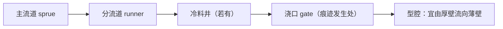

# 注塑浇口类型与位置：侧浇口、潜伏浇口与点浇口对痕迹和对面结构的影响

> [!summary] 一句话概述
> 浇口决定熔体从哪里进入型腔，也就决定了外观面上的浇口残痕、对面或末端可能出现的气纹与冲击，以及保压能否走到厚壁。侧浇口加工简单但侧面留痕，潜伏式与点浇口可自动切断、痕迹更小，但压力损失和浇口尺寸限制不同。本篇讲浇口类型与位置，对照已有「注塑熔接痕」篇——熔接痕可以是浇口布置的后果，但不是本篇要写的形成机理。

## 配图

![[附件/protolabs-fig1-4-5-edge-tunnel-gates.jpg]]
*图源：[Proto Labs, Injection Moulding Part Design For Dummies](https://www.protolabs.com/media/1011290/im-for-dummies-en.pdf) 第 13 页 Figure 1-4、Figure 1-5（已打开 PDF）；上图侧浇口（edge gate）从分型面把熔体送入制件边缘，制件与流道仍连在一起；下图隧道/潜伏式浇口（tunnel gate）从型芯侧斜向进入，顶出时浇口被切断*

![[附件/protolabs-fig1-6-7-post-hottip-gates.jpg]]
*图源：同上第 14 页 Figure 1-6、Figure 1-7；上图柱式浇口（post gate）沿顶针通道从背面进料，顶出后会留下一段需切除的柱；下图热浇口（hot tip）由热嘴直接连到制件，几乎不浪费流道料，但制件上要为出料加一个凹坑（dimple）*

![[附件/xometry-sprue-runner-gate.jpg]]
*图源：[Xometry, How to Choose Core and Cavity Placement in Injection Molding](https://www.xometry.com/resources/injection-molding/injection-molding-core-and-cavity/)（Published August 4, 2023，Updated January 7, 2026；已打开页面并下载原图）；冷流道浇注系统：sprue（主流道）、runner / sub runner（分流道）、gate（浇口）、cold slug（冷料井）。文中说明浇口通常比流道窄得多，是制件与流道的切断点*

> 图片版权归原作者所有，仅作个人学习收藏；出处见文末「来源与核实记录」。

## 结构原理

> 本节所有数字只写来源里给出的；来源没有就写「来源未给出」。一级分类放在 01-壳体与外观件，是因为本篇最值得学的是浇口残痕和对面结构，而不是模具钢材或机台工艺本身。

### 堆叠方案

方向：**沿熔体充填路径，从注塑机喷嘴到型腔（由外到内的浇注链）**。

| 层级 | 零件/特征 | 材料 | 厚度/尺寸 | 固定方式 | 依据 |
| --- | --- | --- | --- | --- | --- |
| L1 | 主流道（sprue） | 模具浇注系统（冷流道或热流道） | 来源未给出通用直径；Xometry：通常垂直于型腔轴线，有时直接通入型腔（直浇口） | 合模后形成通道 | Xometry；Protolabs 第 11–12 页 |
| L2 | 分流道（runner / sub runner） | 同上 | Xometry：流道把熔体从主流道送到浇口，通常比浇口宽 | 同上 | Xometry |
| L3 | 冷料井（cold slug，若采用） | 同上 | 东丽：标准侧浇口若流道冷料井不足，浇口后方容易出现流痕、蛇形纹（喷痕） | 同上 | 东丽「位置」(5)；Xometry 图 |
| L4 | 浇口（gate） | 同上 | 东丽：直径最好在 0.8φ 以上（包括点浇口）；过小则阻力大、剪切热增加，或因浇口过早封闭而产生缩痕和空洞。赫兹：浇口截面厚度通常取产品壁厚的 50%–80%，宽度根据产品体积计算（赫兹未给出体积公式的具体系数） | 与型腔相连，开模后切断或残留 | 东丽「浇口尺寸」；赫兹 4.2 节 |
| L5 | 塑件型腔（由厚壁区流向薄壁区） | 热塑性塑料 | 东丽：壁厚不统一时，浇口应设计在壁厚的部分。赫兹：先厚后薄，利于保压补缩 | 充填、保压、冷却后顶出 | 东丽「位置」(2)；赫兹 4.1 节 |

剖面示意：

### 零件清单

| 零件/特征 | 数量 | 功能 | 材料 | 依据 |
| --- | --- | --- | --- | --- |
| 侧浇口（edge / 侧浇口） | 按需 | 从制件边缘进料；赫兹：加工简单、去除容易、应用最广泛，产品侧面有浇口痕迹。Protolabs：易修剪，但留下 vestige。东丽：标准形状，位置自由度高 | 冷流道常见 | 赫兹表 4 / 680 节五；Protolabs；东丽表 4.1 |
| 潜伏式 / 隧道浇口（submarine / tunnel） | 按需 | 开模或顶出时自动切断。Protolabs：浇口开在型芯侧再转回制件。东丽：制品拔出时自动切掉；并写明 TORELINA™ 一般不适用潜伏式，若必须使用要保证浸入角度足够大（30°–35°） | 冷流道，模具结构较复杂（赫兹） | 同上 |
| 点浇口（pinpoint / 点浇口） | 按需，可多点 | 痕迹小，可自动脱落。东丽：直径很小所以痕迹不明显，但流动性较差；浇口数量增加时，熔接部位等脆弱区更容易出现。赫兹：适合三板模、多腔模、精密小件，压力损失大（680） | 常配合三板模 | 东丽表 4.1；赫兹 686 / 680 |
| 热浇口（hot tip） | 按需 | Protolabs：热嘴直接连到制件，几乎不浪费塑料，但要在制件上加 dimple 才能顺利出料 | 热流道 | Protolabs Figure 1-7 |
| 柱式浇口（post gate） | 按需 | Protolabs：沿顶针通道从背面进料，顶出后留下一段柱，需再切除；适合想把痕迹藏在背面的场合 | 冷流道 + 顶针孔 | Protolabs Figure 1-6 |
| 扇形 / 薄膜 / 盘 / 环形 / 护耳 / 直浇口 | 按几何选用 | 东丽表 4.1 与赫兹表 4 还列出扇形、薄膜、盘浇口、环形、护耳、直接/直型浇口等，用于大面积薄壁、环形件或改善喷痕；本篇不把每一种都写成独立结构 | 视模具 | 东丽表 4.1；赫兹表 4 |

### 装配顺序

浇注系统在合模后形成，不是产品装配。按成形循环（Xometry 四步 + 各来源的切断方式）：

1. 塑化并注射：熔体经主流道、分流道、浇口进入型腔。位置应使各处流动平衡（东丽），并由厚壁流向薄壁。
2. 保压补缩：浇口必须足够大、且开在厚壁，否则东丽指出浇口过早封闭会在厚壁处形成缩痕与空洞。
3. 冷却后开模：侧浇口仍连在流道上，需修剪并留下 vestige（Protolabs、赫兹）；潜伏式 / 点浇口在脱出时自动切断（东丽、赫兹、Protolabs tunnel）。
4. 热浇口几乎无流道废料，但凹坑留在进料点（Protolabs）。柱式浇口的柱需事后切掉（Protolabs）。
5. 顶出痕迹与浇口痕迹是两处不同的外观点，不要布置在同一外观面上（来源未给出两者最小间距）。

### 受力与运动分析

- **受力路径**：浇口附近容易残留成型压力和取向。东丽写：过剩成型压力残留在浇口，导致残余应力较大，机械性能下降；玻纤增强规格因 GF 取向，靠近浇口的部分比其他部分更脆弱。因此不要把浇口放在主受力部位，也不要让熔接线落在主应力路径上（熔接线细节见已有专篇）。
- **运动关系**：开模时浇口与制件分离。侧浇口在分型面断裂或被剪；潜伏式沿隧道被拉断；点浇口在取出时自动修剪；热浇口依靠热嘴不粘连。
- **失效风险**：浇口过小 → 剪切热、降解、补缩不足（东丽、赫兹）。浇口在薄壁 → 薄处先冻、厚处缩痕空洞（东丽）。浇口对着型芯或对面壁直冲 → 东丽要求进浇后熔体应立即改变方向（乱流化），否则侧浇口后方可能出现喷痕、流痕。浇口留在外观面或装配后仍可见处 → 残痕不可接受（赫兹、东丽）。多点浇口增加熔接薄弱点（东丽）。

## 设计要点与参数

| 要点 | 内容 | 依据 |
| --- | --- | --- |
| 浇口放在厚壁 | 壁厚不统一时，浇口应设计在壁厚的部分；薄壁处树脂迅速冷却、粘度增加，从薄处进浇会导致流动性不足，并在厚处形成缩痕与空洞 | 东丽「位置」(2) |
| 先厚后薄 | 浇口设在壁厚最大区域，熔体从厚壁流向薄壁，利于保压补缩 | 赫兹 4.1 节 |
| 避开外观与功能区 | 浇口痕迹应位于非外观面或装配后不可见处；东丽：浇口附近易出现银纹及不规则流动 | 赫兹 4.1；东丽「位置」(3) |
| 远离高应力区 | 浇口附近有残余应力，应避开卡扣、铰链等；东丽：避免将浇口设计在制品的主受力部位 | 赫兹 4.1；东丽「位置」(3) |
| 浇口直径 | 东丽：最好在 0.8φ 以上（包括点浇口） | 东丽「浇口尺寸」 |
| 浇口截面厚度 | 赫兹：通常取产品壁厚的 50%–80%；过小会导致射胶压力过高、剪切发热、保压补缩不足 | 赫兹 4.2 节 |
| 潜伏式浸入角（TORELINA™） | 一般不适用潜伏式；若必须使用，浸入角度要足够大（30°–35°） | 东丽表 4.1 前文 |
| 防喷痕 | 进浇后熔体应立即改变流动方向；侧浇口要有足够冷料井 | 东丽「位置」(5) |
| 侧浇口痕迹 | 产品侧面有浇口痕迹（vestige），但修剪方便 | 赫兹；Protolabs Figure 1-4 |
| 点浇口痕迹 | 痕迹小、可自动切断，但流动性较差，多点时脆弱熔接部位增加 | 东丽表 4.1 |
| 热浇口凹坑 | 制件上需加 dimple 供熔体流出 | Protolabs Figure 1-7 正文 |
| 排气配合 | 赫兹：浇口位置应使熔体最后充填的区域位于分型面，方便排气。东丽另给出 PPS 排气槽约 5/1000 mm，属排气设计，不是浇口尺寸 | 赫兹 4.1；东丽「气体排放」 |

> 来源没有给出的参数一律写「来源未给出」。不把熔接痕温差阈值写入本篇。

## 优缺点

**优点**
- 按外观和自动化需求选类型：侧浇口模具简单；潜伏式 / 点浇口可自动去浇口、痕迹更小；热浇口几乎无流道废料。
- 把浇口放在厚壁并避开外观与主受力区，同时照顾补缩、残痕和强度。
- 背面柱式浇口或内表面潜伏式，可以把切断点藏起来。

**缺点 / 代价**
- 点浇口和过小浇口以压力损失和过早封闭为代价；东丽明确反对「越小越好」。
- 潜伏式对某些材料（东丽写 TORELINA™）并不友好，还要保证浸入角，模具更复杂（赫兹）。
- 热浇口要在制件上预留凹坑；柱式浇口要二次去柱。
- 多浇口改善充填的同时，增加熔接薄弱点（东丽）。

## 可借鉴点

- 先问三个问题：痕迹能否出现在外观面？要不要自动去浇口？壁厚是否均匀？再在侧浇口、潜伏式、点浇口、热浇口之间选，而不是先画一个方便开模的侧浇口再补救。
- 位置检查表：厚壁处进浇、不冲外观面、不落在卡扣/铰链/主受力路径、进浇后有转向空间、最后充填点能排气。
- 点浇口不要为了「痕迹小」而小于东丽所说的约 0.8φ；赫兹的 50%–80% 壁厚可用来校核截面厚度。
- 若材料手册（如 TORELINA™）写明不推荐潜伏式，不要只因为「自动剪浇口」就坚持用，除非能满足其浸入角等附加条件。
- 熔接痕会落在哪里，用已有「注塑熔接痕」篇去管；本篇只负责不要把浇口和熔接安排在外观或主受力区。

## 与库中相似案例对比

| 对比项 | 本案例（浇口类型与位置） | [[注塑熔接痕：位置由浇口定、深浅由前锋温差定]] | [[注塑缩痕：厚壁背面凹陷、减胶坑与保压边界]] | [[注塑均匀壁厚与厚薄渐变：相邻壁厚比与过渡段长度]] |
| --- | --- | --- | --- | --- |
| 主角 | 浇口形式、进浇位置、残痕与对面冲击 | 两股前锋汇合的熔接痕 | 厚壁背面凹陷与保压 | 壁厚窗和过渡段 |
| 浇口在文中的角色 | 本篇的设计对象 | 已有篇用浇口解释熔接位置，但不讲侧浇口/潜伏式/点浇口选型 | 浇口影响补缩，但主角是缩痕 | 提到不要在变壁厚附近浇注，不讲浇口类型 |
| 何时用这篇 | 选浇口种类、布置进浇点和预判残痕时 | 已经在处理熔接痕深浅和位置时 | 处理缩痕和保压时 | 先把壁厚过渡做对时 |
| 是否重复 | 否。本篇不写前锋温差、不把熔接痕机理再写一遍 | 已有，本篇只对照 | 已有 | 本轮新篇，互补 |

## 相关案例

- [[注塑熔接痕：位置由浇口定、深浅由前锋温差定]]
- [[注塑缩痕：厚壁背面凹陷、减胶坑与保压边界]]
- [[注塑均匀壁厚与厚薄渐变：相邻壁厚比与过渡段长度]]
- 分类索引：[[01-壳体与外观件 索引]]

## 来源与核实记录

- 主来源：[东丽塑料，TORELINA™ 模具设计的基本方针（浇口）](https://www.plastics.toray/zh/technical/torelina/tec_036.html)（已打开中文页：表 4.1 浇口类型与特征、浇口尺寸、位置 (1)–(6)、潜伏式 30°–35°。中文主来源。页面未给出独立发布日期）
- 补充来源 1：[赫兹，注塑件设计避坑指南](https://www.hezidesign.com/gongyi/686.html)（2026-05-01，刘也；已打开第 4 节浇口位置与表 4）及同机构[注塑模具基础](https://www.hezidesign.com/gongyi/680.html)（2026-04-30，胡亚设；已打开第 5 节浇口类型表）。两篇只计赫兹一个机构
- 补充来源 2：[Proto Labs, Injection Moulding Part Design For Dummies](https://www.protolabs.com/media/1011290/im-for-dummies-en.pdf)（2012；已打开第 12–14 页 Getting out of the gates 与 Figure 1-4 至 1-7。独立机构）
- 补充来源 3：[Xometry, How to Choose Core and Cavity Placement in Injection Molding](https://www.xometry.com/resources/injection-molding/injection-molding-core-and-cavity/)（Kat de Naoum 撰，Megan Conniff 更新；Published 2023-08-04，Updated 2026-01-07。已打开并下载浇注系统图。独立机构）
- 核实：2026-11-22 打开上述页面与 PDF，下载原图。未引用未打开的链接。未把本篇写成熔接痕专论。
