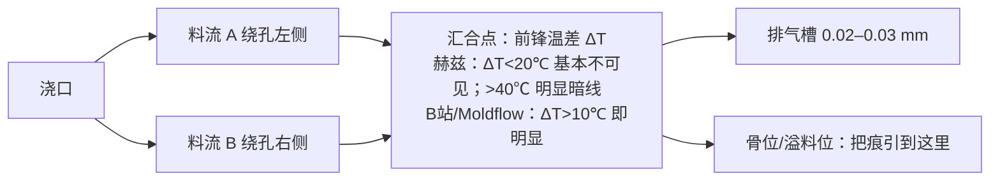

# 注塑熔接痕：位置由浇口定、深浅由前锋温差定

> [!summary] 一句话概述
> 熔接痕（又叫熔接线、夹水线、夹水纹）是两股料流前锋相遇时界面没有完全熔合留下的线。赫兹工业设计把它拆成两个独立问题：**位置**由浇口和型腔几何决定，浇口挪 10 mm，痕就换一条边，调机挪不动它；**深浅**由前锋温差、料温、模温、流速和排气决定，温差 < 20 ℃ 基本看不见，> 40 ℃ 是抛光和喷涂都盖不住的暗线。B 站专栏「模具知识 11」给出的 Moldflow 判据更严：前锋温差 > 10 ℃ 熔接线就很明显。它还列出结构侧的手段：在汇合处加骨位，把痕引过去。

## 配图

![[附件/weldline-gate-position.jpg]]
*图源：[赫兹工业设计 1278](https://www.hezidesign.com/gongyi/1278.html) 原文示意图「熔接痕位置与浇口关系」*

![[附件/weldline-hole-product.jpg]]
*图源：[B 站 cv12024658](https://www.bilibili.com/read/cv12024658)，原图注「产品上的熔接线」；接口开孔多的面板，每个孔后方都有料流汇合*

![[附件/weldline-move-to-rib.png]]
*图源：同上，原图注「将熔接线移动到骨位上」（动图末帧）：环形件左侧进胶，对面汇合处加一个小凸台/骨位*

> 图片版权归原作者所有，仅作个人学习收藏；出处见文末「来源与核实记录」。赫兹文中的 Unsplash 场景图未收录。

## 结构原理

> 本节数字只写来源里给出的；来源没有就写「来源未给出」。

### 堆叠方案

方向：**按料流路径，从浇口到汇合点**

| 位置 | 发生了什么 | 设计杠杆 | 依据 |
| --- | --- | --- | --- |
| 浇口 | 料从这里进；浇口位置决定各方向流程长短 | 浇口数量与熔接线数量成正比；挪浇口 10 mm 痕换边 | 赫兹；B 站 |
| 孔/槽/镶件 | 料流被分成两股绕过去 | 孔、槽数量与熔接线数量成正比 | B 站 |
| 流程中段 | 前锋降温 | 料温（推荐值 +10 ℃ 以内）、模温 60–80 ℃、中速偏快分段注射 | 赫兹 |
| 汇合点 | 两股前锋相遇，分子取向不一致，表面留 V 形槽，强度下降 | 汇合点加排气（槽深 0.02–0.03 mm）；加骨位引痕；分模线/纹理/装饰件遮挡 | 赫兹；B 站 |

剖面示意：

### 零件清单

| 零件/模具要素 | 数量 | 功能 | 依据 |
| --- | --- | --- | --- |
| 浇口（进胶点） | 1~n | 决定熔接痕位置 | 赫兹；B 站 |
| 排气槽/排气镶件 | 汇合点处 | 排走被两股料夹住的气体，防止痕加深和烧焦 | 赫兹 |
| 骨位 | 汇合点处 | 把熔接线引到骨位上 | B 站 |
| 热流道顺序阀 | 可选 | 控制多个浇口依次开启，让汇合时温差小 | B 站 |
| 急冷急热模具 | 可选 | 注射前用蒸汽把模面加热到 Tg 以上，汇合处无缝熔合，可完全消除熔接线 | B 站 |

### 装配顺序

> 本案例是外观件设计流程，按赫兹「按代价从低到高」的改善顺序整理：

1. **结构评审阶段**：把熔接痕预测图作为交付物，在图纸上挪进胶点（改模时只换镶件）。
2. **试模后先加排气**：几乎没有代价，最优先做。赫兹的显示仪外壳只加了两个排气镶件，痕的可见度就降了一个等级。
3. **再调料温**：在材料推荐值上加 10 ℃ 以内；超过 20 ℃ 以上降解风险明显，透明件先发黄，深色件出银纹。
4. **再调模温和流速**：模温 60–80 ℃，透明件更高；在汇合点前降速。
5. **最后改浇口或改分件**：模具做完再改要动模仁，费用和时间都上去。

### 两个实测改法（赫兹 1218）

| 案例 | 现象 | 无效尝试 | 有效改法 |
| --- | --- | --- | --- |
| 血压计上壳，侧面单点进胶 | 视窗右侧发白细线，正对背面两个卡扣孔（绕流型） | 模温 60 → 80 ℃，线淡了一点但没消失 | 两个卡扣孔各挪 6 mm，痕散到非外观面 |
| 小家电 ABS 上盖，主壁厚 2.0 mm，六道筋 | 外观面正中一条明显痕 | 模温 70 → 95 ℃、改注速，无效 | 筋根 1.6 → 1.2 mm（0.8t → 0.6t），痕淡约七成，剩余用咬花盖掉；筋高 +0.5 mm 补刚度 |

**分型判断**：痕能对上背面孔位的是「绕流型」，改孔位和镶件；痕在两浇口连线上的是「汇合型」，改浇口。

### 受力与运动分析

- **强度**：交汇处分子取向不同，强度显著降低（B 站）。所以熔接痕除了是外观问题，还要避开受力位置；赫兹 FAQ 也说「让它不在受力位置」。
- **表面几何**：痕除了颜色差，还有一道微小 V 形槽（B 站图「表面出现 V 型槽」）。喷涂只盖得住颜色、盖不住凹陷，高光漆面还会放大凹槽；熔接痕上的漆附着力差，久了先掉漆（赫兹）。
- **流道与排气**：排气不良时，汇合点的气体顶住两股料，痕加深并伴随烧焦（赫兹）。

## 设计要点与参数

| 参数 | 数值 | 依据 |
| --- | --- | --- |
| 浇口偏移对痕位置的影响 | 挪 10 mm 痕换一条边 | 赫兹 |
| 前锋温差：基本看不见 | < 20 ℃ | 赫兹 |
| 前锋温差：明显暗线 | > 40 ℃ | 赫兹 |
| 前锋温差：Moldflow 判据「非常明显」 | > 10 ℃ | B 站 |
| 料温上调 | 推荐值 +10 ℃ 以内；+20 ℃ 以上有降解风险 | 赫兹 |
| 模温 | 60–80 ℃，透明件更高 | 赫兹 |
| 汇合点排气槽深 | 0.02–0.03 mm | 赫兹 |
| 料流汇合夹角 | > 135° 且温差小可淡化到看不见；< 135° 调模温救不回，要改浇口布局 | 赫兹 1218 |
| 主壁厚 : 局部壁厚 | 控制在 1.5:1 以内 | 赫兹 1218 |
| 筋根厚 | > 0.7t 易在分流处留痕；先减到 0.5–0.6t，再加筋高补刚度 | 赫兹 1218 |
| 厚薄过渡圆角 | ≥ 0.5 mm | 赫兹 1218 |
| 外观验收 | 写明视距和光照，例如 300 mm 视距下看不出可放行；透明件、高光免喷涂件一个都不允许 | 赫兹 |

> 阈值差异：赫兹的「< 20 ℃ 看不见」是外观经验分级，B 站的「> 10 ℃ 很明显」是 Moldflow 前锋温度图的仿真判据。推断：仿真阶段按 10 ℃ 预警更保守；高光、透明件应按更严的 10 ℃。

## 优缺点

**提前在结构上处理的好处**
- 挪浇口在设计阶段只是换镶件，模后再改要动模仁
- 骨位、分模线、纹理遮挡都比喷涂兜底可靠

**代价**
- 有孔、有镶件、多点进胶，就一定有汇合，多数结构无法完全消除（赫兹 FAQ）
- 急冷急热模具能完全消除熔接线，但模具和设备投入高（成本数字来源未给出）

## 可借鉴点

- **把「位置」和「深浅」分开处理**：位置靠浇口和分件，深浅靠排气和工艺
- **汇合点必加排气**，这是代价最低的一步
- **验收标准写视距和光照**，不要写「无明显熔接痕」
- **圆形件用单点进胶加环形流道**，把唯一的汇合点引到安装边内侧（赫兹灯罩案例）
- **孔、槽数量就是熔接线数量**：外观面开孔越少越好，必须开孔时预判汇合位置

## 与库中相似案例对比

| 对比项 | 本案例 | [[免喷涂材料 vs 喷涂：成本、良率与三条硬边界]] | [[塑料件加强筋设计：厚度、高度与间距比例]] |
| --- | --- | --- | --- |
| 关注点 | 熔接痕位置与深浅 | 免喷涂件对熔接痕零容忍 | 筋与壁厚比例 |
| 关系 | 免喷涂的「熔接痕在汇合处聚集金属粉」是本案例的放大版 | 免喷涂只能靠浇口设计，不能靠喷涂兜底 | 筋/骨位可用来引熔接线 |
| 来源 | 赫兹 + B 站 | 赫兹 + SMARTMolding 等 | 见该案例 |

## 相关案例

- [[免喷涂材料 vs 喷涂：成本、良率与三条硬边界]]
- [[咬花（晒纹）与拔模角：每 0.025 mm 纹深加 1°]]（纹理可遮挡熔接痕）
- [[塑料件加强筋设计：厚度、高度与间距比例]]
- [[注塑螺丝柱（Boss 柱）：壁厚比 0.6 分水岭与自攻底孔公式]]
- 分类索引：[[01-壳体与外观件 索引]]

## 来源与核实记录

- 主来源：[熔接痕总在同一个位置：先查浇口再查壁厚](https://www.hezidesign.com/gongyi/1278.html)（赫兹工业设计，刘也，2026-11-11）
- 补充来源：[【模具知识】11、熔接线与产品结构设计](https://www.bilibili.com/read/cv12024658)（B 站专栏，还在上学的rek，2021-07-06）
- 补充来源 2：[熔接痕总在外观面：先查浇口位置，再查壁厚](https://www.hezidesign.com/gongyi/1218.html)（赫兹工业设计，胡亚设，2026-10-16；与主来源同一公司，不计作独立来源）
- 核实：2026-11-13 打开两篇正文核对。
