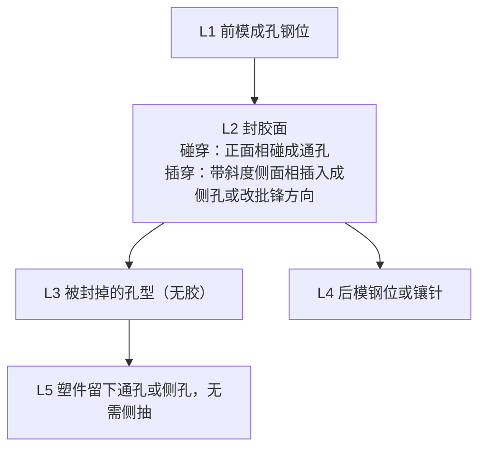

# 注塑碰穿与插穿：用封胶面成型通孔或侧孔，避免侧抽

> [!summary] 一句话概述
> 与开模方向一致或能改到可由开模方向成型的孔，不必上滑块或斜顶：用前、后模仁正面相碰做成通孔（碰穿/靠破），或用带斜度的侧面相互插入做成侧孔（插穿）；封胶面必须有斜度和足够的封胶宽度，swcreo 与亚洲模具展都把上下端尺寸差写成单边要大于 0.1 mm，中正通还给插穿导向写出了 A ≥ 5°、H ≥ 2.5 mm 和最小封胶距离 1.0 mm。

## 配图

![[附件/moldds-keyboard-insert-shutoff.jpg]]
*图源：[中正通《注塑模具分模面的确定》](https://www.moldds.com/design-applications/51.html) 图 5.2.10 直接碰穿与插穿；左为键盘类按键孔实物示意，右为插穿形式的结构及尺寸。正文：碰穿位较平坦时可用直接碰穿；键盘类按键孔为了改变可能出现的「批锋」方向，常改用插穿。图中尺寸以该图为准，正文未逐项解释每一条标注*

![[附件/moldds-midplane-shutoff.jpg]]
*图源：同上图 5.2.11 中间平面碰穿；左为推荐的「合理结构」（图上标有 0.05–0.1，并注明增加该处刚度），右为「不合理结构」，标注「产生侧向分力易于断裂」。正文：碰穿位较陡峭时，用中间平面碰穿缩短钢位高度、改善受力；右侧结构在交变应力下，小孔处钢位易断裂*

![[附件/moldds-insert-shutoff-guide.jpg]]
*图源：同上图 5.2.12 插穿结构；a、b 给出两种改用插穿的几何条件（高度差小于 0.5 mm，或 a 点高于 b 点），c 给出常用结构及尺寸。正文：封胶面最小距离须达到 1.0 mm；导向部位斜度 A ≥ 5°，长度 H ≥ 2.5 mm。图中还可见 0.5、1.0 等与正文对应的标注*

> 图片版权归原作者所有，仅作个人学习收藏；出处见文末「来源与核实记录」。

## 结构原理

> 本节所有数字只写来源里给出的；来源没有就写「来源未给出」，不估算、不换算成看似精确的值。

壳体上的孔不一定要靠侧抽成型。swcreo 写：与模具开模方向平行的孔，通常用型芯（可镶、可延伸留）或碰穿、插穿成型；与开模方向不平行的孔通常要做行位或斜顶。但在不影响使用和装配的前提下，侧壁上的孔也应尽量改成能用碰穿、插穿成型的孔。本篇是「用分型封胶直接把孔做出来」，不是倒扣已经存在之后再选强脱、斜顶还是滑块。

### 堆叠方案

方向：**沿开模方向看一处成孔封胶，从前模钢料到孔壁再到后模钢料**

| 层级 | 零件/区域 | 材料 | 厚度/尺寸 | 固定方式 | 依据 |
| --- | --- | --- | --- | --- | --- |
| L1 前模（定模）成孔钢位 | 孔的一侧壁或孔的上沿 | 模具钢，来源未给出牌号 | 中正通：较陡峭的直接碰穿会让钢位又高又弱，宜改中间平面碰穿以缩短钢位高度 | 固定在前模 | 中正通图 5.2.11 |
| L2 封胶面（碰穿或插穿） | 两半模具相互贴合、把塑料挡在孔型之外的面 | 模具分型/封胶面 | swcreo：枕位、插穿、碰穿均需做斜度，上下断差（大端与小端之差）单边要大于 0.1；亚洲模具展：插穿、靠破面的斜度落差尽量大些，要 0.1 mm 以上；中正通插穿：封胶面最小距离 1.0 mm，导向 A ≥ 5°、H ≥ 2.5 mm | 合模时贴合 | swcreo；亚洲模具展第 34 条；中正通图 5.2.12 |
| L3 孔本身（塑件上的通孔或侧孔） | 由封胶面围出的空腔，塑料不能进入 | 无胶 | 孔径、孔边距的一般规则见 swcreo：孔与外边缘最好大于 1.5 倍孔径，孔与孔之间最好大于 2 倍孔径（这是塑件强度建议，不是封胶角） | 成型时自然成孔 | swcreo 第 5 条「孔」 |
| L4 后模（动模）成孔钢位或镶针 | 孔的另一侧壁，或镶针 | 模具钢或镶针 | 中正通建议小孔处用镶针，但须经设计者允许 | 固定在后模，或做成可换镶针 | 中正通（8）细小孔位处分模面的处理 |
| L5 塑件孔壁 | 壳体上留下的孔边 | 塑件材料 | 来源未给出本篇壁厚 | 开模后随塑件脱出 | 各来源 |

剖面示意：

三种常用做法（按中正通，不要混成同一种）：

- **直接碰穿**：适用于碰穿位较平坦的结构，前后模沿开模方向正面相碰。
- **中间平面碰穿**：适用于碰穿位较陡峭的结构，先做出一段中间平面再碰，缩短高钢位，减少侧向分力。
- **插穿**：两半带斜度插入。中正通写「一般不采用」，仅在 a、b 两点高度差小于 0.5 mm，或 a 点高于 b 点时采用；键盘类按键孔则为了改变批锋方向，常主动选用插穿。

### 零件清单

| 零件/模具要素 | 数量 | 功能 | 材料 | 依据 |
| --- | --- | --- | --- | --- |
| 前模成孔钢位 | 每孔一侧 | 组成孔壁并提供封胶的一面 | 模具钢 | 中正通 |
| 后模成孔钢位或镶针 | 每孔另一侧 | 组成孔壁；小孔建议镶针，便于加工和维修 | 模具钢 / 镶针 | 中正通 |
| 碰穿封胶面 | 平坦或经中间平面处理后的孔 | 正面相碰，挡住塑料进入孔型 | — | 中正通；swcreo |
| 插穿封胶面与导向段 | 高度差很小、方向不利，或要改变批锋方向时 | 斜向插入并导向，避免两面平行摩擦 | — | 中正通图 5.2.12；swcreo |
| 塑件孔壁 | 每孔一圈 | 保留装配或按键所需的孔 | 塑件 | swcreo |

### 装配顺序

> 来源是产品结构与模具分型设计顺序，不是整机拆解。

1. **先问这个孔能不能转到开模方向**：能平行于开模方向，就用型芯或碰穿、插穿；不能平行时才考虑行位或斜顶（swcreo）。
2. **侧孔尽量改几何**：在不影响使用和装配的前提下，把侧壁孔改成可由碰穿或插穿成型，省掉一组滑块。
3. **按孔位形状选封胶方式**：平坦用直接碰穿；陡峭用中间平面碰穿，避免高而薄的钢位和侧向分力；高度差小于 0.5 mm 或 a 高于 b、以及键盘类要改批锋方向时，用插穿。
4. **给封胶面斜度和宽度**：swcreo / 亚洲模具展要求上下断差单边大于 0.1 mm；中正通插穿还要求封胶最小 1.0 mm，导向 A ≥ 5°、H ≥ 2.5 mm。
5. **小孔优先镶针**，并检查孔边距是否满足塑件强度建议。
6. **开模合模**：封胶面在合模时贴死成孔，开模时沿斜度脱开，塑件带孔脱出，无需侧向抽芯动作。

### 受力与运动分析

- **受力路径**：合模力把前、后模的封胶面压在一起，阻挡熔体进入孔型。若封胶面过陡或接近平行于开模方向，中正通指出会在碰穿处产生侧向分力；孔较小时，钢位在交变应力下容易断裂。
- **运动关系**：成孔过程中没有侧向滑块行程。插穿时，开合模会沿导向斜面相对滑入、滑出；斜度不足就会拖曳、拉毛，类似于阶梯分型的 shut-off。
- **失效风险**：斜度或断差不够，出现批锋、拉伤或封不严漏胶；陡峭直碰导致钢位折断；键盘类直接碰穿时，批锋方向可能指向外观或按键配合面（中正通因此改插穿）。swcreo 还提醒细长型芯易断、变形，孔径不宜过小、孔深与孔径比不宜太大。

## 设计要点与参数

| 要点 | 内容 | 依据 |
| --- | --- | --- |
| 优先用碰穿/插穿的孔 | 与开模方向平行的孔用型芯或碰穿、插穿；侧壁孔在不影响使用和装配时应尽量改成可由碰穿、插穿成型，以避免行位或斜顶 | swcreo 第 3、5 条 |
| 插穿/碰穿斜度（断差） | 枕位、插穿、碰穿均需做斜度，上下断差（大端与小端之差）单边要大于 0.1 | swcreo 第 3 条 |
| 插穿/靠破斜度落差 | 一切插穿、靠破面的斜度落差尽量大些，要 0.1 mm 以上 | 亚洲模具展《双色模具设计及双色注塑成型的 36 条经验》第 34 条（该文主题是双色模，本条是其中对插穿/靠破面的要求，已打开原文） |
| 直接碰穿 vs 插穿 | 平坦结构用直接碰穿；键盘类按键孔为改变批锋方向，常采用插穿 | 中正通图 5.2.10 |
| 中间平面碰穿 | 用于较陡峭的碰穿位，缩短钢位高度、改善受力；不要采用会产生侧向分力、小孔钢位易断的结构 | 中正通图 5.2.11 |
| 改用插穿的几何条件 | 当 a、b 两点高度差小于 0.5 mm，或 a 点高于 b 点时，采用插穿 | 中正通图 5.2.12a、b |
| 插穿封胶与导向 | 封胶面最小距离须达到 1.0 mm；导向部位斜度 A ≥ 5°，长度 H ≥ 2.5 mm | 中正通图 5.2.12c |
| 孔边距（塑件强度） | 孔与产品外边缘最好大于 1.5 倍孔径，孔与孔之间最好大于 2 倍孔径 | swcreo 第 5 条（不是封胶宽度） |

> 图 5.2.10、5.2.11 中还有 10°、0.5、2.0、1.5 以及 0.05–0.1 等图面标注，正文没有逐条定义含义，本文不把这些未解释的数字写入上表当作已定义参数。

## 优缺点

**优点**
- 能把侧孔改到开模方向成型时，可少做一组滑块或斜顶，模具更简单、更不容易撞机构。
- 碰穿、插穿把孔的飞边方向和钢位强度变成可设计的对象，而不是试模后再打磨。
- 小孔用镶针，维修和换针比烧焊实体钢位容易。

**缺点 / 代价**
- 封胶面要占斜度和宽度，产品孔边或壁厚不够时，可能改不了、或改完影响装配。
- 插穿和中间平面碰穿对分型设计和研配要求更高；斜度或封胶宽度不足会漏胶、拉毛。
- 不是所有侧孔都能改方向，装配或外观不允许改时，仍要回到滑块或斜顶。

## 可借鉴点

- 壳体评审时把每一个侧孔标成「可碰穿 / 可插穿 / 必须侧抽」三类，能改方向的先改。
- 检查封胶：先看大、小端单边断差是否大于 0.1 mm；做插穿时再查封胶宽度 ≥ 1.0 mm、导向 A ≥ 5°、H ≥ 2.5 mm。
- 孔位很陡时不要硬做高而薄的直碰钢位，改中间平面碰穿，避免侧向分力把钢位掰断。
- 按键孔、外观孔要预先决定批锋朝向哪一面，需要改方向就用插穿，不要等试模出现飞边再争论。
- 细长小孔优先镶针，并核对孔边距是否满足 1.5 倍 / 2 倍孔径的强度建议。

## 与库中相似案例对比

| 对比项 | 本案例 | [[注塑倒扣脱模：强脱、斜顶还是滑块]] | [[注塑喇叭网罩：开孔率、孔径孔距与脱模]] |
| --- | --- | --- | --- |
| 关注点 | 用分型封胶面直接成型通孔或侧孔，取消侧抽 | 倒扣已经存在时，在强脱、斜顶、滑块里选一种出模方式 | 网罩开孔率、孔径孔距以及密集孔怎么脱模 |
| 孔与倒扣 | 把孔做到可由开模方向封胶成型，目标是「不要出现倒扣」 | 倒扣无法取消时的机构选择 | 网孔本身通常仍沿开模方向，重点是孔阵列参数 |
| 何时用这篇 | 壳体上有按键孔、侧孔、过孔，想少做滑块时 | 卡扣、侧凹、螺纹等倒扣必须保留时 | 设计喇叭网、散热孔阵列时 |
| 来源 | swcreo + 中正通 + 亚洲模具展 | 见该案例 | 见该案例 |

与 [[塑料外壳止口与扣位：间隙参数与三个翻车案例]] 的差异：止口是两件产品之间的配合面；本篇的封胶面是两半模具之间用来成孔的贴合面，不要把「产品止口」和「模具碰穿」当成同一个结构。

与本轮「阶梯分型封胶斜度」篇的差异：那篇的 shut-off 连接的是高低分型面；本篇的封胶面是为了在塑件上留下孔。斜度逻辑相近，但几何对象不同。

## 相关案例

- [[注塑倒扣脱模：强脱、斜顶还是滑块]]
- [[塑料外壳止口与扣位：间隙参数与三个翻车案例]]
- [[注塑喇叭网罩：开孔率、孔径孔距与脱模]]
- [[注塑螺丝柱（Boss 柱）：壁厚比 0.6 分水岭与自攻底孔公式]]
- 分类索引：[[01-壳体与外观件 索引]]

## 来源与核实记录

- 主来源：[塑胶产品结构设计常识（PDF）](https://www.swcreo.com/wp-content/uploads/2024/11/设计资料.pdf)（swcreo.com，PDF 元数据作者 zwj，创建日期 2024-11-06；已下载 11 页 PDF 并打开正文，核对脱模斜度条中「枕位、插穿、碰穿均需做斜度，上下断差单边要大于 0.1」以及孔条中「侧壁孔尽量做成能用碰穿、插穿成型」）
- 补充来源：[注塑模具分模面的确定：8 条选择原则与 10 项检查要点](https://www.moldds.com/design-applications/51.html)（中正通设计团队，2026-03-14 发布、2026-11-11 更新；已打开第八节「细小孔位处分模面的处理」，下载图 5.2.10、5.2.11、5.2.12，核对碰穿/插穿选用条件与 A ≥ 5°、H ≥ 2.5 mm、封胶最小 1.0 mm、高度差 0.5 mm）
- 补充来源：[双色模具设计及双色注塑成型的 36 条经验](https://asiamold.gymf.com.cn/news/12438)（亚洲模具展 / 广州法兰克福展览网站刊登，2015-07-10；已打开第 34 条：插穿、靠破面的斜度落差尽量大些，要 0.1 mm 以上。该文其余条目针对双色模，本篇只引用这一条封胶参数，不把双色成型规则写入正文当作本结构的一部分）
- 核实：2026-11-22 实际下载或打开上述来源。同站 https://www.swcreo.com/wp-content/uploads/2024/11/塑胶产品结构设计.pdf 已下载（16 页），因文本抽取顺序异常，未从该文件摘录未核对参数。未把倒扣出模或产品止口写成同一篇。
