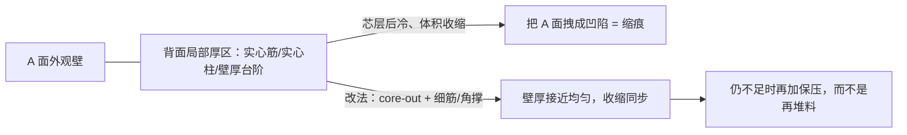

# 注塑缩痕：厚壁背面凹陷、减胶坑与保压边界

> [!summary] 一句话概述
> 缩痕是厚壁区、粗筋或实心螺丝柱背面，因局部多料、冷却收缩不均而把 A 面拽出的凹陷。设计上应先把多余体积减胶（core-out）、用筋代替实心堆积，并让邻壁厚度落在推荐区间；工艺上再靠保压补缩，而不是把壁厚和筋再加厚。

## 配图

![[附件/sink-mark-adjacent-wall-ratio.jpg]]
*图源：[Protolabs《Injection Molding Wall Thickness Guidelines》](https://www.protolabs.com/resources/design-tips/improving-part-design-with-uniform-wall-thickness/)；邻壁厚度宜保持在相邻壁的 40%–60%，并落在所选树脂的推荐壁厚范围内*

![[附件/sink-mark-boss-gussets.jpg]]
*图源：[Protolabs《Design Stronger Molded Parts with Ribs, Gussets, and Durable Materials》](https://www.protolabs.com/resources/design-tips/design-stronger-molded-parts/)；独立螺丝柱用角撑（gusset）加强，而不靠把柱壁或底板加厚*

![[附件/sink-mark-rib-fillets.jpg]]
*图源：同上；筋与壁相交处用圆角过渡，圆角过大又会在交汇处堆料形成新的缩痕*

> 图片版权归原作者所有，仅作个人学习收藏；出处见文末「来源与核实记录」。

## 结构原理

> 本节所有数字只写来源里给出的；来源没有就写「来源未给出」。

### 堆叠方案

方向：**从 A 面（外观面）到背面局部厚壁**

| 层级 | 零件 | 材料 | 厚度/尺寸 | 固定方式 | 依据 |
| --- | --- | --- | --- | --- | --- |
| L1（最外/A 面） | 外观壁 | ABS/PC/PC+ABS/PP 等 | 赫兹推荐壁厚均匀，文中写「推荐 2.5 mm±0.5 mm」；并给出材料推荐壁厚表（见参数表） | 注塑 | 赫兹 653 缺陷表 |
| L2 | 邻壁/过渡 | 同料 | Protolabs：任何壁不应小于邻壁的 40%–60%，且落在该树脂推荐范围内 | 一体 | Protolabs 壁厚指南 |
| L3 | 筋、角撑、空心螺丝柱 | 同料 | 赫兹：筋厚 ≤ 壁厚的 60%，FAQ 写 50–60%；Protolabs：筋和角撑不超过名义壁厚的 60%。本库已有加强筋专篇，此处只强调它们是「用薄特征换刚度、避免实心堆料」 | 一体 | 赫兹；Protolabs |
| L4（背面） | 减胶坑（core-out） | 挖空后的空腔 | 来源未给出坑深、拔模的统一数值；原则是去掉不必要的实心体积 | 模具型芯成型 | 赫兹 FAQ Q2；Protolabs |

剖面示意：

### 零件清单

| 零件 | 数量 | 功能 | 材料 | 依据 |
| --- | --- | --- | --- | --- |
| 外观壳体 | 1 | 可见面，缩痕最不可接受的位置 | 按选型 | 赫兹；Protolabs |
| 加强筋 / 角撑 | 按刚度需要 | 用较薄特征提供刚度，替代加厚实心截面 | 同料 | Protolabs |
| 螺丝柱 | 按紧固点 | 必须掏空成管状并控制柱壁相对底板的比例，否则柱背后缩痕 | 同料 | Protolabs（core out solid bosses）；细节见库中 Boss 柱专篇 |
| 减胶型芯 | 按厚区 | 成型减胶坑 | 模具钢/铝 | Protolabs；赫兹 |

### 装配顺序

缩痕是成型缺陷，发生在注塑循环内，不是装配件：

1. 合模。
2. 注射充填。
3. 保压补缩：赫兹以 ABS 为例，保压压力为注射压力的 50–80%，保压时间 2–8 秒，并以浇口冷却为基准；保压不足会严重缩水，过高则内应力、翘曲。
4. 冷却后顶出。赫兹写冷却时间可按「壁厚²×(1.5–3) 秒/mm²」估（该式为赫兹给出的经验写法）。

### 受力与运动分析

- **受力路径**：厚区芯层比表层晚冷却，体积收缩时通过已凝固的皮层「向内拉」。A 面正对厚区处若刚度不足，就被拉成可见凹陷；内部也可能形成空洞（Protolabs：thick sections → sink, voids, warping）。
- **运动关系**：无机构运动；是冷却收缩引起的局部表面位移。
- **失效风险**：外观凹陷；为掩饰而继续加厚，缩痕更重；圆角/角撑过大，交汇处再次堆料（Protolabs）；只靠加大保压，可能在浇口区产生新的高应力或飞边（赫兹工艺表）。A 面正对粗筋、实心柱是最典型位置。

## 设计要点与参数

| 要点 | 内容 | 依据 |
| --- | --- | --- |
| 缩痕定义 | 表面局部凹陷，通常在厚壁区或加强筋背面；原因是局部壁厚过大导致收缩不均 | 赫兹 653 缺陷表 |
| 设计侧防治（赫兹表） | 壁厚均匀（推荐 2.5 mm±0.5 mm）；加强筋厚度 ≤ 壁厚的 60% | 赫兹 653 |
| 设计侧防治（FAQ） | 保持壁厚均匀；筋厚控制在名义壁厚 50–60%；在厚壁背后做减薄坑（Core-out）；关键外观面避免正对厚壁；无法避免的大壁厚可用装饰纹理或凹槽掩盖缩水 | 赫兹 653 Q2 |
| 壁厚变化 | 最佳壁厚因材料而异，通用建议 2.0–3.5 mm。壁厚变化应控制在 30% 以内，过渡用 R 角 | 赫兹 653 Q1 |
| 邻壁比例（Protolabs） | 任何壁不应小于相邻壁的 40%–60%，并落在该树脂推荐壁厚范围内。螺丝柱同样按周围区域 40–60% 的壁厚规则，以避免缩痕 | Protolabs 壁厚指南 |
| 减胶 | 掏空不必要的实心体积，可减少冷却差异、缩痕、重量。用筋图案代替实心质量，相当于把不需要的材料挖掉、只留支承骨架 | Protolabs 壁厚指南与加强设计文 |
| 筋/角撑上限 | 不超过名义壁厚的 60%，避免筋-壁交汇处过厚；圆角太小减不了应力，太大又会缩痕 | Protolabs 加强设计文 |
| 工艺侧（赫兹缺陷表） | 延长保压时间和压力；降低料温 | 赫兹 653 |
| 保压窗口（ABS 例） | 保压压力 = 注射压力的 50–80%；保压时间 2–8 秒；浇口附近缩水则在浇口冷却前延长保压。注射压力示例 60–140 MPa | 赫兹 653 工艺表 |
| 赫兹材料推荐壁厚（摘录） | ABS 2.0–3.5 mm（收缩率 0.4–0.7%）；PC 2.5–4.0 mm（0.5–0.7%）；PC+ABS 2.0–3.5 mm（0.4–0.6%）；PP 1.5–3.0 mm（1.5–2.5%） | 赫兹 653 材料表 |
| Protolabs 推荐壁厚（摘录，英寸原文并附其毫米换算） | ABS 0.045–0.140 in.（1.143–3.556 mm）；PC 0.040–0.150 in.（1.016–3.81 mm）；PP 0.025–0.150 in.（0.635–3.81 mm） | Protolabs 壁厚指南 / Solving Wall Thickness Issues |
| 缺陷表定义 | Protolabs 总指南缺陷表：Sink marks = 表面凹陷；常见设计原因是厚壁、粗螺丝柱、粗筋；设计改法是把厚区减胶，用筋代替实心质量 | Protolabs Injection Molding Guide |

> 库中已有 [[塑料件加强筋设计：厚度、高度与间距比例]]，筋厚 0.5–0.6 倍壁厚不在本篇展开。本篇只把「不要在 A 面背后堆实心料」和「减胶坑 + 保压边界」写清楚。

## 优缺点

**优点**
- 从图纸去掉实心堆料，比开模后靠调机补缩更稳
- 减胶同时减轻重量、缩短冷却
- 保压仍是必要手段，但应在壁厚已经合理的前提下使用

**缺点 / 代价**
- 减胶要增加型芯或抽芯，模具更复杂
- 过度减胶或邻壁过薄可能充填不足、强度下降
- 保压过高会带来内应力、翘曲或飞边
- 用咬花掩盖缩痕只是外观策略，不消除内部缩孔

## 可借鉴点

- **A 面先做「背后有没有堆料」检查**：粗筋、实心柱、壁厚台阶不要正对外观面
- **能减胶就减胶**：把螺丝柱做成管状、用角撑加强，而不是实心柱
- **邻壁落在 40–60%**：突然加厚比「整体偏厚一点」更容易出缩痕
- **保压只补「已经比较均匀」的收缩**：先改结构，再在浇口冷却前把保压给足；不要用更高保压去 Salvage 实心疙瘩
- 圆角要「刚好能散应力」，不要大到又堆出一块厚区

## 与库中相似案例对比

| 对比项 | 本案例 | [[塑料件加强筋设计：厚度、高度与间距比例]] | [[注塑螺丝柱（Boss 柱）：壁厚比 0.6 分水岭与自攻底孔公式]] | [[气体辅助注塑（GAIM）：用气道掏空厚筋消缩痕]] |
| --- | --- | --- | --- | --- |
| 主角 | A 面凹陷、减胶坑、保压边界 | 筋厚/高/间距比例 | 柱壁与底板比、自攻孔 | 用气体把厚筋掏空 |
| 与本篇关系 | — | 比例不重讲，只引用「筋是替代实心堆料的手段」 | 实心柱是典型缩痕源，细节见该篇 | 厚筋去不掉时的工艺级掏空，见 GAIM 篇 |

## 相关案例

- [[塑料件加强筋设计：厚度、高度与间距比例]]
- [[注塑螺丝柱（Boss 柱）：壁厚比 0.6 分水岭与自攻底孔公式]]
- [[注塑熔接痕：位置由浇口定、深浅由前锋温差定]]
- [[气体辅助注塑（GAIM）：用气道掏空厚筋消缩痕]]
- 分类索引：[[01-壳体与外观件 索引]]

## 来源与核实记录

- 主来源：[注塑成型工艺：从选材到缺陷防治](https://www.hezidesign.com/gongyi/653.html)（赫兹工业设计，作者邓铮；2026-11-15 打开，核缺陷表「缩水（Sink Mark）」行、工艺参数表、FAQ Q1/Q2）
- 补充来源 1：[Injection Molding Wall Thickness Guidelines](https://www.protolabs.com/resources/design-tips/improving-part-design-with-uniform-wall-thickness/)（Protolabs）——邻壁 40–60%、减胶、螺丝柱规则
- 补充来源 2：[Design Stronger Molded Parts with Ribs, Gussets, and Durable Materials](https://www.protolabs.com/resources/design-tips/design-stronger-molded-parts/)（Protolabs）——筋/角撑 ≤ 60% 名义壁厚、圆角过大也会缩痕
- 补充来源 3：[Injection Molding Guide](https://www.protolabs.com/resources/guides-and-trend-reports/injection-molding-guide-process-design-tips-materials/) 与 [Solving Wall Thickness Issues in Molded Parts](https://www.protolabs.com/resources/design-tips/solving-wall-thickness-issues-in-molded-parts/)——缺陷表定义与材料壁厚表
- 核实：2026-11-15 打开上述页面核对全部引用数值。赫兹 1124 也有「壁厚过厚会缩水」的论述，但主题是装配返工，仅作背景，不作为本篇主来源。
