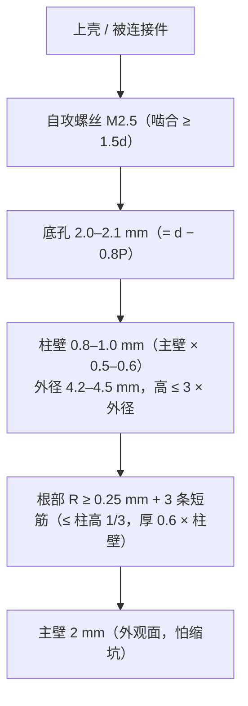

# 注塑螺丝柱（Boss 柱）：壁厚比 0.6 分水岭与自攻底孔公式

> [!summary] 一句话概述
> 螺丝柱开裂和缩水是同一个问题的两面：柱壁厚与主壁厚之比约 0.6 是分水岭，偏薄锁螺丝就裂、偏厚外观面缩坑。赫兹工业设计给出 M2.5 自攻柱的整套经验值（柱壁 0.8–1.0 mm、外径 4.2–4.5 mm、底孔 = 螺丝外径 − 0.8 × 螺距 ≈ 2.0–2.1 mm、柱高 ≤ 3 × 外径、根部 R ≥ 0.25 mm、拔模 0.5–1°），并用一个手持设备改模实例验证：比例从 0.78 调到 0.55，裂纹消失。Protolabs、Eurotec 给出的壁厚比是 40%–60% / ≤ 50%。

## 配图

![[附件/boss-dimensions.jpg]]
*图源：[赫兹工业设计 1282](https://www.hezidesign.com/gongyi/1282.html)；M2.5 自攻 boss 柱五个关键尺寸*

![[附件/boss-wall-ratio.jpg]]
*图源：同上；壁厚比与开裂/缩水风险的定性趋势（作者注明来自跟模断件与缩水投诉的分布）*

> 图片版权归原作者所有，仅作个人学习收藏；出处见文末「来源与核实记录」。

## 结构原理

> 本节数字只写来源里给出的；来源没有就写「来源未给出」。

### 堆叠方案

方向：**沿螺丝轴线从上（被连接件）到下（壳体外观面）**

| 层级 | 零件/区域 | 材料 | 厚度/尺寸 | 固定方式 | 依据 |
| --- | --- | --- | --- | --- | --- |
| L1 | 被连接件（上壳/PCB）+ 沉头孔 | — | 深孔时把沉头放在螺丝穿过的那一件上 | 螺丝压紧 | Protolabs 博客 |
| L2 | 自攻螺丝 M2.5 | 钢 | 螺距 0.45 mm；啮合长度 ≥ 1.5 × 螺丝直径 | 螺纹挤压塑料成型 | 赫兹 |
| L3 | 柱孔（底孔） | 塑料 | 底孔 = 外径 − 0.8 × 螺距 ≈ 2.0–2.1 mm；内壁也要拔模 | — | 赫兹；Protolabs |
| L4 | 柱壁 | 塑料 | 0.8–1.0 mm（主壁厚 × 0.5–0.6）；外径 4.2–4.5 mm；外侧拔模 0.5–1° | 一体注塑 | 赫兹 |
| L5 | 柱根部 + 短筋 | 塑料 | 根部 R ≥ 0.25 mm；3 条短筋均布，长 ≤ 柱高 1/3，厚 = 柱壁 × 0.6 | 一体注塑 | 赫兹 FAQ |
| L6 | 主壁（外观面） | 塑料 | 例：主壁厚 2 mm 时柱壁 > 1.2 mm 已在缩水边缘 | — | 赫兹 |

剖面示意：

### 零件清单

| 零件 | 数量 | 功能 | 材料 | 依据 |
| --- | --- | --- | --- | --- |
| 螺丝柱 | 按连接点 | 承接自攻螺丝 | 同壳体 | 全部来源 |
| 短筋/三角筋 | 每柱 3 条 | 抗偏摆、分散载荷 | 同壳体 | 赫兹 FAQ；Protolabs |
| 自攻螺丝 | 每柱 1 | 紧固 | 钢 | 赫兹 |
| 排气针（必要时） | 柱顶一圈 | 排出盲孔困气，避免缺料或烧焦 | 模具件 | Protolabs |

### 装配顺序

1. 下壳注塑：螺丝柱、短筋一次成型。
2. 上壳/PCB 对位到柱上（柱同时起定位作用）。
3. 锁自攻螺丝：螺纹挤压底孔塑料成型；首批锁螺丝时检查有无开裂声和裂纹。

### 受力与运动分析

- **受力路径**：锁紧时螺纹径向挤压柱壁（环向拉应力）→ 柱根部；使用中的拉拔力 → 螺纹啮合段 → 柱壁 → 根部 → 主壁。根部是柱壁、壳体、筋三向汇合处，冷却收缩不一致先产生拉应力，所以裂在根部。
- **运动关系**：装配后静态。
- **失效风险**：壁太薄或底孔太小 → 锁螺丝撑裂；壁太厚 → 外观面缩坑（无法修复）；柱太高太细 → 注塑时柱芯偏摆、同轴度差、顶出时被顶白；无拔模 → 顶出拉伤，强度打折；晒纹面上的柱拔模按纹深加（每 0.025 mm 纹深加 1°）。

## 设计要点与参数

| 要点 | 内容 | 依据 |
| --- | --- | --- |
| 柱壁厚 / 主壁厚 | 0.5–0.6（赫兹）；40%–60%（Protolabs 设计提示）；≤ 50% 否则可见缩痕（Eurotec）；外观要求时不超过 60%–70%（Protolabs 博客） | 四个来源 |
| 柱外径 | 螺丝外径 + 2 × 柱壁厚，M2.5 约 4.2–4.5 mm（赫兹）；孔径的 2.0–2.4 倍（Eurotec） | 赫兹；Eurotec |
| 自攻底孔 | 螺丝外径 − 0.8 × 螺距；M2.5（P = 0.45）≈ 2.1 mm，实取 2.0–2.1 | 赫兹 |
| 柱高 | ≤ 外径 × 3（M2.5 上限约 13 mm，多数控制 8–10 mm）；同时螺纹啮合 ≥ 1.5 × 螺丝直径，冲突时先保啮合、用筋补稳定 | 赫兹 |
| 根部 | R ≥ 0.25 mm | 赫兹 |
| 拔模 | 外侧 0.5–1°，内侧同样要拔模（赫兹）；按柱高 0.5°–3°（Protolabs）；内外壁 1/2°（Eurotec） | 三个来源 |
| 加筋 | 三条短筋均布，长度 ≤ 柱高 1/3，厚度 = 柱壁 × 0.6，落在柱外壁、不连到外观面 | 赫兹 FAQ |
| 靠近侧壁 | 不要用实心料把柱和侧壁连起来，用筋连；靠外壁的柱往里移 | Protolabs 两篇 |
| 改模实例 | 手持设备 M2 螺丝、柱壁 1.4 mm、主壁 1.8 mm（比例约 0.78）锁螺丝开裂；改到 0.55 后消失，改镶件用了两天 | 赫兹 |
| 实例 2 | 机器人外壳：柱位背面加三条放射状短筋，柱壁从 1.0 降到 0.8 mm，缩水与开裂同时解决 | 赫兹 |

> 注意：0.78 这个比例「偏厚」却开裂，与「偏薄开裂、偏厚缩水」的趋势图不完全一致；原文把它归因于根部料堆积导致的冷却拉应力。设计时两头都要验证（作者说法，未做独立验证）。

## 优缺点

**优点**
- 自攻螺丝柱零件少、成本低，可反复拆装数次
- 规则简单，能写进企业 DFM 检查表

**缺点 / 代价**
- 自攻螺纹反复拆装会磨损（需要反复拆装时改用铜螺母嵌件，见 [[3D 打印件热熔铜螺母：孔径与拉拔力实测]]）
- 尺寸窗口窄，换料（收缩率、韧性不同）要重算

## 可借鉴点

- **DFM 检查表直接用**：柱壁/主壁 0.5–0.6；外径 = d + 2 × 柱壁；底孔 = d − 0.8P；柱高 ≤ 3 × 外径且啮合 ≥ 1.5d；根部 R ≥ 0.25；内外拔模 0.5–1°
- **柱位不要贴外观壁**：往里移，用筋连接
- **要强度别加厚柱**，加三条短筋（长 ≤ 1/3 柱高、厚 0.6 × 柱壁）
- **晒纹面上的柱**也要按纹深加拔模，别统一标 0.5°
- 深孔柱的沉头放到另一件上（Protolabs 博客的做法）

## 与库中相似案例对比

| 对比项 | 本案例 | [[塑料件加强筋设计：厚度、高度与间距比例]] | [[3D 打印件热熔铜螺母：孔径与拉拔力实测]] |
| --- | --- | --- | --- |
| 关注点 | 柱本身：壁厚比、底孔、柱高 | 筋的比例，含螺丝柱加强筋底宽 | 嵌件孔径与拉拔力 |
| 区别 | 给出自攻底孔公式与开裂/缩水权衡 | 不涉及底孔与开裂 | 金属螺纹、可多次拆装 |

## 相关案例

- [[塑料件加强筋设计：厚度、高度与间距比例]]
- [[塑料外壳止口与扣位：间隙参数与三个翻车案例]]
- [[3D 打印件热熔铜螺母：孔径与拉拔力实测]]
- [[咬花（晒纹）与拔模角：每 0.025 mm 纹深加 1°]]
- 分类索引：[[01-壳体与外观件 索引]]

## 来源与核实记录

- 主来源：[boss柱裂在根部：壁厚比、拔模角、根部圆角](https://www.hezidesign.com/gongyi/1282.html)（赫兹工业设计，2026-10-15，邓铮）
- 补充来源 1：[Plastic Boss Design on Molded Parts](https://www.protolabs.com/resources/design-tips/plastic-boss-design-on-molded-parts/)（Protolabs 设计提示）——40%–60%、0.5°–3° 拔模、排气针、二次钻孔
- 补充来源 2：[Design Better Screw Bosses on Molded Parts](https://www.protolabs.com/resources/blog/design-better-screw-bosses-on-molded-parts/)（Protolabs 博客）——外观要求时 ≤ 60%–70%、柱往里移、沉头放另一件
- 补充来源 3：[Eurotec Part Design Guide](https://www.eurotec-ep.com/s/2503/i/Design_Guide_EN_WEB.pdf)（Eurotec 工程塑料，PDF）——外径 2.0–2.4 × 孔径、> 50% 出缩痕、1/2° 拔模
- 核实：2026-11-13 打开四个来源原文核对。赫兹工业设计为设计服务公司，文章有营销成分，但给出了具体实例与数值。
