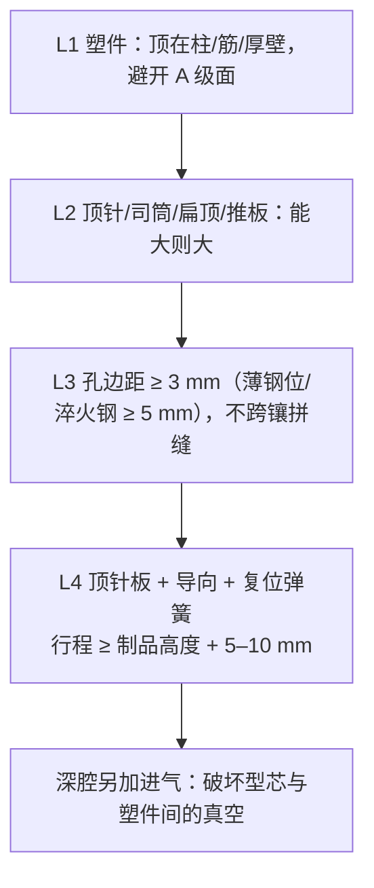

# 注塑顶针布置与顶白：顶在筋柱刚性区，避开外观面并消除真空吸附

> [!summary] 一句话概述
> 顶针要顶在柱位、筋根、厚壁等刚性区，并尽可能用大直径或司筒、扁顶、推板把压强摊开，外观面和装配面避开；顶白往往不只是「顶出力太大」，还来自斜度不足、顶出不同步，以及深腔型芯与塑件之间的真空吸附。

## 配图

![[附件/moldds-ejector-on-boss.jpg]]
*图源：[中正通《注塑模顶出设计 7 条原则》](https://www.moldds.com/design-applications/158.html) 图 6-1；蓝色顶针落在柱位和厚胶位周围，而不是顶在大面积薄壁中央。正文要求：顶在刚性最大的部位，结构允许时顶针直径尽量做大，以降低单位面积压力和顶白风险*

![[附件/hooren-ejector-plate-assembly.jpg]]
*图源：[鸿仁《顶针印与顶白缺陷的顶出系统优化》](https://www.hoorenwell.com/news/2737-cn.html) 文内照片；顶针固定在顶针板上，板下可见复位弹簧，装配时正在核对顶针。鸿仁把顶针板变形、导向间隙偏大和复位不足，列为顶出不同步、局部先顶而发白的隐性原因*

![[附件/moldds-ejector-slide-interference.jpg]]
*图源：中正通同上文图 6-4；行位（SLIDE）下方布置了 EP 顶针，图中标出「撞伤隐患」。开模时行位先抽、合模时行位后复位，若顶针板没有先回位，行位会撞到顶针。原则 7：顶针尽量不要设计在行位下面，避不开时要加先复位机构*

> 图片版权归原作者所有，仅作个人学习收藏；出处见文末「来源与核实记录」。

## 结构原理

> 本节所有数字只写来源里给出的；来源没有就写「来源未给出」，不估算、不换算成看似精确的值。

塑件冷却收缩后包紧型芯，包紧力集中在肉厚、柱位、筋位和深腔处。顶出力如果作用在薄壁或大平板中央，单位面积压力过大，接触处就会留下顶针印（凹陷、亮斑、凸起），或出现应力发白，严重时伴随微裂纹（鸿仁）。本篇写的是顶出系统怎么布置，以避免这些外观缺陷，不是 Boss 柱本身的壁厚和底孔公式。

### 堆叠方案

方向：**从塑件顶出面到注塑机顶棍，沿顶出方向**

| 层级 | 零件/区域 | 材料 | 厚度/尺寸 | 固定方式 | 依据 |
| --- | --- | --- | --- | --- | --- |
| L1 塑件被顶面 | 柱位、筋根、厚胶位等刚性区；避开外观与装配面 | 塑件材料见上 | 鸿仁：若必须顶在外观相关区域，可在背面局部加厚 0.05–0.2 mm，把应力限制在加厚区 | 顶针、司筒、扁顶或推板接触推出 | 中正通原则 1；鸿仁 2737 |
| L2 顶出元件 | 圆顶针、扁顶针、司筒、直顶块、推板/推块 | 中正通提到可统一选用 MISUMI、HASCO、DME 等标准件；具体钢种本篇来源未给全 | 位置允许时尽量加大直径；一套模直径种类不宜超过 2–3 种；常用规格中正通列出 Φ2、Φ2.5、Φ3、Φ4、Φ5、Φ6、Φ8 | 无头螺丝、压板或垫片压紧；司筒用肩部压紧 | 中正通原则 2、4、6；Avient：顶出刀片、顶出套筒和脱模环 |
| L3 顶针孔与周边钢位 | 顶针与镶件、螺钉孔、水路孔的边距 | 模具钢 | 孔壁到孔壁最少 3 mm；淬火钢、薄钢位、受力大处取 5 mm 以上；到镶件拼缝同样按此值 | 铰孔配合，间隙过大会飞边，过小会卡滞 | 中正通原则 3、5 与图 6-3 |
| L4 顶针板、导向与复位 | 顶针板、导柱导套、复位弹簧、必要时撑头/中托司 | Avient 钢种表把 A-2 用于顶针、顶针套筒和顶针板；P-20 可用于顶出板 | 中正通：顶出行程不小于制品高度加 5–10 mm | 导柱导向；弹簧均匀预压；大模可加撑头 | 中正通原则 2；鸿仁 2737 |
| L5 辅助进气（深腔时） | 顶针外壁浅槽或型芯上的进气镶件 | 来源未给出 | 鸿仁：可在顶针外壁加工 0.02–0.05 mm 浅排气槽，顶出时同步通入低压洁净空气，破坏真空 | 进气通道避开封胶位置 | 鸿仁 2737；Avient 也提到空气喷射和提升阀 |

剖面示意：

### 零件清单

| 零件/模具要素 | 数量 | 功能 | 材料 | 依据 |
| --- | --- | --- | --- | --- |
| 圆顶针 | 按顶出力布置，规格尽量少 | 在刚性区把塑件顶离型芯 | 标准件；易磨损处鸿仁建议氮化处理 | 中正通；鸿仁 |
| 司筒（顶出套筒） | Boss 柱位置优先 | 环形接触，比单点细顶针更不易局部发白 | 来源未给出牌号 | 鸿仁 2737；中正通原则 3 提醒司筒不要跨镶拼 |
| 扁顶针 / 直顶块 | 窄骨位或 10 mm 以上高长骨位 | 增大接触面积；直顶还可兼做骨位镶件并排气 | 来源未给出 | 中正通原则 4；鸿仁 |
| 推板 / 托针 / 顶块 | 高外观件可选 | 面接触推出，减弱或消除点状顶针印 | 来源未给出 | 鸿仁 2737；Avient：脱模环 |
| 顶针板与复位弹簧 | 每模一组 | 同步顶出并先于行位复位 | 来源未给出板厚公式 | 中正通；鸿仁 |
| 先复位机构 | 顶针在行位投影下时需要 | 避免行位相撞 | 强制复位杆、先复位弹簧、行程开关，按模具大小组合 | 中正通原则 7 |

### 装配顺序

> 来源是模具设计与试模改进顺序，不是产品拆解。按「布置 → 装配校验 → 试模工艺」整理。

1. **先标包紧力大的位置**：柱位、厚胶、筋根、深腔。把顶出点放在这些刚性区，外观面、密封面、装配基准和熔接痕附近避开（中正通、鸿仁 2498）。
2. **选型**：位置够就加大直径；Boss 用司筒，窄骨用扁顶，10 mm 以上高长骨位优先直顶；不允许顶针印时改推板。一套模把直径种类收在 2–3 种。
3. **查干涉与孔距**：顶针、司筒落在同一块镶件上，孔边到拼缝和其他孔不小于 3 mm（薄钢位 5 mm）；行位下方不布顶针。
4. **装配校验**：顶针高度同步，顶针板导向顺畅，复位弹簧预压足够。中正通要求试模前手动推顶针板，确认全程无卡点；有行位时验证「顶针先回、行位后合」。
5. **深腔先破坏真空再主顶出**：鸿仁建议在型芯加进气，或采用分段/二次顶出，先预脱模再主顶出。
6. **工艺配合**：冷却要够，产品有刚性再顶；顶出曲线慢速启动、匀速推进，避免瞬间冲击（鸿仁）。Avient 补充：较大顶针也可以让较热的零件弹出，缩短循环时间。

### 受力与运动分析

- **受力路径**：包紧力从塑件侧壁和孔壁作用到型芯，顶出力沿顶针轴向反推塑件。若单支顶针总截面积不足，压强先在接触面超过材料承受能力，表现为顶白或顶穿（中正通）。
- **运动关系**：开模后顶针板沿导柱向前；有滑块时必须先抽滑块、后顶出，合模则顶针先复位。深腔时塑件与型芯之间可能形成负压，相当于额外的脱模阻力（鸿仁）。
- **失效风险**：顶在薄壁或平板中央会出现环状顶白（鸿仁）；顶针跨镶拼缝易飞边、断针；行位下布针会撞模；斜度不足或抛光不良会抬高所需顶出力，顶白反复出现。鸿仁点名 POM、PC、透明 PS 对应力敏感。Avient 写：尽可能使用最大直径的顶针，以尽量减少顶针穿透痕迹。

## 设计要点与参数

| 要点 | 内容 | 依据 |
| --- | --- | --- |
| 顶出位置 | 柱位、厚胶位、筋根；避开薄壁、外观面、熔接痕、装配面 | 中正通；鸿仁 2498 / 2737；Avient：位于流道过渡处以及不影响美观的区域 |
| 直径与数量 | 位置允许时尽量做大；按顶出力核算总截面积；一套模控制在 2–3 种直径 | 中正通原则 1、6；Avient：尽可能用最大直径 |
| 高骨位 | 10 mm 以上高长骨位优先直顶；再评估是否粘直顶、透明件痕迹，必要时改扁顶或推板 | 中正通原则 4 |
| 孔边距 | 与螺钉孔、水路孔、镶件孔边到边不小于 3 mm；淬火钢、薄钢位、受力大处取 5 mm 以上 | 中正通原则 5、图 6-3 |
| 顶出行程 | 不小于制品高度加 5–10 mm，并与斜顶、滑块无干涉 | 中正通检查清单 |
| 局部加胶 | 产品背面预留 0.05 至 0.2 mm 加厚，把顶出应力限制在加厚位置 | 鸿仁 2737 |
| 真空破坏 | 顶针外壁可加工 0.02 至 0.05 mm 浅排气槽，或在型芯做进气镶件；进气避开封胶 | 鸿仁 2737 |
| 脱模斜度（顶白相关） | PC、PC/ABS 光面脱模斜度建议不低于 1.5°，蚀纹面再增加 0.5 至 1° | 鸿仁 2737 |
| 长拉伸区域斜度 | 在所有长拉伸区域每侧使用 3°–5° 的斜度 | Avient「零件弹出」（针对其 TPE 模具设计文，材料与上条不同，并列） |
| 顶出曲线 | 慢速启动、匀速推进，避免瞬间冲击；冷却不足时产品偏软，容易压出痕迹 | 鸿仁 2737 |
| 行位下方 | 不布顶针；避不开时加先复位机构 | 中正通原则 7、图 6-4 |

## 优缺点

**优点**
- 顶在刚性区并加大接触面积，能同时降低顶白和顶穿风险。
- 司筒、扁顶、推板、进气和二次顶出，提供了从「还允许有顶针印」到「外观面完全不能见针」的阶梯方案。
- 孔距、规格种类和行位避让规则，可以直接做成出图检查表。

**缺点 / 代价**
- 推板、直顶、先复位和进气都会增加模具成本和配模难度（鸿仁写推板加工配模更难）。
- 顶针直径受空间、薄钢位和外观限制，不是越大越好。
- 顶针间隙既要排气又不能跑胶，量产后磨损会重新带出痕迹，需要定期检查。

## 可借鉴点

- 把「柱、筋、厚壁」画进顶出布置图，先禁止把第一根针顶在 A 级面或大平板中央。
- 深壳体一旦出现稳定顶白，先查真空吸附和顶出同步，而不是只放慢顶出速度。
- 出图时标注孔边距 3 mm / 5 mm、规格种类不超过 3 种、顶出行程 ≥ 制品高 + 5–10 mm，并检查行位投影。
- 外观件在顶针对应的背面预留 0.05–0.2 mm 局部加厚，作为可修模余量。
- PC / PC/ABS 外观件单独检查光面 1.5° 和纹面再加 0.5–1°，不足时先补斜度再加密顶针。

## 与库中相似案例对比

| 对比项 | 本案例 | [[注塑螺丝柱（Boss 柱）：壁厚比 0.6 分水岭与自攻底孔公式]] | [[咬花（晒纹）与拔模角：每 0.025 mm 纹深加 1°]] |
| --- | --- | --- | --- |
| 关注点 | 顶针放在哪、用什么形式顶、顶白和顶针痕怎么消 | Boss 柱壁厚比和自攻底孔 | 纹理深度与侧壁拔模 |
| 关系 | 顶针常顶在柱根或用司筒顶柱，但本篇不给出柱壁厚和底孔公式 | 柱设计完成后再布置司筒或圆周顶针 | 斜度不足会抬高顶出力，从而诱发顶白，但加角度的算法见咬花篇 |
| 何时用这篇 | 评审顶出布置、处理顶白/顶针印、深腔真空吸附时 | 设计螺丝柱截面和底孔时 | 按纹号补侧壁拔模时 |
| 来源 | 鸿仁 + 中正通 + Avient | 见该案例 | 见该案例 |

与 [[注塑倒扣脱模：强脱、斜顶还是滑块]] 的差异：斜顶、滑块要先让开倒扣，本篇再讨论让开之后如何把塑件顶出，以及顶针不要布置在行位下面。

## 相关案例

- [[注塑螺丝柱（Boss 柱）：壁厚比 0.6 分水岭与自攻底孔公式]]
- [[咬花（晒纹）与拔模角：每 0.025 mm 纹深加 1°]]
- [[注塑倒扣脱模：强脱、斜顶还是滑块]]
- [[注塑缩痕：厚壁背面凹陷、减胶坑与保压边界]]
- 分类索引：[[01-壳体与外观件 索引]]

## 来源与核实记录

- 主来源：[顶针印与顶白缺陷的顶出系统优化](https://www.hoorenwell.com/news/2737-cn.html)（鸿仁模具，2026-11-17；已用 https 打开全文，核对顶白成因、0.05–0.2 mm 局部加厚、0.02–0.05 mm 进气槽、PC/PC/ABS 斜度与顶出曲线，并下载文内顶针板装配照片。同站 http 地址返回 500，不作为打开依据）
- 补充来源：[注塑模具顶针布局设计原则与实用技巧](https://www.hoorenwell.com/news/2498-cn.html)（鸿仁模具，2026-10-09；与上一篇同一机构，只作布局原则补充，不另计独立来源）
- 补充来源：[注塑模顶出设计 7 条原则：顶针布局、镶拼避让与行位防撞](https://www.moldds.com/design-applications/158.html)（中正通设计团队，2026-11-11；已打开全文并下载图 6-1、6-3、6-4，核对 3 mm / 5 mm 孔距、10 mm 高骨、行程 +5–10 mm、行位下方不布针）
- 补充来源：[注塑成型：模具设计](https://cn.avient.com/resources/knowledge-base/article/injection-molding-mold-design)（Avient，2025-02-07；已打开中文页「零件弹出」：顶针放在不影响美观的区域、尽可能用最大直径、长拉伸区每侧 3°–5°、可使用顶出刀片/套筒/脱模环及空气喷射）
- 核实：2026-11-22 实际打开上述页面并下载配图。未把 Boss 壁厚公式或倒扣出模选择写成同一篇。
