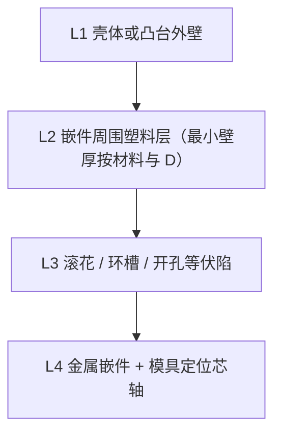

# 金属嵌件注塑：周围壁厚、滚花止转与开裂风险

> [!summary] 一句话概述
> 模内金属嵌件要靠周围足够的塑料壁厚消化金属与塑料的收缩差，用滚花、环槽、切口等伏陷结构止转和抗拉拔，并避开锐边和直冲浇口，否则冷却残余应力会在嵌件周围开裂，或螺母被扭转打滑。

## 配图

![[附件/jlcfa-insert-undercut-forms.jpg]]
*图源：[嘉立创FA机械设计手册《嵌件与塑件的设计》](https://www.jlcfa.com/mcbook/new20023.htm) 表1配图；嵌件上的伏陷结构：(a) 圆柱表面滚花（交叉滚轧的麻粒状花纹，连接效果比直纹滚花好，直纹滚花在轴线方向易松动）；(b) 开圆环槽（周向易松动）；(c) 片条嵌件冲压切口或孔；(d) 细圆条嵌件局部压扁或折弯*

![[附件/jlcfa-insert-types.jpg]]
*图源：[嘉立创FA机械设计手册《金属嵌件的形式》](https://www.jlcfa.com/mcbook/new20022.htm) 插图；常见金属嵌件外形：带滚花或凹槽的螺纹嵌件、密封凸台、片状与杆状嵌件等，本篇关注的是这些嵌件被塑料包覆后的周围壁厚与止转，而不是螺母规格本身*

![[附件/jlcfa-insert-crack-wall.jpg]]
*图源：[嘉立创FA机械设计手册《嵌件周围塑料裂纹》](https://www.jlcfa.com/mcbook/new20025.htm) 插图；(a) 带锐边的嵌件在角部产生裂纹；(b) 热固性塑料模塑制品同一断面上相邻两嵌件的最小距离应大于 4 mm；(c) 周围壁面过薄；(d) 嵌件用作凸台支撑时，周围最小壁厚按该章推荐表确定*

> 图片版权归原作者所有，仅作个人学习收藏；出处见文末「来源与核实记录」。

## 结构原理

> 本节所有数字只写来源里给出的；来源没有就写「来源未给出」，不估算、不编造。

金属嵌件在合模前放入型腔，熔体在高压下包覆嵌件并冷却固化。嘉立创手册写明：金属与塑料的线胀系数等热性能差异较大，冷却固化后嵌件周围的塑料有较大的残余应力，嵌件周围同时存在熔合缝，会降低材料的力学性能，因此周围塑料要有足够的厚度。赫兹 941 进一步把开裂归因于两件事叠加：嵌件周围的环境应力开裂（ESC），以及高温熔体碰到冷嵌件时迅速冷却形成的残余应力；壁厚不均匀会把这个应力放大。

止转和抗拉拔主要靠嵌件表面的伏陷结构，而不是靠塑料与光滑金属的粘附。嘉立创表1把伏陷结构分成滚花、开槽、切口冲孔、压扁弯折四类；赫兹 941 从装配扭矩出发，把常用螺母止转写成滚花、压槽、D 型、开孔四种。两者都指出：直纹或环槽的防转、防拉拔方向不同，要按载荷选择，不能只做一种。

### 堆叠方案

按嵌件局部「从外到内」观察：最外是壳体或凸台的塑料外壁，向内是嵌件周围必须保留的塑料层，再向内是嵌件外圆上的滚花或环槽，最内是嵌件本体和模具定位芯轴。方向以嵌件轴线为准。

| 层级 | 零件 | 材料 | 厚度/尺寸 | 固定方式 | 依据 |
| --- | --- | --- | --- | --- | --- |
| L1（最外） | 壳体或凸台外壁 | 赫兹实例：ABS、PC、PC+ABS；手册按材料分列 | 周围最小壁厚见参数表，随材料与嵌件外径 D 变化 | 与 L2 一体注塑 | 嘉立创《嵌件与塑件的设计》表3；赫兹 1083、941 |
| L2 | 嵌件周围塑料包覆层 | 同上 | 嘉立创另一章按嵌件直径给出绝对毫米值；赫兹建议一般 ≥1.5 mm，并写「至少做到嵌件直径的 0.3～0.5 倍」 | 冷却收缩抱紧嵌件 | 嘉立创《嵌件周围塑料裂纹》推荐表；赫兹 1083 原则一 |
| L3 | 嵌件外圆伏陷结构 | 黄铜、不锈钢等（赫兹） | 赫兹：滚花深度 0.2～0.5 mm；CoreLMould：锁紧结构深度 0.3～0.8 mm | 熔体填入沟槽，固化后机械互锁 | 嘉立创表1；赫兹 1083 原则三；CoreLMould「嵌件凸台设计指南」 |
| L4（最内） | 金属嵌件本体与模具定位芯 | 嵌件为金属；定位靠模具圆柱孔或芯棒 | 嘉立创：柱状嵌件高度 h 不宜超过直径 d 的 2 倍；螺杆嵌件与模具孔按 H9/f9 定位 | 芯轴、凸肩或可拆螺钉芯棒定位，防止熔体冲偏、溢入螺纹 | 嘉立创表2 |

剖面示意：

### 零件清单

| 零件 | 数量 | 功能 | 材料 | 依据 |
| --- | --- | --- | --- | --- |
| 塑料壳体或凸台 | 来源未给出（按产品） | 包覆嵌件、提供周围壁厚、承担收缩应力 | 见材料字段 | 嘉立创表3；赫兹两文实例 |
| 金属嵌件（螺母、螺杆、片状或杆状） | 来源未给出（按产品） | 提供螺纹、导电或定位 | 赫兹：黄铜最常见，也用不锈钢、铝合金 | 嘉立创《金属嵌件的形式》；赫兹 941 FAQ |
| 模具定位芯轴 / 可拆螺钉芯棒 | 来源未给出 | 在注塑压力下固定嵌件，并尽量阻止熔料进入螺纹牙 | 来源未给出 | 嘉立创表2 |
| 可选：嵌件预热 | 来源未给出 | 减薄冷嵌件造成的冻结层，降低残余应力 | 不适用 | 赫兹 941：不少厂预热到 80～120 ℃；修复开裂方案写预热到 100 ℃ 以上 |

### 装配顺序

1. 嵌件在模外准备：不通孔螺母插入模具定位芯棒；通孔螺母则按嘉立创表2，采用可拆卸螺钉芯棒，在模外旋入后再一起定位到模具上。
2. 嵌件放入型腔并可靠定位。嘉立创要求：在动模合模运动中嵌件不松动，以保证在高压熔体冲压下不偏移、不漏料。柱状嵌件过高时要用模具芯柱支撑。
3. 合模注塑，使熔体环绕嵌件并填入滚花或环槽。赫兹 1083 要求浇口避开嵌件，让熔体先填充非嵌件区域再自然包裹；浇口到嵌件的距离「至少 15 mm 以上」。
4. 冷却固化后开模，抽出芯轴。手册提醒：芯轴抽出时环形嵌件可能被带出，定位方案要一并考虑。
5. 后工序锁附螺丝或接入端子。止转是否有效，要到拧紧扭矩时才暴露。

> 以上按嘉立创定位说明与赫兹工艺叙述整理，不是某件具体产品的拆解反推。

### 受力与运动分析

- **受力路径**：锁附扭矩作用在嵌件内螺纹上，若外圆没有足够的止转结构，扭矩会把嵌件在塑料里转滑；轴向拉拔力沿嵌件轴线向外，由填入滚花或环槽的塑料来抵抗。冷却收缩在嵌件周围产生持续的环向拉应力，锐边处应力集中，可直接把塑料拉裂。
- **运动关系**：成型后嵌件与塑料之间设计上应无相对运动。一旦滚花打滑或环槽周向失稳，嵌件就会在孔内旋转或被拔出。
- **失效风险**：嘉立创指出锐边嵌件（方形、矩形、六边形断面）角部易裂，相邻嵌件过近也会在中间塑料上裂开，导电嵌件裂纹还可能短路。赫兹 1083 把常见缺陷统计为：周围缩水占 37%、嵌件偏移占 24%、开裂占 15%（其余为溢胶、位置不准等；此为该文「过去五年试模数据」）。赫兹 941 还记录过 T0 和装配都合格、仓库放置两周后才在嵌件周围开裂的 ESC 案例。

## 设计要点与参数

| 要点 | 内容 | 依据 |
| --- | --- | --- |
| 周围最小壁厚（按外径比例） | 嘉立创表3，单位 mm，按金属嵌件外径 D 分段。D 为 1.5～16 mm / 16～25 mm 时：酚醛塑料 0.8D / 0.5D；尼龙66、聚乙烯 0.4D / 0.3D；尼龙6 0.5D / 0.4D；聚丙烯、聚醛、聚甲基丙烯酸甲酯 0.5D / 0.3D；醋酸纤维素 0.9D / 0.8D；ABS 1.0D / 0.8D | 嘉立创《嵌件与塑件的设计》表3「金属嵌件周围塑料层的最小壁厚」 |
| 周围最小壁厚（按嵌件直径的绝对毫米值） | 同一手册另一章给出另一张表，嵌件直径为 4 / 6 / 10 / 12 / 20 / 25 mm。例如 ABS：4、6、10、12、20、25 mm；聚甲醛：1.6、4、5、6、10、12 mm；PC：4、6、10、12、20、25 mm；PP：4、6、5、5.5、8、9 mm；尼龙：4、6、10、12、20、25 mm；酚醛（通用级）：2.4、4、5、5.5、8、9 mm。HDPE、PS 在直径 4、6 mm 列为「不推荐」，更大直径部分单元格为「不推荐」或未给出。两张表数值体系不同，本文并列原文，不自行折算统一 | 嘉立创《嵌件周围塑料裂纹》「不同塑料品种模塑制品中金属嵌件周围最小壁厚设计推荐值 mm」 |
| 经验下限与倍数 | 「金属嵌件周围的塑胶壁厚，至少做到嵌件直径的 0.3～0.5 倍」。举例：M3 铜螺母外径约 5 mm，周围至少 1.5 mm，推荐 2.0 mm 以上。另一篇写「建议 ≥1.5 mm」，并记录壁厚只有 0.8 mm 时出现「缩水映射」 | 赫兹 1083 原则一；赫兹 941「嵌件壁厚要求」 |
| 伏陷与止转 | 交叉滚花比直纹好，直纹轴向易松动；圆环槽周向易松动。赫兹：滚花螺母扭力可以做到 2～5 N·m；医疗项目由普通螺母改滚花后，扭力测试从 0.3 N·m 到 3.8 N·m。滚花深度 0.2～0.5 mm；直纹抗旋转、网纹抗拉拔 | 嘉立创表1；赫兹 941、1083 |
| 锁紧结构深度与凸台 | 锁紧结构深度 0.3～0.8 mm；圆角半径 0.5～1.0 mm；凸台外径 / 嵌件外径推荐 2.0–2.5×（范围 1.8–3.0×）；嵌件中心距最小值通常为较大嵌件直径的 1.5–2.0 倍，最小边距同为 1.5–2.0 倍 | CoreLMould「嵌件凸台设计指南」「嵌件位置与间距」 |
| 锐边与圆角 | 尽量不用方形、矩形或六边形锐边嵌件。赫兹：嵌件棱边至少 R0.5 以上，方形嵌件四角建议 R1.0 以上 | 嘉立创裂纹章图 a；赫兹 1083 原则四、941 修复方案 |
| 相邻嵌件间距 | 热固性塑料模塑制品，同一断面上相邻两嵌件最小距离应大于 4 mm | 嘉立创裂纹章图 b |
| 柱状嵌件高径比 | 高度 h 不宜超过直径 d 的 2 倍，必要时用模具芯柱支撑 | 嘉立创表2 第3条 |
| 模具定位 | 螺杆嵌件轴段与模具圆柱孔按 H9/f9；有凸肩才能挡住熔料溢入螺纹牙 | 嘉立创表2 |
| 浇口与流动 | 浇口到嵌件至少 15 mm 以上，让熔体环绕而非直冲；嵌件不能挡住流道，否则背面充不满（赫兹称「阴影效应」）。CoreLMould：浇口应经优化，确保塑料均匀环绕嵌件，嵌件不可在关键区域诱发熔接痕 | 赫兹 1083 原则五、941；CoreLMould「嵌件注塑成型设计要求」 |
| 预热 | 嵌件预热到 80～120 ℃ 可减薄冻结层；开裂修复方案写 100 ℃ 以上，并做过 −40 ℃ 冷热冲击 | 赫兹 941 |

> 来源没有给出的参数一律写「来源未给出」，不估算、不编造。嘉立创两张壁厚表不宜混用，设计时按同一章的表执行，并与材料供应商和试模验证。

## 优缺点

**优点**
- 一次成型即可把螺纹或端子留在壳体里，抱紧力高于后装热压。赫兹对比：网纹滚花模内嵌件拉拔力可达 60 N 以上，热压嵌件一般 20～30 N。
- 滚花、环槽、开孔等伏陷结构把扭矩和拉拔力变成机械互锁，不依赖胶粘。
- 按材料给出周围最小壁厚，可以直接作为凸台和壳体局部加厚的检查项。

**缺点 / 代价**
- 模具必须增加嵌件定位机构，成本和试模周期高于后装铜螺母。
- 金属与塑料收缩差无法消除，壁厚不足或锐边残留就会缩水、开裂，有的要到贮存或接触清洁剂后才出现。
- 浇口太近会冲偏嵌件；通孔嵌件若定位没有凸肩，熔料可能溢进螺纹牙。
- 手册两张壁厚表数值并不一致，不能当成一条万能公式。

## 可借鉴点

- 先按塑料品种和嵌件外径查出周围最小壁厚，再检查凸台到外观面、到边缘、到相邻嵌件的实际距离，而不是只按螺丝规格画一个标准 Boss。
- 外圆至少做交叉滚花或「滚花 + 环槽」：要止转用滚花或 D 型、开孔；主要防拔用环槽。不要只用光滑铜套。
- 所有棱边倒圆，方形嵌件四角加大；热固性件相邻嵌件间距大于 4 mm。
- 浇口远离嵌件，流动方向改为环绕；柱状嵌件高径比不超过 2，否则加支撑。
- 对 PC、PC+ABS 等敏感材料，除壁厚外还要考虑嵌件预热和贮存环境中的化学介质，避免 ESC。
- 拉拔力或位置精度要求不高、产量不大时，对比后装热压或超声波埋入，不必默认模内嵌件。

## 与库中相似案例对比

| 对比项 | 本篇 | [[注塑模内预埋铜螺母：模具定位、溢胶风险与直纹及斜花滚花]] | [[注塑螺丝柱（Boss 柱）：壁厚比 0.6 分水岭与自攻底孔公式]] | [[3D 打印件热熔铜螺母：孔径与拉拔力实测]] / [[热铆（热熔柱）：铆柱高度按体积守恒算，蘑菇头直径 2d]] |
| --- | --- | --- | --- | --- |
| 主角 | 嵌件周围的塑料壁厚、过渡和防裂，以及滚花/环槽如何把扭矩和拉拔力留下来 | 铜螺母本身如何在模具里定位、如何防止溢进牙，以及直纹与斜花滚花的差别 | 自攻螺丝柱的柱壁厚与底孔，柱壁约为名义壁厚的 0.6 | 成型后再热压或热铆，不在注塑时预埋 |
| 何时用本篇 | 壳体上已经决定做模内金属件，要定周围壁厚、倒圆和浇口位置 | 要选螺母结构和模具定位、防溢胶细节 | 不嵌金属、直接在塑料柱上自攻 | 产量不大或模具不宜加嵌件机构，改为后装 |
| 不要用本篇代替 | 不代替铜螺母规格与模具定位专篇，也不把 0.6 壁厚比套到嵌件周围 | 预埋铜螺母篇不展开按材料列出的周围最小壁厚表 | Boss 篇的对象不是金属嵌件 | 后装工艺的孔径与铆柱高度不适用于模内包覆 |

## 相关案例

- [[注塑模内预埋铜螺母：模具定位、溢胶风险与直纹及斜花滚花]]
- [[注塑螺丝柱（Boss 柱）：壁厚比 0.6 分水岭与自攻底孔公式]]
- [[3D 打印件热熔铜螺母：孔径与拉拔力实测]]
- [[热铆（热熔柱）：铆柱高度按体积守恒算，蘑菇头直径 2d]]
- [[注塑缩痕：厚壁背面凹陷、减胶坑与保压边界]]
- 分类索引：[[01-壳体与外观件 索引]]

## 来源与核实记录

- 主来源：[嘉立创FA机械设计手册《嵌件与塑件的设计》](https://www.jlcfa.com/mcbook/new20023.htm)（打开页面时未显示单独撰稿人；机构为深圳嘉立创科技集团股份有限公司嘉立创FA手册。已核对表1伏陷结构、表2定位与 h≤2d、表3按材料与 D 的最小壁厚，并下载 image001～image004 原图）
- 补充来源（同一机构，用于裂纹壁厚表与嵌件形式图）：[《嵌件周围塑料裂纹》](https://www.jlcfa.com/mcbook/new20025.htm)、[《金属嵌件的形式》](https://www.jlcfa.com/mcbook/new20022.htm)。已打开并下载裂纹章与形式章插图。相邻嵌件 4 mm、锐边开裂、按直径列出的绝对壁厚表均来自裂纹章。
- 补充来源：[赫兹工业设计《嵌件注塑设计实战：金属嵌件怎么放》](https://www.hezidesign.com/gongyi/1083.html)（2026-08-27，邓铮 / 东莞市赫兹工业设计有限公司）；[《嵌件注塑的止转结构设计》](https://www.hezidesign.com/gongyi/941.html)（2026-06-26，刘也 / 同一机构）。两篇只计一个机构。已核对 0.3～0.5 倍直径、1.5 mm 经验下限、滚花深度、浇口距离、四种止转和 ESC 案例。该站封面渲染图与嵌件结构无直接对应，本文未用作技术插图。
- 补充来源：[CoreLMould《在塑料零件中嵌入金属嵌件：设计指南》](https://corelmould.com/zh/blog/metal-inserts-plastic-parts-design/)（2023-04-29，页面署名 mike-chen）。已核对凸台外径比、锁紧结构深度、圆角、中心距与边距。该页打开时正文无结构插图。
- 核实：2026-11-22 用浏览器标识下载并打开上述页面与手册配图。未把经销商转述或未打开的嵌件厂商样本写入参数表。
