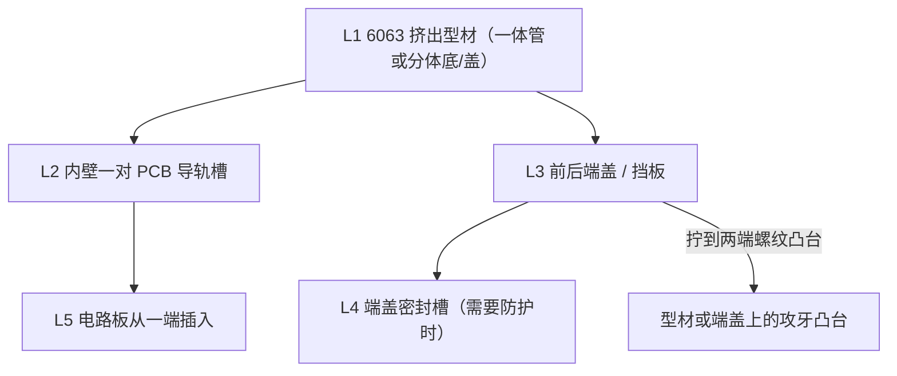

# 铝合金挤出型材电子设备外壳：一体管、分体壳、PCB导轨槽与端盖密封槽

> [!summary] 一句话概述
> 电子设备用的铝合金外壳，把连续的 6063 挤出断面一次做出来，再按长度切断、配前后端盖：一体管在两端螺纹凸台把端盖拧上，分体壳把底和盖对扣或滑配，内壁的一对导轨槽从一端插入 PCB。它和 [[钣金折弯件设计规则：最小弯曲半径与预留切口]] 都是金属外壳，但这里靠的是挤出断面加端盖，不是板材折弯成盒。

## 配图

![[附件/aluminum-extrusion-tube-and-split.jpg]]
*图源：[永锢《アルミニウム押出成形筐体設計：プロファイル、スロット、カスタマイズ》](https://ja.yongucase.com/blogs/archive/aluminum-extrusion-enclosure-design-profiles-slots-customization) 文内插图（CDN：extrusion-one-piece-vs-split-shell1.jpg）；左侧一体管（one-piece tube）带端盖（end cap）和攻牙凸台（tapped boss），右侧分体壳（split shell）内壁标出 PCB 导轨槽（PCB slot rail），槽里已插入电路板*

![[附件/pumay-tube-section.jpg]]
*图源：[浦美《Pumay Enclosure Catalog 2023》](https://pumaycase.com/wp-content/uploads/2024/12/Pumay-Enclosure-Catalog2023.pdf) 第 14 页；一体式铝型材外壳 PA001–PA005 的零件表与断面图。以 PA001 为例：壳体 46.2×29.6 mm、6063AL、壁厚 1.5 mm，两端板 5052AL、厚 1.2–1.5 mm，M3 螺丝；断面上可看到内壁 PCB 卡槽和角部螺钉座*

![[附件/fangda-extrusion-profiles.jpg]]
*图源：[方达铝业《铝型材截面结构设计怎么选？壁厚过渡与拔模角解析》](https://www.fangdaly.cn/solutions/profile-design-aluminum-shell-solution.html) 文内实物照片；多种规格铝合金挤压型材的端面，用来对照「截面几何在出图阶段就决定可制造性」，不是某一款电子外壳的装配图*

> 图片版权归原作者所有，仅作个人学习收藏；出处见文末「来源与核实记录」。

## 结构原理

> 本节所有数字只写来源里给出的；来源没有就写「来源未给出」。

### 堆叠方案

方向：**沿型材挤出方向看断面，再沿长度方向看端盖封闭**

永锢把挤出外壳拆成四块：6063-T5 或 T6 型材、机加或压铸的两块端盖、可选的内部 PCB 槽、表面处理。断面一定，设计工作集中在型材和端盖，长度只是切断尺寸。

两种基本形式（永锢）：

- **一体管**：封闭中空断面，端盖拧到两端的螺纹凸台上，最轻，适合仪器盒、接线盒。
- **分体壳**：底座和盖对扣或滑配，整段长度都能打开，方便装已经贴好器件的板。

浦美目录把一体式铝型材外壳写成「壳体 + 前后挡板 + 螺丝」三部分，并写明壳体内有 PCB 卡槽。嘉立创 FA 的分体式产品则是「壳身 6063-T5 + 盖板 5052」。永锢中文 K01 产品页是分体对扣加防护框的变体：上下壳体型材 + 前后挡板 + ABS/TPE 防护框 + 固定螺丝，壳体内同样设 PCB 插槽。

| 层级 | 零件 | 材料 | 厚度/尺寸 | 固定方式 | 依据 |
| --- | --- | --- | --- | --- | --- |
| L1（外侧） | 挤出型材壳体（一体管或分体的底/盖） | 6063-T5 或 T6（永锢）；浦美表列 6063AL；嘉立创壳身 6063-T5 | 永锢：6063 外壳实用壁厚 1.5–3.0 mm；浦美 PA001 壳体壁厚 1.5 mm，PA002 为 1.9 mm | 分体：对扣或滑配；一体：自身为封闭管 | 永锢「壁の厚さ」；浦美第 14 页表；嘉立创产品卡 |
| L2 | 内壁 PCB 导轨槽（一对对向轨道，与型材一体挤出） | 与壳体同材 | 永锢：槽宽比板宽总共大 1.0–1.5 mm（每侧约 0.5 mm），槽深 2–3 mm 或至少为板厚的 1.5 倍，槽根到外壁留 1.5 mm；嘉立创 25×25 规格最大板厚 1.60 mm、最大板宽 21.40 mm | 板从一端插入，全长被槽夹持 | 永锢「基板取り付けスロット」；嘉立创 K1 产品卡 |
| L3 | 前后端盖 / 挡板 | 永锢：机加铝板、带凸台的压铸件，或室内用塑料；浦美端板 5052AL；嘉立创盖板 5052 | 浦美 PA001–PA005 端板厚 1.2–1.5 mm | 拧到型材两端的螺纹凸台或螺钉座上 | 永锢「エンドキャップ」；浦美第 14 页 |
| L4 | 密封（IP 盒） | 永锢写垫片 / O 形圈，具体牌号来源未给出 | 端盖上的密封槽：宽 1.5–2.0 mm、深 1.0–1.5 mm；槽离端盖边缘 1.5 mm；螺钉间距不超过 60–80 mm | 端盖压紧，压缩时槽保住 O 形圈 | 永锢「エンドキャップの設計と加工」 |
| L5 | 内部 PCB | 永锢举例 1.6 mm 厚 FR-4 | 永锢槽宽表按型材外形给出最大板宽，例如 60×60 mm 型材对应槽宽 52 mm、最大板宽 50.5 mm | 从一端滑入导轨槽 | 永锢槽宽表 |

剖面示意：

永锢强调：螺纹不要直接攻在 1.5 mm 的壁上，1.5 mm 壁留不住 M3；要做厚度约为螺纹直径 2.5 倍的实体凸台。垫片面要有 3 mm 宽的「地盤」才能开槽。

### 零件清单

| 零件 | 数量 | 功能 | 材料 | 依据 |
| --- | --- | --- | --- | --- |
| 挤出型材壳体 | 一体管 1 件；分体则为底 + 盖 | 构成连续断面、提供 PCB 槽和螺钉座 | 6063-T5/T6 或目录中的 6063AL | 永锢；浦美；嘉立创 |
| 端盖 / 前后挡板 | 2 | 封闭两端、安装连接器，IP 盒上开密封槽 | 浦美：5052AL；永锢：机加铝、压铸或塑料 | 浦美第 14 页；永锢 |
| 紧固螺丝 | 浦美 PA001 为 8 颗 M3 | 把端盖锁到型材两端 | 浦美写作 iron | 浦美第 14 页 |
| PCB | 1 或多块 | 从导轨槽插入并沿长度被夹持 | 永锢举例 FR-4，1.6 mm 厚 | 永锢 |
| 密封件 | 需要防护时 | 填入端盖密封槽 | 永锢写垫片 / O 形圈，牌号未给出 | 永锢 |
| 防护框（K01 这类分体防护型） | 永锢 K01 配备 | 防摔、辅助密封 | ABS/TPE | 永锢 K01 产品页 |

### 装配顺序

1. 挤出 6063 型材，按需要的箱长切断。永锢：锯切长度公差约 ±0.5 mm；端盖缝要求严时，用 CNC 端加工，约 ±0.1–0.2 mm。端部必须垂直，否则垫片会留下楔形缝；薄壁还要处理毛刺，钝刀会把壁向内翻折，端盖会装不严。
2. 在型材两端的凸台上攻牙，并按需要在端盖上加工连接器开孔。永锢：开孔从端盖上的基准点标注，不要从型材端头标注；连接器本体两侧各留约 1.5 倍宽度的平坦部。防水箱的开孔要配密封格兰头。
3. 分体壳：先把已装配的 PCB 放入底座导轨，再盖上或滑上上盖。一体管：把 PCB 从一端沿导轨槽推入。
4. 把两块端盖对到型材两端，用螺丝锁紧。需要 IP 防护时，先把垫片或 O 形圈放入端盖密封槽，再压紧；螺钉间距不超过 60–80 mm，否则端盖会翘、密封会留缝（永锢）。
5. 表面处理可在机加之后做。永锢给出阳极氧化膜约 10–20 µm、粉末涂层 60–100 µm；沿岸或腐蚀环境要指定封闭阳极氧化或粉末喷涂，并把垫片和格兰头当作进水路径的控制点。氧化膜对尺寸的影响见 [[铝件阳极氧化的尺寸链：膜厚一半向外、遮蔽螺纹与挂点]]，不要把两组膜厚数字混用。

### 受力与运动分析

- **受力路径**：外壳要承受搬运磕碰、螺钉预紧和（户外盒）垫片压紧力。永锢：壁厚小于 1.5 mm 时，壁的直线度变差，搬运易凹，也留不住螺纹；大于 3.0 mm 会增加挤压力和模具磨损，刚度却不成比例增加。相邻厚薄段金属流速不同，薄侧会扭，所以邻壁厚度要比大约控制在 2:1 以内。
- **运动关系**：使用中壳体与端盖无相对运动；装配时 PCB 沿导轨槽做单自由度滑动。分体壳在维护时可把盖整段打开。
- **失效风险**：端盖不垂直或螺钉间距过大，密封会被翘起留缝（永锢）。槽太紧则 1.6 mm FR-4 插不进，太松会晃（永锢把总间隙定在 1.0–1.5 mm）。细长箱在运输中会弯，永锢建议加内筋、加厚壁，或用连接套把长度做成模块。方达另外指出：不对称开口或长悬臂齿容易扭拧、并齿，这是挤出工序的风险，不是钣金折弯的回弹。

## 设计要点与参数

| 要点 | 内容 | 依据 |
| --- | --- | --- |
| 材料 | 电子外壳常用 6063-T5/T6，挤出性和阳极氧化好。永锢给 6063 热导率约 200 W/m·K，对照压铸 ADC12 约 96 W/m·K | 永锢；嘉立创、浦美产品也用 6063 壳体 |
| 壳体壁厚 | 永锢：6063 外壳实用范围 1.5–3.0 mm | 永锢「壁の厚さ」 |
| 邻壁厚度比 | 永锢：相邻截面厚度大致控制在 2:1 以内。方达作为另一家挤出厂的规则是最大/最小壁厚比建议 ≤1.5:1，必须突变时过渡区长度 ≥2 倍壁厚差。两家口径不同，不要混成同一条 | 永锢；方达第三节 |
| 螺纹凸台 | 不要在 1.5 mm 壁上攻 M3；凸台厚度约为螺纹直径的 2.5 倍 | 永锢 |
| PCB 槽宽 | 比板宽总共大 1.0–1.5 mm（每侧约 0.5 mm） | 永锢 |
| PCB 槽深 | 2–3 mm，或至少为板厚的 1.5 倍；开口做导入倒角；槽根到外壁留 1.5 mm | 永锢 |
| 槽宽举例（永锢） | 型材 60×60 / 75×40 / 100×50 / 150×75 / 200×75 mm，对应槽宽 52 / 63 / 92 / 142 / 192 mm，最大板宽 50.5 / 61.5 / 90.5 / 140.5 / 190.5 mm | 永锢槽宽表 |
| 嘉立创分体壳卡槽（产品实测规格，不是设计公式） | 25×25：最大板厚 1.60 mm、最大板宽 21.40 mm；35×26：1.60 / 31.40；50×20：1.70 / 47.20；63×25：1.60 / 59.40 | 嘉立创 FA 产品页 |
| 端盖密封槽 | 宽 1.5–2.0 mm、深 1.0–1.5 mm；离边缘 1.5 mm；螺钉间距 ≤60–80 mm；垫片面要有 3 mm 地盤 | 永锢 |
| 切断公差 | 锯切约 ±0.5 mm；CNC 端加工约 ±0.1–0.2 mm；端部垂直度比长度更关键 | 永锢 |
| 方达挤出通用几何（交叉，不是外壳专用公式） | 常规壁厚建议 ≥1.0 mm；外圆角 r≥0.5 mm、内圆角 R≥0.8 mm；与挤出方向平行的侧壁拔模 1°–3°，空心型材建议 2°–3°；加强筋厚度为主壁的 60%–80% | 方达第二、四、五、七节 |

> 方达还写过最薄可到 0.3 mm、以及多种内控公差。这些是该厂对一般型材的工艺宣称，与永锢专门针对电子设备外壳给出的 1.5–3.0 mm 不是同一组数，未写入上表作为外壳设计默认值。

## 优缺点

**优点**
- 断面一次挤出，长度只是切断尺寸，同一副模具可以做不同长度的盒子（永锢：型材从压力机出来是 3–6 m）
- 内壁 PCB 槽、螺钉通道、密封槽、散热齿都可以做进断面，减少另件（永锢、浦美、方达都提到这一集成）
- 6063 导热和阳极氧化优于常见压铸铝（永锢给出与 ADC12 的热导率对照）

**缺点 / 代价**
- 断面沿长度不变，连接器开孔、异形窗口只能事后机加（永锢）
- 壁太薄会凹、攻不上牙；壁太厚则挤压力和模具磨损上升（永锢）
- 邻壁厚薄比、不对称开口会在挤出时扭拧（永锢、方达），端盖平面度和螺钉间距会直接决定密封是否漏

## 可借鉴点

- 先定 PCB 板宽和板厚，再倒推槽宽（总间隙 1.0–1.5 mm）和槽深（2–3 mm 或 ≥1.5 倍板厚），不要先画外壳再「挖一条缝」
- 螺纹做在实体凸台上，不要直接攻在 1.5 mm 壁上
- IP 盒不要只靠平底垫片：在端盖上开 1.5–2.0 mm 宽、1.0–1.5 mm 深的槽，螺钉间距控制在 60–80 mm 以内，并保证切断端面垂直
- 一体管适合从端部维护的封闭盒；已经贴好器件、需要整段打开的板，用分体壳
- 引用壁厚比时写清来源：永锢外壳邻壁约 2:1，方达一般型材建议 ≤1.5:1，不要合成一个「行业标准」

## 与库中相似案例对比

| 对比项 | 本案例 | [[钣金折弯件设计规则：最小弯曲半径与预留切口]] | [[铝件阳极氧化的尺寸链：膜厚一半向外、遮蔽螺纹与挂点]] | [[特斯拉 Giga Press 一体化压铸车身件]] |
| --- | --- | --- | --- | --- |
| 成型方式 | 连续挤出断面 + 切断 + 端盖 | 板材折弯成盒 | 表面处理，不决定壳体成型 | 超大型一体压铸 |
| 关键尺寸 | 壁厚、槽宽/槽深、密封槽、邻壁厚度比 | 最小弯曲半径、折弯预留切口 | 膜厚如何吃进尺寸链 | 压铸工艺与一体车身结构 |
| 内部安装 | 挤出一体的 PCB 导轨槽 | 折弯后另加支架或折边 | 不涉及 | 不涉及电子外壳导轨槽 |
| 何时用这篇 | 要做铝型材电子盒、先定断面和端盖 | 要折钣金盒、先定弯角和避位 | 铝件要氧化、先算膜厚进出 | 讨论超大型一体压铸，不是这种小电子外壳 |

本篇也不替代压铸电子壳体的壁厚/拔模规则：挤出断面沿长度不变，压铸可以做三维变化的腔和筋，两套几何约束不同。

## 相关案例

- [[钣金折弯件设计规则：最小弯曲半径与预留切口]]
- [[铝件阳极氧化的尺寸链：膜厚一半向外、遮蔽螺纹与挂点]]
- [[塑料外壳止口与扣位：间隙参数与三个翻车案例]]
- 分类索引：[[01-壳体与外观件 索引]]

## 来源与核实记录

- 主来源：[永锢《アルミニウム押出成形筐体設計：プロファイル、スロット、カスタマイズ》](https://ja.yongucase.com/blogs/archive/aluminum-extrusion-enclosure-design-profiles-slots-customization)（2026-11-20，Yongu Case / 永锢。已打开日文正文，核对壁厚、邻壁比、PCB 槽、密封槽、切断公差和一体管/分体壳结构）
- 补充来源 1：[浦美 Pumay Enclosure Catalog 2023](https://pumaycase.com/wp-content/uploads/2024/12/Pumay-Enclosure-Catalog2023.pdf)（已打开预下载 PDF 第 13–14 页：一体式铝型材外壳由壳体+前后挡板+螺丝组成，壳体内有 PCB 卡槽；PA001–PA005 的 6063AL 壳体壁厚与 5052AL 端板厚度）
- 补充来源 2：[嘉立创 FA 铝合金外壳](https://ke.jlcfa.com/housing/05)（已打开产品页，核对分体壳身 6063-T5、盖板 5052，以及 25×25 / 35×26 / 50×20 / 63×25 的卡槽最大板厚和最大板宽。该页营销信息和联系方式未写入正文）
- 补充来源 3：[方达铝业《铝型材截面结构设计怎么选？壁厚过渡与拔模角解析》](https://www.fangdaly.cn/solutions/profile-design-aluminum-shell-solution.html)（2026-11-05，深圳市方达铝业有限公司。独立挤出厂，用来交叉截面壁厚比、圆角和拔模；与永锢外壳专用壁厚不是同一组数。页面联系方式未写入正文）
- 补充来源 4：[永锢 K01 70×35 防护铝外壳产品页](https://www.yonggubox.com/cn/product/product-43-298.html)（与主来源同属永锢，只用来核对分体对扣、PCB 插槽和 6063-T5 材质，不作为第二机构）
- 核实：2026-11-22 实际打开上述页面和浦美 PDF。拓发《如何设计电子设备的铝制外壳》已打开，但正文以 CNC 实体壳体为主，6063 只作为「长而一致型材」的对照，未把其中的 1.5–3.0 mm 当作挤出外壳参数引用。宏鑫中文博客已打开，有 PCB 导轨、垫圈槽等概念，但没有可核对的槽宽、槽深数字，故未列入参数表。
