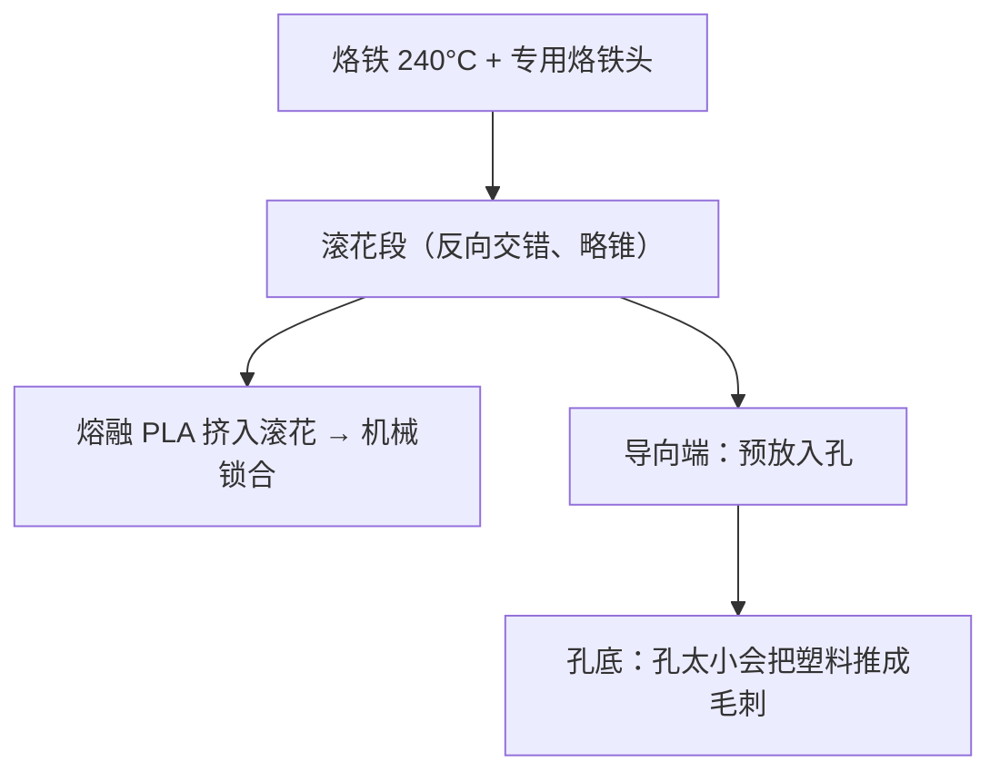

# 3D 打印件热熔铜螺母：孔径与拉拔力实测

> [!summary] 一句话概述
> CNC Kitchen 把近 50 颗 M3 热熔铜螺母熔进 3.6–4.6 mm 不同孔径的 PLA 试样并逐个拉出：小孔时拉拔力约 1400 N，孔径变大先缓降后「断崖」；打印孔普遍比 CAD 小约 0.25 mm，所以 CAD 画 4.2 mm 是甜点——能预放、背面不起毛刺、强度仍约为最大值的 90%。

## 配图

![[附件/heat-set-insert-section.jpg]]
*图源：CNC Kitchen 博客；剖开的试样：塑料挤入并锁住滚花，而不是粘在黄铜上*

![[附件/heat-set-insert-pullout-chart.jpg]]
*图源：同上；M3×5.7 嵌件拉拔力–孔径曲线（打印孔 vs 钻孔）*

![[附件/heat-set-insert-knurl.jpg]]
*图源：同上；滚花段略带锥度（绿线），下方为无滚花的导向端*

> 图片版权归原作者所有，仅作个人学习收藏；出处见文末「来源与核实记录」。

## 结构原理

> 本节数字只写来源里给出的；来源没有就写「来源未给出」。

### 堆叠方案

方向：**沿螺母轴线从上（安装面）到下（孔底）**

| 层级 | 零件/区域 | 材料 | 厚度/尺寸 | 固定方式 | 依据 |
| --- | --- | --- | --- | --- | --- |
| L1 | 嵌件上段：反向交错滚花，略带锥度 | 无铅黄铜 | M3 嵌件滚花外径 4.6 mm | 熔融塑料流入滚花后机械锁合 | 博客「What makes a heat-set insert hold」 |
| L2 | 孔壁塑料（熔化后包裹滚花） | PLA | 孔径决定可用塑料量 | 热熔 | 博客正文 |
| L3 | 嵌件下段：导向端（pilot end） | 黄铜 | 来源未给出 | 用于熔入前预放到孔里 | 博客正文 |
| L4 | 孔底 / 背面 | PLA | 盲孔比嵌件长约 1 mm | — | 补充来源 Tips & Tricks |

剖面示意：

### 零件清单

| 零件 | 数量 | 功能 | 材料 | 依据 |
| --- | --- | --- | --- | --- |
| M3 热熔嵌件（M3×5.7） | 试验近 50 颗 | 提供金属螺纹 | 无铅黄铜 | 博客正文、图表标题 |
| PLA 试样 | 每个孔径 3 件，打印孔和钻孔各一套 | 被测基体 | Polymaker PolySonic PLA | 博客正文 |
| USB 烙铁 + 专用头 | 1 | 加热植入，设 240 °C | — | 博客正文 |
| 嵌件校正器（insert straightener） | 1 | 保证垂直、与表面齐平 | 铝 | 博客正文 |

### 装配顺序

1. 按材料与打印机实际缩孔量设计孔径（M3 打印孔 CAD 取 4.2 mm；钻孔取标称 4.0 mm）。
2. 把嵌件导向端预放入孔中（孔合适时有轻微阻力能立住）。
3. 烙铁 240 °C 带专用头加热嵌件，轻压熔入；用校正器压平保证垂直齐平。
4. 检查孔背面：若有毛刺被推出，说明孔偏小，增大一档。

### 受力与运动分析

- **受力路径**：螺钉拉力 → 嵌件 → 滚花与塑料的机械咬合 → 塑料基体。6000 fps 高速视频显示塑料并不粘在黄铜上，而是锁在滚花里；拔出时嵌件因斜向滚花还会略微转动。
- **运动关系**：安装后静态；滚花反向切削兼顾拉拔与抗扭。
- **失效风险**：孔过大时滚花只部分咬合，拉拔力急剧下降（钻孔试样在 4.1–4.2 mm 之间大幅下降，大到几乎能用手拔出）；孔过小时无法预放，并在背面推出毛刺，可能挡住螺钉穿出。试样壁数与填充不足时塑料先坏。

## 设计要点与参数

| 要点 | 内容 | 依据 |
| --- | --- | --- |
| 打印孔缩小量 | 作者 CORE One L + PolySonic PLA 实测约小 0.25 mm | 博客 TL;DR |
| 试验范围 | 孔径 3.6–4.6 mm（4.6 mm 为滚花外径），每径 3 件 | 博客正文 |
| 最大拉拔力 | 小孔时约 1400 N（约 150 kg） | 博客 TL;DR |
| 打印孔甜点 | CAD 4.2 mm：可预放、无毛刺、强度约为最大值的 90% | 博客 TL;DR |
| 钻孔 | 大幅下降发生在 4.1–4.2 mm；标称 4.0 mm 合理 | 博客 TL;DR |
| 通用规则 | 孔做到嵌件「刚好能带点阻力预放」；小规格嵌件 CAD 加 0.2–0.3 mm | 博客结论 |
| 植入温度 | 240 °C（PLA） | 博客正文 |
| 盲孔深度 | 比嵌件长约 1 mm；通孔不必比嵌件长；孔应为直孔、一般不需倒角，并保证最小壁厚 | 补充来源 Tips & Tricks |
| 其他材料/规格 | 来源未给出（作者认为其他规格趋势相似，但未测） | 博客结论 |

## 优缺点

**优点**
- 给塑料件提供可反复拆装的金属螺纹
- 植入工具简单（烙铁），可预放后批量熔入

**缺点 / 代价**
- 结果依赖打印机与材料的缩孔量，需要校准件
- 孔径公差窗口很窄（0.1 mm 级就从「强」变「弱」）

## 可借鉴点

- 设计热熔嵌件孔时以「实际孔径」为准，CAD 值 = 标称值 + 本机缩孔量
- 先打印孔径校准块（作者为每种嵌件规格做了含水平/竖直/斜向孔的校准件）
- 把「能预放」作为现场判据：既保证装配效率，又落在强度合格区间
- 注塑件的热熔/超声埋植嵌件也是「塑料锁入滚花」原理，孔径与滚花外径的关系同样关键（推断）

## 相关案例

- [[微软 Surface Laptop 超声波点焊与 Alcantara 覆面（反面案例）]]
- [[塑料件加强筋设计：厚度、高度与间距比例]]（螺丝柱加强筋）
- 分类索引：[[02-连接与紧固 索引]]

## 来源与核实记录

- 主来源：[Are Our Heat-Set Insert Datasheets Wrong?](https://www.cnckitchen.com/blog/are-our-heat-set-insert-datasheets-wrong)（CNC Kitchen 博客，2026-03-28，Stefan Hermann）
- 补充来源：[Tips & Tricks for Heat-Set Inserts used in 3D printing](https://www.cnckitchen.com/blog/tips-and-tricks-for-heat-set-inserts)（CNC Kitchen）
- 核实：2026-11-13 打开主来源全文，核对试验条件、拉拔力、孔径结论；打开补充来源核对盲孔/通孔/壁厚/倒角规则。CNC Kitchen 本身销售嵌件，属厂商自测。
