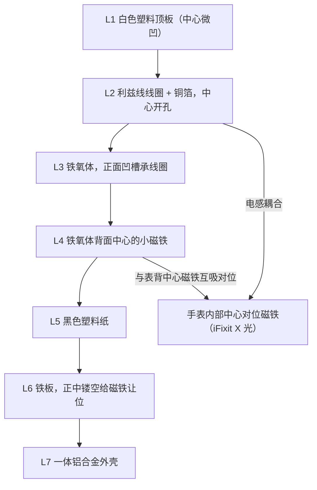

# Apple Watch 磁吸充电盘：中心单颗磁铁对位与电感耦合（对照手机环形阵列）

> [!summary] 一句话概述
> Apple Watch 的磁吸充电盘用**中心一颗小磁铁**把圆盘吸到表背并对准，再靠盘内线圈与手表做电感耦合充电；磁铁在铁氧体背面中心，线圈坐在铁氧体正面的凹槽里，底部铁板在对应磁铁处镂空。它和 iPhone MagSafe 那种绕线圈的一圈 18 颗磁铁不是同一套几何。

## 配图

![[附件/watch-s7-center-magnet.jpg]]
*图源：[充电头网：拆解报告：Apple Watch Series 7原装USB-C口磁吸充电器](https://www.chongdiantou.com/archives/100615.html)（2021-09-22）；铁氧体背面中心固定的小磁铁。该文原句为「背面中心固定有小磁铁」。*

![[附件/watch-s7-iron-plate.jpg]]
*图源：同上；掀起利兹线线圈后，可以看到铝合金壳里的铁板，正中镂空（文中写「最下方放置有一块铁板，对应小磁铁处镂空」）。线圈本身也绕成中心开孔的圆环，给这颗中心磁铁让位。*

![[附件/watch-s7-ferrite-groove.jpg]]
*图源：同上；黑色铁氧体正面做出凹槽，用来放下线圈并降低厚度。线圈上方原先还贴有铜箔贴纸。*

![[附件/ifixit-magsafe-vs-watch-xray-b.jpg]]
*图源：[iFixit，iPhone 12 and 12 Pro Teardown，步骤 18](https://www.ifixit.com/Teardown/iPhone+12+and+12+Pro+Teardown/137669)，X 光由 Creative Electron 拍摄。这张是 **iPhone MagSafe 充电器**的 X 光：外围一圈分段磁铁包围发射线圈。iFixit 用它来对照 Apple Watch 充电器——后者「只用中心一颗磁铁」，没有这圈外环。*

> 图片版权归原作者所有，仅作个人学习收藏；出处见文末「来源与核实记录」。

## 结构原理

> 本节所有数字只写来源里给出的；来源没有就写「来源未给出」。充电头网拆的是 Series 7 原装 USB-C 磁吸充电器实物；iFixit 提供的是与 iPhone MagSafe 充电器、以及手表内部对位磁铁的交叉对照。不要把 MagSafe 手机那组力值和 18 颗磁铁写进这只圆盘。

### 堆叠方案

方向：**从充电盘贴手表的顶面，向下到铝合金外壳底板**（充电头网拆解顺序）

| 层级 | 零件 | 材料 | 厚度/尺寸 | 固定方式 | 依据 |
| --- | --- | --- | --- | --- | --- |
| L1（最外，贴表） | 白色塑料顶板 | 塑料；表面哑光、类肤手感，中心微微内凹 | 整盘直径约 27.52 mm，厚度约 5.97 mm（含外壳） | 拆掉后才能看到内部；内部打胶 | 充电头网外观段与「将顶部塑料板拆掉」 |
| L2 | 无线充电线圈 + 铜箔贴纸 | 利兹线绕制；贴纸为铜箔 | 来源未给出匝数、线径 | 放入铁氧体正面凹槽；铜箔也连到导线上；利兹线焊接到从 USB-C 头延伸的导线上 | 充电头网拆解段 |
| L3 | 铁氧体导磁片 | 黑色铁氧体 | 来源未给出厚度；正面有凹槽以降低总体厚度 | 凹槽朝向线圈；背面中心固定小磁铁 | 充电头网 |
| L4 | 中心小磁铁 | 来源未给出牌号 | 来源未给出直径或厚度 | 固定在铁氧体背面中心 | 充电头网「背面中心固定有小磁铁」；iFixit：充电器为中心单颗磁铁 |
| L5 | 黑色塑料纸 | 塑料 | 来源未给出 | 垫在铁氧体下方 | 充电头网 |
| L6 | 铁板 | 铁 | 来源未给出厚度；对应小磁铁处镂空 | 最下方，置于铝合金壳内 | 充电头网 |
| L7（最外，背面/侧面） | 一体式铝合金外壳 | 铝合金 | 与顶面共同构成约 5.97 mm 厚的圆饼 | 与顶板围合 | 充电头网 |
| 线缆与控制电路 | USB-C 头内 PCB | 小板长 16.93 mm、宽 9.6 mm；USB-C 塑料外壳 24.28 × 12.49 × 6.39 mm | 电路与线圈分开，发热分散 | 充电头网：钢套点焊、导热胶、注塑保护 | 充电头网 |

剖面示意：

和 iPhone MagSafe 环形阵列的差别（iFixit 步骤 18 的原句对照）：

- 本案例：充电盘和手表都靠**中心单颗磁铁**对位，线圈绕在这颗磁铁外面。
- [[iPhone MagSafe 环形磁铁阵列：18 颗磁铁把线圈对中并对附件保持]]：线圈外面围一圈磁铁（iPhone 12 为 18 颗），充电器上也是外围磁环，不是盘心一颗。

### 零件清单

| 零件 | 数量 | 功能 | 材料 | 依据 |
| --- | --- | --- | --- | --- |
| 白色塑料顶板 | 1 | 贴表充电面，中心微凹 | 塑料 | 充电头网 |
| 利兹线线圈与铜箔贴纸 | 1 | 发射交变磁场；铜箔连到导线 | 利兹线、铜箔 | 充电头网 |
| 铁氧体 | 1 | 导磁、给线圈提供凹槽、降低厚度 | 黑色铁氧体 | 充电头网 |
| 中心小磁铁 | 1 | 与手表对位并保持 | 来源未给出牌号 | 充电头网；iFixit「single magnet in the center」 |
| 黑色塑料纸 | 1 | 隔离铁氧体与铁板 | 塑料 | 充电头网 |
| 铁板（中心镂空） | 1 | 位于最下方；镂空避免挡住中心磁铁 | 铁 | 充电头网 |
| 铝合金外壳 | 1 | 背面与侧面结构件 | 铝合金 | 充电头网 |
| USB-C 头内控制板 | 1 | USB 连接、降压和线圈驱动，与盘内线圈分开以分散发热 | 含 STM32L433RC、两颗 TI TPS51604、一颗丝印 338S00810-A0 的定制芯片 | 充电头网 |
| 手表内部对位磁铁 | 1（iFixit 在表内中心看到） | 与充电盘中心磁铁互吸对准 | 来源未给出牌号 | iFixit Apple Watch X-ray Teardown 步骤 2 |

### 装配顺序

> 按充电头网拆解顺序反推。

1. 把小磁铁固定到铁氧体背面中心。
2. 把利兹线线圈放入铁氧体正面凹槽，贴上铜箔贴纸，并把线圈和铜箔接到从 USB-C 头延伸过来的导线上。
3. 在铁氧体下方垫黑色塑料纸，再放入中心镂空的铁板。
4. 将上述叠层放入一体式铝合金外壳，内部打胶固定。
5. 盖上中心微凹的白色塑料顶板。
6. 控制电路预先做在 USB-C 插头内的小板上（钢套点焊、导热胶、注塑保护），与充电盘分开放置。
7. 使用时把圆盘靠近表背，中心磁铁互吸对位，再开始感应充电。

### 受力与运动分析

- **受力路径**：中心磁铁与手表内部的中心对位磁铁互相吸引，把充电盘拉到表背并保持。铁氧体和底部铁板构成磁路的一部分，但铁板在磁铁处镂空，避免把这颗中心磁铁「短路」或挡住（结构可见，来源未用这段话解释磁路计算）。线圈负责传能，不承担保持力。来源未给出吸力的牛顿数或公斤数。
- **运动关系**：吸合后圆盘相对表背没有工作滑动；对中主要靠中心那一对磁铁，而不是外围磁环的径向自对中。顶面中心微凹，有助于和表背贴合，来源未给出凹面的曲率半径。
- **失效风险**：充电头网写内部打胶很牢，拆开后底部仍残留大量胶水。推断：中心单颗磁铁的有效吸合面积比环形阵列小，偏转或侧向错位时更容易脱开，来源未给出侧向力测试。电路放在 USB-C 头里，线缆要同时承担供电和信号，线与盘、线与头的抗弯折是薄弱环节之一，来源未给出弯折寿命。

## 设计要点与参数

| 要点 | 内容 | 依据 |
| --- | --- | --- |
| 对中几何 | 中心单颗磁铁，不是外围环形阵列 | 充电头网「背面中心固定有小磁铁」；iFixit：Watch 充电器 uses but a single magnet in the center |
| 手表侧 | 表内中心也有一颗用于对准充电器的小磁铁 | iFixit Apple Watch X-ray Teardown 步骤 2 |
| 充电盘直径 | 约 27.52 mm | 充电头网实测 |
| 充电盘厚度 | 约 5.97 mm | 充电头网实测 |
| 线缆总长 | 约 1 m | 充电头网实测 |
| USB-C 头外壳 | 长 24.28 mm，宽 12.49 mm，厚 6.39 mm | 充电头网实测 |
| 控制小板 | 长 16.93 mm，宽 9.6 mm | 充电头网实测 |
| 实测输入（给手表充电时） | 5 V 0.32 A，1.65 W（ChargerLAB POWER-Z KM001C） | 充电头网。该文同时写最大充电功率仍需进一步测试，不要把 1.65 W 写成额定上限 |
| 线圈工艺 | 利兹线，焊接到 USB-C 头延伸导线；上方有铜箔贴纸 | 充电头网 |
| 铁氧体 | 正面凹槽承线圈、降低厚度；背面中心固定磁铁 | 充电头网 |
| 铁板 | 最下方，对应小磁铁处镂空 | 充电头网 |
| 热设计 | 控制电路在 USB-C 头内，与盘内线圈分开，分散发热、降低温升 | 充电头网 |
| 吸力、磁铁牌号与尺寸 | 来源未给出 | 已打开来源均未列 |

该文前言还写到 Series 7「从 0% 充到 80% 仅需 45 分钟」「较 Series 6 提升 33%」，说的是手表充电架构与 USB-C 快充座的宣传对比，不是这只充电盘拆解测得的额定功率，不写入上表作为本盘参数。

## 优缺点

**优点**
- 中心单磁铁加上圆形盘面，对圆形表背是很直接的对位方式，用户不必对准一圈磁环。
- 铁氧体凹槽把线圈做薄，整盘厚度可以做到约 6 mm。
- 铁板中心镂空，让中心磁铁继续朝表背「露出」磁路，结构分工清楚。
- 把发热较大的驱动电路放到 USB-C 头里，圆盘本身只留线圈、磁铁和导磁件，有利于贴腕部位的温升（充电头网的设计判断）。

**缺点 / 代价**
- 只有中心一颗磁铁，没有外围磁环那种「先靠近、再被径向拉到中心」的宽容差阵列；偏了就主要靠这一对磁铁纠正。
- 吸力数值来源未给出，无法按窗口验收。
- 盘内打胶很牢，维修性差。
- 额定最大功率在该拆解发布时仍写「需进一步测试」，不能把一次 1.65 W 的在线测量当成规格。

## 可借鉴点

- **圆形、需要贴合的感应充电面，优先考虑中心单磁铁，而不是套用手机那种大圆环阵列。** 盘的直径只有约 28 mm，一圈 18 颗磁铁既放不下，也没有必要。
- **磁铁放在铁氧体背面中心，线圈绕在凹槽里并中心开孔**：磁路和线圈同轴，又不让绕组挡住磁铁。
- **底部铁板要在磁铁处镂空**，否则金属板会改变中心磁路，也可能增加厚度。
- **把功率电路和线圈在空间上拆开**：小充电盘里只留磁与线圈，驱动放到插头或线缆另一端，是控制贴肤面温升的一种做法。
- 若要给平板或手机做大面积无线充对中，应去看环形阵列，而不是把这颗中心磁铁放大套用。

## 与库中相似案例对比

| 对比项 | 本案例（Apple Watch 磁吸充电盘） | [[iPhone MagSafe 环形磁铁阵列：18 颗磁铁把线圈对中并对附件保持]] | [[MagSafe 1-2 笔记本磁吸充电头：磁力保持触点对中，拉力过大时整头脱落]] |
| --- | --- | --- | --- |
| 磁力的角色 | 中心单颗磁铁给圆盘和表背对位、保持 | 线圈周围的环形阵列对中，并保持附件 | 把带触针的插头吸到插座上，可整头脱落 |
| 传能方式 | 盘内利兹线线圈感应耦合 | 感应耦合 | 弹簧顶针接触导电 |
| 几何 | 直径约 27.52 mm 的圆饼，磁铁在中心 | 大圆环 + 可选取向磁铁 | 扁平插头、线性五针 |
| 何时用这篇 | 圆形穿戴、表背充电、中心对位 | 手机/附件环形对中或 Qi2 磁环 | 可脱落的磁吸电源触点 |

## 相关案例

- [[iPhone MagSafe 环形磁铁阵列：18 颗磁铁把线圈对中并对附件保持]]
- [[MagSafe 1-2 笔记本磁吸充电头：磁力保持触点对中，拉力过大时整头脱落]]
- [[Pogo Pin 弹簧顶针：针头、弹簧与针管的工作行程和弹力]]
- 分类索引：[[02-连接与紧固 索引]]

## 来源与核实记录

- 主来源：[充电头网：拆解报告：Apple Watch Series 7原装USB-C口磁吸充电器](https://www.chongdiantou.com/archives/100615.html)（2021-09-22，作者捣蛋猫 / 深圳充电头网传媒有限公司。圆盘直径与厚度、顶面白塑料与铝合金外壳、线圈铜箔、铁氧体凹槽、背面中心小磁铁、底部镂空铁板、利兹线、USB-C 头内电路与实测 5 V 0.32 A / 1.65 W，均来自这篇已打开的全文与配图。）
- 补充来源 1：[iFixit, iPhone 12 and 12 Pro Teardown，步骤 18](https://www.ifixit.com/Teardown/iPhone+12+and+12+Pro+Teardown/137669)（独立第二机构。明确写出 Apple Watch 充电器「只用中心一颗磁铁」，并以 MagSafe 充电器外围磁环的 X 光作对照。）
- 补充来源 2：[iFixit, Apple Watch X-ray Teardown，步骤 2](https://www.ifixit.com/Teardown/Apple+Watch+X-ray+Teardown/41323)（与补充来源 1 同属 iFixit，不另计机构。X 光说明表内中心有用于对准充电器的小磁铁。）
- 核实：2026-11-27 打开上述页面并下载配图。未把 iPhone MagSafe 的 18 颗磁铁、ADG 拔脱力或笔记本 MagSafe 触点头写入本盘参数。未把 1.65 W 的一次测量写成额定最大功率。
