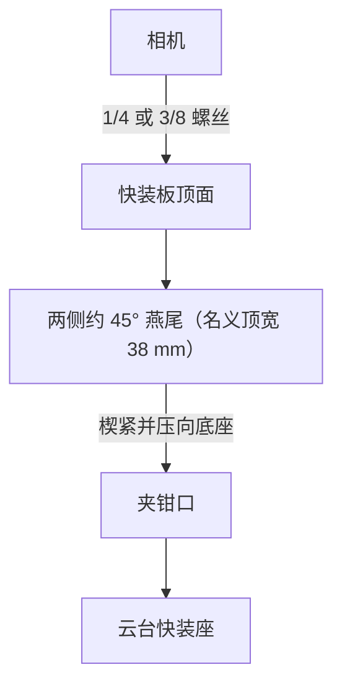

# Arca-Swiss 38 mm 燕尾快装板：事实标准与跨品牌混用风险

> [!summary] 一句话概述
> 相机快装里最常见的「Arca 兼容」燕尾，名义上是顶面约 38 mm 宽、两侧约 45° 的梯形，夹钳从两边楔进把板压向底座。它来自瑞士 Arca-Swiss 1950 年代的大画幅导轨，后来用到球台快装上，却从来不是一份正式公布的强制标准——原厂自己还另有 26 mm 的 monoball®Fix。旋钮夹钳能吃下各厂一点点宽窄差；定宽的扳手夹钳和出厂精调的 flipLock® 才是混用翻车的高发区。

## 配图

![[附件/arca-swiss-compatibility.jpg]]
*图源：[ARCA-SWISS USA Classic Camera Plates](https://arca-swiss-usa.com/collections/classic-camera-plates)；原厂自己就把接口分成两套：Classic 燕尾宽 38 mm，monoball®Fix 宽 26 mm。双槽快装上槽吃 38 mm、下槽吃 26 mm，不能当成「一种板吃所有夹」*

![[附件/arca-swiss-classic-plate.jpg]]
*图源：同上，Classic Universal 一类快装板示意；图上 40 × 60 是这块板的外形尺寸，不是 38 mm 燕尾宽度，二者不要混读*

> 图片版权归原作者所有，仅作个人学习收藏；出处见文末「来源与核实记录」。

## 结构原理

> 本节所有数字只写来源里给出的；来源没有就写「来源未给出」。

### 堆叠方案

方向：**从相机底面到云台本体**

| 层级 | 零件 | 材料 | 厚度/尺寸 | 固定方式 | 依据 |
| --- | --- | --- | --- | --- | --- |
| L1（最上） | 相机 + 连接螺丝 | 来源未给出 | 常用 1/4" 或 3/8"（官网板型名称中出现 1/4、3/8，具体牙型以各板页为准） | 螺丝把板拧在相机底部 | 官网产品名（如 Classic 55 mm 1/4） |
| L2 | 快装板顶面 | 来源未给出 | 板的外形因型号而异（示例图 40 × 60）；燕尾名义顶宽约 38 mm | 与燕尾一体 | Optaxis；官网示例图 |
| L3 | 燕尾两侧斜面 | 来源未给出 | 名义约 45°；各厂略有出入 | 与板一体 | Optaxis；IDS：传统 Arca 与 RRS 在「斜面起始高度」和宽度上有差 |
| L4 | 夹钳两片 45° 钳口 | 来源未给出 | 旋钮式开合无级可调；扳手式多为定宽 | 旋钮或扳手驱动一侧/两侧钳口 | Optaxis |
| L5 | 云台/快装座本体 | 来源未给出 | 原厂 Classic 为 38 mm 上槽；部分双槽下槽为 26 mm | 与云台一体或独立快装座 | 官网兼容图 |

剖面示意：

IDS 对传统 Arca 板与 RRS 板的差异（该文描述，不是行业标准值）：斜面开始前的高度分别为 1.905 mm 与 1.5 mm；RRS 宽度换算为 38.1 mm。这类「差之毫厘」在旋钮夹钳的行程里通常还能夹牢，但在定宽扳手夹钳上就可能太松或合不拢。

### 零件清单

| 零件 | 数量 | 功能 | 材料 | 依据 |
| --- | --- | --- | --- | --- |
| 快装板 | 1 / 机 | 把相机接到燕尾接口 | 来源未给出 | 官网；Optaxis |
| 夹钳（旋钮或扳手） | 1 | 楔紧燕尾 | 来源未给出 | Optaxis |
| 安全限位螺丝 / 防脱销 | 常见为板两端各 1，但无统一规范 | 夹钳松开后限制滑出行程 | 来源未给出 | Optaxis；官网有 Stop plate Kit |
| 原厂 26 mm 系统（对照） | — | 更窄的 monoball®Fix，不是 38 mm Classic | 来源未给出 | 官网 |

### 装配顺序

按 Optaxis「选购与上手」：

1. 先定夹钳类型：要跨品牌、求稳，用旋钮夹钳；求快且板、夹同厂，才用扳手（尽量带安全锁）。
2. 把板拧到相机上。机型专用 L 板/底板通常会给电池仓和侧面接口留开口；通用板常挡住这些口。
3. 带限位螺丝的板从上方落入夹钳（不能再从侧面推入）；无限位的板可以侧推。
4. 夹紧后用手拉、左右晃，确认锁死。扳手要看锁定指示。重装备另加安全绳。
5. 安全限位螺丝要留着。跨品牌时为了塞进夹钳而拆掉限位，等于拆掉防摔的最后保险（Optaxis：已有因此摔机的记录）。

### 受力与运动分析

- **受力路径**：相机重量和操作力经螺丝到快装板，再由两侧斜面把力分解成「夹紧」和「压向底座」。夹得住，靠的是楔形增力和夹钳预紧，而不是燕尾自己「卡死」。
- **运动关系**：夹紧后理想状态是板相对夹钳无移动。松开后，无限位的光板可以沿槽滑出坠落；有限位时只能在两颗螺丝之间滑动一小段。
- **失效风险**：Optaxis 指出，扳手被衣角、树枝勾到半开，没有限位的板就会整块滑出。扳手夹钳定宽，板太窄会滑、太宽合不拢；连 RRS 自家扳手都夹不住阿卡 P0 Slidefix 和 Novoflex 的板，官方建议这些用户改用旋钮。原厂 flipLock® 出厂按自家板校准，第三方板太宽、太窄、倒角太圆或规格不符时可能要再调（官网原文）。部分夹钳上的防滑凸起（nib）位置各厂不同，会挡住别家的板，IDS 写这些凸起通常是可拆螺丝，但拆了就失去防滑脱功能。

## 设计要点与参数

| 要点 | 内容 | 依据 |
| --- | --- | --- |
| 名义几何 | 顶面约 38 mm 宽，两侧斜面各约 45° | Optaxis；官网写 Classic「38 mm dovetail width」 |
| 是不是强制标准 | 不是。Optaxis：从来没有一份官方发布的精确规范；38 mm、45° 是被广泛沿用的标称值 | Optaxis |
| 原厂第二套尺寸 | monoball®Fix 燕尾宽 26 mm，与 Classic 38 mm 不是同一槽 | 官网 |
| 实测差异例 | 传统 Arca 与 RRS：斜面起始高度 1.905 mm vs 1.5 mm；RRS 宽度换算 38.1 mm | IDS |
| 旋钮 vs 扳手 | 旋钮无级可调、对宽度差最宽容；扳手定宽、快，但不保证跨品牌 | Optaxis；IDS 同样建议跨品牌优先旋钮 |
| 安全限位 | 板两端凸出的限位螺丝；无统一尺寸规范 | Optaxis |
| 商标与措辞 | 「Arca-Swiss」是注册商标/公司名；「Arca compatible」与「Arca-style / Arca-type」严格程度不同，商家常混用 | Optaxis |
| 起源 | 官网：Classic 板在 1950 年代设计并申请专利，燕尾与大画幅光学导轨底座一致，至今未改 | 官网。Optaxis 补充：专利号网上查不到，三种「有没有专利/是否到期」说法互相打架，能确定的是流行开来时已不受保护、也没有正式规范 |

## 优缺点

**优点**
- 楔形夹紧把板压向底座，比只有平面摩擦更抗扭转
- 没有被锁成独家标准，所以生态大，板和云台可以按任务换
- 旋钮夹钳用行程吃公差，一套夹能兼容多数「差不多」的板

**缺点 / 代价**
- 「兼容」不是保证：定宽扳手、出厂校准锁、防脱销位置都可能让「都写着 Arca」的零件装不牢
- 无限位时，夹钳一旦松开，整机可以沿槽滑出
- 原厂同时维护 38 mm 和 26 mm 两套槽，买错槽位会直接装不上

## 可借鉴点

- **事实标准要在图纸上写「名义尺寸 + 公差带」，并写清不能混用的变体**（这里就是 38 mm Classic 与 26 mm Fix）。只写「按某品牌风格」而不给公差，下游一定会出现扳手夹不牢。
- **需要跨品牌互配时，锁紧件做成可调行程（旋钮），不要做成只有一个锁止位置的扳手。**
- **防脱落和快装是一对矛盾**：限位螺丝能救命，但强迫从上方落入；为了侧推而拆限位，等于取消安全。
- **商标不等于标准**。对外沟通要用「兼容 / 按某某名义尺寸」，并做装夹实测，不要只靠文案。
- 买板看会不会挡电池仓和侧面接口：38 mm 燕尾本身限制了板上能开多大的避让口（Optaxis）。

## 与库中相似案例对比

| 对比项 | 本案例 | [[VESA MIS-D 75-100 接口与倾角摩擦关节]] | [[GoPro 快拆卡扣与指旋螺母：两爪弹性卡入和螺钉夹紧是两套锁]] |
| --- | --- | --- | --- |
| 标准属性 | 事实标准，无强制规范 | 协会指南：孔距、螺丝都有规定 | 厂家接口，螺纹规格官方未公布 |
| 对位 | 38 mm / 45° 名义燕尾，各厂略差 | 75 或 100 mm 正方形孔距 | 交叉指 + M5 社区规格 |
| 混用风险 | 扳手夹钳、flipLock、限位销位置 | 孔距错了装不上，风险直观 | M5 与 10-32 混牙 |
| 防脱落 | 限位螺丝，无统一规范 | 螺丝连接，另论 | 卡爪 + 螺母夹紧 |

## 相关案例

- [[VESA MIS-D 75-100 接口与倾角摩擦关节]]
- [[GoPro 快拆卡扣与指旋螺母：两爪弹性卡入和螺钉夹紧是两套锁]]
- [[Sony E 卡口：三爪、18 mm 法兰距与锁销磨损]]
- 分类索引：[[02-连接与紧固 索引]]

## 来源与核实记录

- 主来源：[一条燕尾,半个世界的三脚架都在用｜Optaxis](https://www.optaxis.app/marketing/articles/arca-dovetail-app-zh.html)（中文；38 mm × 45° 名义几何、事实标准、旋钮 vs 扳手、安全限位、措辞三层）
- 补充来源 1：[ARCA-SWISS USA: Classic Camera Plates](https://arca-swiss-usa.com/collections/classic-camera-plates)（Classic 38 mm，1950s 设计并称申请过专利、燕尾至今未改；monoball®Fix 26 mm；flipLock 按原厂板校准，第三方可能太宽/太窄/太圆）
- 补充来源 2：[IDS: ARCA SWISS standard and cross brand compatibility issue](https://idsworks.store/pages/arca-swiss-standard-and-across-brand-competibility)（斜面起始高度 1.905 mm vs 1.5 mm、RRS 宽度 38.1 mm；旋钮有公差、定宽锁不能保证跨品牌；夹钳防滑 nib 位置各异）
- 核实：2026-11-17 打开上述三页。未引用未打开的 Wikimedia 剖面 SVG（本批下载超时）。示例板图上的 40 × 60 只当作该板外形，不当作燕尾宽度。
