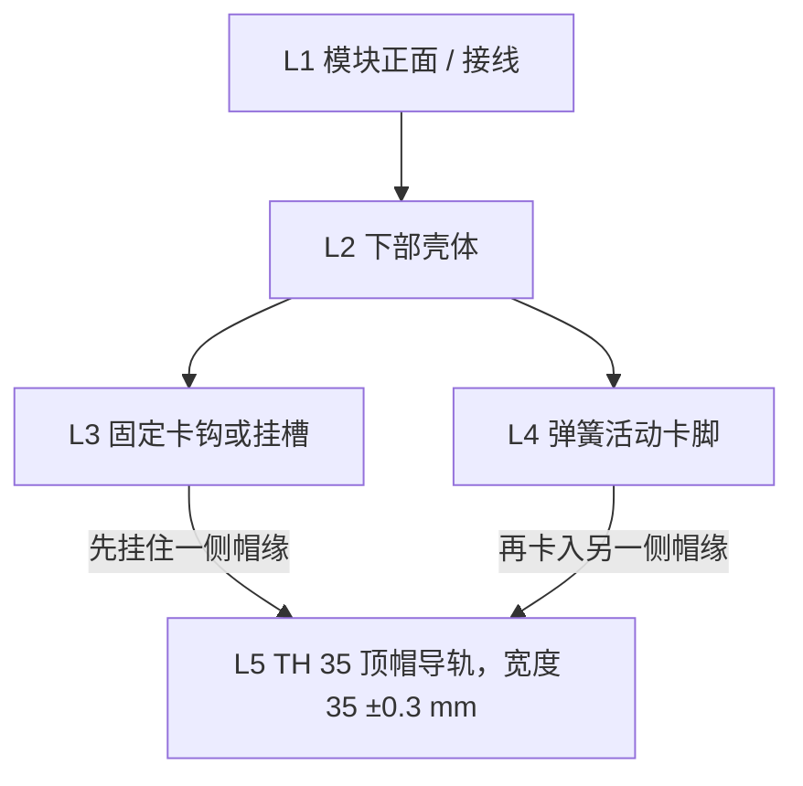

# DIN 导轨卡装模块（IEC 60715 TH35）：卡钩挂住 35 mm 顶帽轨，弹簧卡脚锁紧，拆时拨开卡脚

> [!summary] 一句话概述
> 工业模块背面用一个固定卡钩（或槽）加上带弹簧的活动卡脚，卡到符合 IEC 60715 的 35 mm 顶帽导轨（TH 35）上：先挂住导轨的一侧帽缘，再把另一侧的弹簧卡脚压过帽缘，听到或感觉到卡住即保持；拆卸时用螺丝刀拨开卡脚（或按产品说明反向拨动壳体），再把模块从导轨上掀下。并排模块和总线连接可以另做，本篇只写怎么挂上和取下。

## 配图

![[附件/zlg-din-rail-clip-install.jpg]]
*图源：[周立功 导轨安装说明 PDF](https://zlg.cn/data/upload/software/Products/pxb/rail-mounted-pxb.pdf)；图 A 为两只模块并排卡在 35 mm DIN 导轨上，背面标出导轨卡扣；图 B、C 给出该产品的安装/拆卸方向：先把背面卡扣的弹簧卡入导轨下方，再顺时针按入，直到导轨完全进入卡扣安装槽*

![[附件/phoenix-eh-din-rail-snap.jpg]]
*图源：[Phoenix Contact EH…F 电子壳体数据手册 106461_en_00（2015-03-05）](https://media.digikey.com/pdf/Data%20Sheets/Phoenix%20Contact%20PDFs/EH_F_Series_ElectHousings_3-5-15.pdf) 第 19 页图 30；安装 (A)：先把壳体上部槽挂到 35 mm 导轨上缘，再向安装面按压，直到底部卡脚发出可听见的咔哒；拆卸 (B)：用螺丝刀拨开底部卡脚的锁止，握住壳体上盖向上掀，再从导轨上取下*

![[附件/iec60715-th35-profile.jpg]]
*图源：[IEC 60715:2017 预览](https://cdn.standards.iteh.ai/samples/23197/de6fcc085faa4dc1a9af3ef4265d161d/IEC-60715-2017.pdf) 第 9 页图 2 Mounting rail TH 35；明细 A 标注顶帽宽度 35 ±0.3 mm、壁厚 1 ±0.04 mm、边缘无毛刺且圆角 ≤R0.2。预览带 iTeh 水印，侧视图上 7,1、3,45、35,3 等尺寸未在旁完整注明对应哪一段轮廓，本文不把这些数字当作已核对参数*

> 图片版权归原作者所有，仅作个人学习收藏；出处见文末「来源与核实记录」。

## 结构原理

> 本节所有数字只写来源里给出的；来源没有就写「来源未给出」，不估算、不换算成看似精确的值。

### 堆叠方案

方向：**从模块正面到导轨安装面（柜壁或安装板）**

| 层级 | 零件 | 材料 | 厚度/尺寸 | 固定方式 | 依据 |
| --- | --- | --- | --- | --- | --- |
| L1（最外，操作面） | 模块/壳体正面与接线区 | 菲尼克斯 EH…F：ABS | 壳体宽度有 22.5 / 35 / 45 mm 等多档（与导轨宽度不是同一回事） | 上盖卡在下部壳体上 | 菲尼克斯手册订货数据与第 9 节 |
| L2 | 下部壳体 | ABS（EH…F）；颜色浅灰近似 RAL 7035 或黑近似 RAL 9005 | 例如 EH 35 F-B 下部壳体宽度 35 mm | 与上盖卡合；背面带导轨卡装脚 | 菲尼克斯手册：Lower housing part with vents and base latch for DIN rail mounting |
| L3 | 背面固定卡钩或挂槽 | 与壳体一体或作为卡脚组件，来源未拆开说明 | 须与 35 mm 顶帽缘配合，具体钩深来源未给出 | 先挂住导轨一侧帽缘 | 菲尼克斯：upper housing slot hooks onto the top edge；周立功图中的导轨卡扣 |
| L4 | 弹簧活动卡脚（snap-on foot / 导轨卡扣弹簧） | 来源未给出弹簧材料 | 来源未给出弹力与行程 | 压过导轨另一侧帽缘后卡住；拆时拨开 | 菲尼克斯图 30；周立功安装/拆卸步骤 |
| L5 | 35 mm 顶帽导轨（TH 35，手册亦写 EN 60715 / 对称 DIN 轨） | IEC 本预览页未给出轨材 | 顶帽宽度 35 ±0.3 mm；壁厚 1 ±0.04 mm（图 2 明细 A）。标准还给出 TH 35-7,5 与 TH 35-15 两种高度代号，7.5 mm / 15 mm 的完整公差图在预览附录页未完整展开 | 固定在安装板或柜壁上，本篇不写轨本身如何上柜 | IEC 60715:2017 图 2；菲尼克斯：snapped onto symmetrical DIN rails according to EN 60715 |

剖面示意：

两种常见挂法（必须分开写，不能合成同一步骤）：

- **先挂上缘、再卡下脚（菲尼克斯 EH…F）**：把装置从上方放到接地的 35 mm DIN 导轨上，使壳体上部槽挂住导轨上缘；再把壳体上部小心地推向安装面；底部卡脚发出可听见的咔哒后，检查是否已牢固。拆卸：用合适的螺丝刀拨开底部卡脚的锁止，握住上盖小心地向上掀，再把装置从导轨上抬下。
- **先卡下缘弹簧、再按入（周立功安装页）**：① 把产品背面导轨卡扣的弹簧卡入导轨下方；② 顺时针把产品往里按压，直到导轨完全卡入卡扣的安装槽。拆卸：① 在上方顶住产品；② 逆时针拨动产品，直到导轨底部脱离卡扣安装槽，取出产品。该页图示没有要求使用螺丝刀，但原理同样是「一侧挂住、一侧弹簧卡脚越缘」。

本篇核心是模块如何在导轨上挂上/取下，不展开并排模块的总线连接。周立功图 A 只表明多只模块可以并排卡在同一根 35 mm 导轨上。

### 零件清单

| 零件 | 数量 | 功能 | 材料 | 依据 |
| --- | --- | --- | --- | --- |
| 模块上部壳体/上盖 | 每模块 1 | 封闭与接线开孔、手持拆卸 | 菲尼克斯：ABS | 菲尼克斯手册 |
| 下部壳体 | 每模块 1 | 形成安装基准，带导轨卡脚 | 菲尼克斯：ABS | 菲尼克斯手册 |
| 固定挂槽或卡钩 | 每模块 1 | 先与导轨一侧帽缘定位 | 来源未单独给出 | 菲尼克斯图 30；周立功图 |
| 弹簧卡脚 | 每模块 1 | 卡住另一侧帽缘，拆时被拨开 | 弹簧材料来源未给出 | 同上 |
| TH 35 导轨 | 1 根（可并排多模块） | 标准化机械支承 | 本预览页未给出 | IEC 60715:2017；两家厂商均写 35 mm |

### 装配顺序

按各自来源的安装步骤（不是拆解反推）：

**菲尼克斯 EH…F（手册 9.1）**

1. 壳体出厂带用于 DIN 导轨安装的底部卡脚。
2. 从上方把装置放到接地的 35 mm DIN 导轨上，使上部槽挂住导轨上缘。
3. 在壳体上部向安装面小心按压。
4. 卡脚发出可听见的咔哒后，检查是否已牢固附着。
5. 拆卸：用合适螺丝刀拨开卡脚锁止；握住上盖向上掀；再从导轨上抬下。

**周立功安装页**

1. 把背面卡扣的弹簧卡入导轨下方。
2. 顺时针往里按压，直到导轨完全进入卡扣安装槽。
3. 拆卸时先在上方顶住产品，再逆时针拨动，使导轨底部脱离卡扣槽后取出。

手册还给出墙面安装用的底部卡脚与钻孔图（Φ4、间距 83.5 mm 等），那是另一条安装路径，不是本篇的导轨卡装。

### 受力与运动分析

- **受力路径**：模块自重和接线拉力经壳体传到卡钩与弹簧卡脚，再传到导轨的两道顶帽缘。导轨需按规定固定在柜内；本篇打开的来源没有给出卡脚的额定保持力。
- **运动关系**：安装时模块相对导轨作一次倾斜挂入，再绕挂点转到与安装面平行，弹簧卡脚越缘后复位卡住。拆卸时先解除卡脚，再反向倾斜退出。挂上后模块沿导轨长度方向仍可能滑动，因此实际柜内常另加终端挡件；本篇打开的这三份来源没有把终端挡件的结构写全，故不展开。
- **失效风险**：未挂住上缘就硬压，可能把卡脚扳变形（推断）。拆卸不用螺丝刀拨开卡脚而硬撬壳体，可能损坏卡脚或导轨帽缘（推断）。导轨若不是 35 mm 顶帽截面，卡钩对不齐。并排模块若没有终端限位，振动下可能沿轨滑动（推断；来源未给滑动力）。

## 设计要点与参数

| 要点 | 内容 | 依据 |
| --- | --- | --- |
| 导轨标准与宽度 | 对称 35 mm 顶帽轨，菲尼克斯写作符合 EN 60715；IEC 图 2 将此轮廓称为 TH 35，顶帽宽度 35 ±0.3 mm | 菲尼克斯手册第 1 节与 9.1；IEC 60715:2017 图 2 |
| 壁厚与边缘 | 明细 A：1 ±0.04 mm；边缘无毛刺，圆角 ≤R0.2 | IEC 图 2 |
| 高度代号 | 标准目录列出 TH 35-7,5 与 TH 35-15；完整高度公差图未在本预览页展开，高度数值来源未在本篇核对 | IEC 目录 A.3 |
| 挂入顺序（菲尼克斯） | 先挂上缘槽，再按压到底部卡脚咔哒 | 菲尼克斯 9.1 与图 30 |
| 挂入顺序（周立功） | 先把弹簧卡入导轨下方，再顺时针按入到安装槽 | 周立功安装说明 |
| 拆卸 | 菲尼克斯：螺丝刀拨开底部卡脚锁止，向上掀；周立功：上方顶住后逆时针拨动脱离 | 两家各自步骤 |
| 壳体材料 | EH…F：ABS，UL 94 HB；浅灰近 RAL 7035 或黑近 RAL 9005 | 菲尼克斯手册 |
| 壳体宽度档（示例） | 下部壳体有 22.5 mm、35 mm 等多档，指模块宽度，不是导轨宽度 | 菲尼克斯订货数据 |
| 卡脚弹力、钩深、寿命 | 来源未给出 | — |

## 优缺点

**优点**
- 不用螺丝就能把模块固定到柜内标准轨上，安装和更换快。
- 导轨截面由 IEC/EN 60715 规定顶帽宽度，不同厂商的模块可以挂在同一类 35 mm 轨上（具体卡脚是否与所有轨高兼容，仍要按该产品说明书）。
- 拆卸路径明确：先释放弹簧卡脚，再倾斜取下，模块不会在没解锁时直接被拉脱。

**缺点 / 代价**
- 不同产品的「先挂哪一侧」并不统一，不能把一家的步骤抄到另一家的壳体上。
- 沿轨方向的定位通常还要靠终端挡件或相邻模块挤紧，本篇来源没有把这一层写全。
- 弹簧卡脚是易损件，公开手册很少给出弹力和寿命，维修时只能按原厂卡脚更换。

## 可借鉴点

- 做导轨卡装时，把「定位挂点」和「弹簧锁紧点」分在导轨两道帽缘上：先挂后压，拆时先解锁再掀。这比两侧同时硬卡更容易对准。
- 在说明书和图上写清先挂哪一边。同一 35 mm 轨可以有「先上后下」或「先下后上」两种卡脚布置，步骤不能混用。
- 拆卸要给工具或手指一个明确的拨开位点（菲尼克斯画了螺丝刀拨底部卡脚），避免用户撬壳体止口。
- 导轨宽度按标准写公差（本例顶帽 35 ±0.3 mm），模块卡脚的开口必须按这个公差设计，而不是按「大约 35」。
- 模块自身宽度（22.5 mm 模数等）和导轨宽度是两个尺寸，不要在图样上混用同一个「35」。

## 与库中相似案例对比

| 对比项 | 本案例（DIN 导轨卡装） | [[电柜三点连杆锁：一点把手驱动上下连杆把柜门多点锁在框上]] | [[Southco、DZUS 四分之一转快锁：90° 凸轮与按总材料厚度选钉长]] | [[电缆防水格兰头：PG 螺纹、夹紧爪与密封圈]] |
| --- | --- | --- | --- | --- |
| 锁的对象 | 模块挂在柜内 35 mm 顶帽轨上 | 柜门锁在门框上 | 面板锁在框架上 | 电缆固定并密封在壳体开孔上 |
| 动作 | 倾斜挂入 + 弹簧卡脚越缘 | 一点把手带动上下连杆 | 约 90° 凸轮锁 | 旋紧螺帽，夹紧爪抱紧电缆 |
| 标准化关键 | IEC 60715 TH 35，顶帽 35 ±0.3 mm | 柜门锁具系列，不是导轨截面 | 按 TMT 选钉长 | PG 螺纹与密封圈 |
| 拆卸 | 拨开卡脚后掀下模块 | 反向转把手 | 反向转约 90° | 松开螺帽 |
| 是否已收录三点锁 | 不是柜门多点锁，不可写成同一篇 | 本库已有，本篇只对照 | 不是导轨卡脚 | 不是导轨卡脚 |

## 相关案例

- [[电柜三点连杆锁：一点把手驱动上下连杆把柜门多点锁在框上]]
- [[Southco、DZUS 四分之一转快锁：90° 凸轮与按总材料厚度选钉长]]
- [[电缆防水格兰头：PG 螺纹、夹紧爪与密封圈]]
- [[Framework Desktop 免工具面板与标准件模块化]]
- 分类索引：[[02-连接与紧固 索引]]

## 来源与核实记录

- 主来源：[周立功：导轨安装说明（35mm DIN 导轨与导轨卡扣）](https://zlg.cn/data/upload/software/Products/pxb/rail-mounted-pxb.pdf)（打开日期 2026-11-22。中文安装/拆卸步骤与图 A–C；文档本身未印发布日期）
- 补充来源 1：[Phoenix Contact Series EH…F electronics housings 数据手册 106461_en_00](https://media.digikey.com/pdf/Data%20Sheets/Phoenix%20Contact%20PDFs/EH_F_Series_ElectHousings_3-5-15.pdf)（2015-03-05；ABS / UL 94 HB、EN 60715、图 30 先挂上缘再卡底部卡脚、螺丝刀拆卸。独立第二机构）
- 补充来源 2：[IEC 60715:2017 预览](https://cdn.standards.iteh.ai/samples/23197/de6fcc085faa4dc1a9af3ef4265d161d/IEC-60715-2017.pdf)（图 2 TH 35：35 ±0.3 mm、1 ±0.04 mm、≤R0.2；目录列出 TH 35-7,5 与 TH 35-15。独立标准机构。预览有水印，未引用看不清的尺寸）
- 核实：2026-11-22 下载并打开上述三份文件。施耐德中国 FAQ 与菲尼克斯中文产品页本次打开失败（HTTP 567/403），不写入引用。未把电柜三点门锁或电缆格兰头写成同一结构。
