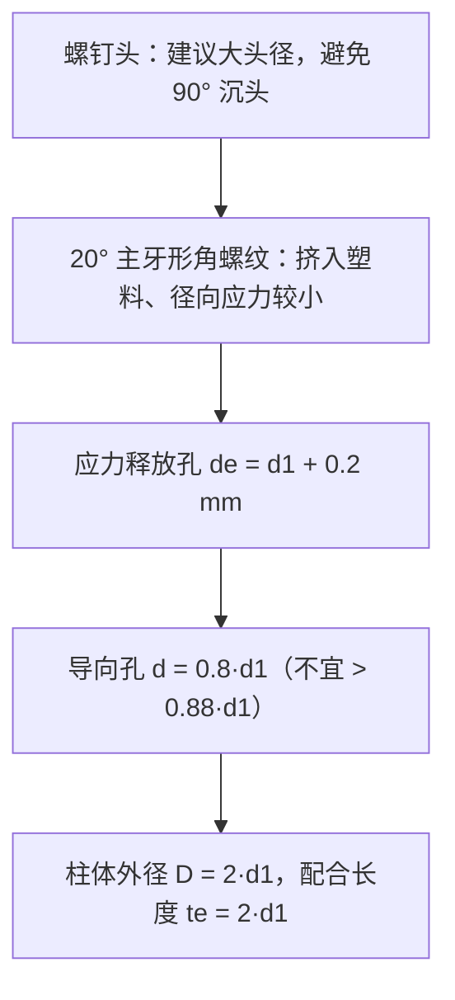

# EJOT Delta PT 塑料用三角齿自攻螺丝：底孔 0.8·d1、20° 牙侧角与应力释放沉孔

> [!summary] 一句话概述
> Delta PT 是专用于热塑性塑料的自攻螺丝：主牙形角 20°（相对普通 60° 机牙侧角更窄），把塑料挤向牙侧而不是径向撑裂薄壁；Bossard 中文资料给出常用塑料的导向孔 d = 0.8·d1、孔口应力释放孔 de = d1 + 0.2 mm、柱体外径 D = 2·d1、螺纹配合长度 te = 2·d1，并且孔径不宜超过 0.88·d1。库中已有的 Boss 柱篇讲柱壁厚比和通用自攻底孔，本篇主角是这套专用牙型与孔口结构。

## 配图

![[附件/delta-pt-thread-profile.png]]
*图源：[Bossard《紧固技术》中文资料](https://assets.eu.ctfassets.net/0vp0u5uh75zd/3DLqM7Z9oEMiNjXOeKeL6V/cc666bc273211e5c3e0d6ddfc95f8ff6/F071_F085_Fastening_CN_12_2024.pdf) 第 F.075 页；Delta PT 主牙形角 20°、对侧 140° 的牙型示意，以及与 PT® 在相同螺纹旋合面积 AFL 下所需拧进深度的对比表*

![[附件/delta-pt-boss-hole.png]]
*图源：同上，第 F.076 页；用于 Delta PT 的柱孔形状：导向孔 d、应力释放孔 de、柱体外径 D 与螺纹配合长度 te*

![[附件/remform-asymmetric-thread.jpg]]
*图源：[Arnold REMFORM® / REMFORM® II HS™ 手册](https://www.arnold-fastening.com/fileadmin/templates/_media/pdf/produkte/REMFORM-II-HS-EN.pdf) 第 2 页附近；独立厂家的塑料自攻牙型——不对称承力牙侧、较小牙侧角以降低径向应力，用来对照「窄牙侧角」这条设计逻辑，不是 Delta PT 本身*

> 图片版权归原作者所有，仅作个人学习收藏；出处见文末「来源与核实记录」。

## 结构原理

> 本节数字只写来源里给出的；来源没有就写「来源未给出」。

### 堆叠方案

方向：**沿螺丝轴线，从上（被夹紧件）到下（注塑柱体）**，尺寸按 Bossard 对常用塑料（弹性模量 E 不大于 15 000 N/mm²）的推荐

| 层级 | 零件/区域 | 材料 | 厚度/尺寸 | 固定方式 | 依据 |
| --- | --- | --- | --- | --- | --- |
| L1 | 螺钉头部（建议大头径） | 来源未给出具体牌号 | 来源未给出头径数值；资料建议为塑料件选用大头径（BN20040） | 头部摩擦提供拧紧安全、降低表面压力 | Bossard F.076 |
| L2 | Delta PT 螺纹 | 同上 | 主牙形角 20°；对侧示意 140°；螺距小于传统 PT（例：公称直径 4 mm 时 PT K50 螺距 2.24 mm，Delta PT 50 螺距 1.8 mm） | 挤压塑料成型，而非切削排出 | Bossard F.075；中文产品页 |
| L3 | 孔口应力释放孔 de | 热塑性塑料 | de = d1 + 0.2 mm；深度示意见图，资料标出 0.3–0.4·d1 与 0.5·d1 两段 | 分散孔口边缘应力，防止第一圈攻牙把塑料顶出 | Bossard F.076 |
| L4 | 导向孔（底孔）d | 同上 | d = 0.8·d1；为充分利用紧固能力，孔径不应超过 0.88·d1 | 螺钉挤入成型 | Bossard F.076 |
| L5 | 柱壁 / 外径 D | 同上 | D = 2·d1 | 一体注塑 | Bossard F.076 |
| L6 | 螺纹配合长度 te | 同上 | te = 2·d1（该页推荐） | — | Bossard F.076 |

剖面示意：

### 零件清单

| 零件 | 数量 | 功能 | 材料 | 依据 |
| --- | --- | --- | --- | --- |
| Delta PT 自攻螺丝 | 每柱 1 | 在热塑性塑料中直接成型内螺纹并夹紧 | 来源未给出具体牌号 | Bossard 产品页、F.075 |
| 注塑螺丝柱（带导向孔与应力释放孔） | 每连接点 1 | 提供底孔与壁厚 | 热塑性塑料 | Bossard F.076 |
| 被夹紧件 | 1 | 被头部压紧；剪切力应由零件间的形状配合承担 | 来源未限定 | Bossard F.076 |
| 带力矩/转角控制的拧紧工具 | 1 | 控制攻入与拧紧 | — | Bossard F.077 |

### 装配顺序

1. 注塑时直接成型导向孔、应力释放孔和柱体外径，不要事后随便扩孔（Bossard：被夹紧件上避免采用扩大的孔）。
2. 用带可靠停止功能的电动工具安装；F.075 建议装配转速 400 转/分钟，F.077 写旋转速度应在 300 至 800 rpm 之间。拧紧扭矩需按实际应用确定，并建议先用首件做装配运行控制。
3. 攻丝扭矩应始终小于最小破坏扭矩（F.075 装配参考值页的原则）。批量生产前，计算或软件（DELTACALC®）结果必须用实际零件试验确认（F.077）。

### 受力与运动分析

- **受力路径**：拧紧时牙侧把塑料挤向牙槽，预紧力经螺纹斜面传到柱壁，再传到柱根。20° 主牙形角比 60° 机牙产生的径向分量更小，有利于薄壁（Bossard 产品页与 F.075）。
- **运动关系**：安装时螺丝相对柱孔作螺旋挤入；装到位后无相对运动。资料强调较小螺距提高抗振稳定性。
- **失效风险**：孔口没有应力释放孔时，易应力开裂，聚碳酸酯尤其敏感；第一圈攻牙还可能把塑料顶出、使夹紧面不平（F.076）。沉头 90° 会产生径向和轴向松弛并导致开裂（F.076）。孔径偏大（超过 0.88·d1）则吃不饱螺纹，紧固能力用不满。

## 设计要点与参数

| 要点 | 内容 | 依据 |
| --- | --- | --- |
| 牙型 | 主牙形角 20°，有利于塑料变形；中心截面积增加，同样公称直径 Ød1 拉伸强度约增加近 50% | Bossard F.075；产品页写「螺纹角更小（20°和30°），与普通 60° 相比径向应力更小」 |
| 螺距与拧进深度 | 同样螺纹旋合面积 AFL=35 mm²：PT® K50（d=4 mm，P=2.24 mm）te=13.24 mm；Delta PT 50（d=4 mm，P=1.8 mm）te=10.42 mm；Delta PT 40（d=3.2 mm，P=1.46 mm）te=11.75 mm | Bossard F.075 |
| 导向孔 | d = 0.8·d1；孔径不应超过 0.88·d1 | Bossard F.076 |
| 应力释放孔 | de = d1 + 0.2 mm；用于边缘应力分布，防 PC 等应力开裂，并防止第一圈顶出塑料 | Bossard F.076 |
| 柱体外径 / 配合长度 | D = 2·d1，te = 2·d1（该页对 E≤15 000 N/mm² 常用塑料的推荐） | Bossard F.076 |
| 最小拉伸断裂载荷（Delta PT 公称尺寸） | 公称尺寸 30 / d1=3 mm：3.8 kN；40 / 4 mm：6.8 kN；50 / 5 mm：10 kN；60 / 6 mm：15 kN | Bossard F.077 |
| 装配转速 | F.075 建议 400 r/min；F.077 写 300–800 rpm；要用力矩和/或转角控制的拧紧机 | Bossard F.075、F.077 |
| 孔偏差来源 | 注塑加工条件、模具设计、浇口位置、熔接缝、颜料/纤维等添加剂，以及不同厂家改性和配方 | Bossard F.076 |
| 独立来源对照（REMFORM，不是 Delta PT） | 较小承力牙侧角降低径向力（手册写约 30°，REMFORM II HS 承力牙侧约 10–12°）；底孔按材料系数×公称直径，例如 REMFORM：PP 0.72·d、PA6 0.74·d、ABS 0.74·d、PC 0.78·d，旋入深度约 2.00–2.50·d | Arnold 手册第 16–17 页 |

> 同一本 Bossard 资料后文还有 PT® / ecosyn®-plast 按材料给出的孔径系数表（如 PP 0.70·d1、PC 0.85·d1）。该表出现在「用 PT® 螺钉、ecosyn®-plast 在热塑性塑料上直接安装」一节，**不能直接当作 Delta PT 官方孔径表**；Delta PT 在 F.076 给出的是统一的 d=0.8·d1 与上限 0.88·d1。实际零件仍要做装配试验。

## 优缺点

**优点**
- 窄牙侧角径向应力小，适合薄壁扁平结构，可节省材料、缩短注塑周期（Bossard 产品页）
- 较小螺距在较短拧进深度下仍能获得足够啮合，螺钉可以更短（F.075 对比表）
- 直接装配，不必预埋铜螺母或二次攻丝

**缺点 / 代价**
- 底孔、应力释放孔和柱体外径都必须按专牙设计，不能拿普通机牙或通用自攻底孔公式直接套用
- 注塑缩孔、熔接缝、玻纤含量都会让实际孔径偏离推荐值，必须用首件验证
- 沉头和被夹件上的大过孔都会破坏头部摩擦与预紧，属于结构禁忌

## 可借鉴点

- **出图时把三个孔画全**：导向孔 d=0.8·d1、孔口应力释放孔 de=d1+0.2 mm、柱体外径 D=2·d1，不要只给一个光孔
- **不要用 90° 沉头螺丝压塑料件**；优先大头径，剪切力交给零件之间的止口/凸台，而不是螺丝
- **孔径校核上限 0.88·d1**；首件测量实际孔径（含缩孔），再锁螺丝听开裂、看出胶
- 若改用其他品牌塑料自攻（如 Arnold REMFORM），孔径系数要换那一家的材料表，不能把 0.8·d1 当成万能常数

## 与库中相似案例对比

| 对比项 | 本案例 | [[注塑螺丝柱（Boss 柱）：壁厚比 0.6 分水岭与自攻底孔公式]] | [[3D 打印件热熔铜螺母：孔径与拉拔力实测]] |
| --- | --- | --- | --- |
| 主角 | 专用塑料自攻螺丝的牙型与配套底孔 | 注塑柱体的壁厚比、根部和通用自攻底孔 | 成型后热熔植入的铜螺母 |
| 固定原理 | 窄牙侧角挤入塑料成型 | 通用自攻切/挤螺纹，重点在柱壁不开裂、外观不缩 | 熔融塑料包住滚花 |
| 关键参数 | d=0.8·d1、de、D、te、牙侧角 20° | 柱壁/主壁约 0.6、底孔≈d−0.8P | 打印孔径与拉拔力曲线 |
| 区别 | 本篇不重复抄写柱壁厚比公式；讨论的是专牙带来的径向应力下降和孔口沉孔 | 已有篇不涉及 20° 牙型与应力释放孔 | 热熔嵌件是另一条路线 |

## 相关案例

- [[注塑螺丝柱（Boss 柱）：壁厚比 0.6 分水岭与自攻底孔公式]]
- [[3D 打印件热熔铜螺母：孔径与拉拔力实测]]
- [[注塑模内预埋铜螺母：模具定位、溢胶风险与直纹及斜花滚花]]
- [[TAPTITE II 金属三角挤牙自攻螺丝：按啮合率选底孔]]（金属挤牙，不是本篇热塑性塑料专牙）
- 分类索引：[[02-连接与紧固 索引]]

## 来源与核实记录

- 主来源：[Bossard《紧固技术》中文资料 F071/F085（2024-12 文件名；页内版权标记 © Bossard, F-cn-2023.06）](https://assets.eu.ctfassets.net/0vp0u5uh75zd/3DLqM7Z9oEMiNjXOeKeL6V/cc666bc273211e5c3e0d6ddfc95f8ff6/F071_F085_Fastening_CN_12_2024.pdf)，引用 F.075（牙型、AFL 对比）、F.076（孔形与 d/de/D/te）、F.077（拉伸断裂载荷与装配转速）
- 补充来源（同一公司/经销关系，不计第二独立来源）：[Bossard 中文产品页「EJOT® Delta PT® 塑料用自攻螺钉」](https://www.bossard.com.cn/cn-zh-cn/product-solutions/product-categories-and-brands/direct-assembly-screws/delta-pt/)（页内注明 EJOT® 和 DELTA PT® 为 EJOT SE & Co. KG 注册商标）
- 独立第二来源：[Arnold REMFORM® and REMFORM® II HS™ 英文手册](https://www.arnold-fastening.com/fileadmin/templates/_media/pdf/produkte/REMFORM-II-HS-EN.pdf)（Arnold Umformtechnik；引用不对称牙侧角与第 17 页 core hole factors）
- 核实：2026-11-21 用 curl GET 下载上述 PDF 与页面，pdftotext 核对表格。未把 Semblex 的 PT 许可手册计为独立来源（其文本写明 PT® / Delta PT® 为 EJOT 商标、Semblex 为 licensed products）。后文 PT®/ecosyn®-plast 材料孔径表未并入 Delta PT 参数。
