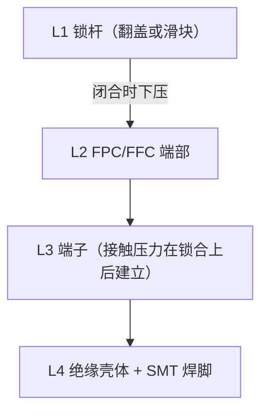

# FPC 翻盖锁扣连接器：IRISO 三类锁与 Hirose FH12 前翻盖 ZIF

> [!summary] 一句话概述
> ZIF 排线连接器用翻盖或滑锁把 FPC/FFC 压到端子上：锁打开时插入力接近于零，锁合上后才建立接触压力；IRISO 将其分为滑块、前翻盖和后翻盖三类，Hirose FH12 是前翻盖（front flip）的具体系列，抬起锁杆、插到位再压下锁杆即可反复拆装，不必焊接排线。

## 配图

![[附件/hirose-fh12-flip-lock-photo.jpg]]
*图源：[Hirose FH12 系列手册](https://media.digikey.com/pdf/Data%20Sheets/Hirose%20PDFs/FH12.pdf) 首页；左为不同极数的 FH12 与 FPC/FFC，右为用手指压下旋转锁杆（Flip-lock）*

![[附件/hirose-fh12-operating-instructions.jpg]]
*图源：同上，「Bottom Contact Type」操作说明；①抬起锁杆解锁，②导电面朝下垂直插入，③压下锁杆；右侧为禁止抓拧锁杆、未插到位就上锁、以及向上硬拉排线的图示*

![[附件/iriso-front-flip.jpg]]
*图源：[IRISO《FPC/FFC 连接器的类型和特点》](https://www.irisoele.com/cn/technology/connectors/feature/fpcffc-types-features/) 前翻盖示意图；打开盖、插入排线，再把朝排线一侧倒下的盖压上*

> 图片版权归原作者所有，仅作个人学习收藏；出处见文末「来源与核实记录」。

## 结构原理

> 本节所有数字只写来源里给出的；来源没有就写「来源未给出」，不估算、不换算成看似精确的值。

### 堆叠方案

方向：**从锁杆外侧到印制板焊盘**（以 ZIF、FH12 下触点卧式为例）

| 层级 | 零件 | 材料 | 厚度/尺寸 | 固定方式 | 依据 |
| --- | --- | --- | --- | --- | --- |
| L1 | 锁杆 / 翻盖 / 滑块 | FH12 绝缘体为聚酰胺或 PPS（手册未单独列出锁杆牌号） | FH12 标准翻盖锁在板上方高度 2.0 mm；加强锁杆再增加 0.4 mm | 可旋转或滑动，打开时释放端子，闭合时把卡压向端子 | IRISO 三类锁说明；Hirose FH12 特征栏与操作说明 |
| L2 | FPC/FFC（有时称「卡」） | 柔性印制板或扁平排线；FH12 适用端厚 0.3±0.05 mm（标准），FH12F 为 0.18±0.05 mm，镀层为焊接镀（金镀需配金端子） | 端厚见左；接触节距 0.5 mm 或 1.0 mm（1.0 mm 仅下触点） | 插入槽后再被锁压住，不是焊死在连接器里 | IRISO 定义；FH12 规格表 |
| L3 | 端子 | FH12：磷青铜，焊接镀层。IRISO 另提到保持端子、双触点等选项，属其自家系列 | FH12 额定 0.4 A DC、50 V AC；接触电阻最大 50 mΩ | 锁闭合后对 FPC 导电面施压；FH12 用专利的半调音叉端子，接触力不靠壳体壁来维持 | FH12 规格与特征第 4 条 |
| L4 | 绝缘壳体与金属配件 | 绝缘体：聚酰胺（米色）或 PPS（深棕），UL94V-0；金属配件：黄铜，焊接镀层 | 来源未给出壳体壁厚 | SMT 焊到 PCB；有上触点、下触点和直立安装类型 | FH12 材料表与类型表 |

剖面示意：

### 零件清单

| 零件 | 数量 | 功能 | 材料 | 依据 |
| --- | --- | --- | --- | --- |
| 绝缘壳体 | 1 | 形成插槽并固定端子 | 聚酰胺或 PPS（FH12） | FH12 材料表 |
| 锁杆 / 翻盖 / 滑块 | 1 | 打开时释放插入力，闭合时加压并保持 | 与绝缘体同类或来源未单独给出 | IRISO；FH12 操作说明 |
| 端子 | 等于极数 | 与 FPC 导电面接触并接到 PCB | 磷青铜（FH12） | FH12 |
| 金属配件 | 来源未给出数量 | 手册列为 Macal Fittings（金属配件），黄铜焊接镀层 | 黄铜 | FH12 材料表 |
| FPC/FFC | 1 条 | 被连接的柔性线路 | 端厚见上 | FH12 适用 FPC 栏 |

### 装配顺序

IRISO 对 ZIF 的共同逻辑是：先开锁，再把卡插入，再锁上（两次动作，常需双手）。Hirose FH12 下触点型（0.5 mm / 1 mm 通用）操作说明：

1. 抬起锁杆解锁。可以用拇指或食指指甲轻轻拨起；零件又小又薄，不要抓着锁杆拧，也不要用指甲钩死硬掰。
2. 导电面朝下（下触点），使 FPC 与连接器垂直并完全插入槽内。未插正或未插到底就压锁，可能导致排线损伤或接触不良；若已误锁，应先按拆卸方法打开再重插。
3. 压下锁杆。手册写锁上只需一根手指或 6.9 N；对比其所述竞品侧锁需要两根手指和 39.2 N。不要只压锁杆的一侧，否则会锁不实。
4. 拆卸：先抬起锁杆，锁松开后再把 FPC 抽出。手册注明这类结构对向上的拉力保持不强，若排线受拉力，应另外托住，不要向上硬拽。

Hirose 支持页把 FH12 归为 front flip（前翻盖）及 vertical flip（直立翻盖）；同一页把 FH34SRJ、FH35C 等列为 backflip，FH40、FH48 列为 vertical flip。

### 受力与运动分析

- **受力路径**：锁闭合后，锁杆把 FPC 压向端子，接触力由端子（FH12 为半调音叉结构）维持，电流经端子到 SMT 焊脚。IRISO 指出：滑块型保持力高，但体积和操作较差；前翻盖把盖朝卡的一侧倒下，尺寸和操作性更好，但卡被向上掀时的保持力较弱，需要高保持力时可能不适用；后翻盖的手柄在插入侧的后方，更耐冲击、保持力倾向更高，但深度方向变长，SMT 焊脚有时被挡住不便检查。
- **运动关系**：ZIF 的定义是插卡时几乎不加力，接触压力只在锁动作后出现。Non-ZIF / LIF 则一开始就靠端子压力夹卡，没有这套锁。FH12 锁杆是旋转一次性按压（手册称 Rotating One-touch / Flip-lock），可在板面上并排放两只或更多连接器，不必为侧向滑锁留操作空间。
- **失效风险**：单边压锁、未插到位就合盖、抓拧锁杆、以及向上硬拉排线，都是 FH12 手册明确禁止的。IRISO 也提醒滑块锁较重、前翻在上掀时保持力不足。FH12 插拔寿命为 20 次，超出后接触电阻可能不再满足 50 mΩ 上限。上触点类型还把 FPC 向上翘出，便于在排线下方布置零件，但更要注意不要把翘起的排线当提手。

## 设计要点与参数

| 要点 | 内容 | 依据 |
| --- | --- | --- |
| 锁的三种基本形式 | 滑块型、前翻盖型、后翻盖型（另有 I-Lock 预定位等选项） | IRISO 中文技术文 |
| FH12 锁类型 | 前翻盖（front flip），并有直立翻盖型 | Hirose 支持页；手册封面 Flip-lock |
| 锁合力 | 一根手指或 6.9 N；手册对比竞品侧锁 39.2 N、两根手指 | FH12 特征 1 |
| 板上方高度 | 标准翻盖锁 2.0 mm；加强锁杆再加 0.4 mm | FH12 特征 2 |
| 节距与端厚 | 0.5 mm 与 1.0 mm（1.0 mm 仅下触点）；标准端厚 0.3±0.05 mm，FH12F 为 0.18±0.05 mm | FH12 规格与特征 3、6 |
| 电与环境 | 0.4 A DC，50 V AC；工作温度 −40 到 +70°C（含通电温升）；储存 −10 到 +50°C；湿度最大 90%（不结露） | FH12 Product Specifications |
| 绝缘与耐压 | 绝缘电阻最小 500 MΩ（100 V DC）；耐压 150 V AC / 1 分钟 | 同上 |
| 接触电阻与寿命 | 最大 50 mΩ（1 mA 条件）；插拔 20 次，无损伤且接触电阻仍满足上限 | 同上 Durability |
| 回流与手焊 | 按手册推荐温度曲线回流；手焊 350±5°C、3 秒 | 同上 |
| 前翻盖的选用建议 | IRISO：固定、无强振动且有人操作时，成本和操作性优先，可考虑前翻盖 | IRISO「使用不同的连接器类型」 |
| 需要更高保持力时 | IRISO 建议滑块型，或考虑其 Auto I-Lock；不要默认前翻盖能抗上拉 | 同上 |

## 优缺点

**优点**
- 排线可反复插拔，维修不必熔化焊点
- 打开锁后再插入，避免用插入力硬挤多极软排线
- 前翻盖占用深度小，可以并排布置，操作直观
- 系列化的节距、极数、上/下触点和端厚，便于按 FPC 规格选型

**缺点 / 代价**
- 前翻盖对向上掀排线的保持力较弱，不能把锁当成应变消除
- 必须先开锁再抽线，否则会伤卡或伤锁杆
- FH12 手册给出的插拔寿命只有 20 次，不适合当作频繁热插拔接口
- 锁杆细薄，单边按压或抓拧容易造成锁合不良
- 滑块或后翻盖若要更高保持力，往往要付出体积或焊点可检查性

## 可借鉴点

- 凡是维修时可能要断开的显示、触控板、键盘排线，优先用可开合的 ZIF/LIF 锁，而不是直接把 FPC 焊在板上
- 选型时先问清排线会不会被向上掀或受到振动：要保持力选滑块或后翻，要矮和易操作选前翻，不要混用三类锁的口号
- 在壳体或维修说明里画清「先开锁、再插、再双端压死」，并禁止把排线当提手
- 给锁杆留出手指或拨片的操作空间；并排安装时前翻盖比侧向滑锁更省宽度（FH12 的设计点）
- 按手册核对端厚（0.3 mm 与 0.18 mm 不能混用）和镀层匹配，不要用「差不多厚的排线」凑合

## 与库中相似案例对比

| 对比项 | 本案例（ZIF / 翻盖锁 FPC 连接器） | [[Pogo Pin 弹簧顶针：针头、弹簧与针管的工作行程和弹力]] | [[ThinkPad T480 整张键盘作为可选服务 CRU：两颗螺丝滑出后拔排线]] | [[任天堂 Switch Joy-Con 滑轨连接]] |
| --- | --- | --- | --- | --- |
| 接触如何建立 | 锁闭合后把 FPC 压到端子上，打开锁则几乎无插入力 | 弹簧把针头顶到对面焊盘或靶面，没有翻盖锁 | 该机键盘背面正是这类可开合排线锁的应用，本篇写连接器本身 | 滑轨里的电接触，结构不是 FPC 翻盖 |
| 分离方式 | 先开锁再抽排线 | 直接分离两个部件，靠弹簧行程 | 翻起整张键盘后开锁抽线 | 沿滑轨抽出手柄 |
| 典型寿命关注点 | FH12 手册耐久 20 次插拔 | 该篇的行程与弹力，不套用到本篇 | 以整张键盘更换次数为主，连接器寿命见本篇手册 | 插拔与磨损见该篇 |
| 分类取舍 | 02：可拆连接，重点是锁与端子 | 02：弹簧顶针接触件 | 06：整张键盘模块如何拆 | 02：滑轨连接 |

> 苹果 MacBook Pro 2016 的 Flexgate 是排线路由与弯折寿命问题，不是本篇这种连接器锁结构，故不把该故障的参数写进来。

## 相关案例

- [[Pogo Pin 弹簧顶针：针头、弹簧与针管的工作行程和弹力]]
- [[ThinkPad T480 整张键盘作为可选服务 CRU：两颗螺丝滑出后拔排线]]
- [[任天堂 Switch Joy-Con 滑轨连接]]
- 分类索引：[[02-连接与紧固 索引]]

## 来源与核实记录

- 主来源：[FPC/FFC 连接器的类型和特点](https://www.irisoele.com/cn/technology/connectors/feature/fpcffc-types-features/)（IRISO 中文技术文。核对 ZIF 定义，滑块 / 前翻盖 / 后翻盖的结构差异、保持力与深度方向的取舍，以及选用建议。页面未标注独立发表日期，于 2026-11-22 打开）
- 补充来源 1：[Hirose FH12 Series：0.5mm and 1mm Pitch Connectors For FPC/FFC](https://media.digikey.com/pdf/Data%20Sheets/Hirose%20PDFs/FH12.pdf)（Hirose 手册，经 Digi-Key 转存。核对 Flip-lock、6.9 N / 39.2 N、高度 2.0 mm 与 +0.4 mm、端厚、电规格、材料、20 次插拔，以及下触点操作步骤与注意事项）
- 补充来源 2：[What is the locking structure of the FPC/FFC connector?](https://support.hirose.com/en/support/solutions/articles/68000029713-what-is-the-locking-structure-of-the-fpc-ffc-connector-)（Hirose Electric Support；页面显示 Modified on Fri, Jun 26，未写年份。明确 FH12 为 front flip 及 vertical flip，并列出其他系列的 backflip 归属。与手册同属广濑，不作为第三机构）
- 核实：2026-11-22 打开 IRISO 中文页并下载其前翻盖示意图；下载 FH12 手册并阅读规格、材料与第 9 页操作说明；打开广濑支持页确认 front / back flip 命名。参数只采用手册写出的数字，未把 IRISO 未给出的力值或寿命套用到 FH12 以外的锁型。
