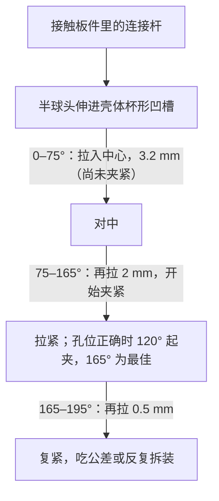

# Häfele Minifix 15 柜体连接件：半球头对中拉入杯形凹槽（对照 Hettich Rastex）

> [!summary] 一句话概述
> 板式柜体常用的「壳体 + 连接杆」可拆连接，海福乐把它做成 Minifix：连接杆的半球头坐进壳体里的杯形凹槽，转动壳体时把头拉到凹槽中心并夹紧。官方原理页强调这是 **centric principle（对中原理），而不是传统偏心原理**；半圈下来拉进行程超过 5 mm，用来吃掉钻孔公差。Hettich Rastex 15 是同一类零件（Ø15 mm 锌压铸壳体、边距 24 或 34 mm、用凸轮把销拉到中心），本文只把它当作独立对照，不拆成第二篇。

## 配图

![[附件/hafele-minifix-principle.jpg]]
*图源：[Häfele DGH-M 2021 Ixconnect Cabinet Connectors Information，页 4.8](https://www.hafele.com.de/prod-live/web/WFS/Haefele-HEX-Site/en_VA/-/EUR/Static-View/pdfcatalog/en_VA/catalogs/catalogs/DGH_Technik2021/pdf/print/bk_22.pdf)；上：连接杆半球头与壳体杯形凹槽；中：两板直角装配示意，箭头必须指向拉杆；下：Minifix「钟面」三段行程*

![[附件/hettich-rastex-15-housing.jpg]]
*图源：[Hettich Connecting technology 2016](https://web.hettich.com/fileadmin/media/Connecting_technology_2016_16359_HUS.pdf) 第 8 页；Rastex 15 带边/不带边锌压铸壳体，目录写：最多可从板端外 4 mm 处把侧板拉到位，内外凹坑把连接销拉到中心*

![[附件/hettich-rastex-15-drilling.jpg]]
*图源：同上目录第 10 页；Rastex 15 按底板厚度给出的钻孔：壳体孔 Ø15 mm，拉杆孔 Ø8 mm，边距 24 或 34 mm（公差 +0.5 / −0.3 mm），孔深随板厚变化*

> 图片版权归原作者所有，仅作个人学习收藏；出处见文末「来源与核实记录」。

## 结构原理

> 本节所有数字只写来源里给出的；来源没有就写「来源未给出」。Minifix 的行程数字只用于海福乐，Rastex 的钻孔表只用于 Hettich。

### 堆叠方案

方向：**从原板件（用端面去顶的那块板，壳体装在它靠板边的大面上）到接触板件（被顶住的大面，拉杆拧入或打入）**。原板件/接触板件的叫法是为了说清孔位，零件名称以厂商目录为准。

| 层级 | 零件 | 材料 | 厚度/尺寸 | 固定方式 | 依据 |
| --- | --- | --- | --- | --- | --- |
| L1（可见面） | 装饰盖（可选） | 海福乐有适用于无边沿 Minifix 15 的端盖、装饰盖 | 来源未在已打开页面给出厚度 | 盖在无边沿壳体上 | 海福乐中国母体页关联件 |
| L2 | Minifix 15 壳体 | 锌合金（中国产品页）；HAF267 另有聚碳酸酯壳体 | 壳体孔 Ø15 mm；孔深 D 随板厚变，见下表；尺寸 A 为锁舌孔中心到壳体顶边 | 压入原板件大面上的面孔，安装时箭头必须正对拉杆 | 海福乐中国母体页；DGH-M 2021；HAF267 |
| L3 | 连接杆（螺栓）的半球头 | 来源未给出杆身完整牌号 | 半球头与杯形凹槽对中配合 | 头伸进壳体内，被凹槽拉紧 | DGH-M 2021：The semi-spherical head of the bolt fits exactly in the centre of the cup-shaped recess |
| L4 | 原板件（侧孔） | 木质板，系统适用板厚自 12 mm 起 | 拉杆穿孔 Ø5、Ø7 或 Ø8 mm，视所选连接杆；壳体中心到板边 24 或 34 mm | 端面侧孔让拉杆穿过 | 海福乐中国母体页、连接杆页 |
| L5 | 连接杆杆身 | 同上 | 长度按 24/34 mm 边距及板厚选，具体杆长来源未在已打开页面完整列表 | 穿过原板件侧孔，另一头进入接触板件 | 连接杆页：尺寸 B 为壳体中心到面板前沿，24 或 34 mm |
| L6 | 接触板件上的拉杆孔 / 预埋 | 来源未给出预埋件必选要求 | 孔径随杆为 5、7 或 8 mm | 拧入、膨胀或厂商指定的打入方式 | 海福乐中国页；Hettich 另有 Rapid S 打入销、Twister 拧入销 |

Rastex 15 对照（Hettich，不是 Minifix 零件）：锌压铸壳体，Ø15 mm，带边或不带边；可用一字、PZ 3 或内六角 AF 4 拧紧；边距同样是 24 或 34 mm（+0.5/−0.3 mm）。例如 16 mm 层板：壳体孔深方向尺寸 12.7 mm，拉杆孔 Ø8 mm，对应高度尺寸 8 mm。

剖面示意：

海福乐对原理的原话（DGH-M 2021 / HAF267）：系统基于 centric principle；HAF267 写 *The fitting works on the centric principle as opposed to eccentric principle. It has no sharp edges and substantial added strength*。行业和部分工艺文仍把这类零件俗称「偏心轮 / 三合一」，Hettich 目录也直接用 Eccentric cam connecting fitting。对照时按各自原文：海福乐强调半球头被导到凹槽中心再夹紧；Hettich 强调球形凸轮（spherical eccentric cam）以及内外凹坑把销拉到中心，避免板件错位。

### 零件清单

| 零件 | 数量 | 功能 | 材料 | 依据 |
| --- | --- | --- | --- | --- |
| Minifix 15 壳体 | 每连接点 1 | 杯形凹槽容纳并拉紧杆头；箭头指示安装方向 | 锌合金（中国页）；HAF267 另有 PC 壳体 | 海福乐中国母体页；HAF267 |
| 连接杆 | 每连接点 1 | 一头进接触板件，一头被壳体拉紧 | 按型号；中国页写适用全部 Minifix 连接杆 | 连接杆页 |
| 装饰盖 / 端盖 | 可选 | 遮住无边沿壳体 | 来源按盖型号 | 母体页关联件 |
| 预埋螺母等 | 可选，视杆型 | 让拉杆在接触板件里更牢 | 来源未在已打开页面写死必须使用 | 未作为本篇必选零件 |

Hettich 对照零件：Rastex 15 壳体 + Rapid S / Twister / 钢销。Rapid S 为 8 mm 胀套，销长 20 mm 或 30 mm；目录用颜色区分长度（绿色 20 mm、黑色 30 mm 配 Rastex 15）。这些数字只用于 Rastex，不写进 Minifix 表。

### 装配顺序

按海福乐原理页和产品页（不是某一工厂的工艺卡）：

1. 按板厚选壳体。中国母体页（无边沿）给出的钻孔深度 D 与尺寸 A：

| 适用板厚 | 钻孔深度 D | 尺寸 A | 依据 |
| --- | --- | --- | --- |
| ≥13 mm | 11 mm | 6.5 mm | 海福乐中国母体页 |
| ≥15 mm | 12 mm | 7.5 mm | 同上 |
| 16 mm | 12.5 mm | 8 mm | 同上 |
| 18 mm | 13.5 mm | 9 mm | 同上 |
| ≥19 mm | 14.0 + 0.5 mm | 9.5 mm | 同上（该档深度写法与其他档不同，按原文抄） |
| ≥23 mm | 16.5 mm | 11.5 mm | 同上 |
| ≥26 mm | 18.5 mm | 13 mm | 同上 |
| 29 mm | 19.5 mm | 14.5 mm | 同上 |

2. 在原板件大面上钻 Ø15 mm 壳体孔，深度用上表；壳体中心到板边取 24 mm 或 34 mm，必须与所选连接杆一致。
3. 在原板件端面钻拉杆侧孔，孔径 5、7 或 8 mm，按杆选定。
4. 在接触板件上钻对应的拉杆孔，并按所选杆的方式把杆装上（拧入或厂商指定的打入方式）。
5. 合板，使杆头进入壳体。**壳体箭头必须正对拉杆**，否则转不到正确行程。
6. 按「钟面」转动壳体（HAF267：锌合金壳体可用 PZ2、6×1.5 一字或 SW4 内六角；聚碳酸酯壳体为单槽，可用大号一字、钥匙或硬币）。三段行程见下表。
7. 如需拆装，松开壳体后可以反复再紧。官方把「多次松开再拧紧仍然可靠」列为优点。

### 受力与运动分析

- **受力路径**：两板被拉开的力经连接杆传到半球头，再由杯形凹槽的承托面传到壳体，最后由壳体孔壁传到原板件。海福乐写：壳体虽小，但内部有较大的拉紧和承托面；杆被中心导向，层板不会相对侧板错位。
- **运动关系**：工作动作就是转动壳体约半圈。DGH-M 2021 / HAF267 把拉进行程 A 分成三段（HAF267 把总行程写成约 5.7 mm，原理页写成 more than 5 mm）：
  - 闭合段 0–75°（6 点到 8:30）= 拉入 3.2 mm：只把杆头拉到壳体中心，这一段还不夹紧。
  - 夹紧段 75–165°（8:30 到 11:30）= 再拉 2 mm：连接被夹紧。孔打准的话，120°（10 点）就开始夹紧；165°（11:30）是最佳位置。
  - 复紧段 165–195°（11:30 到 12:30）= 再拉 0.5 mm：只在孔径有偏差、家具已经反复拆装、或承受过较大载荷时才需要。壳体在箭头到达 195° 止挡之前就应建立张紧。
- **公差补偿**：原理页和 HAF267 都写，半圈超过 5 mm（约 5.7 mm）的行程可以补偿钻孔公差 +1 mm 到约 −0.5 mm，且不损失效能。
- **失效风险**：箭头没有对准拉杆，杆头进不了凹槽中心，会出现空转或夹不紧。边距 24/34 mm 和杆长不匹配，钩不住或两板留缝。壳体孔深和板厚不匹配，壳体高出或沉不下去。Hettich 从另一侧说明同一类风险：它用内外凹坑保证销被拉到中心，「ruling out any displacement of furniture components」。

## 设计要点与参数

| 要点 | 内容 | 依据 |
| --- | --- | --- |
| 原理（海福乐原文） | 对中原理（centric），对照传统偏心；半球头准确落入杯形凹槽中心再夹紧 | DGH-M 2021；HAF267 |
| 壳体孔径 | Minifix 15：Ø15 mm；Minifix 12：Ø12 mm | DGH-M 2021；HAF267；中国母体页：外壳钻孔直径 15 mm |
| 适用板厚 | 系统自 12 mm 起 | DGH-M 2021；中国页 |
| 边距 | 24 或 34 mm | 中国母体页、连接杆页；HAF267 |
| 拉杆孔径 | 5、7 或 8 mm，视杆而定 | 中国页；HAF267 |
| 钟面行程 | 3.2 + 2 + 0.5 mm；总行程原理页 >5 mm，HAF267 约 5.7 mm；止挡 195° | DGH-M 2021；HAF267 |
| 钻孔公差补偿 | +1 mm 至约 −0.5 mm | 同上 |
| 工具（锌合金壳体） | PZ2、一字 6×1.5、内六角 SW4 | HAF267；DGH-M 2021 写 PZ2 / SW4 / flat blade |
| 箭头 | 必须正对拉杆 | 所有海福乐已打开文档 |
| Rastex 15 对照 | 锌压铸；一字 / PZ3 / AF4；可从板端外最多 4 mm 处把侧板拉到位；边距 24 或 34 mm（+0.5/−0.3）；16 mm 板示例孔深方向 12.7 mm、Ø8 mm 拉杆孔 | Hettich 2016 第 8、10 页 |

## 优缺点

**优点**
- 可反复拆装，适合平板包装和上门安装
- 对中导向，官方明确要避免层板和侧板错位
- 半圈就有超过 5 mm 的拉进行程，对钻孔正公差有明确的补偿区间
- 壳体和杆在系统内可组合（海福乐写 all components 兼容）；Hettich 一侧也用多种销去配同一壳体家族

**缺点 / 代价**
- 壳体孔出现在板面上，无边沿款还要加盖；这是明装连接件的外观代价
- 边距、杆长、孔深、箭头方向有一项错，就会钩不住或夹不紧，返工成本高
- 海福乐与 Hettich 对「偏心 / 对中」的叫法不同，行程数字不能互抄
- 接触板件里的锚固方式（自攻、预埋、打入胀销）要按所选杆来，不能默认都有预埋螺母

## 可借鉴点

- **要拉紧又要可拆时，把「对中」和「夹紧」分成两段行程**：先把杆头拉进中心（海福乐前 75° 不夹紧），再进入夹紧段。不要一转头就又挤又偏。
- **用一块「钟面」把角度写成毫米行程**，并单独留出复紧段给公差和反复拆装，比只写「拧紧即可」更可执行。
- **箭头是装配防错，不是装饰**：壳体相对拉杆的相位一旦装反，后面所有角度都错。
- **边距只能在目录给定的几档里选**（这里是 24 或 34 mm），杆长、壳体位置和钻孔必须是同一套数，不要按「看起来居中」现场改边距。
- 和 Hettich 对照时，学的是同一类「壳体转、杆头被拉到中心」，不要把一家的 3.2 mm / 195° 写到另一家的壳体上。

## 与库中相似案例对比

| 对比项 | 本案例（Minifix 15，对照 Rastex 15） | [[拉铆螺母（铆螺母）：单面镦头、铆接范围与圆孔滚花及六角防转]] | [[热铆（热熔柱）：铆柱高度按体积守恒算，蘑菇头直径 2d]] |
| --- | --- | --- | --- |
| 连接性质 | 可反复拆的板式直角连接 | 在薄板上做出螺纹，供螺丝反复拆 | 塑料柱热铆，通常一次性 |
| 拉紧方式 | 转动壳体，杯形凹槽把半球头拉到中心 | 轴向镦出凸缘夹紧板 | 熔塌成蘑菇头 |
| 对孔要求 | 15 mm 壳体孔 + 5/7/8 mm 杆孔，边距 24/34 mm | 按铆螺母规格选底孔 | 柱高、孔径按体积关系 |
| 拆装 | 官方强调多次松开再拧仍然可靠 | 螺纹可拆，铆螺母本身留在板上 | 拆开往往要破坏铆头 |

## 相关案例

- [[拉铆螺母（铆螺母）：单面镦头、铆接范围与圆孔滚花及六角防转]]
- [[钣金压铆螺母（PEM S-CLS）：孔径、最小板厚、边距与板材硬度上限]]
- [[3D 打印件热熔铜螺母：孔径与拉拔力实测]]
- 分类索引：[[02-连接与紧固 索引]]

## 来源与核实记录

- 主来源：[海福乐中国：Häfele Minifix 15 母体（锌合金，不带边沿）](https://www.hafele.com.cn/zh/product/haefele-minifix-15-haefele-minifix-15-/P-00861333/)（2026-11-22 打开。Ø15 mm 壳体孔、板厚与 D/A 对照、边距 24/34 mm、拉杆孔 5/7/8 mm、锌合金）
- 补充来源 1：[海福乐中国：Minifix 15 连接杆（锌合金，带边沿）](https://www.hafele.com.cn/zh/product/minifix-haefele-minifix-15-/P-00861332/)（同属海福乐。尺寸 A、B、D 定义，板厚自 12 mm 起）
- 补充来源 2：[Häfele DGH-M 2021 Ixconnect 原理页 4.8](https://www.hafele.com.de/prod-live/web/WFS/Haefele-HEX-Site/en_VA/-/EUR/Static-View/pdfcatalog/en_VA/catalogs/catalogs/DGH_Technik2021/pdf/print/bk_22.pdf)（页脚 2021-02-02。对中原理、钟面三段行程、箭头、工具、>5 mm 行程与 +1/−0.5 mm 公差。与主来源同一机构）
- 补充来源 3：[Häfele Minifix K.D. Connecting Fittings Product Guide，HAF267 / TCH-FF 2010](https://resources.swanseatimber.co.uk/PDFs/Technical/HAF267_00_911.pdf)（杯形凹槽、半球头、centric as opposed to eccentric、总行程约 5.7 mm、工具。同一机构）
- 补充来源 4：[Hettich Connecting technology 2016，16359 HUS](https://web.hettich.com/fileadmin/media/Connecting_technology_2016_16359_HUS.pdf)（独立第二机构。Rastex 15 锌压铸、球形凸轮、内外凹坑对中、4 mm 拉入、24/34 mm 边距及分板厚钻孔图）
- 核实：2026-11-22 打开上述页面并下载 PDF。未把通用「三合一偏心轮」工艺文里的约数写成 Minifix 参数；APlus 等行业通识文仅作背景理解，不列入本篇来源表。
