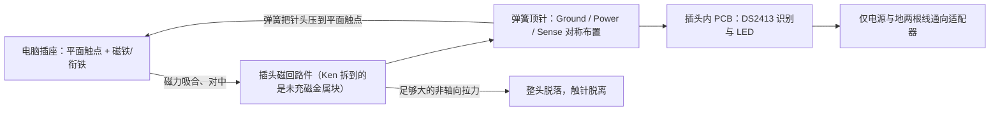

# MagSafe 1-2 笔记本磁吸充电头：磁力保持触点对中，拉力过大时整头脱落

> [!summary] 一句话概述
> MagSafe 与 MagSafe 2 把笔记本电源插头做成「磁吸对中 + 弹簧触针导电」：插头与插座上的磁元件（磁铁或铁磁衔铁）互相吸引，把弹簧顶针压到对应平面触点上；线缆被绊到或受到足够大的非轴向拉力时，整个插头从插座上脱落，而不是把电脑拽下桌或把插针拗断。它解决的是可分离电源连接，不是 iPhone 那种环形磁铁给无线充电线圈对中，也不是弹簧顶针元件本身的内部结构。

## 配图

![[附件/magsafe-laptop-pins-labeled.png]]
*图源：[Ken Shirriff，Teardown and exploration of Apple's Magsafe connector](https://www.righto.com/2013/06/teardown-and-exploration-of-magsafe.html)；MagSafe 2 插头端面。五枚触针左右对称排列：两端为 Ground，往内两枚为 Power，正中为 Adapter Sense。文中说明这种对称布置使插头正反都能插。*

![[附件/magsafe-laptop-exploded.png]]
*图源：同上；Ken 拆开的较早款 MagSafe 插头。左侧是未充磁、但会被电脑侧强磁吸住的金属块；中间白色绝缘座装着弹簧顶针（即文中所称 spring-loaded "Pogo pins"）；右侧是压住针的塑料件；前方可见拆下的针头。*

![[附件/magsafe-patent-fig3-section.png]]
*图源：[US7645143B2，Google Patents / USPTO 附图第 2 页](https://patents.google.com/patent/US7645143B2/en) Fig. 3–5；专利给出的一种剖面：插座 150 与插头 110 各有磁元件（图中标 N/S 的 170、130），插头触针 120 由弹簧 122 推向插座平面触点 160。Fig. 4 / Fig. 5 把正负触点做成对称，以避免插反。*

![[附件/magsafe-patent-fig6-breakaway.png]]
*图源：同上附图第 3 页 Fig. 6；插头 110 在非轴向外力下整头离开插座 150，用于说明「线被绊到时连接自行断开」，而不是靠插针或锁扣承受这笔载荷。*

> 图片版权归原作者所有，仅作个人学习收藏；出处见文末「来源与核实记录」。

## 结构原理

> 本节所有数字只写来源里给出的；来源没有就写「来源未给出」。Ken Shirriff 拆的是实物插头，US7645143B2 是苹果的磁吸连接器专利，充电头网 A1436 只补充 MagSafe 2 适配器的外观和输出规格。三处不要混成「同一只插头的同一组零件表」。

### 堆叠方案

方向：**从电脑插座表面到电源线缆**（以 Ken 拆开的较早款 MagSafe 插头为主，专利 Fig. 3 用来对照磁路与弹簧触针的分工）

| 层级 | 零件 | 材料 | 厚度/尺寸 | 固定方式 | 依据 |
| --- | --- | --- | --- | --- | --- |
| L1（电脑侧） | 插座：平面触点 + 磁元件 | 触点为平面金属片（专利 plates 160）；磁元件可以是磁铁或铁磁材料 | 来源未给出具体毫米数 | 固定在电脑壳体上 | US7645143B2 Fig. 3–5；摘要写 receptacle 上有 corresponding contacts |
| L2 | 插头端面的磁回路件 | Ken 拆到的是「未充磁、但会被电脑侧强磁吸引的金属块」；专利允许插头侧也放磁铁（优选永磁稀土磁铁） | 来源未给出 | 作为插头外壳/磁路的一部分，套在绝缘座外 | Ken 拆解正文与爆炸照片；US7645143B2 摘要 |
| L3 | 弹簧顶针（Power / Ground / Sense） | 来源未给出牌号；Ken 称为 spring-loaded "Pogo pins" | MagSafe 1：中间 Adapter Sense 针明显更细；MagSafe 2：五针外形更接近，但两枚接地针略长，以便先接触。其余尺寸来源未给出 | 由白色绝缘座与外侧塑料件限位 | Ken 正文与标注照片、爆炸照片 |
| L4 | 绝缘座与外壳 | 绝缘座为塑料；Ken 还写到外壳内有一块可能是聚乙烯的软蜡状塑料，用来扩散 LED 光线并保护电路 | 来源未给出 | 塑料件把顶针保持在位 | Ken 拆解 |
| L5 | 插头内电路板 | 来源未给出基材牌号；板上有红/橙与绿色 LED，以及一颗 DS2413 1-Wire 双通道可寻址开关 | 电路板「非常小」，未给边长 | 线缆的电源与地线焊在板背面；Sense 走 1-Wire | Ken 拆解 |
| L6 | 电源线 | Ken：只有电源和地两根线通向适配器，没有把 Adapter Sense 再送到电源砖 | 充电头网测 A1436 输出线长约 175.5 cm（该文样品） | 与插头尾部连接，并做抗弯折处理（充电头网） | Ken；充电头网 A1436 |

剖面示意：

和本批其他磁吸充电、以及库内顶针专篇的分工：

- 本案例的主角是「磁铁（或衔铁）负责对中与保持、拉力过大时整头脱落」，顶针只是被压到平面触点上的导电零件。
- [[Pogo Pin 弹簧顶针：针头、弹簧与针管的工作行程和弹力]] 讲的是顶针三件套本身的行程与弹力，不负责整头的磁路和安全分离。
- 本批 iPhone MagSafe 环形阵列用的是线圈对中，没有这组外露弹簧顶针；不要把两种 MagSafe 写成同一结构。

### 零件清单

| 零件 | 数量 | 功能 | 材料 | 依据 |
| --- | --- | --- | --- | --- |
| 插头磁回路件 / 金属块 | 1（Ken 拆到的实物） | 被电脑侧磁铁吸引，把插头吸到插座端面并对中 | Ken：该块本身未充磁 | Ken 拆解正文 |
| 电脑侧磁元件 | 来源未给出只数 | 提供吸力；专利写插头和插座「各有一个磁元件」，其中至少一侧是磁铁 | 专利：优选永磁稀土磁铁，也可用电磁铁；对侧可以是铁磁材料 | US7645143B2 摘要与说明书 |
| 弹簧顶针 | 5 | 导电：两地、两电源、一枚 Adapter Sense；对称布置使正反都可插 | 来源未给出 | Ken 标注图；充电头网 A1436 也拍到 MagSafe 2「凹槽内有五个触点」 |
| 绝缘座与压针塑料件 | 各 1（Ken 爆炸图） | 保持针位、绝缘 | 塑料 | Ken 爆炸图 |
| 插头 PCB | 1 | 1-Wire 识别充电器规格与序列号，并开关状态灯 | 来源未给出 | Ken：DS2413；两侧各一对橙/红与绿色 LED |
| 软性透光填料 | 1 块 | 扩散 LED 光并保护电路 | Ken 估计可能是聚乙烯，未做材料鉴定 | Ken |
| 插座平面触点 | 与插头针对应 | 提供接触面；专利强调针是被偏置顶到「基本平坦的板」上 | 来源未给出牌号 | US7645143B2 Fig. 3–5 |

专利还写过一种「多颗磁铁 + 铁磁背板」的实施例（Figs. 11A–11B、12A–12B），用来加强磁路。Ken 拆到的那只较早款插头里，看到的是一块未充磁金属块，电脑侧才是强磁。不要把专利实施例里的四磁铁布置，直接写成 Ken 所拆那只插头的零件表。

### 装配顺序

> 以下 1–5 步按 Ken 的拆解顺序反推；第 6 步是使用时的对位，不是工厂装配。

1. 把五枚弹簧顶针装入白色绝缘座，再用外侧塑料件把针保持在位。
2. 将绝缘座与未充磁金属块（或专利实施例中的磁铁/背板组件）对好，组成插头头部。
3. 把带 LED 和 DS2413 的电路板装到头部后方，使顶针与板上的相应焊点接通。
4. 电源线只把电源和地两根导体焊到电路板背面；Sense 不延伸到电源砖。
5. 套上外壳，并填入用于扩散指示灯光的软性材料。
6. 使用时把插头靠近电脑插座：磁力把两端面吸合，弹簧把针头压到平面触点上。拔出或线被绊到且力足够时，整头离开插座。

### 受力与运动分析

- **受力路径**：磁力把插头端面拉向插座端面，弹簧再把各枚顶针压到对应触点上，形成并保持电接触。线缆上的拉力首先传到插头壳体和磁结合面。专利写：保持力与两块磁性元件的接触面积成正比；当插头或插座被意外移动且力足够大时，插头应能从插座上脱离（break away）。Fig. 6 画的是非轴向外力把整头拽离。Ken 也写它「snaps on magnetically and disconnects if you pull on it」。来源未给出这只插头的吸力牛顿数或公斤数。
- **运动关系**：结合态下，插头相对插座没有工作行程上的滑动；顶针在绝缘座里沿轴向被压缩。分离时，整个插头作为一个刚体离开插座，触针跟着脱离。五针左右对称，MagSafe 2 可以正反插。
- **失效风险**：Ken 展示过电源触点被烧蚀的故障电缆；他还警告 85 W 量级足以损坏电脑直流输入板。接地针略长，是为了插入时先接地。专利把「绊线把电脑或适配器拽坏」列为要避免的既有问题，所以不用机械锁死来对抗这笔意外载荷。推断：若磁面有异物或顶针卡住缩不回去，可能出现接触不良或难以脱落，来源未给出这类失效的统计。

## 设计要点与参数

| 要点 | 内容 | 依据 |
| --- | --- | --- |
| 引出时间 | MagSafe 连接器由苹果在 2006 年推出 | Ken 开篇 |
| 触点排列 | 五针对称：Ground–Power–Adapter Sense–Power–Ground，故可正反插 | Ken 标注图与正文 |
| 接地针长度 | 两枚接地针略长于其他针，插入时先接触（文中对照 USB 的做法） | Ken |
| MagSafe 1 与 2 外形 | MagSafe 2 更扁；较早的 MagSafe 中间 Sense 针明显更细 | Ken |
| 顶针形式 | 弹簧顶针顶到电脑侧平面触点，不是针孔互配 | Ken；US7645143B2 Fig. 3（pins 120 / springs 122 / plates 160） |
| 磁路分工（Ken 所拆实物） | 插头侧金属块未充磁，电脑连接器里是强磁 | Ken |
| 磁路分工（专利概括） | 插头与插座各有磁元件；一侧或两侧可以是磁铁（优选永磁稀土磁铁，也可用电磁铁），没有磁铁的一侧用铁磁材料 | US7645143B2 摘要 |
| 安全分离 | 非轴向拉力足够大时整头脱落，避免线缆仍连着却把设备拽坏 | US7645143B2 说明书与 Fig. 6；Ken「disconnects if you pull on it」 |
| 识别与指示 | 中间 Sense 针走 1-Wire，芯片为 DS2413：回报充电器规格/序列号，并开关橙/红与绿色 LED（同时亮则为黄） | Ken |
| 线芯 | 通向电源砖的只有电源和地，Sense 不送到砖内 | Ken |
| 上电时序 | 先在电源针上提供约 100 µA 的低电流信号（MagSafe 为 6 V，MagSafe 2 为 3 V）；电脑加上电阻负载（文中举例 39.41 kΩ）把电压拉到约 1.7 V；适配器在整整一秒后才改为全电压 | Ken |
| 全电压范围 | 14.85–20 V，随型号和瓦数而变 | Ken |
| MagSafe 2 45 W 样品输出 | 型号 A1436，输入 100–240 V~ 50/60 Hz 1 A，输出 14.85 V 3.05 A；端部凹槽内五个触点，线头外壳为金属、中心有指示灯 | 充电头网 A1436 拆解报告，2022-06-06 |
| 该样品外形尺寸 | 机身长 64.82 mm、宽 65.1 mm、厚 28.33 mm；输出线约 175.5 cm。这些是电源砖和线长，不是磁头厚度 | 充电头网 A1436 |
| 吸力数值 | 来源未给出 | 已打开的三份来源都没有牛顿或公斤数 |

## 优缺点

**优点**
- 对中和保持靠磁力，使用时不必对准插孔、也不必分正反（对称五针）。
- 意外拉力作用在磁结合面上，整头脱落，而不是把顶针或电脑插座当成机械锁。
- 弹簧顶针只承担导电和吃公差，磁路和电接触可以分开设计、分开失效。
- 先低电流探测再转全电压，降低了刚吸上就短路的风险（Ken 对时序的说明）。

**缺点 / 代价**
- 保持力没有机械锁死，不能拿这只插头去承受故意的持续拉拽；来源也没给出可设计的力值窗口。
- 插头侧是否放置磁铁，实物和专利实施例并不总一致：Ken 拆到的是衔铁，专利允许两侧都放磁铁。做仿制或维修时不能只抄其中一处。
- 触点外露，Ken 展示过电源针烧蚀；需要靠时序、接地针先接触和识别芯片来降低误接通的风险。
- Sense 针和 1-Wire 芯片是额外成本，也让「随便换一根线」变得不那么直接。

## 可借鉴点

- **把「对中/保持」和「导电」拆开**：磁面负责吸上和对齐，弹簧顶针只在吸合后被压缩。不要指望顶针既当定位销又当电接触。
- **用可脱落的磁结合面做安全分离**：若使用场景存在绊线、拽包，保持力应该设计成「正常使用够用、异常拉力先断连接」。这和带机械锁死的磁吸扣是相反的选择。
- **对称触点换来正反可插**：电源和地各做两份并左右对称，代价是多两枚针，换来不用判断方向。
- **接地针略加长**：在磁吸还没完全坐实、其余针尚未接触时，先建立地。若做类似磁吸电源头，这是比「五针一样齐」更值得保留的细节。
- **不要把专利实施例和某一只实物的磁路混用**：先确认磁铁在插头里、在插座里，还是两侧都有，再画磁路和背板。

## 与库中相似案例对比

| 对比项 | 本案例（MagSafe 1-2 笔记本磁吸头） | [[Pogo Pin 弹簧顶针：针头、弹簧与针管的工作行程和弹力]] | [[任天堂 Switch 2 Joy-Con 2 磁吸连接]] | 本批 iPhone MagSafe 环形磁铁阵列 |
| --- | --- | --- | --- | --- |
| 磁力的角色 | 把插头吸到插座端面并对中，拉力过大时整头脱落 | 不负责对中；顶针只提供接触力 | 手柄与主机之间的磁吸保持，并带电触点 | 环形磁铁阵列把无线充电线圈对中，并给配件提供保持力 |
| 导电方式 | 五枚弹簧顶针顶到平面触点 | 顶针元件本身 | 该案例范围内的电触点，不是本篇这组五针电源头 | 电感耦合，没有这组外露弹簧顶针 |
| 有无机械锁死 | 无；靠磁力保持，可安全分离 | 无（元件级） | 该案例范围内无机械扣 | 无机械锁死 |
| 几何 | 扁平插头对插座，线性五针 | 单针轴向压缩 | 手柄对接面 | 圆环磁铁阵列绕线圈 |
| 何时用这篇 | 要做可脱落的磁吸电源头、磁路与触针分工、正反可插或安全分离 | 只选型或设计顶针行程、弹力和电流路径时 | 做手柄/模块磁吸对接时 | 做无线充对中环或 MagSafe 附件时 |

## 相关案例

- [[Pogo Pin 弹簧顶针：针头、弹簧与针管的工作行程和弹力]]
- [[任天堂 Switch 2 Joy-Con 2 磁吸连接]]
- [[橱柜磁吸门吸：只有磁力保持、没有机械锁死（对照 FIDLOCK）]]
- [[FIDLOCK V-BUCKLE：磁吸引导到位后再由机械扣锁死]]
- 分类索引：[[02-连接与紧固 索引]]

## 来源与核实记录

- 主来源：[Ken Shirriff, Teardown and exploration of Apple's Magsafe connector](https://www.righto.com/2013/06/teardown-and-exploration-of-magsafe.html)（2013 年 6 月；页面可见最早读者评论为 2013-06-04，正文未另标精确发布日。作者 Ken Shirriff。对称五触点标注、接地针略长、MagSafe 1/2 外形差异、弹簧顶针、插头侧未充磁金属块、DS2413、线芯只有电源和地、低电流预探测与 1 秒后转全电压、全电压 14.85–20 V，以及拆解照片，均来自这篇已打开的全文。）
- 补充来源 1：[US7645143B2 Magnetic connector for electronic device](https://patents.google.com/patent/US7645143B2/en)（2010-01-12 授权；发明人 Rohrbach 等，专利权人 Apple Inc.。已打开 Google Patents 页面并下载专利 PDF：摘要中的稀土永磁/铁磁配对、弹簧偏置触针、非轴向力下整头脱落，以及 Fig. 3–6 的剖面与分离示意。与主来源分属苹果与独立拆解作者，为第二机构。苹果官网与苹果专利不另计机构。）
- 补充来源 2：[充电头网：拆解报告：Apple苹果45W MagSafe 2充电器A1436](https://www.chongdiantou.com/archives/150461.html)（2022-06-06，作者捣蛋猫 / 深圳充电头网传媒有限公司。独立第三机构。只采用该文对 MagSafe 2 线头「金属外壳、中心指示灯、凹槽内五个触点」的外观描述，以及样品 A1436 的 14.85 V 3.05 A、外形和线长。该文主要拆的是电源砖内部，未写入磁头磁路。）
- 核实：2026-11-27 打开上述页面并下载专利 PDF 与配图。未把 iPhone MagSafe 环形阵列或 MagSafe 3 USB-C 转接线写成同一结构。未用来源未给出的吸力数值。
