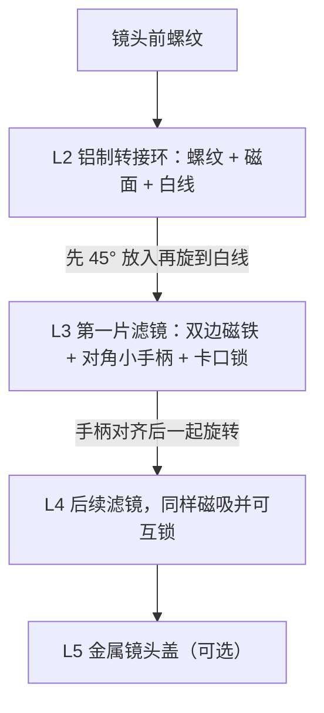

# NiSi JetMag Pro：转接环磁吸滤镜叠放与小手柄旋转锁定

> [!summary] 一句话概述
> JetMag Pro 不是又一块快拆板：镜头先拧上一只带磁面的转接环，圆形滤镜靠磁铁吸到转接环或前一片滤镜上，再把镜框上的一对彩色小手柄转到与转接环白线对齐，用卡口式机械锁防止滤镜被拔掉；多片滤镜可以把小手柄对齐后一起锁成一组。磁吸负责快装和叠放对中，防掉靠旋转锁定。

## 配图

![[附件/nisi-jetmag-system.jpg]]
*图源：[NiSi 耐司 JetMag Pro 产品页](https://www.nisioptics.com/jetmag-pro) 官方使用照片；滤镜已磁吸在镜头前，对角的彩色小手柄（图中为蓝色）既是抓取点，也是对准锁定白线的指示*

![[附件/nisi-jetmag-lock-handles.jpg]]
*图源：同上 NiSi 产品页；用手抓住小手柄安装或旋转滤镜。官网写对称手柄增大受力、更好抓取，多片叠加也能锁定；小耳朵对齐白色指示线为锁定，错开为解锁*

![[附件/nisi-jetmag-manual-page.png]]
*图源：[NiSi JetMag Pro 英文说明书](https://www.nisioptics.com/jetmag-pro)（与产品页同一机构，仅补充操作角度）；单片锁定：先把小手柄放在相对适配器白线约 45° 的位置再旋转到对齐白线；多片则先对齐各片手柄再一起转到白线。说明书还提醒安装时要对准磁吸面，否则可能吸不完整*

> 图片版权归原作者所有，仅作个人学习收藏；出处见文末「来源与核实记录」。

## 结构原理

> 本节所有数字只写来源里给出的；来源没有就写「来源未给出」。

### 堆叠方案

方向：**沿光轴从镜头前镜向外看**

| 层级 | 零件 | 材料 | 厚度/尺寸 | 固定方式 | 依据 |
| --- | --- | --- | --- | --- | --- |
| L1（最靠近镜头） | 镜头前滤镜螺纹 | 来源未给出镜头材料 | 按镜头口径，如常用 82 / 77 / 72 / 67 / 62 mm 等（测评写 82 mm 套装配这 5 个专用转接环） | 转接环旋入 | 什么值得买测评；NiSi 产品页写可通过专用转接环适配不同口径 |
| L2 | 专用磁吸转接环 | 与滤镜边框同样为铝材（测评） | 一侧为镜头螺纹，另一侧为磁面；环上有白色锁定指示线 | 螺纹旋紧在镜头上 | 测评；说明书 |
| L3 | 第一片圆形滤镜（镜框+玻璃+双边磁铁） | 铝材 CNC 镜框（测评）；玻璃与镀膜牌号来源未给出 | 产品页系列口径包括 49 / 67 / 82 / 95 / MAX MAG 等；测评当时写常见为 82 mm 与 95 mm 两档 | 磁吸到转接环，再旋转锁定 | NiSi 产品页；测评 |
| L4 | 可选叠加的后续滤镜 | 同 L3 | 超薄镜框；官网与说明书称在 15 mm 广角上可两片叠加无暗角 | 滤镜对滤镜磁吸，小手柄对齐后一起转到白线，整组互锁 | NiSi 官网、说明书；测评在 15 mm 上复测了两片无暗角 |
| L5（最外，可选） | 全金属磁吸镜头盖 | 金属（官网与测评） | 来源未给出厚度 | 同样磁吸，操作与滤镜相同（测评） | NiSi 官网；测评 |

剖面示意：

这和板式快拆座的差别：载荷路径沿着光轴的「吸合 + 旋转卡口」，目的是叠放光学镜片并防掉，而不是把相机锁到云台上。

### 零件清单

| 零件 | 数量 | 功能 | 材料 | 依据 |
| --- | --- | --- | --- | --- |
| 专用转接环 | 按镜头口径配置；测评称 82 mm 套装配 5 个专用环（82/77/72/67/62 mm） | 把镜头螺纹转成磁吸面，并提供白色锁定刻线 | 铝（测评） | 什么值得买；NiSi 写可通过转接环一镜多用 |
| 圆形滤镜（镜框+玻璃） | 按套装 | 光学滤光；镜框双边可磁吸以便叠放 | 铝框 CNC（测评） | 测评；NiSi |
| 对角彩色小手柄（「小耳朵」） | 每片一对，位于直径方向 | 抓取、旋转、识别滤镜种类，并作为锁定对准标记 | 来源未给出手柄材质；颜色用于区分种类 | NiSi 官网；测评写蓝色 ND、银色 CPL、金色柔光，另有绿色 UV/IR CUT、紫色抗光害 |
| 卡口式机械锁 | 在滤镜内缘（说明书与测评描述为旋转到位后锁死，不能再被拔下） | 防掉；锁定后官网称可以直接提起相机 | 来源未给出锁牙材料 | NiSi 官网与说明书；测评复述对齐白线后拿不下来 |
| 金属镜头前后盖 | 可选 | 保护滤镜和镜头，可直接放入背包（官网） | 金属 | NiSi 官网 |

### 装配顺序

1. 把与镜头口径匹配的专用转接环拧到镜头前镜螺纹上（测评、说明书）。
2. 单片安装：先把滤镜小手柄放在相对转接环白线约 45° 的位置，让磁面吸合；再旋转小手柄直到与白线对齐，此时滤镜被锁定，不能再被拔下（说明书；官网表述为「对齐为锁定，错开为解锁」）。
3. 多片叠加：各片都先以约 45° 放入；把各片小手柄对齐，再把整组一起转到转接环白线，滤镜与滤镜之间同时锁死（说明书、官网）。说明书建议错开各片手柄位置来安装，并对准磁吸面，避免吸合不完整。
4. 解锁单片：把小手柄转离白线约 45°，即可取下该片（说明书）。多片一起解锁时，转到解锁方位后可整组拆下，也可再分别旋转各片手柄单独拆开（说明书）。
5. 金属镜头盖用同样方式吸上。

> 官网强调锁定状态可以直接提起相机；说明书补充：拍摄中不是必须上锁，但挪机位时建议锁上。

### 受力与运动分析

- **受力路径**：滤镜自重和挪动相机时的轴向拉力，先经过磁吸面；锁定后改由卡口机械锁传递到转接环，再经螺纹传到镜头。官网把「提起相机」作为锁定可靠性的展示，说明设计意图是让机械锁而不是磁铁来承担突然的轴向力。
- **运动关系**：安装时滤镜相对转接环有轴向靠近（磁吸）和约 45° 的旋转（锁定）两个动作。CPL 等需要调偏振方向的滤镜，测评写可以用小手柄转动整片；锁定后则不能再自由旋转（由「对齐即锁死、无法取下」推出，测评也把「对齐拿不下来」作为使用体验）。叠放时各片之间同样是磁吸 + 可选互锁。
- **失效风险**：安装角度不对可能导致磁吸不完整（说明书）。测评在 15 mm 上观察到三片开始略有暗角，说明镜框叠厚仍受广角视场限制。同一颜色的多片 ND 只靠颜色不能区分档位（测评提出的使用问题）。锁定几何和保持力的牛顿数、锁牙磨损寿命，来源未给出。

## 设计要点与参数

| 要点 | 内容 | 依据 |
| --- | --- | --- |
| 两级连接 | 磁吸负责快装和对中，旋转卡口负责防掉 | NiSi 官网；说明书；测评 |
| 锁定对准 | 小手柄对齐转接环白线 = 锁定；错开 = 解锁；说明书给出约 45° 的预装方位 | 官网；说明书 |
| 多片互锁 | 各片手柄对齐后一起转到白线，滤镜之间同时锁死 | 官网；说明书 |
| 广角暗角 | 官网：佳能 RF 15-35 mm F2.8 在 15 mm 两片叠加无暗角。测评复测：15 mm 两片无暗角，三片略有暗角；哈苏 XCD 20-35E 上测评写到四片仍无明显暗角 | 官网；什么值得买 |
| 转接环口径 | 测评：82 mm 套装配 82/77/72/67/62 mm 专用环，更小口径再用普通转接环 | 什么值得买 |
| 手柄识别 | 对角布置；颜色区分滤镜种类（测评给出蓝/银/金等对应关系） | 官网；测评 |
| 镜框工艺 | 铝材 CNC 一体车成 | 什么值得买 |
| 卡口牙尺寸、磁铁牌号、轴向保持力 | 来源未给出 | — |

## 优缺点

**优点**
- 把「快装」和「防掉」分开：磁铁解决对中和手感，卡口解决轴向脱落，适合昂贵滤镜和挪机位。
- 滤镜双边都能磁吸，叠放路径清楚，多片还可以锁成一组。
- 小手柄同时解决抓取、旋转、识别和锁定指示，不用在超薄镜框上再找细小刻字。

**缺点 / 代价**
- 需要先装专用转接环，不是直接拧到镜头上的普通滤镜。
- 锁定后不能再自由旋转，CPL 调偏振与锁定是互斥状态，使用时要先调再锁，或接受不锁。
- 叠片数量受广角暗角限制；官网保证写到两片/15 mm，更多片要以实测为准。
- 同色多片 ND 仍不易从手柄颜色区分档位。

## 可借鉴点

- 做「可叠放的磁吸圆件」时，不要只靠磁铁防掉：加一个小角度旋转卡口，并用一目了然的刻线指示锁定。
- 把操作手柄放在直径两端，既加力臂，又兼作锁定对准标记和颜色编码。
- 说明书把「预装角 45° → 转到锁定线」写清楚，并画错误安装（磁面没吸完整）的反例。
- 转接环做成「镜头螺纹 + 统一磁面」，用一组滤镜覆盖多种口径，避免每种镜头各做一套镜片。
- 不要把这种光学叠放锁写成云台快拆板：两者的基准面、载荷方向和重复定位对象都不同。

## 与库中相似案例对比

| 对比项 | 本案例（JetMag Pro） | [[Peak Design SlimLink：方形陶瓷凹槽磁吸预定位与弹簧卡舌硬锁]] | [[Arca-Swiss 38 mm 燕尾快装板：事实标准与跨品牌混用风险]] | [[橱柜磁吸门吸：只有磁力保持、没有机械锁死（对照 FIDLOCK）]] |
| --- | --- | --- | --- | --- |
| 磁铁角色 | 滤镜对中、快装、叠放 | 预定位（硬锁）或单独保持（软锁） | 无 | 唯一保持 |
| 机械锁 | 小手柄旋转卡口，防轴向拔出 | 弹簧卡舌咬方形凹槽 | 燕尾夹钳 | 无 |
| 连接对象 | 镜头螺纹上的滤镜组 | 手机壳到支架 | 相机到云台 | 门到柜体 |
| 何时用这篇 | 要沿轴线叠放薄圆件并防掉 | 要板式快拆、横竖切换 | 要兼容相机燕尾生态 | 只要轻保持 |

## 相关案例

- [[Peak Design SlimLink：方形陶瓷凹槽磁吸预定位与弹簧卡舌硬锁]]
- [[Arca-Swiss 38 mm 燕尾快装板：事实标准与跨品牌混用风险]]
- [[橱柜磁吸门吸：只有磁力保持、没有机械锁死（对照 FIDLOCK）]]
- [[FIDLOCK V-BUCKLE：磁吸引导到位后再由机械扣锁死]]
- 分类索引：[[02-连接与紧固 索引]]

## 来源与核实记录

- 主来源：[NiSi 耐司 JetMag Pro 磁吸魔术快装滤镜系统](https://www.nisioptics.com/jetmag-pro)（中文产品页，2026-11-26 重新打开；锁定/解锁指示、多片叠加锁定、锁定后可提起相机、15 mm 两片无暗角、金属镜头盖等均来自该页。页面标注 2026-08-06 更新）
- 同一机构补充：NiSi JetMag Pro 英文说明书（本轮核对照「45° 预装再旋到白线」、多片手柄对齐后互锁、错误安装可能导致磁吸不完整。与官网同属 NiSi，不单独计为第二机构）
- 交叉来源：[左手plus，「磁吸滤镜是更好的选择吗？NiSi JetMag Pro滤镜测试」，什么值得买，2025-01-10](https://post.smzdm.com/p/a2xdezx7/)（2026-11-26 重新打开全文。北京值得买科技平台上的独立测评：铝框 CNC、对角小耳朵与颜色编码、对齐白线锁定、82 mm 套装转接环规格，以及 15 mm 两片无暗角、三片略有暗角的拍摄结果）
- 核实：Francesco Gola 英文评测页本轮请求返回异常，未引用。未把本结构写成又一个快拆座或 MagSafe 环。
