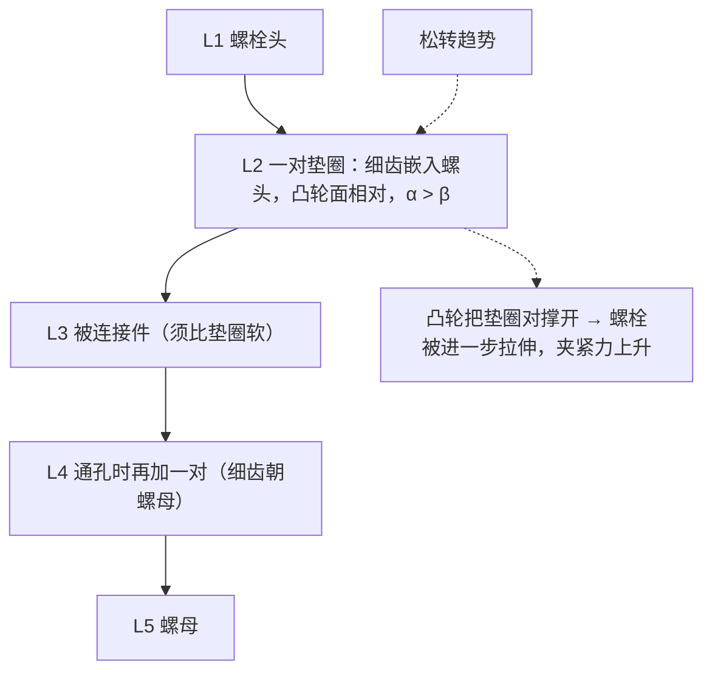

# Nord-Lock 楔形防松垫圈：楔角大于螺纹升角的成对拉伸锁紧

> [!summary] 一句话概述
> Nord-Lock 原厂楔形锁紧垫圈成对使用：相互贴合的一面是楔形凸轮，朝向螺头/螺母和被连接件的一面是径向细齿。因为楔角 α 大于螺纹升角 β，螺栓一旦有松转趋势，就会沿凸轮面把一对垫圈撑开、进一步拉伸螺栓、增大夹紧力——这是**靠拉伸（tension）锁紧**，不是靠弹簧垫圈的弹力，也不是靠尼龙圈摩擦。钢垫圈（EN 1.7182）规格大约 M3–M130，硬度 ≥ 465 HV1，推荐温度 −50 °C 到 200 °C；垫圈必须比接触面硬。

## 配图

![[附件/nord-lock-wedge-principle.jpg]]
*图源：[Nord-Lock Original Washers User Manual](https://www.nord-lock.com/globalassets/mediavalet/web-assets/downloads/user-manual/00095_nl_user_manual_nlo_2026_v01_digital2.pdf)（© 2026 Nord-Lock Group）第 2 页；一对垫圈：凸轮面相对、细齿朝外。拧紧后细齿嵌入接触面；α > β，松转只能走凸轮面，从而维持预紧、阻止松脱。垫圈上有激光标识（品牌、批次、类型码）。*

![[附件/nord-lock-joint-guide.jpg]]
*图源：同上第 3 页；安装规则：盲螺孔用一对；通孔要两对（螺头下一对、螺母下一对），并先把两边凸轮合上再拧紧、拧螺栓时固定螺母。大孔、长圆孔或较软表面改用外径加大的 sp 型，并配合法兰面螺钉/螺母。不推荐：接触面未固定、接触面比垫圈硬、木材和塑料这类很软的面、沉降极大的接头。*

![[附件/wedge-washer-junker-article.jpg]]
*图源：[Fastener World no.212/2025, “Outspoken About Wedge Locking Washers and Junker Test”](https://www.fastener-world.com/data/pdf_download/FW_212_E_267.pdf)（Ing. Jozef Dominik, PhD & Prof. Ing. Bohus Bruzek, PhD）第 267 页；独立技术讨论：WLW 是成对、外侧有齿、内侧为楔面，且 α ＞ β（β 为螺纹升角）。作者同时指出，一对垫圈会增加界面、带来沉降，并提醒 Junker（DIN 65151）主要对应横向振动，不能当成所有载荷类型的万能判据。*

> 图片版权归原作者所有，仅作个人学习收藏；出处见文末「来源与核实记录」。

## 结构原理

> 本节数字只写来源里给出的；来源没有就写「来源未给出」。不编造楔角或升角的具体度数，手册只给出 α > β 的关系。

### 堆叠方案

方向：**以通孔、螺头到螺母为例（手册要求两对垫圈）。**

| 层级 | 零件/区域 | 材料 | 厚度/尺寸 | 固定方式 | 依据 |
| --- | --- | --- | --- | --- | --- |
| L1 | 螺栓头 | 按垫圈材质选配合螺栓等级，钢垫圈可用到 12.9 级 | 来源未给出头厚 | 拧紧 | 手册第 4 页 |
| L2 | 第一对垫圈（细齿朝向螺头，凸轮面相对） | 见材料表 | 一对的厚度会增加夹紧长度；具体单片厚度见尺寸页，本笔记不摘未核对的表格 | 细齿嵌入螺头支承面 | 手册第 2–3 页；FW 文 |
| L3 | 被连接件 | 必须比垫圈软 | 通孔 | — | 手册第 3–4 页 |
| L4 | 第二对垫圈（细齿朝向螺母） | 同 L2 | 通孔场合必须再加一对 | 细齿嵌入螺母支承面 | 手册第 3 页 |
| L5 | 螺母 | 与螺栓匹配 | — | 拧紧时先固定螺母再拧螺栓，以减小沉降 | 手册第 3 页 |

盲螺孔接头只需一对，锁的是螺栓相对被连接件的支承面（手册第 3 页）。

剖面示意：

### 零件清单

| 零件 | 数量 | 功能 | 材料 | 依据 |
| --- | --- | --- | --- | --- |
| 楔形锁紧垫圈（成对） | 盲孔 1 对；通孔 2 对 | 拉伸锁紧 | 钢 NL/NLsp，或不锈钢 NLss 等 | 手册第 3–4 页 |
| 螺栓、螺母 | 1 套 | 提供预紧 | 钢垫圈配合至 12.9；不锈钢垫圈至 A4-80 | 产品页、手册第 4 页 |
| 可选法兰面螺钉/螺母 + sp 大外径垫圈 | 按需 | 大孔、长圆孔或较软表面改善压强分布 | — | 手册第 3 页 |

### 装配顺序

1. 确认接触面硬度低于垫圈，且不是木材、塑料或“未锁住的活动面”（手册第 3 页“不推荐”清单）。
2. 保持出厂配对，凸轮面相对放入；不要拆成单片当弹簧垫圈用。FW 文也写制造商建议成对使用（螺母连接时螺头和螺母下都要有一对）。
3. 通孔：两边先把凸轮合上，再拧到规定预紧；拧螺栓时固定住螺母（手册第 3 页）。
4. 左旋螺纹需要定制垫圈，不能拿标准右旋对直接用（手册第 3 页）。
5. 拆卸时按相反方向拧，必须克服凸轮楔紧（手册示意图“Untightening”）。

### 受力与运动分析

- **受力路径**：预紧把细齿压入螺头/螺母和被连接件；工作中若出现横向滑移导致的松转趋势，因为 α > β，相对运动发生在凸轮面，一对垫圈被楔开，螺栓伸长，夹紧力上升，从而抵抗松脱。Nord-Lock 称之为 tension instead of friction。
- **运动关系**：正常工作无相对转动；一旦有松转趋势，只允许沿凸轮面做很小的轴向分离，而不是沿螺纹旋出。
- **失效风险**：接触面比垫圈硬，细齿嵌不进去，楔紧路径建立不起来（手册明确不推荐）。界面很多时沉降会吃掉预紧（FW 文强调一对垫圈增加界面，沉降随表面粗糙和界面数增加）。Junker 横向振动里表现好，不等于轴向振动或 NAS 3354 一类试验里同样“万能”（FW 文引用 Hard Lock 2007 报告作对照，并批评把 DIN 65151 当成所有应力类型的通用标准）。
- FW 文还提到：有试验图显示“只用一片”沉降更小、锁紧效果看起来类似，但作者认为还需结合被连接件强度再研究，不能据此改设计准则。本笔记仍按原厂“成对使用”来写。

## 设计要点与参数

产品规格来自 Nord-Lock 产品页与 2026 用户手册第 4 页（两处一致）。温度范围来自原材料供应商信息与试验，手册写明在该范围内锁紧功能不受影响。

| 要点 | 内容 | 依据 |
| --- | --- | --- |
| 钢垫圈 NL / NLsp | EN 1.7182；常规外径 M3–M130（#5–5"），加大外径 M3.5–M36；贯通淬火；硬度 ≥ 465 HV1；涂层 Delta Protekt KL100 + 面漆 VH 302 GZ；盐雾 ISO 9227 至少 1000 h；螺栓可用到 12.9；温度 −50 °C 至 200 °C | 产品页、手册第 4 页 |
| 不锈钢 NLss / NLspss | EN 1.4404；常规外径 M3–M80；表面硬化；硬度 ≥ 520 HV0.05；PREN 27；螺栓至 A4-80；温度 −160 °C 至 500 °C；用于无氯/非酸性的一般不锈钢场合 | 同上 |
| 254 SMO | EN 1.4547；M3–M39；硬度 ≥ 600 HV0.05；PREN 45；−160 °C 至 500 °C；盐水、热交换、核电、淡化、食品医疗等 | 同上 |
| Alloy C-276 | EN 2.4819 或等同；M4–M20；硬度 ≥ 520 HV0.05；PREN 68；酸性、化工、蒸发器、井下工具 | 同上 |
| Alloy 718 | EN 2.4668 或等同；M4–M20；硬度 ≥ 620 HV0.05；PREN 29；高温（燃气轮机、增压器、焚烧）；温度至 700 °C | 同上 |
| 硬度规则 | 接触面必须比垫圈软，否则机械锁紧功能无法保证 | 产品页注 *、手册第 4 页 |
| 通孔 / 盲孔 | 盲孔一对；通孔两对 | 手册第 3 页 |
| 大孔、软表面 | 用 sp 加大外径，并配合法兰面螺钉或螺母；复合材料等沉降大的场合，手册另推荐 X-series（本篇不展开） | 手册第 3 页 |
| 不推荐的场合 | 接触面未固定；接触面比垫圈硬；木材、塑料等很软表面；沉降极大的接头 | 手册第 3 页 |
| 原理关系 | α（凸轮楔角）> β（螺纹升角）。已打开资料未给出 α、β 的度数 | 手册第 2 页；FW 文 Fig. 1 |
| 独立来源的限定 | WLW 在横向振动中表现最好，轴向振动中等；有报告称在 NAS 3354 中完全失败。Junker/DIN 65151 是横向动态加载，不应当成任意工况的充分证明 | FW 2025 文 |

## 优缺点

**优点**
- 锁紧原理与预紧方向一致：松转趋势转化为夹紧力增加，适合横向振动（原厂与 FW 文都承认这一点）
- 可重复拆装（相对胶类锁固），不锈钢与高温合金覆盖很宽的温度和腐蚀范围
- 安装规则清楚：通孔两对、接触面要更软、软表面换 sp

**缺点 / 代价**
- 每对垫圈增加界面和夹紧长度，沉降可能多吃一部分预紧（FW 文）
- 通孔要两对，零件数和厚度都增加
- 接触面硬度、软材料、大沉降场合有明确禁区
- 不是所有振动/载荷类型的万能方案；不能只拿一条 Junker 曲线替代工况分析（FW 文）

## 可借鉴点

- 出图时写清：垫圈型号（NL 还是 NLss，是否 sp）、对数（盲孔 1 对 / 通孔 2 对）、接触面硬度必须低于垫圈硬度
- 不要把楔形垫圈拆成单片，也不要和弹簧垫圈、尼龙螺母当成同一类“摩擦防松”
- 软板、长圆孔先把压强分布做对（法兰面 + sp），再谈防松
- 验收预紧时把成对垫圈增加的夹紧长度和界面沉降计算进去
- 需要横向抗振时优先考虑这类拉伸锁紧；若主要是轴向交变或有特殊试验规范，不要只看 Junker 广告曲线

## 与库中相似案例对比

| 对比项 | 本案例（楔形垫圈，拉伸锁紧） | 开口弹簧垫圈（见本轮反面案例） | 改变内螺纹牙型（Spiralock，见本轮另一篇） |
| --- | --- | --- | --- |
| 锁紧原理 | α > β，松转把垫圈对撑开，夹紧力上升 | 指望开口弹力和棱边咬合；拧紧后往往被压平 | 内螺纹牙底 30° 楔面，消除径向间隙 |
| 是否附加零件 | 是，成对垫圈 | 是，单片垫圈 | 否（改螺母/内螺纹） |
| 与标准螺栓 | 完全兼容标准 60° 外螺纹 | 兼容 | 外螺纹仍用标准 60° 牙 |
| 典型证据 | 原厂原理 + 独立文对 Junker 的限定讨论 | Junker 中几乎无效甚至有害 | 牙型接触和载荷分配试验 |
| 选用提示 | 横向振动、接触面够硬且可被细齿嵌入 | 不要再当防松件 | 想少加零件、改内螺纹时考虑 |

## 相关案例

- 分类索引：[[02-连接与紧固 索引]]
- [[钣金压铆螺母（PEM S-CLS）：孔径、最小板厚、边距与板材硬度上限]]（同属紧固设计，但原理完全不同）

## 来源与核实记录

- 主来源：[Nord-Lock Original Washers 产品信息页](https://www.nord-lock.com/nord-lock/original-wedge-locking-washers-product-information/)（2026-11-21 GET，HTTP 200。材料、尺寸范围、硬度、温度、涂层、螺栓等级。）
- 同厂家补充：[Nord-Lock Original Washers User Manual（2026）](https://www.nord-lock.com/globalassets/mediavalet/web-assets/downloads/user-manual/00095_nl_user_manual_nlo_2026_v01_digital2.pdf)（2026-11-21 GET，HTTP 200，约 3.9 MB。第 2 页原理与 α > β，第 3 页安装与禁区，第 4 页与产品页一致的材料表。不作为第二独立来源。）
- 独立第二来源：[Fastener World no.212/2025《Outspoken About Wedge Locking Washers and Junker Test》](https://www.fastener-world.com/data/pdf_download/FW_212_E_267.pdf)（Jozef Dominik & Bohus Bruzek；2026-11-21 GET，HTTP 200。原理简述、界面沉降、Junker/DIN 65151 的适用范围和限制。文中未给出可摘录的曲线数值，故只引用定性结论。）
- 核实：2026-11-21 打开上述三个 URL。未把 Bossard/Böllhoff 经销页计为独立来源。产品信息页本身几乎只有规格表，原理以手册和 FW 文为准。未编造凸轮角度度数或 Junker 预紧力数值。
