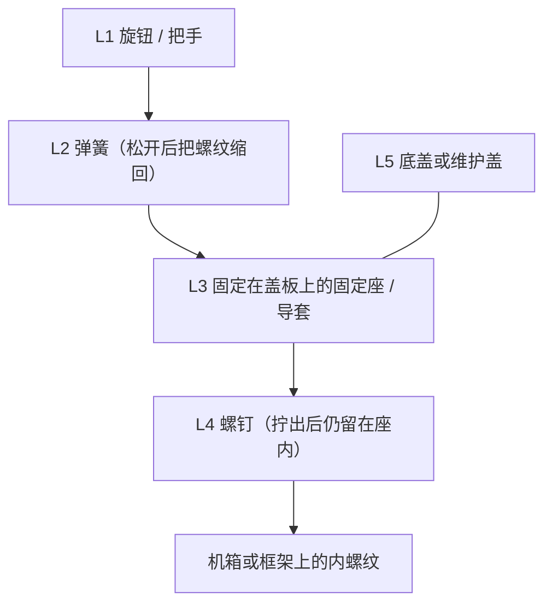

# PEM 与 Southco 防脱落面板螺丝：拧松后留在盖上，HP EliteBook 845 G8 五颗底盖钉

> [!summary] 一句话概述
> 防脱落（captive）面板螺丝把螺钉限制在盖板的固定座或导套里：螺纹拧出啮合后，螺丝仍留在盖上，并可在弹簧作用下缩回；HP EliteBook 845 G8 的底盖就用五颗这类十字槽螺丝，拧松但不取出，再沿铰链侧解开卡扣即可开盖。

## 配图

![[附件/pem-pf11-captive-section.jpg]]
*图源：[PEM《面板螺丝系列》中文目录](https://www.pemnet.com/cn/wp-content/uploads/sites/12/2025/03/15_-PF-1-19-24.pdf) PF11/PF12/PF15 页；左为三种旋钮，中为安装后剖视（裙边限位、弹簧、定位圈把螺钉留在组件内），右为外形尺寸符号*

![[附件/southco-47-captive-m3.jpg]]
*图源：[Southco 47 拴式螺钉把手系列 · M3](https://media.southco.com/media/static/Literature/47-4c.zh.pdf)；未紧固与已紧固的把手高度、弹簧弹起后的螺钉突出，以及压入、扩口、浮动、PCB 四种安装方式*

![[附件/hp-elitebook-845-g8-captive-lifted.jpg]]
*图源：[iFixit《HP EliteBook 845 G8 Bottom Cover Replacement》](https://www.ifixit.com/Guide/HP+EliteBook+845+G8+Bottom+Cover+Replacement/186516)；底盖螺丝完全拧松后仍留在盖板孔里，可用手指向上提起以便插入撬棒*

> 图片版权归原作者所有，仅作个人学习收藏；出处见文末「来源与核实记录」。

## 结构原理

> 本节所有数字只写来源里给出的；来源没有就写「来源未给出」，不估算、不换算成看似精确的值。

### 堆叠方案

方向：**从盖板外侧向内到机箱螺纹孔**（先讲标准件，再落到 845 G8 底盖）

| 层级 | 零件 | 材料 | 厚度/尺寸 | 固定方式 | 依据 |
| --- | --- | --- | --- | --- | --- |
| L1 | 旋钮 / 把手（手旋或带十字、Torx 槽） | PEM：铝旋钮。Southco 47：铝，本色或黑色粉末喷涂 | Southco 47 M3 压入式：H-1（未紧固把手高度）11.3 mm，H-2（已紧固）8.3 mm | 与螺钉组成一体，供手或工具扭转 | PEM PF11 页材质表；Southco 47 目录表 |
| L2 | 弹簧 | PEM PF11：300 系列不锈钢。Southco 文称弹簧弹起设计 | 来源未给出线径 | 未啮合时把螺纹段缩回，避免妨碍合盖 | PEM 材质表；Southco「什么是拴式螺钉」 |
| L3 | 固定座 / 导套 / 套圈 | PEM：硬化碳钢定位圈（固定座覆铜后镀亮镍）。Southco：压入式为硬化碳钢镀锌；扩口式和浮动式为铝；PCB 式为 300 系不锈钢钝化 | Southco 47 压入式导套外径 10.6 mm，与面板配合段约 Ø5.5 mm | 压入、自扣紧、扩口/翻铆或浮动安装到盖板上，把螺钉限制在孔内 | PEM 目录；Southco 47 目录与中文说明（套圈挤压到面板中） |
| L4 | 螺钉 | PEM PF11/PF12/PF15 为 400 系不锈钢，带 M 的型号为硬化碳钢。Southco 47：硬化碳钢，镀锌加铬酸盐保护层 | 见下表公制规格 | 与机箱或框架上的内螺纹啮合；拧出后被固定座挡住，不能掉出 | PEM；Southco |
| L5（应用） | HP EliteBook 845 G8 底盖 | 来源未给出 | 备件号 M52486-001 | 五颗防脱落十字螺丝 + 周边卡扣。手册要求从铰链附近用非金属、不导电工具松开边缘 | HP 维护手册「Bottom cover」 |

剖面示意：

### 零件清单

| 零件 | 数量 | 功能 | 材料 | 依据 |
| --- | --- | --- | --- | --- |
| 面板螺丝组件（旋钮+弹簧+固定座+螺钉） | 按盖板孔位 | 把盖板拧到框架上，并在松开后不让螺丝掉进设备 | 见上表 | PEM、Southco |
| EliteBook 845 G8 底盖防脱落螺丝 | 5 | 固定整块底盖；拧松但不取出 | 来源未给出规格，槽型为十字（Phillips） | HP 手册；iFixit 845 G8 指南 |
| 底盖卡扣 | 来源未给出数量 | 螺丝松开后仍需沿边缘解开卡扣才能取盖 | 来源未给出 | HP 手册步骤 2–3；iFixit |
| 底盖备件 | 1 | 可单独订购的底盖 | 来源未给出；备件号 M52486-001 | HP 手册 Table 5-1 |

### 装配顺序

标准件（以 PEM 自扣紧 / Southco 压入或扩口为例，按各自目录安装说明）：

1. 在盖板上按目录制备安装孔（孔径与最小板厚见参数表），注意最小孔边距。
2. 用压装或翻铆/扩口把固定座或导套永久装到盖板上。裙边或台肩在安装时起限位（PEM 写明裙边提供可靠的限位挡板）。
3. 螺钉留在座内。合盖时对准机箱内螺纹，压下（弹簧压缩，螺纹伸出）再拧紧。
4. 拆盖时只把螺纹拧出啮合，螺丝仍挂在盖上；弹簧把螺纹缩回，盖板可以拿走而不掉钉。

845 G8 底盖（HP 手册，iFixit 与之对应）：关机并断开电源与外设 → **拧松**五颗防脱落十字螺丝，不要把它们当作普通螺丝取出 → 从铰链侧用非金属、不导电工具松开底盖边缘 → 取下底盖。iFixit 补充：若撬棒进不去，确认螺丝已完全拧松，必要时用手指把仍留在盖上的螺丝向上提起。装回时先把前边（与铰链相对）的卡扣滑进框上的槽，再放下盖板并沿周边压合，最后拧紧那五颗螺丝。

### 受力与运动分析

- **受力路径**：拧紧后，螺钉把盖板压向框架，夹紧力由螺纹副承担。固定座只负责「把螺丝留在盖上」和把安装载荷传到薄板，不代替螺纹预紧（推断：依据 Southco 把套圈/导套描述为把螺钉固定在外面板中的手段）。
- **运动关系**：螺钉相对固定座有一段轴向行程：拧入时克服弹簧伸出并啮合；拧出后被座内的挡肩或相当结构拦住，不能完全脱出。Southco 称之为弹簧弹起：未接合时把螺纹缩回，以免在合盖或维护时碰到其他零件。PEM PF11 图中的 T1、T2 表示旋钮在不同状态下的高度，P、A、C、E、G 为外形与安装尺寸。
- **失效风险**：板太薄、孔径不对或孔边距不足，自扣紧/压入的固定座会松脱，防脱落功能随之失效。浮动型用于补偿错位，但不能弥补错误的板厚。笔记本底盖若只拧松螺丝却不去解卡扣，硬撬会伤到盖边；螺丝若被误认为可取出而强拧，可能破坏挡肩（推断，依据「loosen but not remove」的反复强调）。

## 设计要点与参数

| 要点 | 内容 | 依据 |
| --- | --- | --- |
| 防脱落如何实现 | Southco：通过干涉配合或止动，把螺钉一直留在外面板中；安装时常把螺钉周围的套圈挤压进面板。PEM：组件安装到薄板后，消除可能脱落并损坏内部组件的松动硬件 | Southco「什么是拴式螺钉」；PEM 目录开篇 |
| 弹簧弹起 | 未啮合时把螺纹缩回，便于对准且不干扰其他零件 | Southco 中文说明；PEM「弹性伸缩」系列说明 |
| 安装方式 | 两者都提供压入/自扣紧、扩口或翻铆、浮动；另有 PCB / 表面贴装类型 | PEM 目录；Southco 47 与中文说明 |
| PEM PF11 M3×0.5（长度代码 1，目录公制表） | A 最大 0.92 mm；最小板材厚度 0.92 mm；安装孔 5.56 mm（+0.08）；C 最大 5.54 mm；E 10.59 mm（±0.25）；G 5.84 mm（±0.64）；P 1.52 mm（±0.64）；T1 名义 7.87 mm；T2 名义 11.43 mm；槽型 #1；最小孔边距 7.11 mm。长度代码 0/2 的 G、P 不同，不在此行照抄 | PEM 中文目录 PF11 公制表（已对照原页） |
| PEM 螺纹与板材 | 外螺纹 ASME B1.1 2A / B1.13M 6g；适用板材硬度低于 HRB 80 / HB 150 | 同页 |
| Southco 47 M3 压入式 | 外面板厚度范围在该表以「~」给出，总浮动 0.7 mm；未紧固螺钉突出 P-1 按规格有 0.8 / 2.5 / 4 / 5.6 mm 等档，已紧固 P-2 相应增加。导套外径 Ø10.6 mm | Southco 47 目录第 516–517 页 |
| 845 G8 底盖 | 拧松五颗防脱落十字螺丝；备件 M52486-001。这五颗螺丝的牙径、长度来源未给出 | HP 维护手册第 32 页；iFixit 指南 |
| 同机其他防脱落螺丝 | 手册在风扇处写「拧松三颗防脱落十字螺丝」，在散热片处写「按标注顺序拧松四颗防脱落十字螺丝」 | HP 手册后续章节 |
| 与普通可卸螺丝的差别 | 两者都把「维修时螺丝掉进设备或丢失」作为要消除的风险；Southco 特别提到服务器、电柜、医疗等不能让小零件掉进去的场合 | PEM 开篇案例；Southco 应用说明 |

## 优缺点

**优点**
- 开盖后螺丝还在盖上，减少丢失和掉入电路的风险
- 弹簧缩回螺纹，合盖时不容易先顶弯或错牙（PEM 还有带自引导螺纹的 M 型号）
- 一种零件解决「薄板需要可反复拆的螺纹连接」，不必再为每颗普通螺丝准备垫圈和防掉方案
- 在笔记本上配合整块底盖，一次拧松全部防脱落螺丝即可暴露内存、硬盘等客户可更换件

**缺点 / 代价**
- 比普通螺丝多了固定座、弹簧和一次压装工序，成本与最小板厚、孔边距都有限制
- 一旦固定座松脱，螺丝可能连座一起失效，现场不易用普通螺丝临时替代到同样的防掉效果
- 845 G8 这类整块底盖仍要解一圈卡扣，防脱落螺丝只解决「钉不丢」，不自动变成免工具卡扣盖
- 手册往往不写这些防脱落螺丝的牙径，备件要以整盖或螺丝套件为单位

## 可借鉴点

- 只要盖板可能被反复打开，而且内部怕掉入金属件，就把螺丝做成「拧松后仍留在盖上」，不要只在说明书里写「小心别丢螺丝」
- 选件时先定板厚、孔径、孔边距和是否需要浮动对位，再选压入、翻铆还是浮动座；不要只看头型
- 弹簧缩回行程要覆盖「盖板合上时螺纹不会先撞到对侧零件」
- 在整机上把防脱落螺丝和卡扣分工：螺丝负责可逆压紧和防丢，卡扣负责对位和周边保持
- 维修步骤必须写「拧松、不要取出」；必要时像 iFixit 那样提示把仍留在孔里的螺丝轻轻提起，以便工具进入盖缝

## 与库中相似案例对比

| 对比项 | 本案例（防脱落面板螺丝 + 845 G8 底盖） | [[Framework 笔记本模块化扩展卡与磁吸边框]] | [[PS5 免工具侧板与 DualSense 隐藏螺丝]] | [[台阶螺丝（ISO 7379 塞打螺丝）：光杆定位、螺纹只锁紧]] |
| --- | --- | --- | --- | --- |
| 结构核心 | 固定座把螺丝留在薄板盖上，弹簧可把螺纹缩回 | 该篇重点是扩展卡与磁吸边框，不是防脱落螺丝的座与弹簧 | 侧板免工具卡合；手柄用隐藏螺丝，不是本类松不脱座 | 光杆定距、螺纹只负责锁紧，螺丝仍可完全卸下 |
| 打开后螺丝是否还在盖上 | 是，这是本结构的定义特征 | 库中该篇不以此为分析对象，不能把参数挪过来 | 隐藏螺丝需要取出或另论，与 captives 不同 | 通常完全卸下 |
| 典型应用 | 维护盖、服务器面板、本机型整块笔记本底盖 | 模块化笔记本的扩展与外观件 | 游戏机侧板与手柄 | 需要精确夹紧长度的连接 |
| 分类取舍 | 02：可拆连接 / 螺纹与嵌件，重点在紧固件本身 | 06：整机模块化 | 06 / 该篇已有的免工具外壳与隐藏螺丝 | 02：定位与锁紧分工不同的螺丝 |

## 相关案例

- [[Framework 笔记本模块化扩展卡与磁吸边框]]
- [[PS5 免工具侧板与 DualSense 隐藏螺丝]]
- [[台阶螺丝（ISO 7379 塞打螺丝）：光杆定位、螺纹只锁紧]]
- [[钣金压铆螺母（PEM S-CLS）：孔径、最小板厚、边距与板材硬度上限]]
- 分类索引：[[02-连接与紧固 索引]]

## 来源与核实记录

- 主来源：[PEM® 面板螺丝系列（中文目录）](https://www.pemnet.com/cn/wp-content/uploads/sites/12/2025/03/15_-PF-1-19-24.pdf)（PennEngineering，目录页码含 PF11 第 196 页；PDF 元数据为 2025-03-17。核对照片、材质、公制尺寸表与安装类型）
- 补充来源 1：[PEM 手旋面板螺丝系列（中文产品页）](https://www.pemnet.com/cn/products/engineering-guides/captive-panel-screws/)（与目录同机构，用于核对系列说明，不算第二机构）
- 补充来源 2：[什么是拴式螺钉？](https://southco.com/zh_cn_int/resources/what-are-captive-screws)（Southco Inc.，页面署期 January 20 2025；套圈挤压、弹簧弹起、应用场合）
- 补充来源 3：[47 拴式螺钉把手系列 M3](https://media.southco.com/media/static/Literature/47-4c.zh.pdf)（Southco 中文目录页 516 起；材料、安装方式与尺寸表）
- 补充来源 4：[HP EliteBook 845 G8 Notebook PC Maintenance and Service Guide](https://www.hp.com/ctg/Manual/c07067671.pdf)（© 2021 HP；第 32 页 Bottom cover：拧松五颗 captive Phillips，备件 M52486-001）
- 补充来源 5：[HP EliteBook 845 G8 Bottom Cover Replacement](https://www.ifixit.com/Guide/HP+EliteBook+845+G8+Bottom+Cover+Replacement/186516)（iFixit，Carsten Frauenheim；发布记录 2025-05-01。核对「完全拧松但不要取出」以及用手提起仍留在盖上的螺丝）
- 核实：2026-11-22 打开并下载上述页面与 PDF，对照 PEM 公制原表抄录 M3 行，不使用未打开的英文目录转述。845 G8 的应用只用来源给出的「五颗防脱落十字螺丝」，未给这些螺丝自编牙径。Framework 的防丢螺丝只在对比表中作为不同案例的侧写，未把该篇没有的数据写进来。
