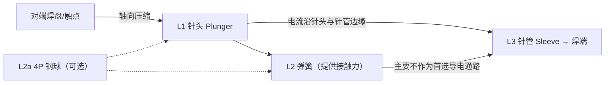

# Pogo Pin 弹簧顶针：针头、弹簧与针管的工作行程和弹力

> [!summary] 一句话概述
> Pogo Pin（弹簧顶针 / spring-loaded contact）用「针头（plunger/piston）+ 压缩弹簧 + 针管（barrel/sleeve）」做成可轴向压缩的电接触：对接到位后针头被压入，弹簧提供持续接触力，用来吃掉外壳和 PCB 的高度公差；电流按 N&H 的说明主要从针头经针管边缘流到焊端，弹簧主要用于提供压力，而不是首选导电路径。

> [!note] 与已收录/同轮案例的区别
> 本篇讲的是**弹性电触点元件**本身，不是整机锁扣，也不是按键开关。[[电动工具电池包：滑轨插入与按压锁舌（得伟拆解）]] 里的电池触点是工具侧和电池侧的固定金属片对位；[[FIDLOCK V-BUCKLE：磁吸引导到位后再由机械扣锁死]] 和 [[任天堂 Switch 2 Joy-Con 2 磁吸连接]] 解决的是机械锁/定位。[[鼠标微动开关（Omron D2FC）：杠杆、簧片翻转与触点]] 是双稳态翻转通断，行程极短；Pogo Pin 则在一段工作行程里保持常通。

## 配图

![[附件/pogo-pin-structure-current-flow.png]]
*图源：N&H Technology《DESIGN GUIDE & PRODUCT RANGE — POGO PINS》第 13 页（https://www.nh-technology.de/download/Pogo-Pins.pdf）。剖视给出 Piston / Spring / Sleeve 三件与电流路径（Current Flow）；同页电气规格写标准型额定电流 1 A / 2 A，特殊设计最高 13 A，接触电阻 < 100 mΩ（取决于设计）。*

![[附件/pogo-pin-backdrill-bias-4p.png]]
*图源：同上手册第 15 页。从左到右：Back-Drill（短针，图注 Pin Length ~2.5 mm、Current 1 A）、Bias-Design（针头端部倒角贴住针管内壁，图注 ~3.5 mm、2 A）、4P-Design（针头与弹簧之间加钢球或加帽，图注 ~4.5 mm、3 A / 5 A / 13 A）。*

![[附件/pogo-pin-stroke-illustration.png]]
*图源：同上手册第 13 页「Illustration of the travel」。三只针处在不同压缩位置，用来示意行程，该图未标具体毫米数。*

> 图片版权归原作者所有，仅作个人学习收藏；出处见文末「来源与核实记录」。

## 结构原理

> 本节数字只写来源里给出的；来源没有就写「来源未给出」。SUNMON 与 N&H 是两家厂商的选型/目录说明，参数只挂在给出该数的来源上。

### 堆叠方案

方向：**沿针的轴线，从对接触点到焊接端**（N&H 第 13 页剖视，针头在左、焊端在右）

| 层级 | 零件 | 材料 | 厚度/尺寸 | 固定方式 | 依据 |
| --- | --- | --- | --- | --- | --- |
| L1（对外接触） | 针头 / 活塞（Plunger、Piston） | N&H 标准为黄铜，可选铍铜、磷铜、SK4 钢 | 针头直径、自由高度按型号图面；N&H 写目录中最短 1 mm、最长 23 mm | 可在针管内轴向滑动，受弹簧向外推 | N&H 第 13、16 页；SUNMON「针头（Plunger）」定义 |
| L2 | 压缩弹簧（Spring） | N&H：不锈钢 | 来源未给出线径、圈数 | 装在针管腔内，一端顶针头（或 4P 结构里的钢球）、一端顶针管底部 | N&H 第 13、15、16 页 |
| L2a（仅 4P） | 不锈钢球（或替代的帽） | 不锈钢球（N&H 称 stainless steel ball） | 来源未给出球径；4P 标准长度范围 5.4–15.0 mm | 夹在针头与弹簧之间 | N&H 第 15 页 4P-DESIGN |
| L3（主体） | 针管 / 套筒（Barrel、Sleeve） | N&H 标准为黄铜，可选铍铜、磷铜 | 针管外径决定占位；SUNMON 写市面有低于 1.0 mm 的微型针，也有 2.0 mm、3.0 mm 或更大 | 与 PCB 以 SMT、DIP/THT、直角、螺纹、焊杯等按型号固定 | N&H 第 14–16 页；SUNMON 第 9 节安装方式 |
| 表面 | 镀层 | 标准：先镍后金 | 镍 1–2 μm，金 0.1–1 μm | 针管与针头通常双层电镀 | N&H 第 16 页 |

剖面示意：

### 零件清单

| 零件 | 数量 | 功能 | 材料 | 依据 |
| --- | --- | --- | --- | --- |
| 针头 | 1（双头型两端各一） | 与对端接触并压缩 | 黄铜等（见上表） | N&H 第 13–14 页；SUNMON 双头式说明 |
| 弹簧 | 1（双头型按结构可能更多，来源未给出确切件数） | 提供接触弹力并复位 | 不锈钢（N&H） | N&H 第 13、16 页 |
| 针管 | 1 | 导向、承载、导电到焊端 | 黄铜等 | N&H 第 13、16 页 |
| 钢球或帽 | 0 或 1 | 4P：提高侧向力，减轻弹簧过电流烧损；5 A–13 A 可用帽替代钢球 | 不锈钢球（N&H） | N&H 第 15 页 |
| 镀层 | 针头与针管外表面 | 降低接触电阻、抗腐蚀氧化 | 镍 1–2 μm + 金 0.1–1 μm（N&H 标准） | N&H 第 16 页 |

### 装配顺序

1. 按 N&H 第 15 页的内部结构：先把弹簧（及 4P 的钢球或帽）装入针管腔。
2. 装入针头。短针若用 Back-Drill：弹簧比空心针头还长，从针头背面的钻孔方向布置，以便在总长小于 3.5 mm 时仍凑出所需弹力。
3. 收口或限位，使针头只能在自由高度与最大压缩之间滑动，不会脱出（收口工艺细节来源未给出）。
4. 电镀若在组装前完成，则按零件分别镀；N&H 写针管与针头通常先镀镍再镀金，也可只镀部分零件。
5. 按拆解顺序反推（来源给出的是成品剖视与安装方式，不是工厂装配作业指导）：再把单针以 SMT、THT/DIP、直角、螺纹、焊杯、焊线或压入等方式装到塑胶座或 PCB 上。SUNMON 提醒多针模块要另外看连接器系列，不要只用单针中心距去当整座外形。

### 受力与运动分析

- **受力路径**：对端把针头沿轴向压入。弹簧被压缩，工作高度下的弹力把针头压在对端焊盘上。多针时，SUNMON 给出初步估算：总压缩力 ≈ 单支工作弹力 × 针数（例：8 针 × 50 gf = 400 gf ≈ 3.92 N），对端机构和磁吸力必须大于这个反力，并留摩擦与公差余量。
- **运动关系**：理想情况只有沿针管轴线的移动；N&H 另有 Rolling Pin（针尖带球，用于横向移动甚至 360° 转动时仍保持接触）。装配公差会带来少许侧向偏摆。Bias-Design 把针头端部倒角（手册写「up to 18°」），让针头与针管内壁保持接触，并称可达到 100% 接触。
- **导电路径**：N&H 第 13 页写电流从针头经针管边缘流到接触端，弹簧主要用于接触压力。大电流时若电流大量走弹簧，弹簧会过热；所以 4P 用钢球提高侧向力，并写明目的包括防止高压电流把弹簧烧坏。SUNMON 也写：部分大电流针用斜面接触、滚珠辅助等，减轻弹簧作为主通路的程度，但「并不是超过 2 A 就一律必须某种结构」。
- **失效风险**：长期压到最大行程——弹簧应力过大、针头与针管磨损、焊盘压痕、没有公差余量，特定结构还可能卡针（SUNMON）。压缩不足——接触力不够、电阻波动、振动瞬间断路。镀层磨损或污染会抬高接触电阻；电阻发热按 SUNMON 引用的 \(P=I^2R\)，例：20 mΩ 时 5 A 损耗 0.5 W，10 A 为 2 W。

## 设计要点与参数

| 要点 | 内容 | 依据 |
| --- | --- | --- |
| 高度与行程定义 | 自由高度 = 未受力伸出高度；工作高度 = 正常对接到位后的高度；工作行程 = 自由高度 − 工作高度；最大行程 = 厂商允许的最大压缩。不同厂图面标法可能不同，必须对着图确认。 | SUNMON「Working Stroke 与 Full Stroke」节 |
| 计算示例（不是通用比例） | 自由高度 5.0 mm、工作高度 4.3 mm、最大允许压缩 1.2 mm → 工作压缩 0.7 mm，约占最大行程的 58%。文中明确这只是示例，不代表所有针都该设在 58%。 | SUNMON 压缩量计算 |
| 公差要同时给最小/最大压缩 | 若标称压缩 0.7 mm，外壳+PCB 累计公差 ±0.2 mm，则实际可能 0.5–0.9 mm；须分别确认 0.5 mm 时弹力是否够、0.9 mm 是否仍低于安全极限、全程接触电阻是否稳定。不要只给一个工作高度。 | SUNMON 组装公差段 |
| 弹力（分清初始/工作） | 1 gf ≈ 0.00981 N。规格里的 Initial Force 与 Working Force 不能混用。例：SUNMON SMT 型号 909-00312，初始弹力 25±10 gf、工作弹力 60±20 gf。设计应以**工作高度下的弹力**为准。 | SUNMON 第 4 节 |
| 弹簧力目录范围 | N&H「About」段写弹簧力随类型在 50–400 g 之间；同手册类型表：Flat/SMT 为 25 g–400 g，Plug-In 35 g–500 g，Right Angle 80 g–120 g，Rolling Pin 60 g–150 g 等。两处范围不一致，按所在段落分别引用，不以其中一条覆盖另一条。 | N&H 第 13–14 页 |
| 额定电流 | N&H 第 13 页电气规格：标准型 1 A / 2 A，特殊设计最高 13 A；同页「About」另写高电流版本每触点最高 15 A。SUNMON 列举自家型号：909-00177 最高 10 A / DC 60 V、工作行程 1.2 mm；909-00019 最高 30 A / DC 28 V、工作行程 1.0 mm。不同料号不能拼成同一只针的规格。 | N&H 第 13 页；SUNMON 第 5 节 |
| 接触电阻 | N&H：< 100 mΩ（取决于设计）。SUNMON 列举部分商用规格会写成 ≤50 / ≤30 / ≤20 / ≤10 mΩ，并声明这不是强制分级。 | N&H 第 13 页；SUNMON 第 6 节 |
| 机械寿命 | SUNMON：部分消费电子规格为 10,000 次；某些工业/特殊测试接點可能要求 50,000、100,000 次或更高。例：909-00019 标 10,000 次，909-00177 标 50,000 次。须连测试方法和允收标准一起看。 | SUNMON 寿命段 |
| 内部结构分档（N&H） | Back-Drill：通常用于长度小于 3.5 mm 的短针（图注约 2.5 mm、1 A）。Bias：长度 3.5 mm 以上几乎都用，针头端部倒角最大 18°，图注约 3.5 mm、2 A。4P：在 Bias 上加钢球，用于 >3 A 和抗振；5 A 至最高 13 A 可用帽替代；套管在这些场合会加强；标准长度 5.4–15.0 mm。 | N&H 第 15 页 |
| 针距 | Pin Pitch = 相邻针中心距。例：单排 4 针、Pitch 2.54 mm，则第一到第四中心距 7.62 mm，这还不是整座外形，还需留针管直径、胶座壁厚、绝缘距离和装配公差。 | SUNMON 第 2 节 |
| 镀层 | N&H 标准：镍 1–2 μm + 金 0.1–1 μm。手册另有 Super AP 涂层对比（更耐汗液/电解等），本篇不把对比倍数当设计输入，只记下标准金层厚度。 | N&H 第 16 页 |

> 来源没有给出的参数一律写「来源未给出」，不估算、不编造。接插世界网同主题文带有「部分内容由 AI 辅助创作」声明，本篇未引用。

## 优缺点

**优点**
- 用一段工作行程补偿外壳、PCB 和对端的高度公差，适合反复对插的充电座、磁吸座和振动环境（N&H、SUNMON 均把公差补偿当核心用途）。
- 单针占位比常规连接器小，多数类型可 SMT（N&H 优点列表）。
- 内部结构可按电流和长度换：短针 Back-Drill、常规定位 Bias、大电流 4P/帽，不必改外安装接口就能调导电路径。

**缺点 / 代价**
- 弹力和行程是一对耦合量：压太深伤弹簧和焊盘，压不够则接触不稳；必须同时规定最小/最大工作压缩，而不是只标一个高度。
- 多针总反力随针数线性增加（SUNMON 估算式），磁吸或卡扣的保持力不够就会顶开。
- 额定电流不能从外径直接推论；接触电阻在大电流下按平方发热。寿命、盐雾等数字离开测试条件没有可比性。
- 侧向滑动或对偏时，普通直针不如 Rolling Pin 或 4P 的侧向承载；强行横推是常见的卡针/弯针风险（推断，来源强调 Rolling Pin 是为横向运动准备的专门结构）。

## 可借鉴点

- 图面上同时标 **自由高度、工作高度、最大行程、初始弹力、工作弹力**，并按外壳公差算出最小/最大压缩，用这两个点去查弹力和电阻，而不是只给标称工作点。
- 多针模块先算总反力（工作弹力 × 针数），再检查磁吸力、卡扣保持力和塑胶座强度是否压得住。
- 电流路径优先走「针头–针管」金属接触（Bias 倒角、4P 钢球/帽），不要默认弹簧是导体；大电流要看厂商是否给出温升条件，而不是只看安培标称。
- 短针（N&H：总长小于 3.5 mm）不要按长针的弹簧长度去硬塞，手册已用 Back-Drill 说明「弹簧可以比空心针头更长」。
- 对端焊盘尺寸不能按针管外径随意加 0.2 mm；SUNMON 要求按实际针头接触直径、定位精度、侧向偏移和表面处理来定，并留边缘安全距离。
- 寿命和镀层（镍 1–2 μm + 金 0.1–1 μm 只是 N&H 标准值）要和盐雾、汗液等测试方法一起写进规格，避免只抄「10,000 次」。

## 相关案例

- [[电动工具电池包：滑轨插入与按压锁舌（得伟拆解）]]（整机侧是滑轨锁 + 固定触片，不是弹簧针）
- [[FIDLOCK V-BUCKLE：磁吸引导到位后再由机械扣锁死]]（磁吸用于锁扣对位，不是弹性电接触）
- [[任天堂 Switch 2 Joy-Con 2 磁吸连接]]
- [[鼠标微动开关（Omron D2FC）：杠杆、簧片翻转与触点]]（翻转通断 vs 行程内保持常通）
- [[电缆防水格兰头：PG 螺纹、夹紧爪与密封圈]]（同属可拆的对外接口，但格兰头解决的是电缆夹紧与密封）
- 分类索引：[[02-连接与紧固 索引]]

## 来源与核实记录

- 主来源：[Pogo Pin 規格指南：尺寸、行程、彈力與電流選型](https://smeconn.com/tw/pogo-pin-specifications/)（2026-11-05，SUNMON Electronics / Lucky Shen）
- 补充来源：[N&H Technology，DESIGN GUIDE & PRODUCT RANGE — POGO PINS](https://www.nh-technology.de/download/Pogo-Pins.pdf)（打开并核对第 12–16 页的结构、类型、材料与镀层；无页内出版年份，以 PDF 内页码为准）
- 核实：2026-11-17 用 curl 下载并 `pdftotext` 核对 N&H PDF，用浏览器级抓取核对 SUNMON 正文。未引用带 AI 声明的接插世界网转述文。N&H 弹簧力「50–400 g」与类型表「25 g–400 g」、载流「15 A」与规格栏「max. 13 A」均并存分述。
