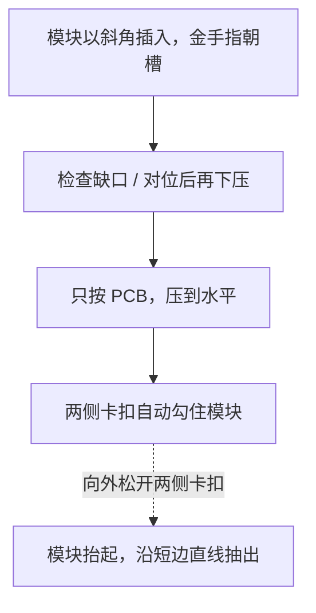

# SODIMM 双侧释放卡扣：斜插入槽后下压锁止（对照焊接 LPDDR）

> [!summary] 一句话概述
> SODIMM 不是焊在主板上的：模块先以一个斜角把金手指插入插槽，再向下压平，两侧卡扣勾住模块，把它保持在工作位置。拆卸时向外松开两侧卡扣，模块抬起，再沿短边直线抽出。对照戴尔 XPS 13 Plus 9320 这类 LPDDR5 机型：官方写明「无内存插槽」「内存集成在系统主板上，不可升级」。本篇讲的是插槽和双侧卡扣，不是 M.2 那种单端斜插再上螺丝的固定方式。

## 配图

![[附件/micron-csn23-sodimm-angle-insert.jpg]]
*图源：Micron CSN-23 *Proper Handling Procedures for Modules and SSDs*（Rev. E，2025-07）Figure 22，https://assets.micron.com/adobe/assets/urn:aaid:aem:19b2b7a9-4868-447a-a4d0-4d63892c0b3e/renditions/original/as/csn23.pdf；握住模块边缘，以斜角把带金手指的一边先插入插槽。美光写明：笔记本 SODIMM 的插入步骤与台式机/服务器用的常规 DIMM 不同。*

![[附件/micron-csn23-sodimm-press-down.jpg]]
*图源：同上，Figure 25；只按压 PCB 本身，把模块压到最终位置，不要碰存储芯片、电容、电阻或其他元件。若不能轻松插入，不要强按，取出后从第一步重来。*

![[附件/micron-csn23-sodimm-release-clips.jpg]]
*图源：同上，Figure 55；拆卸时小心地松开插槽两侧的卡扣，然后只接触 PCB 短边，把模块直线抽出。美光同时禁止触摸芯片，也禁止斜向硬拔。*

## 结构原理

> 本节所有数字只写来源里给出的；来源没有就写「来源未给出」，不估算、不换算成看似精确的值。

### 堆叠方案

按「从模块上表面到主板」写。插入时模块先斜、后平。

| 层级 | 零件 | 材料 | 厚度/尺寸 | 固定方式 | 依据 |
| --- | --- | --- | --- | --- | --- |
| L1（最上，工作位置） | SODIMM / CSODIMM 内存模块（PCB、芯片、金手指；金手指边有防呆缺口） | 未注明 | 来源未给出模块长宽与厚度。Patriot 写 SODIMM 槽通常比台式机 DIMM 槽短，且常上下叠放 | 斜插入槽后下压，由两侧卡扣保持 | 科赋笔记本电脑安装步骤四、五；Patriot 步骤 3；美光 Inserting an SODIMM |
| L2 | 插槽两侧的金属释放卡扣 / 扣具 | 未注明 | 来源未给出卡扣高度、张开角度或钩入深度 | 下压到位后自动扣上；拆卸时向外松开或轻推两侧卡扣，模块抬起 | 科赋「两侧扣具将自动扣上固定」；Patriot「metal retention clips」「pop up slightly at a 45-degree angle」；美光「release the clips on the sides of the socket」；超微「Push the side clips… to release the module」 |
| L3 | 插槽本体与槽内防呆结构 | 未注明 | 来源未给出槽宽。科赋：模块缺口对准插槽凹口。Patriot：金手指上的小缺口对准槽内对应凸起。美光：module socket includes two alignment notches，下压前须确认已平、且对位缺口位置正确 | 金手指插入槽内接触簧片；缺口/凸起限制插反 | 科赋步骤四；Patriot「Align the Notch」；美光步骤 2 |
| L4（最下） | 主板（插槽焊在板上） | 未注明 | 来源未给出 | 插槽固定在主板；对照机型则没有这一插槽，内存直接集成在主板 | 科赋「寻找笔记本电脑主板上的 SODIMM/CSODIMM 内存插槽」；戴尔 XPS 13 Plus 9320：「无内存插槽」「内存集成在系统主板上，不可升级」 |

剖面示意：

### 零件清单

| 零件 | 数量 | 功能 | 材料 | 依据 |
| --- | --- | --- | --- | --- |
| SODIMM / CSODIMM 模块 | 视机型槽位数；来源未统一规定 | 提供可更换内存 | 未注明 | 科赋、美光、Patriot、超微 |
| 双侧释放卡扣 | 每槽两侧各一（四家来源都按两侧描述） | 保持模块水平到位；松开后让模块抬起 | 未注明 | 科赋、美光、Patriot、超微 |
| 金手指与槽内触点 | 来源未给出针数 | 电气连接 | 未注明 | 科赋、美光（gold connectors）；Patriot（gold connector pins / gold contacts） |
| 防呆缺口 / 对位结构 | 科赋、Patriot 描述为金手指边上的缺口对槽内凹口或凸起；美光写 socket includes two alignment notches | 防止插反或未对齐就下压 | 未注明 | 三家安装步骤。原文用词不同，不合并成一个未在来源中出现的尺寸 |
| 对照：焊在主板的 LPDDR 封装 | 戴尔该型号无插槽 | 内存不可拆、不可升级 | 未注明封装形式细节 | 戴尔 XPS 13 Plus 9320 内存规格表：类型 LPDDR5；最小 8 GB，最大 32 GB；速度 5200 MHz 或 6000 MHz（按处理器代次分列） |

### 装配顺序

安装（科赋中文指南，笔记本电脑 SODIMM/CSODIMM）：

1. 完全关闭电源并拔掉电源变压器。若为可拆式电池，先取下。建议长按电源键数秒，释放主板上残余电力。
2. 卸下底盖螺丝，按该笔记本手册打开底盖。
3. 找到 SODIMM/CSODIMM 插槽。
4. 握持模块边缘，将缺口对准插槽上的凹口，以约 30 度角斜向插入插槽。
5. 轻轻将模块向下压平，使其贴合主板，两侧扣具自动扣上固定。
6. 装回底盖并锁上螺丝，接电开机，在 BIOS 或操作系统中确认识别。

美光 CSN-23 对插入的补充（独立机构，英文原件）：

1. 只握住模块边缘，以斜角插入，金手指一边先进入插槽。
2. 下压前目视检查模块已平，且对位缺口位置正确；未对齐就下压可能造成损坏。
3. 只推 PCB 本身到最终位置，不要碰芯片和其它元件。不能轻松插入时不要强推，取出后从第一步重来。
4. 电气方面：插入或移除前应关闭电源单元；「Hot plugging/unplugging of module/SSD is strictly prohibited.」

Patriot 的安装描述与科赋同属「斜插再下压、卡扣自动扣合」，但斜角写法不同：以大约 45 度角滑入，直到金触点几乎完全没入槽内，再向下按，直到两侧金属卡扣自动卡住，并可听到轻声咔嗒；装好后模块应平贴，金触点几乎看不见。拆卸时把两侧金属卡扣向外推，模块会略微弹起到 45 度，再从槽中直线滑出，不要直接向上拔；若有叠放的模块，先拆上面再拆下面。

拆卸（美光）：小心地松开插槽两侧卡扣；只抓 PCB 短边，把模块从插槽中直线拉出。超微：推动 SODIMM 槽两端的侧夹以释放模块，再向上拉出；并警告不要对释放片过度用力，以免损坏模块或插槽。

> 斜插角度：科赋写「约 30 度」，Patriot 写「approximately a 45-degree angle」。两家都是指导性约数，不是实测标准角。本篇同时记下，不改写成某一个「正确角度」。美光给出动作顺序和禁止项，但没有写出度数。

对照（戴尔 XPS 13 Plus 9320 中文《设置和规格》「内存」表，不是 SODIMM 机型）：

- 内存插槽：无内存插槽。注：内存集成在系统主板上，不可升级。
- 内存类型：LPDDR5。
- 因此没有本篇的斜插、下压和双侧卡扣可操作；容量在购买时选好后不能靠换条升级。该页列出的配置是 8 GB、16 GB、32 GB 等出厂选项，最大内存配置 32 GB，最小 8 GB。

### 受力与运动分析

- **受力路径**：安装时，手把模块沿斜向推入，金手指进入槽内触点；随后下压力作用在 PCB 上，模块转到水平，两侧卡扣勾住。工作状态下，卡扣保持模块不抬起，槽内触点保持接触。拆卸时，先把卡扣向外推开，去掉这一保持，模块在卡扣释放后抬起（Patriot 写会弹到约 45 度），再沿槽口方向抽出。来源未给出卡扣保持力或触点正压力数值。
- **运动关系**：模块相对插槽有两个阶段的运动：先是带倾斜的插入，再是下压转到接近平行于主板。卡扣相对插槽座有向外张开、向内扣合的短行程。美光强调拆卸时要直线抽出，不要斜着拔。常规 DIMM 的装法被美光明确写成另一套：模块放平、不斜插，同时按下两侧的 ejector pins/latches 使 DIMM 抬起——不要和 SODIMM 混用。
- **失效风险**：未对齐就下压可能损坏模块或插槽（美光）。按压芯片而不是 PCB 会损伤器件（美光）。对释放片用力过猛会损坏卡扣或插座（超微）。热插拔被美光明确禁止。焊接 LPDDR 机型则不存在这套插拔失效，但代价是无法升级、维修内存须动主板。推断（来源未测）：只松开一侧卡扣就撬模块，会让金手指偏载。

## 设计要点与参数

| 要点 | 内容 | 依据 |
| --- | --- | --- |
| 插入姿态 | 斜插，金手指先入槽，再下压到水平。科赋：约 30 度。Patriot：约 45 度。美光：at an angle，未给度数 | 科赋步骤四；Patriot 步骤 3；美光步骤 1 |
| 防呆 | 科赋、Patriot：模块缺口对插槽凹口或凸起。美光：socket includes two alignment notches，下压前检查 | 各安装步骤 |
| 下压位置 | 只按 PCB，不要按芯片或其它元件 | 美光步骤 3 与不当示例说明 |
| 锁止 | 两侧扣具/金属卡扣自动扣上；Patriot 提到轻声咔嗒，装好后金触点几乎不可见 | 科赋步骤五；Patriot 步骤 3 |
| 释放 | 松开或外推两侧卡扣，模块抬起，再直线抽出 | 美光 Figure 55 步骤；Patriot 拆卸；超微 |
| 带电插拔 | 美光禁止热插拔，要求先关闭电源单元。科赋：先关机、断电、处理可拆电池并释放残余电力 | 美光 Installation 前的 EOS 注意事项；科赋步骤一 |
| 与常规 DIMM 的差别 | 美光：笔记本 SODIMM 步骤与工作站/台式/服务器用 DIMM 不同；DIMM 是放平插入，不是斜插 | 美光引言与 DIMM 插入步骤 |
| 与焊接内存的差别 | 戴尔 XPS 13 Plus 9320：无内存插槽，LPDDR5 集成在主板，不可升级 | 戴尔中文规格「内存」表 |
| 卡扣力、插槽寿命、金手指针数 | 来源未给出 | 未引用未打开的 JEDEC 付费标准条文 |

## 优缺点

**优点**
- 内存可以在关掉电源、打开底盖后更换或升级，不必更换整块主板。
- 双侧卡扣加上缺口防呆，插入方向和最终位置都有机械限制。
- 斜插再下压把「先对准金手指」和「再锁平」分成两步，比强行垂直压入更容易保护触点（以已打开的 SODIMM 指南为准）。
- 多家手册都强调只碰边缘和 PCB，操作要点清楚。

**缺点 / 代价**
- 必须在主板上占用插槽高度和开盖维护空间，薄型笔记本往往改用焊接 LPDDR，放弃用户升级。
- 卡扣和插槽是可损坏件，用力过猛或按芯片都会造成故障。
- 明确禁止热插拔，不能按服务器硬盘或电源的方式带电更换。
- 不同指南给出的斜角约数不一致（30 度与 45 度），设计时不能把某一品牌的约数当成标准角度。

## 可借鉴点

- 做可更换的边缘连接模块时，用「斜插入槽 + 下压锁止 + 双侧卡扣勾缺口」这一套，把对准和保持分开；拆卸必须先开两侧卡扣，再直线抽出。
- 在说明书里写清按哪里（PCB）和不要按哪里（芯片），并写「插不进就取出重来，不要加压」。
- 需要防呆时，用缺口和槽内凸起限制插反；不要只靠操作者对齐金手指。
- 若产品改成焊接 LPDDR，应像戴尔规格表那样直接写「无内存插槽、集成在主板、不可升级」，避免用户按 SODIMM 步骤去撬板。
- 不要和 M.2 混用同一套固定：M.2 是单端斜插入槽、另一端用螺丝或卡扣压住，不是两侧弹片勾模块缺口。本篇不展开 M.2 尺寸。

## 与库中相似案例对比

| 对比项 | 本案例（SODIMM 双侧释放卡扣） | 焊接 LPDDR（写入本篇作为反面对照，不另立篇） | 候补题目中的免工具 M.2 锁扣（本篇不展开，仅作区分） | [[Pogo Pin 弹簧顶针：针头、弹簧与针管的工作行程和弹力]] |
| --- | --- | --- | --- | --- |
| 连接方式 | 金手指插入插槽，斜插后下压 | 内存封装直接做在主板，无用户插槽 | 单端金手指斜插入 M.2 槽，另一端用螺丝或卡扣 | 弹簧顶针轴向接触 |
| 保持 | 两侧卡扣勾住模块 | 焊接，用户不可拆 | 单端压紧，不是双侧弹片 | 弹力与结构保持，见该案例 |
| 拆卸 | 松开两侧卡扣，模块抬起后直线抽出 | 官方写不可升级；维修须动主板级作业 | 先卸固定端再抽出 | 见该案例 |
| 带电插拔 | 美光禁止热插拔 | 不适用「换条」 | 不按本篇规则 | 视产品，不套用本篇 |
| 分类取舍 | 02：最值得学的是插槽双侧卡扣这套可拆连接 | 作为本篇对照，不单独开一篇只有结论没有结构的「焊接内存」 | 若另写 M.2，须单独成篇并写清与双侧弹片的差异 | 02，另一类电连接 |

另与库内托盘类结构的差异：[[Nano-SIM 针顶出托盘（Pin-eject）：外部顶针把客户自制托盘顶出]] 是整只卡托被顶出，不是两侧卡扣把模块压平；[[卡扣三种基本形式：悬臂、环形、扭转]] 讲的是卡扣几何分类，可用来理解本篇金属释放片，但不包含 SODIMM 的斜插运动。

## 相关案例

- [[Nano-SIM 针顶出托盘（Pin-eject）：外部顶针把客户自制托盘顶出]]
- [[卡扣三种基本形式：悬臂、环形、扭转]]
- [[Pogo Pin 弹簧顶针：针头、弹簧与针管的工作行程和弹力]]
- [[SD 与 microSD 推推式卡座：心形槽滑块与卡片当撞销]]
- [[热插拔硬盘托架：前手柄锁止、托盘滑入并把接口盲插到背板]]
- 分类索引：[[02-连接与紧固 索引]]

## 来源与核实记录

- 主来源：[科赋 KLEVV 内存安装指南（简体中文 PDF）](https://www.klevv.com/HyAdmin/upload/goodFile/KLEVV%20MEMORY%20INSTALLATION%20GUIDE_SC.pdf)（Essencore Limited / KLEVV；PDF 标题页为 KLEVV MEMORY INSTALLATION GUIDE_SC，元数据日期 2026-07。核对了笔记本 SODIMM/CSODIMM：约 30 度斜插、缺口对准、下压后两侧扣具自动扣上，以及关机断电步骤）
- 补充来源 1：[Micron CSN-23: Proper Handling Procedures for Modules and SSDs（Rev. E，2025-07）](https://assets.micron.com/adobe/assets/urn:aaid:aem:19b2b7a9-4868-447a-a4d0-4d63892c0b3e/renditions/original/as/csn23.pdf)（Micron Technology, Inc. 独立机构。斜角插入、two alignment notches、只按 PCB、禁止热插拔、两侧卡扣释放后直线抽出、与 DIMM 步骤的区别；配图 Figure 22、25、55 抽自该 PDF）
- 补充来源 2：[Patriot Memory：What are the general steps for installing SODIMM RAM?](https://support.patriotmemory.com/hc/en-us/articles/33601751542295--DRAM-How-To-What-are-the-general-steps-for-installing-SODIMM-RAM)（Patriot Support，页面标注 July 21, 2025 Updated。约 45 度、卡扣外推后弹起、缺口对准、咔嗒锁止）
- 补充来源 3：[Supermicro：SODIMM Removal（SYS-E50-14AM / A4SAP）](https://www.supermicro.com/en/support/manuals/product/system/sys-e50-14am/Content/component-installation/memory-support-installation/sodimm-removal-a4sap.htm)（Super Micro Computer, Inc.。推两侧卡扣释放后向上拉出；不要对释放片过度用力。页面注明 last published June 23, 2025，page updated February 18, 2025）
- 补充来源 4：[戴尔 XPS 13 Plus 9320 设置和规格：内存](https://www.dell.com/support/manuals/zh-cn/xps-13-9320-laptop/xps-13-9320-setup-and-specifications/%E5%86%85%E5%AD%98?guid=guid-05867936-5f4f-49a0-aba0-bdb592fd6959&lang=zh-cn)（Dell 独立机构，用作焊接/板载内存对照。无内存插槽，LPDDR5 集成在主板，不可升级；8 GB / 32 GB 上下限及 5200/6000 MHz 分列）
- 核实：2026-11-22 下载科赋与美光 PDF，抽出美光实物照片；打开 Patriot 与超微页面；打开戴尔中文规格页。JEDEC JESD309A 未能作为可免费打开的全文使用，未写入具体条文。联想部分笔记本用户指南 PDF 下载中途过慢，未等其完成，故未引用其中可能存在的「焊接在主板」表述。
