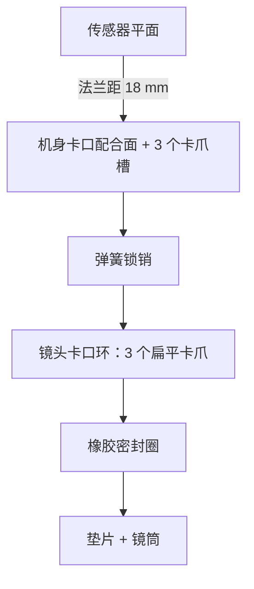

# Sony E 卡口：三爪、18 mm 法兰距与锁销磨损

> [!summary] 一句话概述
> 镜头卡口是卡口（bayonet）在相机上的用法：镜头侧用扁平卡爪（而不是圆销）旋进机身侧的槽里，再由弹簧锁销顶住防转。以 Sony E 为例，中文维基给出 3 个卡爪、法兰距 18 mm、内径 46.1 mm、10 个电子触点；Lensrentals 拆 Sony FE 70-200 mm f/2.8 GM 时看到卡口用 4 颗螺丝固定，环与镜筒之间有橡胶密封，底下还有校正倾斜的垫片，租用镜头的锁销槽两侧已出现金属隆起。

## 配图

![[附件/bayonet-mount-l-slot.png]]
*图源：[Wikipedia: Bayonet mount](https://en.wikipedia.org/wiki/Bayonet_mount)；通用卡口原理：公端径向销对准母端 L 形槽推入，再旋转进入横臂末端的短「衬线」（serif），弹簧把销顶进这小段，防止自行转出*

![[附件/sony-nex5-e-mount.jpg]]
*图源：[Wikipedia: Sony E-mount](https://en.wikipedia.org/wiki/Sony_E-mount)（Sony NEX-5 机身）；机身侧 E 卡口法兰、卡爪槽与底部触点*

![[附件/sony-fe-70200-lockpin-wear.jpg]]
*图源：[Lensrentals, Roger Cicala, 2017-02-24](https://www.lensrentals.com/blog/2017/02/lens-teardown-of-the-complicated-sony-fe-70-200mm-f2-8-gm-oss-part-1/)；Sony FE 70-200 mm f/2.8 GM 镜头卡口上的锁销槽，红线标出槽两侧已隆起的金属*

> 图片版权归原作者所有，仅作个人学习收藏；出处见文末「来源与核实记录」。

## 结构原理

> 本节所有数字只写来源里给出的；来源没有就写「来源未给出」，不估算、不换算成看似精确的值。

### 堆叠方案

方向：**从机身传感器一侧看向镜头（以 E 卡口为例）**

| 层级 | 零件 | 材料 | 厚度/尺寸 | 固定方式 | 依据 |
| --- | --- | --- | --- | --- | --- |
| L1（最靠近传感器） | 成像面 / 传感器平面 | 来源未给出 | 与卡口配合面的距离即法兰距 18 mm | 机身内部 | 中文维基信息框；英文 Sony E-mount 词条 |
| L2 | 机身卡口座（母端） | 来源未给出 | 内径 46.1 mm；3 个卡爪槽（不对称，保证只能按一个方向插入） | 固定在机身前板 | 中文维基「卡扣 3」；Lens mount 词条：卡爪常被做成不同大小（keyed） |
| L3 | 弹簧锁销（机身侧，推断常见布置） | 来源未给出 | 来源未给出 | 弹簧顶入镜头卡口上的锁销槽 | Lens mount 词条：弹簧销锁住；Lensrentals 在镜头卡口上拍到锁销槽 |
| L4 | 镜头卡口环（公端）与卡爪 | 金属（具体牌号来源未给出） | 3 个扁平卡爪；环由 4 颗螺丝固定 | 4 颗螺丝拧在镜筒上 | 中文维基；Lensrentals 拆解 |
| L5 | 橡胶天气密封圈 | 橡胶 | 来源未给出 | 夹在卡口环与镜筒之间 | Lensrentals：「relatively robust rubber weather seal」 |
| L6 | 倾斜校正垫片（shim） | 来源未给出 | 来源未给出（两处放置） | 垫在卡口环下方 | Lensrentals |
| L7 | 电子触点 | 来源未给出 | 10 个电子触点 | 卡口面上的弹性触点 | 中文维基信息框 |

剖面示意：

通用卡口（灯泡、刺刀那种）用圆销 + L 形槽；相机镜头卡口把圆销换成更结实的扁平卡爪，作用相同（Wikipedia Bayonet mount：「Camera lens mounts usually employ stronger flattened tabs rather than pins, though their function is the same」）。

### 零件清单

| 零件 | 数量 | 功能 | 材料 | 依据 |
| --- | --- | --- | --- | --- |
| 机身卡口座 | 1 | 提供法兰基准、卡爪槽和触点 | 来源未给出 | 维基；NEX-5 照片 |
| 卡爪 / 卡爪槽 | 3（E 卡口） | 旋转锁紧、传递轴向和部分扭矩 | 来源未给出 | 中文维基 |
| 弹簧锁销 + 镜头侧锁销槽 | 各 1（拆解所见） | 转到位置后防反转松脱 | 来源未给出 | Lens mount 词条；Lensrentals |
| 镜头卡口环 | 1 | 与机身互锁，并可拆下维修 | 金属 | Lensrentals，4 颗螺丝拆下整环 |
| 密封圈 | 1 | 卡口结合面防水/防尘 | 橡胶 | Lensrentals |
| 垫片 | 来源写「a set of shims in two locations」 | 校正卡口倾斜 | 来源未给出 | Lensrentals |
| 电子触点 | 10 | 镜头与机身通信、供电 | 来源未给出 | 中文维基 |

### 装配顺序

装镜头（按 Wikipedia 卡口原理 + Lens mount 词条）：

1. 把镜头卡爪与机身槽对齐（槽/爪不对称，只有一个方向能插入）。
2. 沿光轴推入，使卡爪走到槽底。
3. 旋转（E 卡口的旋向来源未在已打开页面中写成「顺/逆时针」的硬规定，不编造），卡爪沿槽的横向段走到定位。
4. 弹簧锁销弹入镜头侧的锁销槽，锁死旋转。
5. 取下时先按机身解锁按钮，把锁销从槽里退出，再反向旋转并抽出。

镜头卡口环装到镜筒（按 Lensrentals 拆解顺序反推）：

1. 在镜筒端面放好垫片（两处），用于校正倾斜。
2. 放上橡胶密封圈。
3. 套上卡口环，用 4 颗螺丝拧紧。

> 卡口环这一段按拆解顺序反推；装镜头步骤来自百科对卡口动作的描述。

### 受力与运动分析

- **受力路径**：镜头自重和操作扭矩先由 3 个卡爪与机身槽的接触面承担；转到位置后，弹簧锁销挡住反向旋转。法兰距把光学后截距钉在 18 mm 这一条基准上。解锁后沿卡口旋转再轴向抽出。
- **运动关系**：安装时有「先轴向推入、再旋转锁紧」两个自由度；锁销弹出后旋转被锁住。未推到位就只转一部分、销没进槽时，Wikipedia 写它会暂时留在那儿，但很容易意外松开。
- **失效风险**：Lensrentals 在较新的租用 FE 70-200 GM 上已看到锁销槽两侧金属隆起；文中说目前还没造成问题，但若继续恶化，可能出现旋转旷量或上镜头发涩。密封圈在卡口环和镜筒之间，拆卡口时是一道可更换的密封。垫片决定倾斜，漏装或装错会让镜头相对传感器偏斜（推断，拆解只说 shims「would correct lens tilt at the mount」）。

## 设计要点与参数

| 要点 | 内容 | 依据 |
| --- | --- | --- |
| 法兰距 | 18 mm（配合面到焦平面） | 中文维基信息框；英文 Sony E-mount |
| 卡口内径 | 46.1 mm | 同上 |
| 卡爪数 | 3 | 中文维基信息框「卡扣 3」 |
| 电子触点 | 10 个 | 中文维基信息框 |
| 发表时间 | 2010-05-10，随 NEX-5 / NEX-3 | 中文维基 |
| 与 A 卡口对比 | 先前 Sony α / Minolta A 卡口法兰距 44.5 mm（英文 E-mount 词条） | 英文 Sony E-mount |
| 卡口环固定 | 4 颗螺丝 | Lensrentals |
| 密封 | 卡口环与镜筒之间有较厚实的橡胶天气密封 | Lensrentals |
| 倾斜校正 | 卡口下两处垫片 | Lensrentals |
| 锁销磨损 | 锁销槽两侧出现隆起金属 | Lensrentals |
| L 形槽「衬线」 | 通用卡口靠弹簧把销顶进横臂末端短竖槽，防止自行转出 | Wikipedia Bayonet mount |
| 卡爪形状 | 镜头卡口多用扁平卡爪，比圆销更结实，功能相同 | Wikipedia Bayonet mount |
| 防插错 | 卡爪常做成不同大小，只允许一个插入方向 | Wikipedia Lens mount |

## 优缺点

**优点**
- 比螺纹卡口对位准、上镜头快，也不会拧乱牙（Wikipedia）
- 短法兰距（18 mm）给转接留出空间：许多长法兰距的单反镜头可以通过转接环在 E 卡口上实现无限远对焦（中文维基「转接兼容」）
- 卡口环可拆（4 颗螺丝），密封圈和垫片可以单独处理（Lensrentals）

**缺点 / 代价**
- 锁销槽是局部接触，租赁等高频插拔下会先在槽口两侧堆起金属（Lensrentals）
- 短法兰距放不下反光镜箱，必须用电取景（英文 E-mount 词条）
- 各厂家卡口机械、电接口和法兰距几乎都不通用（Lens mount 词条）

## 可借鉴点

- **旋转卡口要同时设计「槽」和「销」**：卡爪只负责转到位并承受轴向力，防松要另做弹簧锁销；只靠摩擦力容易在振动下回转。
- **卡爪或槽做成不对称**，从结构上禁止插反，不要只靠颜色标记。
- **法兰距是光学基准，也是机械基准**：卡口环下面留垫片位置，用来校正倾斜，而不是指望把环「拧平」。
- **高频插拔的锁销槽要当磨损件看**：局部凸起会先出现在销与槽的入口两侧；设计和维修都要能检查、必要时换环。
- **密封放在可拆的卡口环和镜筒之间**，换密封不必拆整颗镜头光学组。

## 与库中相似案例对比

| 对比项 | 本案例 | [[VESA MIS-D 75-100 接口与倾角摩擦关节]] | [[苹果 AirTag 旋转后盖与内部卡扣]] |
| --- | --- | --- | --- |
| 接口性质 | 旋转卡口 + 锁销，法兰距是正式系统基准 | 方形孔距标准（75/100 mm）+ 螺丝，协会指南 | 旋转后盖，卡入到位 |
| 对位 | 3 爪不对称，只能一个方向插入 | 4 孔正方形，旋转 90° 仍可能对上孔 | 转到卡位 |
| 防松 | 弹簧锁销进槽 | 螺丝预紧（另议摩擦关节） | 内部卡扣 |
| 公差手段 | 卡口下垫片校倾斜 | 标准规定孔距和螺丝，不规定加工 | 来源未按法兰距这类光学基准写 |

## 相关案例

- [[VESA MIS-D 75-100 接口与倾角摩擦关节]]
- [[苹果 AirTag 旋转后盖与内部卡扣]]
- [[任天堂 Switch Joy-Con 滑轨连接]]
- 分类索引：[[02-连接与紧固 索引]]

## 来源与核实记录

- 主来源：[Wikipedia: Bayonet mount](https://en.wikipedia.org/wiki/Bayonet_mount)（卡口 L 形槽、弹簧衬线、镜头卡口改用扁平卡爪）
- 补充来源 1：[Wikipedia: Sony E-mount](https://en.wikipedia.org/wiki/Sony_E-mount)（法兰距 18 mm、内径 46.1 mm、相对 A 卡口 44.5 mm、短法兰距不能放反光镜）
- 补充来源 2：[中文维基：索尼E接环](https://zh.wikipedia.org/wiki/%E7%B4%A2%E5%B0%BCE%E6%8E%A5%E7%8E%AF)（信息框：卡扣 3、法兰距 18 mm、内径 46.1 mm、10 个电子触点、2010-05-10；与英文词条同属 Wikimedia，不另计独立机构）
- 补充来源 3：[Wikipedia: Lens mount](https://en.wikipedia.org/wiki/Lens_mount)（现代静物相机多用卡口；卡爪通常 3 或 4 个、常不对称；弹簧销锁住；反向旋转取出）
- 补充来源 4：[Lensrentals: Lens Teardown of the Complicated Sony FE 70-200mm f/2.8 GM OSS, Part I](https://www.lensrentals.com/blog/2017/02/lens-teardown-of-the-complicated-sony-fe-70-200mm-f2-8-gm-oss-part-1/)（Roger Cicala，2017-02-24；锁销槽磨损、4 颗螺丝拆卡口、橡胶密封、两处垫片）
- 核实：2026-11-17 打开上述页面核对原理、尺寸和拆解细节。卡爪数以中文维基信息框为准；英文 E-mount 词条未在已抓取正文中写出「3 爪」，故不把 3 爪记在英文词条名下。未把无法溯源的第三方参数表当作硬数据。
