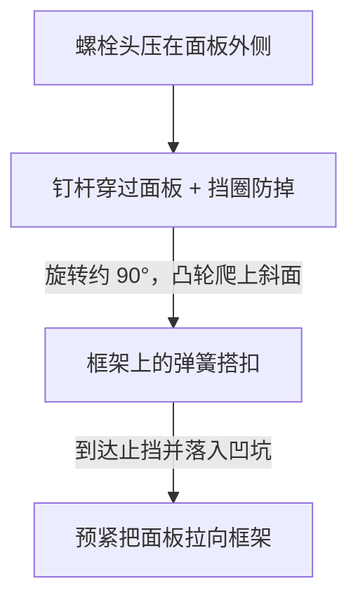

# Southco、DZUS 四分之一转快锁：90° 凸轮与按总材料厚度选钉长

> [!summary] 一句话概述
> 四分之一转快锁用大约 90° 的旋转，让螺栓上的凸轮（或横销）爬上搭扣的斜面，把面板拉向框架，最后掉进锁止凹坑，靠弹簧预紧抵抗振动。钉的长度不能随手选，要先按所选搭扣的公式算出总材料厚度（TMT），再进对应系列的钉长表。Southco 手册把凸轮分成三类：外螺旋适合 TMT 偏差大，内螺旋适合高拉力，铲形凸轮（82/85 Lion 等）则偏向高循环寿命。William Dzus 在 1932 年做出最早的四分之一转锁，这条原理后来被多家沿用。

## 配图

![[附件/southco-quarter-turn-exploded.jpg]]
*图源：[Southco Quick-Access Fasteners 手册（2018）](https://media.southco.com/media/static/documents/brochures/201808-BR-Quick-Access-Fasteners_EN.pdf) Overview 页；典型系统三件套：螺栓（Stud）穿过面板，挡圈（Retainer）把它留在可拆面板上，搭扣（Receptacle）固定在框架上。头型、挡圈和搭扣都有多种安装方式*

![[附件/southco-tmt-selection.png]]
*图源：同上 Design Considerations 页；原文：Total Material Thickness (TMT) is required to determine stud length，TMT 按搭扣类型、可选附件和应用参数用手册公式计算*

![[附件/southco-external-spiral-cam.png]]
*图源：同上「External Spiral Cam Design」页；D2 Rapier、D8 PANEX、D9 Tech Line 都属于外螺旋，手册在总览页把这一类对应到「Where high TMT variance allowance is required」。D8 的 TMT 偏差 0.9 mm，TMT 范围最大到 23 mm，拉力档为 Medium\**

> 图片版权归原作者所有，仅作个人学习收藏；出处见文末「来源与核实记录」。

## 结构原理

> 本节所有数字只写来源里给出的；来源没有就写「来源未给出」。

### 堆叠方案

方向：**从可拆面板外侧到框架内侧**

| 层级 | 零件 | 材料 | 厚度/尺寸 | 固定方式 | 依据 |
| --- | --- | --- | --- | --- | --- |
| L1（最外） | 螺栓头（一字、十字、内六角、翼形、提环等） | D8 Size 4：钢，锌加铬酸盐或镀铬；可选 ABS 手环盖 | 头型尺寸见 D8 目录（例如 Size 4 椭圆一字头外径等，以该页毫米/英寸为准） | 手拧或工具驱动 | 手册 Overview；D8 目录 |
| L2 | 可拆面板 | 应用自定 | 计入 TMT 的一部分（常记为 P） | 被头压住 | 手册 TMT 页；中文 82 目录用 TMT = P + … 这类公式 |
| L3 | 挡圈（Retainer） | 来源按型号而异 | 把螺栓留在面板上，打开后面板不会掉钉 | 推入式等 | 手册：Typical Quarter-Turn System includes a Stud, Retainer & Receptacle |
| L4 | 螺栓杆与凸轮 / 横销 | 与螺栓一体 | 钉长按 TMT 表选，例如 D8 目录用 Stud Length Table，按不同搭扣给出 TMT 区间再对应长度代号 | 穿过面板孔 | D8 目录：Calculate the total material thickness (TMT) using the formula given for the receptacle selected |
| L5 | 框架 | 应用自定 | 计入 TMT（常记为 F），有时还加缝隙或挡圈厚度 | 搭扣装在框架上 | 中文 82 目录 TMT 公式 |
| L6 | 搭扣（弹簧片、卡入、铆接、压铆等） | 来源按型号而异 | 提供斜面/凸轮配合面和弹簧 | 按所选类型安装 | 手册多种 Receptacle Styles |

剖面示意：

独立来源对同一动作的表述：

- HFS（介绍 Camloc 类四分之一转）：钉上的横销沿凸轮爬升，大约转 90° 后碰到正向机械止挡，横销落入锁止凹坑；弹簧元件产生预紧，从而抗振。弹簧可以做在钉上，也可以做在搭扣上。
- RacingJunk 写 Dzus Standard Line：螺旋凸轮钉（俗称 button）转过四分之一圈，与弹簧丝搭扣啮合，把弹簧拉过凸轮峰，再卡进末端凹坑；凸轮上的峰用来抵抗振动把钉转开。

这些是同一类运动，具体凸轮是外螺旋、内螺旋还是铲形，以及拉力档，要以 Southco 对应系列为准。

### 零件清单

| 零件 | 数量 | 功能 | 材料 | 依据 |
| --- | --- | --- | --- | --- |
| 螺栓（Stud） | 每锁 1 | 旋转、拉紧、锁止 | 见上表，按系列 | 手册；D8 / 82 目录 |
| 挡圈（Retainer） | 每锁 1（常见） | 打开后钉子留在面板上 | 来源按型号 | 手册 |
| 搭扣（Receptacle） | 每锁 1 | 提供凸轮配合与弹簧 | 来源按型号 | 手册 |
| 手环盖等附件 | 可选 | 手操、标识 | D8：ABS 黑色手环盖 | D8 目录 |
| 弹出弹簧等 | 可选 | 解锁后部分顶出，便于看见已打开 | 中文 82 目录有弹出弹簧附件 | 中文 82 目录 |

### 装配顺序

按手册和 D8 目录的选型/安装逻辑（不是某一现场的工艺卡）：

1. 选搭扣类型和安装方式（卡入、铆接、压铆、侧面安装等），确认框架能否安装、是否盲孔。
2. 用该搭扣对应的公式计算 TMT（常要计入面板厚、框架厚、缝隙和附件的附加厚度）。中文 82 目录里出现过 TMT = P + 缝隙 + 1.6，以及按框架厚度是否大于「0.9 + 挡圈厚度」改写公式的附注——公式随搭扣而变，必须用所选搭扣那一页的式子。
3. 在该系列的钉长表里，找到 TMT 落入的区间，读出钉长代号和材料。D8 目录还举例：算出 TMT 为 5.2 后再进表。
4. 在面板上按该系列的孔径要求开孔，装上螺栓和挡圈。
5. 把搭扣装到框架上。合上面板，把钉插入搭扣，转动约 90° 至止挡/手感到位。
6. 打开则反向转约 90°。若有自弹出设计，钉会部分顶出，既提示已解锁，又避免竖直面丢钉。

### 受力与运动分析

- **受力路径**：旋转通过凸轮斜面变成沿钉轴的拉力，把面板压向框架；弹簧（在钉上或在搭扣上）提供弹性预紧。HFS 写：与螺纹紧固件不同，Camloc 类并不依赖被连接件和钉本身的弹性来建立预紧，安装扭矩更低，头部凹槽磨损也更小，循环次数可以更高。
- **运动关系**：工作行程大约就是 90° 旋转。转到凹坑后，再正转会被止挡拦住；反转要先克服凹坑和凸轮峰。RacingJunk 写凸轮峰就是用来抵抗振动回转的。
- **失效风险**：钉长和 TMT 不匹配——太短夹不紧，太长转不到位或卡死。外螺旋系列允许的 TMT 偏差较大（D8 / D2 为 0.9 mm），内螺旋 D5 只有 0.2 mm，选错系列会在公差面前失锁或装不上。手册中的拉力、循环和抗振都带星号，要求查阅 Southco 试验指南并在实际应用里测试，不能把「Medium / High」当成牛顿数。

## 设计要点与参数

| 要点 | 内容 | 依据 |
| --- | --- | --- |
| 动作 | 约 90°（quarter turn）开合 | 手册；HFS；RacingJunk |
| 按 TMT 选钉长 | 先按搭扣公式算 TMT，再进钉长表 | 手册 Design Considerations；D8 目录步骤 1–3 |
| 外螺旋（D2 / D8 / D9） | 手册定位：需要较大 TMT 偏差容许时。D8：TMT Variance 0.9 mm，TMT Range 最大 23 mm，Tensile Load Medium\*，Cycle Life 500–2000\*，Vibration Moderate\*。D2 同样 0.9 mm / 最大 23 mm / Medium\*。D9：0.5 mm，最大 9.2 mm | 手册 External Spiral Cam 页与总览 |
| 内螺旋（D4 / D5） | 手册定位：需要高抗拉性能时。D4：TMT Variance 0.7 mm，Range 最大 19 mm，Tensile High\*，Vibration High\*。D5：Variance 0.2 mm，Max. Panel Thickness 3.2 mm，Tensile High\*，Vibration High\* | 手册 Internal Spiral Cam 页与总览 |
| 铲形凸轮（82/85 Lion、D1） | 手册定位：需要高循环寿命时。82/85：TMT Variance 0.5 mm，Range 最大 15 mm，Tensile High\*，Cycle 2000+\* | 手册 Spade Cam 页 |
| D8 Size 4 材料 | 螺栓：钢，锌加铬酸盐或镀铬；手环盖 ABS 黑 | D8 目录 |
| 历史规格（不是 Southco 现表） | RacingJunk 列 Dzus Standard Line #3/#4/#5/#65 的钉径、头径、锁定工作拉力、最大拉力、抗剪和寿命循环，单位为英寸和磅。只作历史对照，不写入 Southco 选型 | RacingJunk |
| 发明 | William Dzus 于 1932 年发明最初的四分之一转锁，先用于飞机整流罩和检修盖 | RacingJunk；HFS 写 1930s、最初为直升机等面板 |

## 优缺点

**优点**
- 开合只要约 90°，比拧一整颗螺钉快，适合频繁检修的面板
- 钉子可以留在面板上，竖直面也不容易丢件
- 凸轮峰 + 弹簧预紧，专门针对振动回松
- 用系列分工：容差大走外螺旋，拉力高走内螺旋，寿命高走铲形凸轮

**缺点 / 代价**
- 选型步骤比「买一颗 M4」长，TMT 算错就整套合不上或夹不紧
- 不同系列的偏差容许可以从 0.2 mm 到 0.9 mm 以上，混用手册结论会出错
- 目录里的 Medium / High、循环次数都带试验条件，必须按应用复测

## 可借鉴点

- **把「旋转」变成「轴向夹紧」时，一定要有止挡和凹坑**：只靠斜面停在半途，振动会把钉转回来。
- **钉长按「总厚度」选，不要按「看起来差不多」选**。公式要随搭扣和附件改，缝隙、挡圈、密封垫都要进 TMT。
- **先问公差还是先问拉力**：面板厚度和间隙散就选外螺旋这类高偏差系列；连接要扛更大拉力、抗振要求高，再走向内螺旋，并接受更严的 TMT 窗口。
- **可拆面板上的钉子要做成防掉件**（挡圈或自弹出），尤其是头顶或侧面的盖。
- 历史牌号（Dzus #3/#4）和今天的 Southco 系列表不是同一套数，维修旧件时要对着对应年代的手册，不要混抄磅值和毫米表。

## 与库中相似案例对比

| 对比项 | 本案例 | [[Mac Pro 2019 旋转把手外壳锁与免工具模块锁]] | [[VESA MIS-D 75-100 接口与倾角摩擦关节]] |
| --- | --- | --- | --- |
| 动作 | 约 90° 凸轮锁，弹簧预紧 | 旋转把手后上拔外罩 | 螺丝固定，另用摩擦关节停倾角 |
| 选型关键 | TMT → 钉长；外/内螺旋取舍 | 整机互锁与模块锁，未按 TMT 表 | 孔距 75/100 mm、M4×10 mm |
| 防松 | 凸轮峰 + 凹坑 + 弹簧 | 把手锁 + 电源互锁 | 螺丝预紧 |
| 掉件 | 挡圈把钉留在面板上 | 外罩是整件拉出 | 螺丝可能脱落，标准不管这个 |

## 相关案例

- [[Mac Pro 2019 旋转把手外壳锁与免工具模块锁]]
- [[VESA MIS-D 75-100 接口与倾角摩擦关节]]
- [[Framework Desktop 免工具面板与标准件模块化]]
- 分类索引：[[02-连接与紧固 索引]]

## 来源与核实记录

- 主来源：[Southco Quick-Access Fasteners 手册（201808-BR，英文）](https://media.southco.com/media/static/documents/brochures/201808-BR-Quick-Access-Fasteners_EN.pdf)（2018-08；三件套、TMT 选钉长、外螺旋/内螺旋/铲形凸轮的分工与各系列 TMT 偏差、范围、拉力档、循环）
- 补充来源 1：[Southco D8 DZUS PANEX 英文目录](https://media.southco.com/media/static/Literature/d8.en.pdf)（钉长表与 TMT 计算步骤、Size 4 材料与头型。与手册同属 Southco）
- 补充来源 2：[Southco 82/85 中文目录](https://media.southco.com/media/static/Literature/81-82-85.zh.pdf)（TMT 公式随搭扣变化、材料。同属 Southco，不另计机构）
- 补充来源 3：[HFS Industrial: How Quarter Turn Fasteners Work](https://www.hfsindustrial.com/news/post/how-quarter-turn-fasteners-work)（Dieter Jüling；Camloc 类：约 90°、横销爬凸轮、止挡与凹坑、弹簧预紧、与螺纹件的区别。独立厂商说明）
- 补充来源 4：[RacingJunk: Button It Up: Dzus Fasteners](https://www.racingjunk.com/news/button-it-up-dzus-fasteners/)（Wayne Scraba，2024-07-05；1932 年发明、Standard Line 的凸轮峰与弹簧丝搭扣、历史尺寸表）
- 核实：2026-11-17 下载三份 Southco PDF 并打开两篇独立文章。thingsunpacked 一文主要转述 Southco，不作为独立第二来源。
