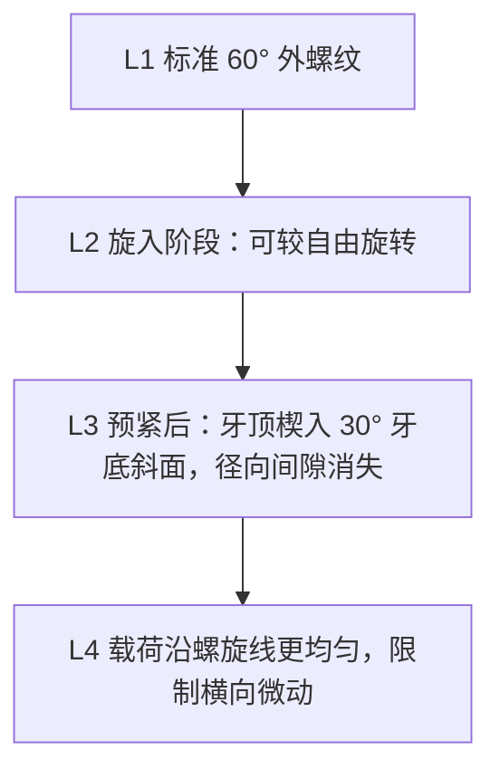

# Spiralock 楔形底 30° 防松内螺纹：牙顶楔入斜面消除径向间隙

> [!summary] 一句话概述
> Spiralock（施必牢）把防松做在**内螺纹牙型**上：牙底有 30° 楔形斜面，仍与标准 60° 外螺纹兼容。自由旋入时螺栓可以较轻松地拧到位；一旦施加预紧，螺栓牙顶楔入这道斜面，径向间隙被消除，横向微动被限制，啮合各牙的载荷也更均匀。这既不是垫圈，也不是尼龙或全金属锁紧螺母的嵌件。Machine Design 转述的研究给出过载荷分配例子：MIT/Daimler-Chrysler 计算中，Spiralock 第一圈承载约 18%、末圈约 9.4%，标准 60° 内螺纹则是约 34.1% 和 3.1%。

## 配图

![[附件/spiralock-thread-form.png]]
*图源：[拓力泰《螺纹连接的抗振动及防松设计原理研究（下）》](https://www.tuolitai.cn/news/company-news/2786) 文内“施必牢螺纹的结构及受力图 / 普通螺纹的结构及受力图”；左图内螺纹牙底为 30° 楔面（图中标 DTF 内螺纹），外螺纹牙顶顶在斜面上；右图为普通 60° 牙侧接触，牙底有径向间隙。*

![[附件/spiralock-contact.png]]
*图源：同上文配图；预紧后牙顶与 30° 楔面贴合的示意，用来对照“自由旋转、拧紧后才楔紧”的装配特点。*

![[附件/spiralock-load-share.png]]
*图源：同上文配图；用来示意普通螺纹载荷集中在前几牙、楔形底螺纹沿旋合长度更均匀。具体百分比以 Machine Design 文中引用的研究为准，不从图上估读。*

> 图片版权归原作者所有，仅作个人学习收藏；出处见文末「来源与核实记录」。

## 结构原理

> 本节数字只写打开来源给出的，并标明是哪一项研究。拓力泰文中的“疲劳寿命提高 3 倍”“规格 M0.3–M90”等属于该文陈述，不是 Machine Design 那几项试验的结论，引用时分开。

### 堆叠方案

方向：**从螺栓外螺纹牙顶到内螺纹牙底。**

| 层级 | 零件/区域 | 材料 | 厚度/尺寸 | 固定方式 | 依据 |
| --- | --- | --- | --- | --- | --- |
| L1 | 标准 60° 外螺纹螺栓 | 无需改牙型，符合普通标准即可 | 来源未要求特殊外螺纹 | 拧入内螺纹 | 拓力泰；Machine Design |
| L2 | 旋合前的径向间隙 | — | 普通螺纹靠 60° 牙侧接触，牙顶与牙底之间有间隙，允许横向微动 | 自由旋入阶段近似普通螺纹，直到压上楔面 | 拓力泰 |
| L3 | 30° 楔形牙底（内螺纹） | 螺母、钢丝螺套或直接在本体上攻出的 Spiralock 内螺纹 | 牙底楔面 30°；需用专用工具加工 | 预紧后外螺纹牙顶楔入斜面 | 拓力泰 |
| L4 | 被连接件夹紧面 | — | 预紧后才产生夹紧力；在此之前可较轻松地旋转、对中 | 夹紧力把牙顶压进楔面 | 拓力泰（“自由旋转型：直到拧紧时才需施力”） |

剖面示意：

### 零件清单

| 零件 | 数量 | 功能 | 材料 | 依据 |
| --- | --- | --- | --- | --- |
| 标准螺栓 | 1 | 提供 60° 外螺纹和夹紧力 | 不需改牙 | 拓力泰 |
| Spiralock 内螺纹（螺母、螺套或本体孔） | 1 | 30° 楔面锁紧 | 来源未限定材质 | 拓力泰；Machine Design 试验用过螺母和钢丝螺套 |
| 专用丝锥/工具 | 加工时 1 | 做出楔形牙底 | — | 拓力泰 |

### 装配顺序

1. 内螺纹按 Spiralock 牙型加工（或选用成品螺母/螺套），外螺纹用标准件。
2. 螺栓可较为自由地旋入并对中，直到开始压紧（拓力泰把这一点列为提高装配效率的原因）。
3. 施加预紧后，牙顶进入 30° 斜面，消除径向间隙。
4. 拆卸按普通螺纹反向拧出；拓力泰称可重复使用、锁紧效果受影响小。已打开的英文文没有给出允许重复次数，故不编造。

### 受力与运动分析

- **受力路径**：预紧把外螺纹牙顶压在内螺纹 30° 斜面上，接触法向带有较大的径向分量，把螺栓“抱紧”，限制横向移动；同时载荷不再过分集中在第一、二牙。
- **运动关系**：工作中相对转动被楔面和摩擦共同抑制；这是改变接触几何，不是附加弹簧或尼龙环。
- **载荷分配（英文来源中的研究，摘录）**：
  - 一篇分析在装配预紧 1,733 lb 时：Spiralock 螺母第一牙约承担总载荷的 12.5%，没有任何一牙低于 8%；对比 UNF 螺母前两牙各约 21%，最后三牙各约 4% 或更少。
  - MIT 为 Daimler-Chrysler 做的计算：Spiralock 第一圈约 18%、最后一圈约 9.4%；标准 60° 牙型约 34.1% 和 3.1%。
- **振动试验（英文来源转述，摘录）**：
  - Goddard Space Flight Center：1/4-28 螺母（A-286 不锈钢和合金钢），2 g、24.7 Hz 正弦，以及 20–40 Hz、2 g rms 随机；标准螺纹螺母在第一分钟内开始掉预紧，Spiralock 螺母一直保持到螺栓疲劳断裂。文中称这两项试验在时间和严酷程度上都比该应用规范高一个数量级。
  - 英国 British Aerospace：M6、25 mm、8 级螺栓，预紧 1,800 lb，L168 铝，13.6 Hz 横向振动；Spiralock 螺套在前 1,000 周约损失 15% 预紧，随后约 1%。后半句在已打开文本中被截到“followed by a 1% loss”，完整后续未再显示，故只引用已看见的这一段。
- **失效风险**：内螺纹必须真正做成楔形底，用普通丝锥攻出的 60° 牙没有这个效果。预紧不足时牙顶还没楔紧，锁紧尚未建立（推断，与“自由旋转直到拧紧”的描述一致）。

## 设计要点与参数

| 要点 | 内容 | 依据 |
| --- | --- | --- |
| 牙型 | 内螺纹牙底 30° 楔面，外螺纹保持标准 60° | 拓力泰；Machine Design / Electronic Design |
| 兼容性 | 螺栓、螺钉不必改牙，符合普通标准即可 | 拓力泰 |
| 装配特点 | 拧紧前可较自由旋转，对中后再施加预紧 | 拓力泰 |
| 载荷分配例子 | 见上文 MIT 与 1,733 lb 那组分析，数字只属于被引用的那项研究 | Machine Design 文 |
| Goddard 振动条件 | 1/4-28，2 g / 24.7 Hz，以及 20–40 Hz、2 g rms | Machine Design 文 |
| BAe 试验条件 | M6×25 mm、8 级、预紧 1,800 lb、L168 铝、13.6 Hz；前 1,000 周约 15% 预紧损失 | Machine Design 文 |
| 拓力泰另外列出的特点 | 无需弹簧垫圈、止动垫片或胶；可重复使用；有自对中；该文称可提高疲劳寿命 3 倍、规格有 M0.3–M90。这些是该中文文的陈述，未在已打开的英文试验文中逐条核对 | 拓力泰 |
| 与锁紧螺母、垫圈的区别 | 改变的是内螺纹牙型本身，不是尼龙圈、全金属变形牙，也不是垫圈 | 本篇结构定义；拓力泰“无需辅助锁紧元件” |

## 优缺点

**优点**
- 外螺纹继续用标准件，防松做在螺母或本体螺孔上，可减少垫圈和胶
- 预紧后消除径向间隙，并改善各牙载荷分配（有计算和试验引用）
- 拧紧前旋转轻快，有利于对中和装配

**缺点 / 代价**
- 必须使用专用内螺纹工具或合格的 Spiralock 螺母/螺套，现场用普通丝锥无法“改装”
- 预紧仍然是前提，拧不紧就没有楔紧
- 扭矩–预紧系数（K）会与普通螺母不同；拓力泰提到 K 更一致，但已打开来源没有给出可直接采用的扭矩系数表，必须用本接头标定
- 中文源部分性能数字（如 3 倍疲劳寿命）缺乏与英文试验的一一对应，设计时不要当保证值

## 可借鉴点

- 想少加零件、又要抗横向振动时，优先评估“改内螺纹牙型”，而不是在已经失效的弹簧垫圈上打转
- 图样上明确标注 Spiralock / 施必牢牙型或对应螺母、螺套标准，并禁止用普通丝锥返修该孔
- 扭矩规范单独做试验，不要直接套普通 60° 螺母的扭矩表
- 把本方案和楔形垫圈、锁紧螺母分成三条路线：改牙型、加垫圈、改螺母嵌件，按是否允许改内螺纹、是否允许增加厚度来选
- 引用载荷分配或振动数据时写明研究名称和条件，不要写成“Spiralock 一律 18%”

## 与库中相似案例对比

| 对比项 | 本案例（30° 楔形底内螺纹） | [[Nord-Lock 楔形防松垫圈：楔角大于螺纹升角的成对拉伸锁紧]] | [[开口弹簧垫圈防松失效（反面案例）：压平后在横向振动中几乎无效]] |
| --- | --- | --- | --- |
| 改了什么 | 内螺纹牙底 | 支承面下的成对垫圈 | 加一片开口垫圈 |
| 外螺纹 | 标准 60° | 标准 60° | 标准 60° |
| 锁紧机制 | 牙顶楔入 30° 斜面，消除径向间隙 | α > β，松转抬升垫圈、增大夹紧力 | 压平后基本失效 |
| 厚度代价 | 不增加垫圈厚度 | 每对垫圈增加夹紧长度和界面 | 很薄，但无效 |
| 加工代价 | 要专用内螺纹 | 标准螺纹即可 | 标准螺纹即可 |

## 相关案例

- [[Nord-Lock 楔形防松垫圈：楔角大于螺纹升角的成对拉伸锁紧]]
- [[开口弹簧垫圈防松失效（反面案例）：压平后在横向振动中几乎无效]]
- 分类索引：[[02-连接与紧固 索引]]

## 来源与核实记录

- 中文主来源：[四川拓力泰《螺纹连接的抗振动及防松设计原理研究（下）》](https://www.tuolitai.cn/news/company-news/2786)（2026-11-21 GET，HTTP 200。30° 楔面原理、与标准外螺纹兼容、自由旋转后楔紧、文内结构图。同页还介绍了唐氏螺纹等其他牙型，本篇不展开。）
- 独立第二来源：[Machine Design 归档文 *Ramp breaks common thread of fastener failures*](https://www.machinedesign.com/archive/article/21816697/ramp-breaks-common-thread-of-fastener-failures)（2026-11-21 GET，HTTP 200。载荷分配计算、Goddard 与 British Aerospace 试验条件及结论。）
- 补充：[Electronic Design *Fasteners Take 30° Turn To Secure Cabinets And Contents*](https://www.electronicdesign.com/technologies/components/article/21761000/fasteners-take-30-turn-to-secure-cabinets-and-contents)（同日打开，内容与上篇高度同源，不另计独立来源。）
- 未采用为独立来源：Bossard 中国产品页已打开，但抽取正文过短，无法核对参数；上海底特网站连接失败。
- 核实：2026-11-21 打开上述 URL。BAe 试验“1% loss”之后的句子在页面抽取中被截断，未补写。未把经销商转述当成原厂保证值。
