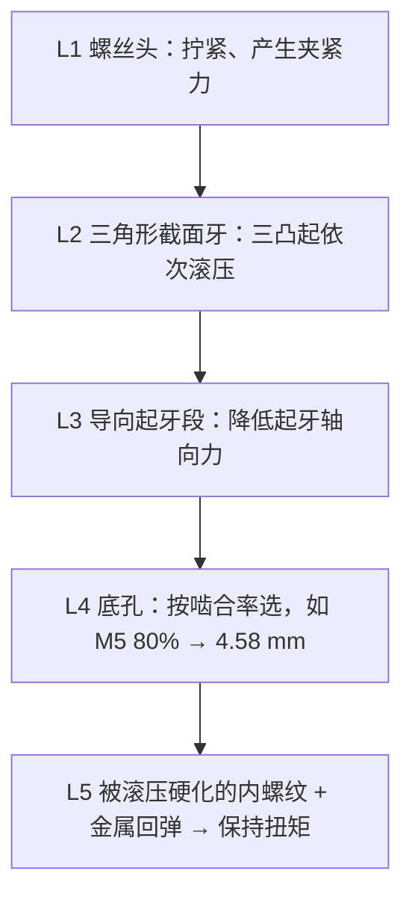

# TAPTITE II 金属三角挤牙自攻螺丝：按啮合率选底孔

> [!summary] 一句话概述
> TAPTITE II 是用于延性金属（钢板、压铸件等）的三角截面（TRILOBULAR）挤牙螺丝：三个凸起依次滚压出公制内螺纹，无切屑，并靠金属回弹得到防松的保持扭矩。底孔必须按**螺纹啮合率**和被攻件厚度来选，例如手册示例：M5×0.8 配 4.58 mm 底孔对应 80% 啮合；不要把塑料自攻常用的约 0.8d 底孔直接套过来。冷轧钢板、M3×0.5、板厚 2 mm、底孔 2.75 mm 时，手册给出的攻牙扭矩约 0.35–0.55 N·m，推荐装配扭矩 1.0 N·m（实验室条件，仅作量级参考）。

## 配图

![[附件/taptite-ii-trilobular-family.jpg]]
*图源：[TAPTITE II and Other TRILOBULAR Products](https://taptite.com/assets/files/taptite-ii-compressed.pdf)（REMINC/CONTI，© 2013）第 2 页；TRILOBULAR 家族总览。TAPTITE II 用于延性金属和铸件的三角挤牙；同手册还收录了偏塑料用的 PLASTITE、已攻螺纹孔用的 POWERLOK 等，本篇只讨论金属挤牙的 TAPTITE II，不把塑料牙型混进来。*

![[附件/taptite-ii-hole-chart.jpg]]
*图源：同上第 8 页；按啮合率给出的推荐底孔。阴影示例：M5×0.8 在 4.58 mm 底孔时为 80% 啮合。公式：Hole = D − (0.6495 × P × %)，D 为公称直径，P 为螺距，0.6495 为手册采用的美国基本牙深系数。啮合低于 70% 时该线性关系精度变差。建议底孔公差按啮合率 +5%/−10% 理解：若名义 80%，最小孔约 85% 啮合、最大孔约 70% 啮合。*

> 图片版权归原作者所有，仅作个人学习收藏；出处见文末「来源与核实记录」。

## 结构原理

> 本节数字只写来源里给出的；来源没有就写「来源未给出」。TAPTITE 2000 是同公司后续产品（在三角截面上加了圆弧牙侧），底孔与扭矩表与 TAPTITE II **不要混用**。

### 堆叠方案

方向：**从螺丝头部到被攻件底孔，再沿啮合长度进入金属。**

| 层级 | 零件/区域 | 材料 | 厚度/尺寸 | 固定方式 | 依据 |
| --- | --- | --- | --- | --- | --- |
| L1 | 螺丝头（承受拧紧） | TAPTITE II；扭矩表用的是锌镀加润滑蜡的六角垫圈头 | 来源未给出头部尺寸 | 拧紧后压在被连接件表面 | REMINC 第 10 页注释 |
| L2 | 三角（TRILOBULAR）牙型杆部 | 同上 | 三个凸起依次滚压金属；日升称为“圆形直径 / 三角形直径” | 挤出内螺纹，无切屑 | REMINC 第 2 页；日升 |
| L3 | 导向/起牙段 | 同上 | 手册强调比早期 TAPTITE 更低的起牙轴向力和更稳定的攻牙扭矩 | 对中进入底孔 | REMINC 第 5 页 |
| L4 | 被攻件底孔 | 延性金属、压铸件、冲挤件 | 按啮合率和板厚选孔，例如 M5×0.8、80% 啮合 → 4.58 mm | 金属被滚压硬化并回弹包住三角面 | REMINC 第 2、8、9 页 |
| L5 | 啮合长度（与板厚相关） | — | 第 9 页按“应用负荷等级”把板厚写成螺丝直径的 0.3 / 0.5 / 0.75 / 1.0 / 1.25 倍，并对应 90%–70% 啮合 | 板越厚，推荐啮合率略降、底孔略大 | REMINC 第 9 页 |

剖面示意：

### 零件清单

| 零件 | 数量 | 功能 | 材料 | 依据 |
| --- | --- | --- | --- | --- |
| TAPTITE II 螺丝 | 每孔 1 | 自己滚压内螺纹并夹紧 | 手册本篇未给牌号；结构型 CORFLEX 为合金钢，可按 SAE 5/8 或公制 9.8/10.9 | REMINC 第 2、21 页 |
| 被攻件（光孔） | 1 | 提供被挤的金属 | 延性金属、压铸、冲挤件；第 9 页底孔表明确针对钢制螺母件 | REMINC 第 2、9 页 |
| 底孔（钻、冲或铸出） | 每连接 1 | 决定啮合率 | — | REMINC 第 8 页 |

### 装配顺序

1. 按被攻件材料和厚度，在第 8–9 页表中选啮合率和底孔（不要按塑料自攻经验孔）。
2. 螺丝对中插入底孔；TAPTITE II 的设计目标之一是降低开始攻牙所需的轴向压力（REMINC 第 5 页）。
3. 以低于失效扭矩的规范拧紧。第 10 页给出冷轧钢实验室典型值，并声明不能代替本应用试验。
4. 拆装再装时，内螺纹已存在，仍可利用三角面的保持扭矩；日升把“可免除预攻牙、不必再加防松垫圈”列为相对机牙螺丝的优点。

### 受力与运动分析

- **受力路径**：拧紧时，三角凸起对孔壁做塑性滚压，同时头部把被连接件压向被攻件；夹紧力由螺丝拉伸和头部支承面承担。金属在凸起过后弹性回弹，增大接触面积，形成保持扭矩（prevailing torque），这是防松的来源，不是弹簧垫圈。
- **运动关系**：工作后无相对运动。拆卸时要克服保持扭矩（手册称为 first prevailing removal torque，是头部离座后再转出所需的扭矩）。
- **失效风险**：底孔过小则攻牙扭矩过高、易断钉或滑牙；底孔过大则啮合不足、拉出力和保持扭矩下降。第 10 页用 * 表示螺母螺纹可能滑牙，用 † 表示螺丝可能拧断。不要把塑料用细牙、小牙侧角自攻（如 Delta PT 一类）的底孔经验套到金属三角牙上。

## 设计要点与参数

全部数值来自 TAPTITE II 手册（© 2013），并标明页码。单位：孔为 mm，扭矩为 N·m。

| 要点 | 内容 | 依据 |
| --- | --- | --- |
| 80% 啮合底孔（摘录） | M3×0.5：2.74；M4×0.7：3.64；M5×0.8：4.58（手册阴影示例）；M6×1.0：5.48；M8×1.25：7.35 | 第 8 页 |
| 按钢件厚度推荐（第 9 页，摘录） | M3：板厚 0.5–1.1 → 孔 2.71（约 90%）；1.1–1.7 → 2.72；1.7–2.7 → 2.74；2.7–3.3 → 2.76；3.3–4.0 → 2.77。M5：1.0–2.1 → 4.53；2.1–2.9 → 4.56；2.9–4.4 → 4.58；4.4–5.9 → 4.61；5.9–7.1 → 4.64 | 第 9 页 |
| 负荷等级定义 | Light / Medium-Light / Medium-Heavy / Full Strength / Extended 大致对应板厚为螺丝直径的 0.3 / 0.5 / 0.75 / 1.0 / 1.25 倍；中-重型的平均板厚约等于 0.75d | 第 9 页注 |
| 冷轧钢典型扭矩（M3×0.5） | 板 1.0、孔 2.71：攻牙 0.30–0.45，首次退出保持 0.15–0.30，推荐装配 1.0，失效 1.5–2.0*。板 2.0、孔 2.75：攻牙 0.35–0.55，保持 0.15–0.30，推荐 1.0，失效 1.6–2.5*。板 3.0、孔 2.75：攻牙 0.50–0.80，保持 0.25–0.40，推荐 1.6，失效 2.5–3.5*† | 第 10 页 |
| 冷轧钢典型扭矩（M5×0.8） | 板 2.5、孔 4.57：攻牙 1.3–2.0，保持 0.60–0.80，推荐 2.8，失效 5.3–8.0*。板 3.5、孔 4.57：攻牙 1.5–2.7，保持 0.90–1.5，推荐 6.0，失效 10–12*。板 5.0、孔 4.60：攻牙 2.0–3.0，保持 0.90–1.5，推荐 7.0，失效 11–14*† | 第 10 页 |
| 试验条件 | 六角垫圈头、锌镀加润滑蜡、低速、实验室控制条件；材料软硬、孔和螺丝变化都会改变扭矩，不能代替应用试验 | 第 10 页注 |
| 相对机牙螺丝的优点（中文源） | 底孔不必预先攻牙；防松力强、可不加防松垫圈；可用较小直径；相对普通自攻：锁进扭矩小、锁付扭矩大、无切屑、发热小 | 日升 2012-09-03 |
| TAPTITE 2000（同公司补充，勿与 II 混表） | 在保留三角截面的同时增加圆弧牙侧，中文手册称可降低起牙轴向力、提高失效/攻牙扭矩比。其 80% 啮合底孔表开头几档与 II 相同（如 MR3 为 2.74），但后续规格和扭矩表是 2000 自己的 | tt2k 中文手册第 2、4 页 |

## 优缺点

**优点**
- 省掉预攻牙和攻牙相关成本，并避免切屑进入装配（REMINC、日升）
- 金属回弹形成保持扭矩，本身有抗振防松能力，日升认为可不另加防松垫圈
- 底孔公差带按啮合率给出，比攻牙螺纹孔更吃孔径波动（REMINC 第 2 页：“Accepts larger pilot hole variations than drilled and tapped holes.”）

**缺点 / 代价**
- 只适用于延性金属和合适的铸件；手册把它和塑料用 PLASTITE 分开，不能拿同一张底孔表打塑料
- 推荐装配扭矩对板厚、孔径、表面润滑很敏感，第 10 页值只是实验室估计
- 多次拆装后保持扭矩如何衰减，已打开页未给出曲线，设计时要做应用试验
- 被攻件必须留出足够壁厚和边距（具体最小值来源未给出），否则有胀裂风险（推断，需试验）

## 可借鉴点

- **先定啮合率和板厚，再定底孔**：金属三角牙不要写“底孔 = 0.8d”。M5 的 80% 是 4.58 mm，不是 4.0 mm。
- 在图样上写清：螺丝型号（TAPTITE II 还是 2000）、材质/板厚、底孔及公差（可按手册 +5%/−10% 啮合理解）。
- 把推荐装配扭矩和失效扭矩留出余量，并用本零件做拧紧曲线，而不是直接抄第 10 页。
- 需要结构强度、深啮合时，手册另有 CORFLEX 中性淬火 + 牙尖感应淬火的型号，与普通表面渗碳件不是同一热处理。
- 与塑料自攻（细牙、小牙侧角、防涨裂）分流：金属用三角挤牙，塑料用对应塑料牙型，底孔表绝不混用。

## 与库中相似案例对比

| 对比项 | 本案例（TAPTITE II 金属三角挤牙） | [[注塑螺丝柱（Boss 柱）：壁厚比 0.6 分水岭与自攻底孔公式]] | [[钣金压铆螺母（PEM S-CLS）：孔径、最小板厚、边距与板材硬度上限]] |
| --- | --- | --- | --- |
| 被连接件 | 延性金属、压铸件 | 注塑塑料 Boss | 薄钣金 |
| 螺纹如何产生 | 三角截面滚压出公制内螺纹，无切屑 | 自攻钉在塑料底孔切/挤牙 | 预先做好的螺母被压入板中 |
| 底孔逻辑 | 按啮合率与板厚选，约 70%–90% | 按塑料与 d1 的经验公式（如 0.8d 量级，见该篇） | 压铆专用孔径，与螺纹中径不是同一回事 |
| 防松 | 金属回弹产生保持扭矩 | 主要靠塑料牙的摩擦与预紧 | 要另选锁紧措施 |
| 不要混用 | 金属三角牙底孔表 | 塑料底孔公式 | 压铆孔径表 |

> 与 [[EJOT Delta PT 塑料用三角齿自攻螺丝：底孔 0.8·d1、20° 牙侧角与应力释放沉孔]] 的区别是母材和牙型：Delta PT 服务塑料，细牙、20° 牙侧角并强调防涨裂，底孔约 0.8·d1；本篇服务金属，三角挤牙并滚出公制牙，底孔按啮合率选。两表绝不能混用。

## 相关案例

- [[EJOT Delta PT 塑料用三角齿自攻螺丝：底孔 0.8·d1、20° 牙侧角与应力释放沉孔]]
- [[注塑螺丝柱（Boss 柱）：壁厚比 0.6 分水岭与自攻底孔公式]]
- [[钣金压铆螺母（PEM S-CLS）：孔径、最小板厚、边距与板材硬度上限]]
- [[3D 打印件热熔铜螺母：孔径与拉拔力实测]]
- 分类索引：[[02-连接与紧固 索引]]

## 来源与核实记录

- 主来源：[TAPTITE II and Other TRILOBULAR Products](https://taptite.com/assets/files/taptite-ii-compressed.pdf)（Research Engineering & Manufacturing Inc. / CONTI，© 2013；2026-11-21 GET，HTTP 200。引用第 2、5、8、9、10 页。扭矩表按公制 N·m 摘录，未把英制 in-lb 混进同一行。）
- 独立第二来源：[宁波日升《三角自攻锁紧螺丝》](https://www.risheng-cn.com/news/416.html)（2012-09-03，日升紧固件。原理、术语和相对机牙/普通自攻的定性优点；未给出具体底孔毫米数，故尺寸全部以 REMINC 手册为准。）
- 同公司补充：[TAPTITE 2000 中文手册](https://taptite.com/assets/files/tt2kchnbrochure.pdf)（2026-11-21 GET 打开。圆弧牙侧说明及 2000 自己的底孔表；不作第二独立来源，也不与 II 的扭矩表混用。）
- 核实：2026-11-21 curl GET 下载三份资料并 pdftotext。第 8 页 M5 阴影示例 4.58 mm / 80% 已核对；第 9 页多栏排版在无版面模式下核对了 M3、M5 行。
