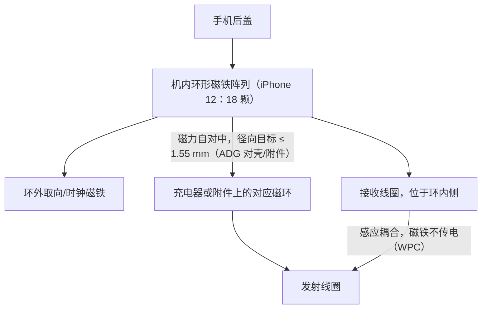

# iPhone MagSafe 环形磁铁阵列：18 颗磁铁把线圈对中并对附件保持

> [!summary] 一句话概述
> iPhone 12 起的 MagSafe 在无线充电线圈周围排布一圈磁铁（iFixit 与 WPC 都写到 iPhone 12 上是 18 颗），用磁极布置把充电器或附件的发射线圈拉到接收线圈的中心，并提供保持力；充电仍然靠线圈之间的感应耦合，磁铁本身不传输电能。它和笔记本 MagSafe 1-2 的「磁吸插头 + 弹簧顶针」不是同一条结构路径。

## 配图

![[附件/iphone12-magsafe-array-close.jpg]]
*图源：[iFixit，iPhone 12 and 12 Pro Teardown，步骤 16](https://www.ifixit.com/Teardown/iPhone+12+and+12+Pro+Teardown/137669)；掀起无线充电线圈后，可以看到线圈下方的圆形阵列。iFixit 写道：线圈本身并不新鲜，但那 18 颗磁铁是新的。*

![[附件/iphone12-magsafe-xray.jpg]]
*图源：同上拆解步骤 10，X 光由 Creative Electron 拍摄；iPhone 12（左，铝边框）与 12 Pro（右，不锈钢边框，在 X 光里更不透明）。线圈外一圈深色环是 MagSafe 磁铁阵列，环下方还能看到单独的取向/时钟磁铁。*

![[附件/iphone12-magsafe-polarity.jpg]]
*图源：iFixit 同一篇步骤 16 所链的极性示意图（https://d3nevzfk7ii3be.cloudfront.net/igi/gZCD5IGDKL4eXp4L.full）。图中把环形阵列画成内外两圈分段磁极，并在环外单独标出一块带 N/S 的取向磁铁。iFixit 正文的判断是：这种极性「似乎能扩大有效放置范围，同时仍然强制正确对中，以保证充电效率」。*

![[附件/adg-magsafe-ring-polarity.png]]
*图源：[Apple Accessory Design Guidelines for Apple Devices](https://developer.apple.com/accessories/Accessory-Design-Guidelines.pdf) 第 267 页 Figure 41-3、41-4（© 2026 Apple Inc.，页脚日期 2026-10-30）。这是给壳和附件用的官方磁环与取向磁铁截面：环形磁铁有内外极和中间的非磁化区，取向磁铁另有自己的极性布置。同页写出壳在已装到手机上时，垂直拔脱 MagSafe 附件的标称目标力为 1000–1300 gf。这些尺寸约束的是兼容附件/外壳，不要直接当成 iPhone 内部那 18 颗磁铁的零件图。*

> 图片版权归原作者所有，仅作个人学习收藏；出处见文末「来源与核实记录」。

## 结构原理

> 本节所有数字只写来源里给出的；来源没有就写「来源未给出」。iFixit / WPC 描述的是 iPhone 12 机内阵列；ADG 第 41 章约束的是 MagSafe 外壳磁铁阵列和附件磁铁阵列。两组几何同属「环形磁铁对中」这一原理，参数必须分别标注来源，不能合成一张「手机内部尺寸表」。

### 堆叠方案

方向：**从手机背面外表面向机内，再对照充电器/附件一侧**（以 iFixit 对 iPhone 12 / 12 Pro 的拆解为主）

| 层级 | 零件 | 材料 | 厚度/尺寸 | 固定方式 | 依据 |
| --- | --- | --- | --- | --- | --- |
| L1（最外，手机背面） | 后盖 / 外壳 | iPhone 12 为铝边框，12 Pro 为不锈钢边框（iFixit 用 X 光密度差说明） | 来源未给出后盖厚度 | 整机结构的一部分 | iFixit 步骤 10 |
| L2 | 环形磁铁阵列 | iFixit / WPC 未给牌号。ADG 对外壳阵列写 N45SH 钕铁硼、8–16 µm 环氧涂层（或类似） | 手机内部单颗尺寸来源未给出。ADG 把外壳/附件阵列的几何画在 Figure 41-2～41-4，本文不转抄未在正文出现的图面毫米数 | 位于线圈周围、与线圈同轴；ADG 要求阵列磁铁处于同一平面 | iFixit 步骤 16；WPC；ADG 41.1 / 41.2 |
| L3 | 取向（时钟）磁铁 | 来源未单独给牌号 | ADG Figure 41-2、41-4 给出外壳用取向磁铁的位置与极性图 | 位于磁环外侧（X 光与极性图都画在环的下方） | iFixit 极性图；ADG 41.1.2.2、Figure 41-4 |
| L4 | 无线充电线圈 | 铜绕组（拆解照片可见） | 来源未给出匝数与线径 | 盖在阵列内侧，对中后与充电器发射线圈耦合 | iFixit 步骤 16、20（充电器侧同样有线圈） |
| L5（充电器/附件侧） | 对应的磁环（可选加取向磁铁）与发射线圈 | ADG 对附件磁铁写 N48H 钕铁硼、7–13 µm NiCuNi（或类似）镀层；直流屏蔽为低碳钢 1010 / DT4 或类似 | 附件脱出力见参数表；磁环几何见 ADG 41.2 | 磁铁在同一平面；应在 1.55 mm 径向范围内自对中到设备磁环 | iFixit 步骤 18：充电器外围有一圈对应磁铁；ADG 41.2 |

剖面示意：

和本批其他方案的分工：

- 本案例：环形永磁阵列给**两个线圈**对中，并给附件提供保持力。
- [[MagSafe 1-2 笔记本磁吸充电头：磁力保持触点对中，拉力过大时整头脱落]]：磁铁把**带弹簧顶针的插头**吸到平面触点上，可整头脱落，不是线圈对中。
- 本批 Apple Watch 充电盘：iFixit 明确写它「只用中心一颗磁铁」，几何不是这圈环形阵列。

### 零件清单

| 零件 | 数量 | 功能 | 材料 | 依据 |
| --- | --- | --- | --- | --- |
| 机内环形阵列磁铁 | iPhone 12：18 颗（iFixit、WPC） | 与充电器/附件磁环互吸，引导并保持线圈对中 | 机内牌号来源未给出 | iFixit 步骤 16；WPC「Looking inside the iPhone 12… 18 magnets」 |
| 取向/时钟磁铁 | ADG：外壳与附件阵列都可以带一颗；iFixit 极性图在环外画出一块 | 约束相对转角，而不只是径向对中 | 来源未单独给牌号 | ADG 41.2：An Orientation Magnet may be included；iFixit 极性图 |
| 接收线圈 | 1 | 感应接收电能 | 铜 | iFixit |
| 充电器磁环 + 发射线圈 | 磁环一圈（iFixit 未数充电器上的块数）+ 线圈 | 与手机磁环对应，并对中发射线圈 | 附件磁铁牌号见 ADG N48H | iFixit 步骤 18；ADG 41.2 |
| 直流屏蔽（附件要求） | ADG 对附件磁阵给出 | 约束直流磁场 | 低碳钢 1010、DT4 或类似，Bsat 至少 2.0 T，5–10 µm 镀镍或类似 | ADG 41.2.2.7 |

Qi2 并不改写「磁铁传电」。WPC 写：Qi2 的 Magnetic Power Profile 把磁环的尺寸、布置、方向和保持力写成开放规范，认证还要测拉力和剪切力；磁铁仍然只负责把两只线圈对上。

### 装配顺序

> 手机内部装配顺序来源未给出逐步工艺。下面 1–4 步按 iFixit 拆解顺序反推；5–6 步是附件侧的对位，来自 ADG 与 WPC。

1. 在后盖内侧、以无线充电线圈中心为基准，布置环形磁铁阵列（iPhone 12 为 18 颗），并使各磁铁处于同一工作平面。
2. 按设计放好环外的取向磁铁（若该机或该附件需要约束转角）。
3. 把接收线圈装在磁环内侧，引出到无线充电相关电路（iFixit 在主板侧识别到 STMicroelectronics STWPA1-3033ABM 等无线充芯片，芯片只说明系统里有无线充管理，不是磁铁零件）。
4. 装后盖，完成整机封闭。
5. 充电器或附件按 ADG 做对应磁环（标准环或加长环），需要时加取向磁铁和直流屏蔽。
6. 使用时把附件靠近后盖：环形磁铁互吸并自对中，线圈进入有效耦合区后开始感应充电。WPC 的说法是「磁铁对齐，线圈充电」。

### 受力与运动分析

- **受力路径**：用户把充电器或附件靠近后盖，环形磁铁之间的吸力把它拉向对中位置，并提供垂直于背面的保持力。ADG 用垂直拔脱力来验收：外壳已装到设备上时，拔脱 Apple MagSafe Charger 一类附件的标称目标是 1000–1300 gf；附件直接装到设备上时，拔脱力应在 650–1510 gf。WPC 还提到认证会测拉力与剪切力，但该文未给出具体牛顿数。充电的交变磁场走线圈，不走这些永磁铁（WPC）。
- **运动关系**：结合过程中附件可在平面内被磁力推到中心；ADG 对外壳和附件都要求磁环把附件自对中到 1.55 mm 径向范围以内。取向磁铁用于限制相对转角。一旦吸合，正常使用中没有持续相对滑动。
- **失效风险**：偏心会降低耦合、增加发热（WPC 用「偏 1 厘米充电变慢、余能变热」说明未对中的代价，这是该文对无线充共性问题的说明，不是 iPhone 12 的实测值）。ADG 要求外壳阵列不得干扰感应充电，表面磁场不超过 0.215 T，并有对低矫顽力磁卡的验证。WPC 提醒不要把银行卡、门禁、护照夹在手机和磁吸充电器之间；过厚或金属壳会加大线圈气隙或削弱磁保持。来源未给出这 18 颗磁铁的单颗失磁力或疲劳寿命。

## 设计要点与参数

| 要点 | 内容 | 依据 |
| --- | --- | --- |
| 机内磁铁数量 | iPhone 12：18 颗，围绕无线充电线圈 | iFixit 步骤 16；WPC 对 iPhone 12 的同一表述 |
| 充电器侧 | 外围有对应的一圈磁铁；Apple Watch 充电盘则是中心单颗磁铁，不要混用 | iFixit 步骤 18 |
| 极性作用 | 扩大有效放置范围，同时强制对中以保证充电效率 | iFixit 步骤 16 |
| 充电功率（该拆解机型） | MagSafe 15 W 无线充电 | iFixit 步骤 1 规格表 |
| 磁铁是否传电 | 否。磁铁只负责把接收线圈对准发射线圈 | WPC |
| Qi2 | Magnetic Power Profile 规定磁环尺寸、布置、方向和保持力，并把这种环形对中写成开放规范 | WPC |
| 自对中（壳/附件） | 径向最大 1.55 mm | ADG 41.1.2.2、41.2.2 |
| 外壳厚度（壳） | 均匀厚度不大于 2.1 mm，Apple 建议 2.0 mm | ADG 41.1 |
| 外壳磁铁材料 | N45SH 钕铁硼，8–16 µm 环氧涂层或类似非金属涂层 | ADG 41.1.2.1 |
| 外壳磁铁磁性能 | Br 13.2–13.6 kGs；Hcb 12.75 kOe；Hcj 20.50 kOe；BHmax 43–46 MGOe | ADG Table 41-1 |
| 外壳表面磁场 | 内外表面均不得超过 0.215 T | ADG 41.1.2.1 |
| 壳上拔脱附件的力 | 壳已装到设备上时，垂直拔脱 MagSafe 附件的标称目标 1000–1300 gf | ADG 41.1.2.3 |
| 附件磁铁材料 | N48H 钕铁硼，7–13 µm NiCuNi 或类似镀层 | ADG 41.2 |
| 附件磁铁磁性能 | Br 13.7–14.1 kGs；Hcb 13.25 kOe；Hcj 17 kOe | ADG Table 41-2 |
| 附件直接装到设备上的拔脱力 | 最小 650 gf，最大 1510 gf | ADG Table 41-3 |
| 附件直流屏蔽 | 低碳钢 1010、DT4 或类似，ASTM A848；Bsat 至少 2.0 T；5–10 µm 镀镍或类似 | ADG 41.2.2.7 |
| 机内单颗磁铁尺寸、牌号、吸力 | 来源未给出 | iFixit 与 WPC 只给出 18 颗和极性作用，未列单颗参数 |

已打开来源没有把这圈阵列称作 Halbach 阵列，本文也不使用该名称。

## 优缺点

**优点**
- 把「对中」从用户的目视摆放，改成磁环自动完成，线圈耦合更稳定（WPC 对磁吸无线充的核心论点）。
- 同一套环形阵列既给充电器对中，也给壳、卡包、支架一类附件提供保持力。
- 极性分段加上取向磁铁，可以在允许一定靠近误差的同时，把最终位置锁到线圈中心，必要时还锁转角。
- Qi2 把这套磁环写成公开规范，不同品牌的认证设备可以互吸、互对中（WPC）。

**缺点 / 代价**
- 后盖内侧要让出一圈磁铁和取向磁铁的空间，并处理与无线充、NFC、磁卡的干扰（ADG 有专门的干扰与磁卡验证）。
- 保持力仍然只是磁力，没有机械锁死；ADG 把拔脱力限制在指定窗口，过强会伤及取下，过弱则附件不稳。
- 厚壳、金属壳会加大线圈气隙或削弱吸力，从而牺牲充电速度（WPC）。
- 机内 18 颗磁铁的牌号与单颗尺寸没有出现在已打开的拆解或联盟科普里，做「同等阵列」时不能用 ADG 的壳/附件表替代机内零件。

## 可借鉴点

- **对中用磁环，传能用线圈**：两者同轴、功能分开。不要让永磁铁去「兼当」变压器。
- **用分段极性和一颗取向磁铁同时解决「吸得上」和「转到对的角度」**。只要径向对中、不需要方向时，可以不加取向磁铁（ADG 把取向磁铁写成可选）。
- **把保持力写成可测窗口，而不是「尽量吸得紧」**：壳 1000–1300 gf、附件 650–1510 gf 是两套验收，不能混用。
- **对外发布几何时，壳阵列和附件阵列要分表**：材料牌号（N45SH 与 N48H）、镀层、力值都不相同。
- 若产品形态是「可脱落的电源插头」而不是「两个线圈对中」，应去看笔记本 MagSafe 1-2，而不是套这圈环形阵列。

## 与库中相似案例对比

| 对比项 | 本案例（iPhone MagSafe 环形阵列） | [[MagSafe 1-2 笔记本磁吸充电头：磁力保持触点对中，拉力过大时整头脱落]] | 本批 Apple Watch 磁吸充电盘 | [[Pogo Pin 弹簧顶针：针头、弹簧与针管的工作行程和弹力]] |
| --- | --- | --- | --- | --- |
| 磁力的角色 | 把两个无线充线圈对中，并保持附件 | 把带触针的插头吸到插座端面，拉力大时整头脱落 | 中心单颗磁铁给充电盘与表背对位 | 不负责对中 |
| 导电/传能 | 感应耦合；磁铁不传电 | 五枚弹簧顶针顶到平面触点 | 感应耦合 | 顶针本身导电 |
| 几何 | 线圈周围的环形阵列（iPhone 12 为 18 颗）+ 可选取向磁铁 | 扁平插头对插座 | 盘中心单颗磁铁，不是圆环 | 单针轴向 |
| 何时用这篇 | 要做无线充或附件的环形磁吸对中 | 要做可脱落的磁吸电源触点头 | 表类圆形充电盘、中心磁铁对位 | 只设计顶针元件时 |

## 相关案例

- [[MagSafe 1-2 笔记本磁吸充电头：磁力保持触点对中，拉力过大时整头脱落]]
- [[Pogo Pin 弹簧顶针：针头、弹簧与针管的工作行程和弹力]]
- [[橱柜磁吸门吸：只有磁力保持、没有机械锁死（对照 FIDLOCK）]]
- 分类索引：[[02-连接与紧固 索引]]

## 来源与核实记录

- 主来源：[iFixit, iPhone 12 and 12 Pro Teardown](https://www.ifixit.com/Teardown/iPhone+12+and+12+Pro+Teardown/137669)（指南 137669，作者 Taylor Dixon。已通过官方 API 打开全文步骤。步骤 1 的 15 W MagSafe、步骤 10 的 X 光磁环、步骤 16 的 18 颗磁铁与极性说明、步骤 18 充电器对应磁环以及与 Apple Watch 中心单磁铁的对照，均来自这篇拆解。配图按指南中的 image guid 下载。）
- 补充来源 1：[Accessory Design Guidelines for Apple Devices](https://developer.apple.com/accessories/Accessory-Design-Guidelines.pdf)（Apple Inc.，已打开的文本页脚为 2026-10-30。第 41 章 MagSafe Attach：外壳/附件磁铁阵列的材料与磁性能表、1.55 mm 自对中、2.1 mm 壳厚、1000–1300 gf 与 650–1510 gf 拔脱力、取向磁铁可选、直流屏蔽。与 iFixit 分属苹果与独立拆解机构。苹果专利与本指南不另计机构。）
- 补充来源 2：[Wireless Power Consortium, How Magnetic Phone Chargers Work: The Snap, the Magnets, the Alignment](https://www.wirelesspowerconsortium.com/blog-pages/how-do-magnetic-chargers-work/)（无线充电联盟。磁铁只负责对中、不传电；iPhone 12 机内 18 颗磁铁以极性导向中心；Qi2 Magnetic Power Profile 规定磁环尺寸、布置、方向和保持力。独立第三机构。）
- 核实：2026-11-27 打开上述页面/PDF 并下载配图。未把 ADG 壳/附件尺寸表写成 iPhone 内部 18 颗磁铁的实测尺寸。未把笔记本 MagSafe 触点头或「又一个 MagSafe 壳」写成另一篇。
