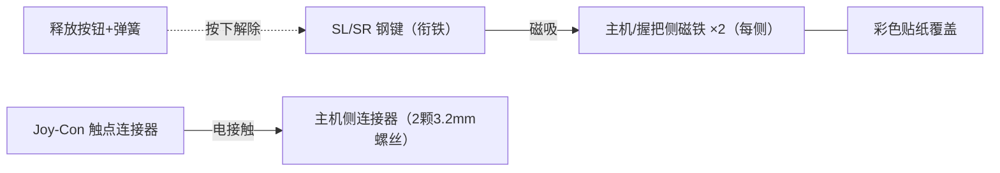

# 任天堂 Switch 2 Joy-Con 2 磁吸连接

> [!summary] 一句话概述
> Switch 2 把一代 Joy-Con 的金属滑轨+弹簧锁扣换成「主机侧藏磁铁 + 手柄侧钢制 SL/SR 键当衔铁」的磁吸连接，握把用的是和主机完全相同的磁铁；中间的触点连接器做成可单独更换的模块——代价是磁场让任天堂放弃了霍尔摇杆。

> [!note] 与已收录案例的区别
> [[任天堂 Switch Joy-Con 滑轨连接]] 是机械滑轨 + 弹簧卡扣锁止；本篇是磁吸吸合 + 按钮释放，连接件「功能复用」（SL/SR 按键兼作磁吸衔铁），属于不同的连接思路，二者正好形成同一产品线两代方案对照。

## 配图

![[附件/switch2-joycon2-grip-magnet-core.jpg]]
*图源：iFixit 社区拆解 Nintendo Switch 2 Joy-Con 2 Grip Teardown（Logan Readinger）Step 8；拆掉全部螺丝后两侧握把从中间的磁吸部分上取下*

![[附件/switch2-joycon2-grip-cover-tabs.jpg]]
*图源：同上 Step 5；下盖内侧，5 个卡舌靠摩擦扣住上盖*

> 图片版权归原作者所有，仅作个人学习收藏；出处见文末「来源与核实记录」。

## 结构原理

> 本节数字只写来源里给出的；来源没有就写「来源未给出」。

### 堆叠方案

方向：**从 Joy-Con 侧到主机/握把侧**（连接界面横截）

| 层级 | 零件 | 材料 | 厚度/尺寸 | 固定方式 | 依据 |
| --- | --- | --- | --- | --- | --- |
| L1 | Joy-Con 2 的 SL / SR 键（兼作衔铁） | 钢 | 来源未给出 | 装在 Joy-Con 侧边排线上方 | iFixit 设备页；TronicsFix 视频约 3:45 |
| L2 | Joy-Con 2 中间触点连接器（rail 模块） | 来源未给出 | 来源未给出 | 螺丝固定，模块化可拆 | TronicsFix 视频约 3:30 |
| L3 | 释放按钮 + 弹簧 | 来源未给出 | 来源未给出 | 装在 Joy-Con 侧边 | TronicsFix 视频约 3:20 |
| L4 | 主机/握把侧彩色贴纸（盖住磁铁） | 贴纸 | 来源未给出 | 背胶；主机侧需加热揭下才能拆后盖螺丝 | iFixit 设备页；更换指南 194221 Step 4–9 |
| L5 | 磁铁（每侧 2 块） | 磁铁 | 来源未给出 | 藏在贴纸下 | iFixit 设备页 |
| L6 | 主机侧 Joy-Con 2 连接器 | 来源未给出 | 来源未给出 | 2 颗 3.2 mm 黑色螺丝 + ZIF 排线 | 更换指南 194221 Step 35–40 |

剖面示意：

### 零件清单

| 零件 | 数量 | 功能 | 材料 | 依据 |
| --- | --- | --- | --- | --- |
| 磁铁 | 每侧 2 块（握把与主机相同） | 吸住 Joy-Con | 来源未给出 | iFixit 设备页 |
| SL / SR 键 | 每只 Joy-Con 2 个 | 按键 + 磁吸衔铁 | 钢 | iFixit 设备页；TronicsFix 视频 |
| 触点连接器模块 | 每只 1 | 电连接 | 来源未给出 | TronicsFix 视频 |
| 释放按钮（带弹簧） | 每只 1 | 解除吸合 | 来源未给出 | TronicsFix 视频 |
| 握把：橡胶脚垫 | 4 | 遮盖螺丝 | 橡胶 | 握把拆解 Step 1 |
| 握把：00 号十字螺丝 | 4 + 4 + 2（共 3 种规格） | 固定外壳与磁吸中段 | 来源未给出 | 握把拆解 Step 3、6、7 |
| 握把：下盖卡舌 | 5 | 下盖与上盖摩擦扣合 | 塑料 | 握把拆解 Step 5 |

### 装配顺序

握把（按拆解顺序反推）：
1. 两侧握把壳体对准中间的磁吸部分，装 2 颗螺丝（第 3 种规格）
2. 装中间 4 颗螺丝
3. 下盖 5 个卡舌扣入上盖
4. 脚垫下 4 颗螺丝
5. 压入 4 个脚垫：带缺口一侧对准孔的缺口；上面 2 个孔朝向握把中心，下面 2 个孔朝上方中心 45°

### 受力与运动分析

- **受力路径**：Joy-Con 与主机的保持力来自磁铁对钢制 SL/SR 键的吸力（来源未给吸力数值）；电连接由中间触点连接器完成。
- **运动关系**：插上为磁吸自对位；取下时按释放按钮解除（TronicsFix 视频描述释放按钮有弹簧，并会推出一根销）。
- **失效风险**：
  - 磁场干扰：iFixit 指出任天堂在 4 月确认摇杆不用霍尔传感器，原因合理——新的磁吸连接会干扰传感器里的磁铁（iFixit 建议可选对磁干扰不敏感的 TMR）。
  - 释放按钮：TronicsFix 认为按钮位置与一代相同、缺少加强，用户用力过猛可能把按钮压断（作者观点）。

## 设计要点与参数

| 要点 | 内容 | 依据 |
| --- | --- | --- |
| 衔铁复用 | SL/SR 键用钢制，同时当按键和磁吸衔铁 | iFixit 设备页 |
| 磁铁一致性 | 握把与主机用完全相同的磁铁，每侧 2 块，彩色贴纸盖住 | iFixit 设备页 |
| 连接器模块化 | Joy-Con 侧触点连接器可单独拆换；主机侧连接器 2 颗 3.2 mm 螺丝 | TronicsFix；指南 194221 |
| 磁敏感器件回避 | 摇杆未用霍尔传感器 | iFixit 新闻 |
| 握把脚垫 | 仅摩擦固定、无胶，带缺口防错方向 | 握把拆解 Step 1–2 |
| 磁铁规格/吸力/释放力 | 来源未给出 | — |

## 优缺点

**优点**
- 去掉滑轨与锁扣弹片，插拔动作更简单，靠磁力自对位（推断）
- SL/SR 键兼作衔铁，少一个零件
- 连接器模块可单独维修

**缺点 / 代价**
- 磁场限制了周边器件选型（摇杆不用霍尔）
- 主机侧磁铁和螺丝被背胶贴纸覆盖，维修需加热揭贴纸、易损坏贴纸

## 可借鉴点

- 做磁吸配件时，让已有的钢件（按键、支架）兼作衔铁，而不是另加铁片
- 磁吸连接需要提前排查附近的霍尔传感器、磁力计等磁敏感器件
- 机械定位/电连接用独立可换模块，磁铁只负责保持力
- 配件与主机使用同一规格磁铁，保证吸附手感一致

## 相关案例

- [[任天堂 Switch Joy-Con 滑轨连接]]
- [[Framework 笔记本模块化扩展卡与磁吸边框]]
- 分类索引：[[02-连接与紧固 索引]]

## 来源与核实记录

- 主来源：[Nintendo Switch 2 Joy-Con 2 Grip（iFixit 设备页）](https://www.ifixit.com/Device/Nintendo_Switch_2_Joy-Con_2_Grip)
- 补充来源：[Nintendo Switch 2 Joy-Con 2 Grip Teardown](https://www.ifixit.com/Teardown/Nintendo+Switch+2+Joy-Con+2+Grip+Teardown/213340)（iFixit 社区拆解，Logan Readinger，发布于 2026-04-07）；[Switch 2 Teardown: Still Glued, Still Soldered, Still Drifting](https://www.ifixit.com/News/110926/switch-2-teardown)（iFixit，2025-06-06，Elizabeth Chamberlain）；[Switch 2 Right Joy-Con 2 Connector Replacement](https://www.ifixit.com/Guide/Nintendo+Switch+2+Right+Joy-Con+2+Connector+Replacement/194221)（iFixit，Nick Schultz）；[Nintendo Switch 2 Joy-Con Teardown - Full Disassembly](https://www.youtube.com/watch?v=2t61wgZ6GtM)（YouTube，TronicsFix）
- 核实：2026-11-13 读取 iFixit 设备页、握把拆解 8 步与连接器更换指南原文；读取 TronicsFix 视频英文字幕中关于磁铁、释放按钮、连接器模块的段落；核对 iFixit 新闻中霍尔传感器的说法。
