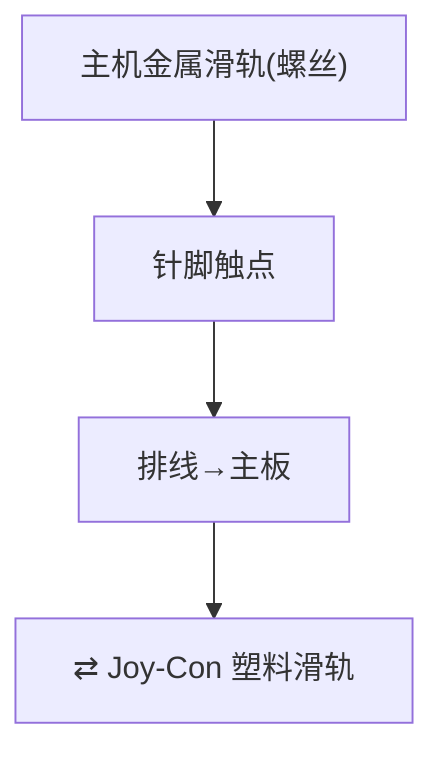

# 任天堂 Switch Joy-Con 滑轨连接

> [!summary] 一句话概述
> Switch 主机两侧各一根金属滑轨（Phillips 螺丝固定）带针脚触点，手柄侧是塑料滑轨——「硬金属 + 软塑料」让磨损和失效优先发生在更便宜、可单独更换的手柄上。

## 配图

![[附件/switch-joycon-rail.jpg]]
*iFixit：从主机上拆下的 Joy-Con 滑轨*

> 图片版权归原作者所有，仅作个人学习收藏；出处见文末「来源与核实记录」。

## 结构原理

> 本节数字只写来源里给出的；来源没有就写「来源未给出」。

### 堆叠方案

方向：**从主机侧边向内**

| 层级 | 零件 | 材料 | 厚度/尺寸 | 固定方式 | 依据 |
| --- | --- | --- | --- | --- | --- |
| L1 | Joy-Con 滑轨（主机侧） | 金属 | 来源未给出 | Phillips 螺丝固定在机身两端 | Step 13、18 |
| L2 | 针脚触点 | — | 来源未给出 | 集成在滑轨上 | Step 13 |
| L3 | 排线 | — | 来源未给出 | 把充电与按键信号传到主板 | Step 13 |
| 对接件 | Joy-Con 侧滑轨 | 塑料 | 来源未给出 | 手柄外壳的一部分 | Step 18 |

剖面示意：

### 零件清单

| 零件 | 数量 | 功能 | 材料 | 依据 |
| --- | --- | --- | --- | --- |
| 主机侧滑轨 | 2 | 导向、承载并带触点 | 金属 | Step 13、18 |
| 手柄侧滑轨 | 每个手柄 1 | 与主机滑轨配合 | 塑料 | Step 18 |
| 排线 | 每侧 1 | 传信号与充电 | — | Step 13 |

### 装配顺序

1. 滑轨用 Phillips 螺丝固定到主机两端
2. 接排线到主板
3. 使用时手柄沿滑轨推入，触点接通

> 主机侧来自拆解；手柄锁扣细节（弹片/按钮）来源未给出。

### 受力与运动分析

- **受力路径**：手柄重量与插拔力由滑轨导向承担；推断：塑料侧更软，磨损集中在手柄侧。
- **运动关系**：手柄沿滑轨直线滑动插拔。
- **失效风险**：发布初期有 Joy-Con 滑轨锁扣耐久问题的传闻；iFixit 认为失效更可能发生在手柄侧，这正是期望的结果（Step 18）。

## 设计要点与参数

| 要点 | 内容 | 依据 |
| --- | --- | --- |
| 滑轨材料 | 主机侧金属 / 手柄侧塑料 | Step 18 |
| 每个手柄电池 | 1.9 Wh | Step 17 |
| 滑轨尺寸/配合间隙 | 来源未给出 | — |

## 优缺点

**优点**
- 导向+电气连接合一
- 把耗损设计在便宜的可换件上

**缺点 / 代价**
- 手柄侧塑料滑轨磨损后连接会松（推断）

## 可借鉴点

- 配对零件选材时，有意让「便宜、易换」的一侧成为磨损件
- 滑轨同时做导向与触点，可减少独立连接器

## 相关案例

- [[Framework 笔记本模块化扩展卡与磁吸边框]]
- [[苹果 AirTag 旋转后盖与内部卡扣]]
- 分类索引：[[02-连接与紧固 索引]]

## 来源与核实记录

- 主来源：[Nintendo Switch Teardown](https://www.ifixit.com/Teardown/Nintendo+Switch+Teardown/78263)（2017-03-04，Evan Noronha / iFixit）
- 补充来源：<https://www.reddit.com/r/Games/comments/5wi0ya/nintendo_switch_joycons_latching_mechanism/>
- 核实：2026-11-13 通过 iFixit API 读取 25 步原文，核对 Step 13、17、18 中滑轨、触点、材料描述。
