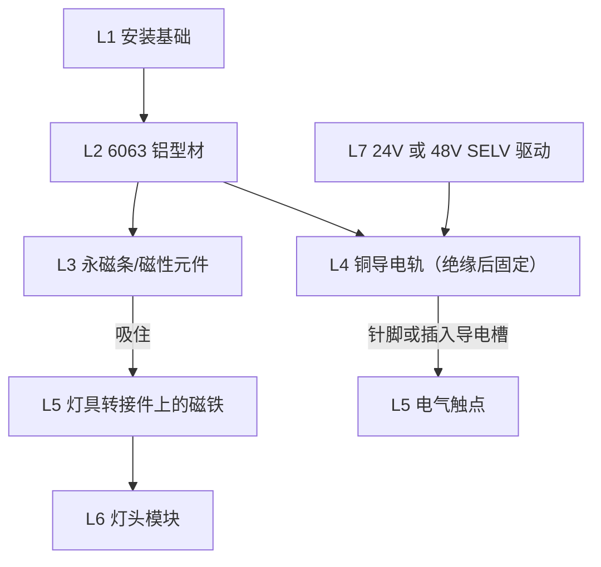

# 低压磁吸轨道灯：导轨内永磁吸附与铜轨针脚取电

> [!summary] 一句话概述
> 低压磁吸轨道灯把照明做成「带电的薄铝轨 + 可滑移灯具」：6063 铝型材里同时装永磁条和两条铜导电轨，灯具转接件上的磁铁把灯吸在轨道上，两个针脚再碰到铜轨取电。轨道运行在 24 V 或 48 V 直流 SELV 下，灯可以带电滑移或取下，不必像市电轨道那样先断电再卡扣安装。它不是快拆板，也不是吸在铁板上的便携工矿灯。

## 配图

![[附件/lightseek-magnetic-track-hero.jpg]]
*图源：[LightSeek，《什么是磁吸轨道照明？组成、24V 与 48V 及如何选择》](https://light-seek.com/zh/news/what-is-magnetic-track-lighting-guide.htm) 页面主图；右侧为灯具被单手吸到黑色轨道上，左侧给出多种型材截面及「磁铁 / 锁定 / 四线」示意。指南正文把系统拆成轨道、驱动、磁吸灯具、连接件四层*

![[附件/cn214840316-fig1.png]]
*图源：[CN214840316U《一种磁吸导电轨道及照明设备》](https://patents.google.com/patent/CN214840316U/zh) 授权公告首页附图；专利权人欧普照明，授权公告日 2021-11-23。横截面可见：安装壁下垂的两道导轨壁，壁外侧为导电槽（耦接元件/导电部），两壁之间的底部插槽固定磁性元件，灯侧磁铁可与之直接接触*

![[附件/cn214840316-fig3.png]]
*图源：同上专利说明书附图页（本轮从专利 PDF 抽出的图页）；用于对照权利要求中的「导电槽在导轨壁外侧、磁性元件在两壁之间底部」这一几何，避免和「磁铁、铜轨都横排在顶面」的旧式顶部取电结构混在一起*

> 图片版权归原作者所有，仅作个人学习收藏；出处见文末「来源与核实记录」。

## 结构原理

> 本节所有数字只写来源里给出的；来源没有就写「来源未给出」。

### 堆叠方案

方向：**从天花/安装面向下，看轨道横截面，再到灯具转接件（按 LightSeek 的系统分层；欧普专利给出一种具体侧向取电截面）**

| 层级 | 零件 | 材料 | 厚度/尺寸 | 固定方式 | 依据 |
| --- | --- | --- | --- | --- | --- |
| L1（安装面） | 天花、墙或家具安装基础 | 应用自定 | 来源未给出 | 轨道型材安装到基础上 | LightSeek；CN214840316U 写「组装于安装基础」 |
| L2 | 挤压铝轨道型材 | 6063 铝（LightSeek） | 指南写型材宽度是设计区分点：24 V 系统可做到 5 mm（其 NANO 5 系列），48 V 轨道通常 15–25 mm；常见长度 0.5–3 m | 机械安装；L / T / 十字连接件拼接 | LightSeek |
| L3 | 永磁条 / 磁性元件 | 永磁（LightSeek 称「永磁条」；专利称「磁性元件」，牌号未给出） | 专利：设于两道导轨壁之间的插槽，并封闭容置空间底部 | 卡入或固定在型材槽内 | LightSeek；CN214840316U 权利要求 1 |
| L4 | 两条导电轨及绝缘/耦接元件 | 铜导电轨（LightSeek）；专利为导轨壁外侧导电槽内的耦接元件，含暴露的导电部 | 来源未给出铜排截面 | 与型材绝缘后固定 | LightSeek；专利权利要求 2 |
| L5 | 灯具磁吸转接件 | 来源未给出牌号 | 指南：两个针脚触点对铜轨；磁铁承担机械固定。专利：灯体插接在导电槽内取电，灯内磁铁模块与轨道底部磁性元件直接接触 | 磁力吸附，可沿轨滑动 | LightSeek；专利摘要 |
| L6 | 灯头（射灯、线性模块等） | 来源未给出 | 指南举例射灯 7–30 W、线性模块 10–40 W/m | 与转接件同属可替换模块 | LightSeek |
| L7（远程） | 驱动：市电交流转为 24 V 或 48 V 直流 | 来源未给出 | 指南：24 V 每路约 80–100 W，48 V 每路约 150–300 W，并建议预留 ≥20% 余量 | 为整段轨道供电 | LightSeek |

剖面示意（功能分层，不是某一品牌的唯一截面）：

欧普专利针对的问题是：旧式低压轨把导电片和磁吸部件都横排在顶部，灯具与轨道面面贴合、顶部取电；新结构改成「磁在槽底直接接触、电在两侧导轨壁外侧」，安装时把灯体插进导电槽，并便于目视检查导电部。

### 零件清单

| 零件 | 数量 | 功能 | 材料 | 依据 |
| --- | --- | --- | --- | --- |
| 轨道型材 | 按线路长度 | 机械承载、容纳磁条和铜轨 | 6063 铝 | LightSeek |
| 永磁条或磁性元件 | 沿轨布置 | 把灯具吸住并可沿轨滑移定位 | 永磁，牌号来源未给出 | LightSeek；CN214840316U |
| 铜导电轨 + 绝缘/耦接元件 | 通常两极；指南亦提到四线系统出现在产品图示中，具体芯数以系列为准 | 供电 | 铜；绝缘件材料来源未给出 | LightSeek；专利 |
| 灯具转接件（磁铁 + 触点） | 每只灯 1 | 机械吸附与电气对接 | 来源未给出 | LightSeek：磁铁机械固定，针脚电气连接 |
| 驱动电源 | 每路至少 1 | 把市电变成 SELV 直流，并决定调光协议 | 来源未给出 | LightSeek |
| 连接件与端盖 | 按拼接需要 | 机械与电气连续性；指南提醒劣质连接件会导致闪烁、打火痕迹 | 来源未给出 | LightSeek |

### 装配顺序

1. 按电压（24 V 或 48 V）和调光协议选定整套系统：轨道、驱动、灯具必须同一系列，指南明确转接件几何、极性与触点间距并不跨品牌通用。
2. 由合格电工完成市电到驱动的接线；SELV 轨道本身按指南可明装于家具或石膏板，但交流侧仍须按规范施工。
3. 安装并拼接铝轨，装好连接件与端盖。
4. 把灯具转接件吸到轨道上，使触点与铜轨接触；可沿轨滑动定位。指南写在 SELV 下多数模块可带电重新定位，灯具取下再吸回即亮。
5. 核算总瓦数不超过驱动额定，并留 ≥20% 余量；注意单端供电长度限制。

> LightSeek 没有给出某一条产线的工厂装配工步。欧普专利描述的是轨道截面几何，不是施工手册。

### 受力与运动分析

- **受力路径**：灯具重力由转接件上的磁铁传到轨道里的永磁条/磁性元件，再由铝型材传到安装基础。电气路径与机械路径分开：针脚或插入式导电部只负责接触取电，不承担主吊挂（LightSeek；欧普专利强调磁铁与磁性元件直接接触以提升吸附力）。指南在常见误解里还提到「灯具还会针脚卡扣锁定」，即有的系统在磁吸之外还有触点侧的机械卡配；这是 LightSeek 的产品经验表述，不同品牌几何并不统一。
- **运动关系**：灯具沿轨道长度方向可滑移，并可按产品设计旋转或更换光学。整条轨道在 SELV 下保持带电，滑动时触点在铜轨上刮擦取电。
- **失效风险**：混用不同品牌转接件可能导致接触不良或短路（指南）。电压降随长度和电流增加，超长线路会出现远端变暗，需中段供电或分段（指南给出典型单端限值：24 V 约 10–15 m，48 V 约 20–30 m，取决于导体截面与负载）。廉价系统出问题的常常是针脚和连接件而不是磁铁（指南）。驱动闷在封闭天花里会过热（指南）。磁性元件与灯侧磁铁之间若隔了过厚的结构件，吸附力会下降——这也是欧普专利把磁性元件放到槽底、让其直接接触的原因。

## 设计要点与参数

| 要点 | 内容 | 依据 |
| --- | --- | --- |
| 电气安全等级 | 标称 24 V / 48 V 直流，按指南引用的 EN 60598 属 SELV，可安全触摸；市电侧仍须由电工安装 | LightSeek（并引用 EN 60598-1 等，本篇不把未打开的标准文本写成已核原文） |
| 机械与电气分工 | 磁铁承担机械固定，针脚承担电气连接 | LightSeek |
| 型材 | 6063 铝挤压；24 V 可做到 5 mm 级，48 V 常用 15–25 mm；长度通常 0.5–3 m | LightSeek |
| 功率预算 | 24 V 每路约 80–100 W，48 V 每路约 150–300 W，建议 ≥20% 余量 | LightSeek（文中称为典型工程值） |
| 单端供电长度 | 典型 24 V 约 10–15 m，48 V 约 20–30 m | LightSeek（典型值，取决于截面与负载） |
| 一种侧向取电截面 | 导轨壁外侧开导电槽固定耦接元件；两壁之间底部插槽固定磁性元件；灯体插入导电槽取电，磁铁与磁性元件直接接触 | CN214840316U 摘要与权利要求 1–2 |
| 兼容性 | 转接件几何、极性、触点间距不跨品牌标准化 | LightSeek |
| 磁铁牌号、吸力牛顿数、铜排截面积 | 来源未给出具体牛顿或平方毫米数 | — |

## 优缺点

**优点**
- 机械安装和电气取电做在同一根薄轨里，换灯、挪位不必请电工重走市电轨道卡扣。
- SELV 降低轨道本身的触电风险，型材可以做得很薄。
- 磁路和电路可以在截面上分开布置（欧普专利把磁放到槽底、电放到两侧），便于检查导电部，也缩短磁铁气隙。

**缺点 / 代价**
- 必须整系统采购，灯具不能任意混轨。
- 每路功率和供电长度有上限，大厅要多路、多驱动。
- 触点沿轨滑动，连接件和针脚是长期可靠性的薄弱点。
- 不同系列的截面完全不同，不能把某一专利的槽形当成所有磁吸轨的标准。

## 可借鉴点

- 设计「可滑移取电的吸附件」时，把承力和导电分成两条路径：磁铁对金属条，触点对铜轨。
- 低压直流才能安全地做成薄型、可触摸、可带电插拔的轨道；不要把市电轨道的卡扣思维直接套过来。
- 截面上尽量让磁铁与磁性元件直接相对，少隔一层塑料或空气，吸附力才稳（欧普专利的出发点）。
- 导电部放在可目视位置，便于检查打火和接触不良。
- 在规格书里同时写清电压、协议、单路功率、单端长度和「禁止跨品牌混用」，避免只宣传「磁一吸就亮」。

## 与库中相似案例对比

| 对比项 | 本案例（低压磁吸轨道灯） | [[DIN 导轨卡装模块（IEC 60715 TH35）：卡钩挂住 35 mm 顶帽轨，弹簧卡脚锁紧，拆时拨开卡脚]] | [[橱柜磁吸门吸：只有磁力保持、没有机械锁死（对照 FIDLOCK）]] | [[Pogo Pin 弹簧顶针：针头、弹簧与针管的工作行程和弹力]] |
| --- | --- | --- | --- | --- |
| 轨道做什么 | 既承力又供电，灯可滑移 | 只做 35 mm 机械卡装，模块另行接线 | 无轨道 | 不是轨道，是单个弹性触点 |
| 磁铁 | 主承力（有的系列另有针脚卡配） | 无 | 点状保持门扇 | 若出现在磁吸充电头里只负责对中，本篇不重写顶针内部 |
| 电压 | 24 / 48 V SELV 直流 | 与本篇无关 | 无电 | 触点导电，结构重点在弹力行程 |
| 何时用这篇 | 要做可滑移、可带电插拔的低压供电轨 | 要做电柜模块卡轨 | 只要门的轻保持 | 要设计弹簧顶针本身 |

## 相关案例

- [[DIN 导轨卡装模块（IEC 60715 TH35）：卡钩挂住 35 mm 顶帽轨，弹簧卡脚锁紧，拆时拨开卡脚]]
- [[橱柜磁吸门吸：只有磁力保持、没有机械锁死（对照 FIDLOCK）]]
- [[Pogo Pin 弹簧顶针：针头、弹簧与针管的工作行程和弹力]]
- [[Peak Design SlimLink：方形陶瓷凹槽磁吸预定位与弹簧卡舌硬锁]]
- 分类索引：[[02-连接与紧固 索引]]

## 来源与核实记录

- 主来源：[LightSeek Lighting Engineering Team，《什么是磁吸轨道照明？组成、24V 与 48V 及如何选择》，2026-08-30](https://light-seek.com/zh/news/what-is-magnetic-track-lighting-guide.htm)（2026-11-26 重新打开中文全文。广州 LightSeek。永磁吸附、针脚取电、6063 型材、SELV 24/48 V、功率与长度典型值、不跨品牌混用等均来自该指南。文中线路长度与功率称为典型工程值）
- 交叉来源：[CN214840316U，欧普照明股份有限公司，杨涛、谢建民，一种磁吸导电轨道及照明设备，授权公告日 2021-11-23](https://patents.google.com/patent/CN214840316U/zh)（2026-11-26 重新打开 Google Patents 中文页并核对照附图。独立第二机构。用于说明「底部磁性元件 + 两侧导电槽」这一具体截面，不把专利权利要求写成所有市售轨道的统一尺寸）
- 核实：未把本结构写成快拆板或吸在铁板上的便携灯。US5154509 本轮未重新打开，不引用。LightSeek 引用的 EN/IEC 标准文本本身未作为已下载原文展开，只保留指南里写明的引用关系。
