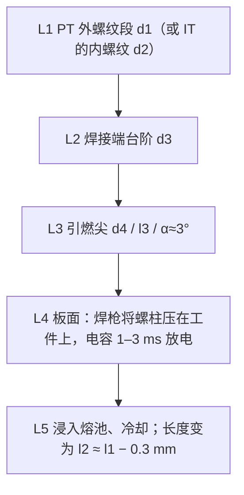

# 储能焊螺柱（GB/T 902.3 PT/IT）：电容放电把焊接端熔到板面

> [!summary] 一句话概述
> 储能（电容放电）焊螺柱把电能预先充进电容，焊接时在约 1–3 ms 内一次放完，将螺柱焊接端的尖端和工件表面熔化，再在压力下浸入熔池。GB/T 902.3—2008 的 PT 型是外螺纹焊柱：焊接端有台阶（d3）和引燃尖（d4、l3、α），焊后长度 l2 ≈ l1 − 0.3 mm；IT 型则是内螺纹焊柱。鸿栢科技的工艺文写明：焊枪把螺柱**紧压在工件表面上**放电，最小板厚约为螺柱直径的 1/10，适合焊直径 3–10 mm 的螺柱；热输入小、背面印痕最小，但不适合热轧厚板。与压铆螺钉对照：压铆要预先冲孔、靠冷流机械互锁；本结构通常在打开来源中**没有要求预先通孔**。

## 配图

![[附件/cd-weld-stud-pt.png]]
*图源：[Mechtool《储能焊用焊接螺柱（GB/T 902.3—2008）》](https://www.mechtool.cn/stdboltsandnuts/stdboltsandnuts_weldstudsforcapacitordischargewelding.html) 页内 PT 型尺寸图（从 mechtool.cn 下载）；左为焊接前：杆部公称直径 d1、长度 l1，焊接端台阶 d3、高度相关尺寸 h/n，引燃尖 d4、l3 和角度 α；右为焊接后，长度变为 l2，端部留下一圈焊后凸台。标准正文写 l2 ≈ l1 − 0.3 mm。*

![[附件/cd-weld-stud-it.png]]
*图源：同上页 IT 型图（mechtool.cn/images/.../stdboltsandnuts_stud9.gif）；IT 型是带内螺纹的焊接螺柱，需同时给出外径 d1 和内螺纹 d2，焊接端同样有台阶和引燃尖。标记示例：d1＝5 mm、内螺纹 M3、l2＝20 mm 的 IT 型写成 焊接螺柱 GB/T 902.3  5×M3×20 IT。*

![[附件/cd-stud-weld-process.jpg]]
*图源：[鸿栢科技《什么是储能式螺柱焊？》](https://www.cmweld.com/autozhuangbei/studweld/20170431.html)（孙辉，2017-04-17）；压力式与提升式对照示意。压力式：螺柱紧压在工件上再放电，焊接时间约 2–3 ms；提升式：放电前先把螺柱提升一段再在弹簧力下冲击浸入熔池，时间约 1 ms，文中称更适合铝钉、减少气孔。*

> 图片版权归原作者所有，仅作个人学习收藏；出处见文末「来源与核实记录」。

## 结构原理

> 本节数字只写来源里给出的；来源没有就写「来源未给出」。标准号以已打开的 Mechtool 页面为准：电容放电焊接螺柱是 **GB/T 902.3—2008**。部分商业站点把“储能焊 PT 型”写成 GB/T 10433，与本页列出的标准分工具不一致（该站把 GB/T 10433—2024 另列为电弧螺柱焊用螺柱），故不以 10433 作为本篇标准依据。

### 堆叠方案

方向：**从螺柱螺纹端到焊接端，再进入板面熔池。以 PT 型为例。**

| 层级 | 零件/区域 | 材料 | 厚度/尺寸 | 固定方式 | 依据 |
| --- | --- | --- | --- | --- | --- |
| L1 | 螺纹段（PT 为外螺纹 d1） | 钢 4.8 / 不锈钢 A2-50 / 有色 CU2；螺纹公差 6g | PT：M3–M8（表 1 列出的规格）；长度 l1 分档，见下表 | 焊后作为连接螺纹 | Mechtool 表 1、表 3 |
| L2 | 焊接端台阶（图中 d3） | 同 L1 | 例如 PT、M3：d3＝4.5±0.2 mm；M4：5.5；M5：6.5；M6：7.5；M8：9 | 焊后形成支承/焊圈的一部分 | Mechtool 图、表 1 |
| L3 | 引燃尖（d4、l3、α） | 同 L1 | PT：d4＝0.6～0.85±0.08 mm（随规格），l3＝0.55 或 0.80±0.05 mm，α＝3°±1°；h＝0.7–1.4 或 0.8–1.4 mm | 放电时首先熔化，引燃电弧/形成熔池 | Mechtool 表 1 |
| L4 | 工件板面（无需在打开来源中预开通孔） | 鸿栢：可焊低碳钢冷轧板、不锈钢、铝、黄铜；不适合热轧钢板 | 最小板厚约等于螺柱直径的 1/10；熔深最浅、背面印痕最小 | 电容在 1–3 ms 内放完，螺柱浸入熔池后冷却 | 鸿栢科技 |
| L5 | 焊后状态 | — | 长度 l2 ≈ l1 − 0.3 mm；端部留下焊后凸台 | 冶金结合，不是冷流互锁 | Mechtool 图注 |

剖面示意：

### 零件清单

| 零件 | 数量 | 功能 | 材料 | 依据 |
| --- | --- | --- | --- | --- |
| PT 型外螺纹焊柱 或 IT 型内螺纹焊柱 | 每焊点 1 | 提供螺纹并焊到板面 | 见表 3 | Mechtool |
| 被焊板件 | 1 | 形成熔池的母材 | 鸿栢列出冷轧低碳钢、不锈钢、铝、黄铜 | 鸿栢 |
| 储能焊机 + 焊枪 | 1 套 | 充电、放电、施压或先提升再冲击 | 鸿栢举例压力式 CD1501/CD2301/CD3101 配 C08 枪，提升式配 CA08 枪（均为该文设备型号，不是标准要求） | 鸿栢 |

### 装配顺序

按鸿栢科技对**压力式**的步骤（提升式在放电前多一步提升）：

1. 焊枪垂直于工件，把螺柱紧压在工件上（来源描述为压在工件表面，未要求预先通孔）。
2. 电容放电，瞬间大电流将螺柱尖端和工件表面熔化，形成熔池。
3. 在焊枪压力下，螺柱垂直向下浸入熔池。
4. 熔池冷却，焊接完成。焊后长度按标准约为 l1 − 0.3 mm。
5. 之后才在螺纹上装配对面的零件。

### 受力与运动分析

- **受力路径**：工作载荷由螺柱通过焊缝传到板。熔深浅，鸿栢写“在较薄的板材上焊接强度高”，但“不适合在热轧钢板上焊接螺柱”。具体拉出力、扭矩来源未给出，不能编造。
- **运动关系**：焊后无相对运动，属于永久连接；螺纹仍可拆对面零件，但螺柱本身不能像压铆件那样拆下重装到同一位置而不破坏焊缝（推断）。
- **失效风险**：板太厚或热轧板，熔深不够；铝钉用压力式可能气孔较多，鸿栢建议改提升式；能量不足或螺柱不垂直会导致虚焊（来源未展开缺陷表，点到为止）。钢柱若用易切钢或碳含量过高，标准注 a 提示可焊性变差。

## 设计要点与参数

PT 型尺寸摘自 Mechtool 表 1（单位 mm）。l1 公差 +0.6/0（注：其他长度由双方协议）。

| 要点 | 内容 | 依据 |
| --- | --- | --- |
| PT、M3 | l1：6、8、10、12、16、20；d3＝4.5±0.2；d4＝0.6±0.08；l3＝0.55±0.05；h＝0.7–1.4；n max＝1.5；α＝3°±1° | Mechtool 表 1 |
| PT、M4 | l1：8、10、12、16、20、25；d3＝5.5；其余尖端参数表中与 M3 同行给出的 d4/l3 在该表排版中需按列对应，已确认的是 d3＝5.5。未完全看清的格子不填 | Mechtool 表 1（部分列在 HTML 中排版不完整，宁缺） |
| PT、M5 | l1：10、12、16、20、25、30；d3＝6.5；d4＝0.75；l3＝0.80；h＝0.8–1.4；n max＝2 | Mechtool 表 1 |
| PT、M6 | l1：10、12、16、20、25、30；d3＝7.5 | Mechtool 表 1 |
| PT、M8 | l1：12、16、20、25、30；d3＝9；d4＝0.85；h＝0.8–1.4；n max＝3 | Mechtool 表 1 |
| 焊后长度 | l2 ≈ l1 − 0.3 mm | Mechtool 图注 |
| 材料与性能 | 钢 4.8：σb ≥ 420 MPa，σs ≥ 340 MPa，δs ≥ 14%（GB/T 3098.1）；不锈钢 A2-50：σb ≥ 500 MPa，σp0.2 ≥ 210 MPa，δ ≥ 0.6d（GB/T 3098.6）；CU2：σb ≥ 370 MPa（GB/T 3098.10）。钢柱一般碳含量 ≤ 0.18%，钢和不锈钢都不得采用易切钢。表面处理：钢为电镀铜，不锈钢和有色为简单处理 | Mechtool 表 3 |
| 标记示例 | 螺纹 M4、l2＝20 mm、4.8 级、电镀铜的 PT 型：焊接螺柱 GB/T 902.3  M4×20 PT | Mechtool |
| 工艺窗口 | 焊接时间 1–3 ms（不可调）；一般用于直径 3–10 mm 的螺柱；最小板厚约为螺柱直径的 1/10；电源举例 220 V、50 Hz；熔池深度最浅、背面印痕最小 | 鸿栢科技 |
| 压力式 vs 提升式 | 压力式约 2–3 ms，材质含低碳钢、不锈钢、黄铜、铝；提升式约 1 ms，文中强调铝钉强度更高 | 鸿栢科技 |

> 表 1 在网页里是多列表格，M4 的 d4/l3 等格子在文本抽取中与邻列有交错风险，因此 M4 只收录能与表头明确对应的 d3 和长度系列。需要完整尺寸时直接查标准文本。

## 优缺点

**优点**
- 打开的工艺来源把螺柱直接压在板面上焊接，不必为螺柱预开通孔（与压铆螺钉形成对照）
- 焊接时间只有毫秒级，发热小，薄板背面印痕小、板材几乎不变形（鸿栢）
- PT/IT 覆盖外螺纹和内螺纹两种植焊形式，长度分档清楚

**缺点 / 代价**
- 熔深浅，不适合热轧板和需要深层熔合的中厚板（鸿栢）
- 焊缝是永久连接，螺柱焊错位置不易返修（来源未给返修工艺）
- 需要专用储能焊机和垂直度控制；已打开来源未给出强度保证值，设计载荷要另做试验或查完整标准/厂商数据
- 钢柱表面常镀铜，后续涂装或导电要求要一并考虑

## 可借鉴点

- 薄板、不允许背面明显凸起、又不想预开螺柱通孔时，优先评估储能焊，而不是压铆
- 出图按 GB/T 902.3 写 PT 或 IT、d、l2（注意标准用焊后长度标记）、材料和镀铜；并把焊后凸台和 l2 ≈ l1 − 0.3 mm 放进厚度方向的空间校核
- 板厚先按“约 1/10 螺柱直径”做可行性判断，再向设备商要焊接规范
- 铝件优先考虑提升式；钢/不锈钢薄板可用压力式
- 材料注明禁止易切钢、碳含量上限，避免“好加工但焊不住”
- 不要把电弧螺柱焊（瓷环、长周期或短周期）的螺柱标准和本篇储能焊搞混

## 与库中相似案例对比

| 对比项 | 本案例（储能焊螺柱） | [[钣金压铆螺母（PEM S-CLS）：孔径、最小板厚、边距与板材硬度上限]] | 压铆螺钉（冷流互锁，本轮不展开） |
| --- | --- | --- | --- |
| 连接原理 | 电容放电，毫秒级熔化后冶金结合 | 板料冷流进槽，机械互锁 | 同样是冷流互锁，要预冲孔 |
| 是否预开孔 | 打开的工艺来源为压在板面上焊，未要求通孔 | 必须按规定孔径冲孔 | 必须冲孔 |
| 热影响 | 有，但时间极短、熔深浅 | 无热输入 | 无热输入 |
| 最薄板 | 约 1/10 螺柱直径（鸿栢） | 由螺母杆长代码决定，如 M3 可到 0.8 mm | 各型号不同 |
| 可拆性 | 螺柱与板不可逆；螺纹可拆对面件 | 螺母留在板上，螺钉可拆 | 钉留在板上 |

## 相关案例

- [[钣金压铆螺母（PEM S-CLS）：孔径、最小板厚、边距与板材硬度上限]]
- [[钣金压铆隔离柱（PEM SO）：孔径、最小板厚、柱长与板材硬度上限]]
- 分类索引：[[02-连接与紧固 索引]]

## 来源与核实记录

- 主来源：[Mechtool《储能焊用焊接螺柱（GB/T 902.3—2008）》](https://www.mechtool.cn/stdboltsandnuts/stdboltsandnuts_weldstudsforcapacitordischargewelding.html)（2026-11-21 GET，HTTP 200。PT/IT 尺寸表、材料与性能、标记方法、焊后长度关系。配图从同站 `mechtool.cn/images/stdboltsandnuts/` 下载，`mechdoc.cn` 镜像返回 403。）
- 独立第二来源：[鸿栢科技（cmweld）《什么是储能式螺柱焊？（储能式螺柱焊的工作原理）》](https://www.cmweld.com/autozhuangbei/studweld/20170431.html)（孙辉，2017-04-17；2026-11-21 GET 打开。1–3 ms 放电、直径 3–10 mm、最小板厚约 1/10 直径、压力式/提升式步骤与适用材质。文末注明文章来源于互联网、版权归原作者，本笔记按该页发布信息引用。）
- 核实：2026-11-21 打开两页。未采用华人螺丝网等把本结构写成 GB/T 10433 的页面作为依据。M4 部分尖端尺寸因网页表格抽取不完整而省略。来源未给出具体拉出力，故不编造。
