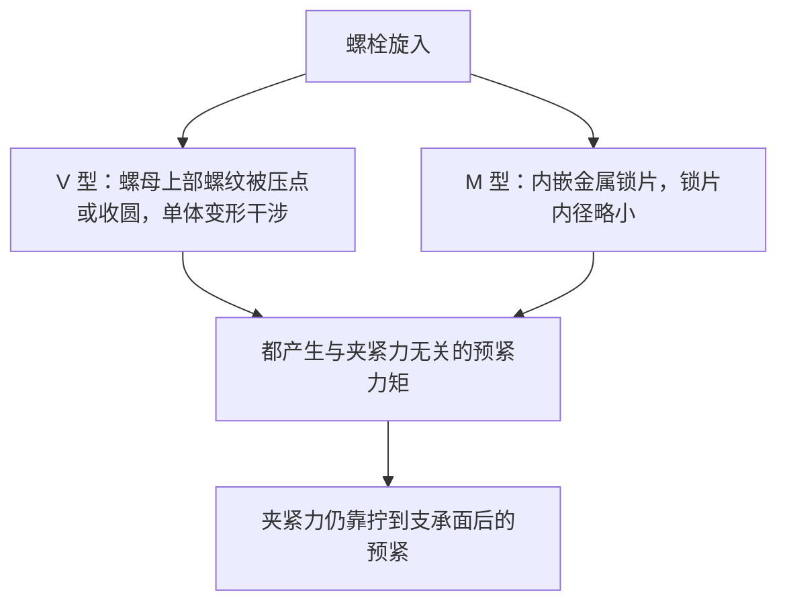

# 全金属锁紧螺母（DIN 980）：三点变形与金属嵌片的预紧力矩防松

> [!summary] 一句话概述
> 全金属锁紧螺母不靠尼龙，而靠金属干涉产生预紧力矩：DIN 980 V 型是单体，把螺母上部螺纹做成三点压点、椭圆或侧面挤压；M 型是两件式，内嵌热处理金属锁片，锁片内径略小于螺栓外径。耐温高于尼龙嵌件螺母，但锁紧力矩会随重复拆装衰减，且 DIN 980:1987 本身已被废止，新图应核对应的 ISO 7042 / ISO 10513 等现行标准。

## 配图

![[附件/din980m-insert-section.jpg]]
*图源：[泛沃 DIN980M 金属嵌件锁紧螺母页](https://www.finesz.com/DIN980M.php)；M 型剖面：顶部金属锁片卡住螺栓牙，尺寸符号 d、s、e、h、P*

![[附件/flaig-fs-all-steel-nut.jpg]]
*图源：[Flaig + Hommel FS® All-Steel Lock-Nut 手册](https://www.flaig-hommel.de/fileadmin/user_upload/Flaig-Hommel/PDF%27s/Prospekte/2019-11_FS_FS-Sicherungsmutter_EN-r03_m.pdf)；全钢锁紧螺母产品介绍页（手册声明符合 DIN 980、DIN 6925、DIN 6927、DIN ISO 7044 等）*

> 图片版权归原作者所有，仅作个人学习收藏；出处见文末「来源与核实记录」。

## 结构原理

> 本节数字只写来源里给出的；来源没有就写「来源未给出」。

### 堆叠方案

方向：**沿螺栓轴线，从支承面到锁紧区（通常在顶部）**

| 层级 | 零件/区域 | 材料 | 厚度/尺寸 | 固定方式 | 依据 |
| --- | --- | --- | --- | --- | --- |
| L1 | 螺母支承面与六角 | 钢或不锈钢 | 泛沃 M 型表：M6 的 s 最大=公称 10 mm（最小 9.78）、e 最小 11.1、h 最大 6 / 最小 5.7；M8：s=13 / 12.7，e 最小 14.4，h 最大 8 / 最小 7.5 | 承受夹紧力 | 泛沃尺寸表 |
| L2a | V 型锁紧区 | 与螺母一体 | 上部螺纹被三点压点、椭圆或侧面挤压，局部内径小于螺栓外径 | 旋入时金属弹性/塑性干涉，产生有效力矩 | 泛沃；Flybear 举三点端面变形为例 |
| L2b | M 型金属锁片 | 经过热处理的金属片 | 内径略小于螺栓外径，嵌在螺母顶部 | 两件式：锁片卡住螺栓牙 | 泛沃 |
| L3 | 螺栓外螺纹 | 与螺母匹配 | 粗牙或细牙必须分开指定（现行 ISO 已拆成粗牙、细牙两个标准） | 旋合 | Flybear |
| L4 | 被夹紧件 | — | 来源未给出 | 支承面压紧 | — |

剖面示意：

### 零件清单

| 零件 | 数量 | 功能 | 材料 | 依据 |
| --- | --- | --- | --- | --- |
| 全金属锁紧螺母（V 或 M） | 每螺栓 1 | 螺纹夹紧 + 金属预紧力矩 | 钢 5/8/10/12 级，或不锈钢 | 泛沃 |
| 配合螺栓 | 1 | 夹紧并与变形区干涉 | 匹配等级与螺距 | 各来源 |
| 安装工具 | 1 | 不能用手拧到位；不锈钢建议预涂润滑脂防咬死 | 棘轮扳手等 | 泛沃 |

### 装配顺序

1. 确认是 V 型还是 M 型，以及粗牙还是细牙；只写「DIN 980」不够（Flybear：锁定几何必须写清）。
2. Aspen 写这类螺母常有锥形顶部，只能朝一个方向安装（top up，锥面朝上）。有方向的品种不要倒装。
3. 用工具拧过锁紧区，再施加规定夹紧扭矩。不锈钢建议润滑，防止快速安装时咬死（泛沃）。
4. 锁紧性能可按 ISO 2320 做五次拧入拧出力矩验证（泛沃）。重复使用后力矩会下降，关键件应检测或换新。

### 受力与运动分析

- **受力路径**：夹紧力走支承面和未变形的螺纹；防松走锁紧区的金属干涉。预紧力矩在螺母尚未压到支承面时就已经存在（Flybear）。
- **运动关系**：装拆时锁紧区与螺栓牙互相刮擦，力矩随循环衰减。这与尼龙环的弹性干涉不同，对配合螺纹的磨损也更「硬」（奥赞在尼龙篇中的对比：全金属略更具攻击性）。
- **失效风险**：把 DIN 980 旧图直接换成任意「等效件」却换了 V/M 结构或高低牙型；高温时以为「全金属就无限耐温」——实际还受材料、镀层和润滑限制（Flybear）。

## 设计要点与参数

| 要点 | 内容 | 依据 |
| --- | --- | --- |
| V 与 M 的结构差别 | V：单体，靠自身螺纹变形（三点、椭圆、侧面挤压）。M：两件式，内嵌金属锁片 | 泛沃；Flybear |
| 标准沿革 | Flybear 写 DIN 980:1987-05 已废止，替换路径为粗牙 ISO 7042:2025、细牙 ISO 10513:2025；另有普通高度 ISO 7719:2025，不能自动当成 DIN 980 替换件 | Flybear |
| 泛沃 M 型主要尺寸（厂商表） | M3：P=0.5，e min=6.01，h=3.7/3.4，s=5.5/5.32；M6：P=1，e min=11.1，h=6/5.7，s=10/9.78；M8：P=1.25，e min=14.4，h=8/7.5，s=13/12.7（单位 mm） | 泛沃 |
| 有效力矩定义 | 不受轴向载荷时旋入产生的扭矩，也称锁紧力矩 | 泛沃 |
| 温度（必须分来源） | Flybear 转述 ISO 2320:2015：符合该标准的全金属螺母使用范围 −50 °C 至 +150 °C，非金属嵌件为 −50 °C 至 +120 °C，并明确这不是所有锁紧螺母的通用额定值。Flaig 写按载荷要求，耐热材料可用于 350 °C 以上，另有 800 °C 的宣传图说，属于其高耐热产品语境，不能写成 DIN 980 的统一上限 | Flybear；Flaig |
| 重复使用 | 泛沃指向 ISO 2320 的五次拧入拧出。Flaig 法兰全金属螺母表给出第 1 次拧入最大、第 1 次拧出最小和第 15 次拧出最小力矩（见下，不是普通 DIN 980 六角的官方表） | 泛沃；Flaig |
| Flaig 带法兰全金属螺母的有效力矩示例（DIN 6927 / ISO 7044，勿与 980 六角混用） | M6：第 1 次拧入最大 3.0 N·m，第 1 次拧出最小 0.45，第 15 次拧出最小 0.3；M8：6.0 / 0.85 / 0.6；M10（AF 16 或 17）：7.0 / 1.5 / 1.0；M12（AF 18 或 19）：11.0 / 2.3 / 1.6 | Flaig 技术数据页 |

## 优缺点

**优点**
- 没有高分子嵌件，适合尼龙已经软化的温度和部分化学环境
- 可重复拆装的次数通常多于尼龙圈（定性，各来源未给出统一次数）
- V 型是单件，没有嵌件脱落问题

**缺点 / 代价**
- 拧入力矩大，必须用工具；对螺栓牙磨损比尼龙更明显
- 有的品种有安装方向
- 旧标准号容易订错结构（V 还是 M，粗牙还是细牙，高牙还是普通高度）
- 锁紧力矩随循环衰减，不能假设「全金属就可以无限重复使用」

## 可借鉴点

- 新图尽量写现行 ISO 号 + 锁紧形式（三点变形或金属嵌片），不要只写「DIN 980」
- 温度先按 ISO 2320 的 −50 至 +150 °C 做门槛，再按材料、镀层和供应商高温数据校核；不要把 350 °C 或 800 °C 的宣传值当成所有全金属螺母的额定
- 工艺上按 ISO 2320 抽检五次循环力矩；不锈钢预涂润滑
- 低于 120 °C、拆装很少的接头，尼龙圈往往更温和、更便宜，不必一律上全金属

## 与库中相似案例对比

| 对比项 | 本案例 | [[尼龙嵌件锁紧螺母（DIN 985 Nyloc）：预紧力矩、120°C 上限与安装方向]] | [[预涂微胶囊螺纹胶与现场涂厌氧锁固剂（precote 与 Loctite 243）]] |
| --- | --- | --- | --- |
| 锁紧介质 | 金属变形或金属锁片 | 尼龙环 | 化学胶 |
| 原理是否「同机构换材料」 | 不是：一个是金属干涉，一个是高分子弹性干涉 | — | 化学填充，不改变螺母几何 |
| 耐温 | 通常高于尼龙，但要把来源温度分开写 | 约 120 °C | 随胶种 |
| 对螺栓牙 | 更「硬」，磨损略大 | 较温和 | 不依赖金属变形 |

## 相关案例

- [[尼龙嵌件锁紧螺母（DIN 985 Nyloc）：预紧力矩、120°C 上限与安装方向]]
- [[预涂微胶囊螺纹胶与现场涂厌氧锁固剂（precote 与 Loctite 243）]]
- [[Nord-Lock 楔形防松垫圈：楔角大于螺纹升角的成对拉伸锁紧]]
- 分类索引：[[02-连接与紧固 索引]]

## 来源与核实记录

- 主来源：[泛沃 DIN980M 金属锁紧螺母标准页](https://www.finesz.com/DIN980M.php)（苏州泛沃；含 V/M 原理与尺寸表）
- 独立第二来源：[Flaig + Hommel FS® All-Steel Lock-Nut 英文手册（2019-11，r03）](https://www.flaig-hommel.de/fileadmin/user_upload/Flaig-Hommel/PDF%27s/Prospekte/2019-11_FS_FS-Sicherungsmutter_EN-r03_m.pdf)
- 补充：[Flybear DIN 980 Lock Nut 说明](https://flybearindustrial.com/din-980-lock-nut/)（标准沿革与 ISO 2320 温度转述）；[Aspen Metric DIN 980 规格 PDF](https://www.aspenfasteners.com/content/pdf/Metric_DIN_980_spec.pdf)（安装方向：锥顶朝上）
- 核实：2026-11-21 curl GET 打开上述页面与 PDF。未把 http://hdyougong.com 与 http://www.luosilianmeng.com 计入（打开为 HTTP 500）。Flaig 力矩表属于带法兰品种，已单独标注，不用作 DIN 980 六角的通用值。
