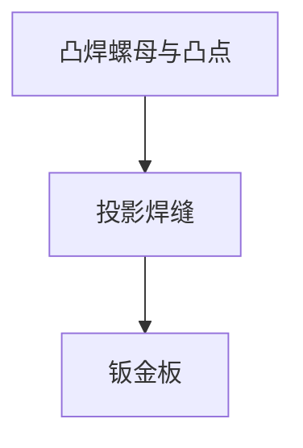

# 凸焊螺母：在薄板上投影焊接螺纹，对照压铆螺母与攻丝

> [!summary] 一句话概述
> 凸焊螺母是把带凸点的螺母投影焊接到薄板上，由焊缝承担拧紧和推出载荷；它和压铆螺母、拉铆螺母、板内攻丝解决的是同一类「薄板上要有螺纹」的问题，但可达性、板材、涂装顺序和维修性不同，不能只按螺纹规格选型。

## 配图

![[附件/sheet-weldnut-sanjun.jpg]]
*图源：[Sanjun，Weld Nut vs Self-Clinching Nut vs Tapped Thread](https://www.sanjunhardware.com/blog/weld-nut-vs-clinch-nut-vs-tapped-thread-guide) 文内工艺图。*

![[附件/sheet-enclosure-fasteners.jpg]]
*图源：[Enclosure Metal，《钣金外壳中的 PEM 压铆件、拉铆螺母与焊接螺母》](https://enclosuremetal.com/zh/resources/sheet-metal-enclosure-fasteners-guide/) 页头机箱外壳图，说明这类螺纹点出现在钣金壳体上。*

> 图片版权归原作者所有，仅作个人学习收藏；出处见文末「来源与核实记录」。

## 结构原理

> 本节所有数字只写来源里给出的；来源没有就写「来源未给出」，不估算、不编造。

Sanjun 把薄板上做螺纹的路径分成四类：板内攻丝（含翻孔攻丝）、压铆螺母、凸焊螺母、拉铆螺母（盲孔、单面安装）。凸焊螺母依靠螺母上的凸点与板材熔化连接，接头强度取决于焊接质量和板材可焊性，而不是像压铆那样靠冷挤锚固。

Enclosure Metal 强调：先根据板材、板厚、硬度、可达性和使用要求选择方式，而不是只看螺纹规格。压铆要求板材在所选系列的厚度和硬度范围内，且压装时两面可达；只能单面安装时考虑拉铆螺母，并检查夹持范围和背面鼓包空间；焊接螺母适用于接头和后处理路线允许焊接的情况。表面处理前要标明接地面、螺纹、承压面和禁涂区。

### 堆叠方案

方向：从螺母、焊缝到钣金。

| 层级 | 零件 | 材料 | 厚度/尺寸 | 固定方式 | 依据 |
| --- | --- | --- | --- | --- | --- |
| L1 凸焊螺母 | 带凸点的螺母 | 可焊钢等，具体牌号来源未给出统一表 | 螺纹规格按设计；凸点几何按螺母样本 | 投影焊到板面 | Sanjun |
| L2 焊缝 | 凸点熔化形成的连接 | 螺母与板的熔合 | 来源未给出通用熔核直径 | 冶金结合 | Sanjun；Enclosure Metal |
| L3 钣金 | 壳体壁 | 可焊接板材 | 孔径、边距按供应商批准条件 | 被焊住 | Enclosure Metal |

剖面示意：

### 零件清单

| 零件 | 数量 | 功能 | 材料 | 依据 |
| --- | --- | --- | --- | --- |
| 凸焊螺母 | 每个螺纹点 1 | 提供可反复拆装的螺纹 | 可焊金属 | Sanjun |
| 对照：压铆螺母 | 可选替代 | 冷挤锚固，需双面压装且板材兼容 | 按 PEM 等系列 | Enclosure Metal；库内已有 PEM 专篇 |
| 对照：拉铆螺母 | 可选替代 | 单面安装 | 按夹持范围 | Enclosure Metal |

### 装配顺序

Enclosure Metal 要求把冲孔、折弯、五金安装、焊接、遮蔽和涂装当成一条制造顺序。焊接螺母通常要在涂装之前完成，并对螺纹和接地面做遮蔽。具体焊点电流和电极，来源未给出通用数，应按螺母与板材样本。

### 受力与运动分析

- **受力路径**：拧紧扭矩和轴向力经螺母、焊缝传到板。Sanjun 讨论推不出、拉脱和拧转失效，不同类型的薄弱环节不同：攻丝看牙与板厚，压铆看锚固环，凸焊看焊缝和热影响区。
- **运动关系**：焊后无相对运动。
- **失效风险**：板材不可焊或过薄被焊穿；涂装后螺纹被漆咬死；热变形影响平面度。来源未给出某一规格的保证扭矩，Enclosure Metal 明确不要假设统一性能结果。

## 设计要点与参数

| 要点 | 内容 | 依据 |
| --- | --- | --- |
| 选型顺序 | 先看板材、板厚、硬度、两面是否可达、是否允许焊接和涂装顺序，再选螺纹规格 | Enclosure Metal；Sanjun |
| 凸焊螺母适用 | 接头及后处理允许焊接 | Enclosure Metal |
| 压铆对照 | 板材符合系列条件且压装两面可达 | Enclosure Metal；对照已有 PEM 篇 |
| 拉铆对照 | 只能单面安装；检查夹持范围和背面鼓包 | Enclosure Metal |
| 攻丝对照 | 板要有足够厚度或先抽孔翻边；反复拆装能力通常较弱 | Sanjun；对照抽孔翻边篇 |
| 图纸与检验 | RFQ 写清料号、孔径、边距、安装侧；需要时给出扭矩、推出、拉脱的买方要求和试验条件 | Enclosure Metal |

来源未给出某一颗凸焊螺母的标准抗扭值，本篇不编造。

## 优缺点

**优点**
- 螺纹在独立金属螺母里，反复拆装通常优于薄板攻丝
- 不依赖压铆对板材硬度和厚度窗口的限制，但依赖可焊性

**缺点 / 代价**
- 有焊接热输入，可能变形，并要处理涂装遮蔽
- 需要焊接设备和可达的焊点位置
- 性能不能只按螺纹规格类推，必须按样本和试验

## 可借鉴点

- 在机箱 BOM 里把每个螺纹点写成「凸焊 / 压铆 / 拉铆 / 攻丝」之一，并锁到料号。
- 允许双面压装且板材在窗口内，优先对照已有压铆螺母篇，而不是一律焊接。
- 涂装前定好禁涂区和接地面，避免焊好的螺纹被漆填死。

## 与库中相似案例对比

| 对比项 | 本案例（凸焊螺母） | [[钣金压铆螺母（PEM S-CLS）：孔径、最小板厚、边距与板材硬度上限]] | [[薄板抽孔翻边攻牙：预冲孔翻起后再攻内螺纹（对照压铆螺母）]] |
| --- | --- | --- | --- |
| 螺纹载体 | 焊上的螺母 | 压入的螺母 | 板料翻边后的孔壁 |
| 工艺 | 投影焊 | 冷挤压 | 翻边+攻丝 |
| 何时用这篇 | 板材可焊、允许热输入、压铆窗口不合适 | 板材和厚度在压铆窗口内且两面可达 | 轻载、少拆、不想加外购螺母 |

## 相关案例

- [[钣金压铆螺母（PEM S-CLS）：孔径、最小板厚、边距与板材硬度上限]]
- [[薄板抽孔翻边攻牙：预冲孔翻起后再攻内螺纹（对照压铆螺母）]]
- [[电阻点焊：按薄件厚度选熔核直径、搭边宽度与最小点距]]
- 分类索引：[[02-连接与紧固 索引]]

## 来源与核实记录

- 主来源：[Sanjun，《Weld Nut vs Self-Clinching Nut vs Tapped Thread》](https://www.sanjunhardware.com/blog/weld-nut-vs-clinch-nut-vs-tapped-thread-guide)（2026-11-27 打开并下载工艺图。四条螺纹路径和失效模式来自该文。）
- 交叉来源：[Enclosure Metal，《钣金外壳中的 PEM 压铆件、拉铆螺母与焊接螺母》](https://enclosuremetal.com/zh/resources/sheet-metal-enclosure-fasteners-guide/)（标注 2026-07-12，更新 2026-11-26。2026-11-27 打开。选型顺序、单面/双面可达、涂装遮蔽和检验要求来自该文。未编造某一规格的扭矩保证值。）
- 核实：2026-11-27 打开上述两处。
